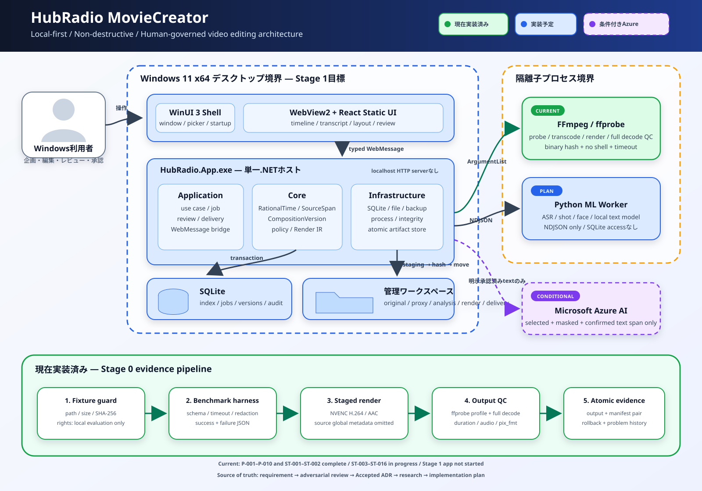

# HubRadio MovieCreator

Windows 11上で、企業向けトーク／インタビュー動画を**根拠付き・非破壊・人による承認付き**で複数形式へ展開する、ローカル優先の動画編集支援アプリケーションです。

> [!IMPORTANT]
> 現在は **Stage 0（技術検証・進行中）** です。P-001〜P-010、ST-001〜ST-007、ST-009、ST-010、ST-014、ST-016は**測定タスクとして完了**していますが、production承認ではありません。ST-007ではCUDA版のword/utterance時刻を編集可能な候補とし、exact精度は未測定、parent外0.14秒のwordを各経路1件そのまま記録しました。自動clampせず、発話時刻＋手動字幕調整を必須fallbackとしています。Stage 0残件と全体承認（ST-015）は未完了で、完成アプリケーションはまだありません。



## 目次

- [概要](#概要)
- [現在の実装状況](#現在の実装状況)
- [クイックスタート](#クイックスタート)
- [現在利用できるツール](#現在利用できるツール)
- [機構とアーキテクチャ](#機構とアーキテクチャ)
- [ディレクトリ構成](#ディレクトリ構成)
- [開発の進め方](#開発の進め方)
- [テストと品質管理](#テストと品質管理)
- [セキュリティ・プライバシー](#セキュリティプライバシー)
- [トラブルシューティング](#トラブルシューティング)
- [ロードマップ](#ロードマップ)
- [関連ドキュメント](#関連ドキュメント)
- [コントリビューション](#コントリビューション)
- [ライセンス](#ライセンス)

## 概要

### 解決したい課題

1本の10〜20分程度の元動画から、次の成果物を一つの案件として作成・追跡できることを目標にしています。

- 社内配信用の16:9長尺版
- YouTube向け16:9版
- YouTube Shorts／TikTok向け9:16短尺版
- LinkedIn／Viva Engage向け告知版
- クイズ／問いかけ形式の9:16短尺版
- 字幕、文字起こし、サムネイル、チャプター、投稿文、レビュー記録

本プロジェクトは「AIが無人で動画を公開する仕組み」ではありません。AIや規則ベース処理は候補だけを提示し、編集者・出演者・コンテンツ責任者・ブランド担当・権利担当が必要な確認を行います。

### 設計上の中心原則

- **元動画不変:** 取込後の元ファイルを上書きしない。
- **非破壊編集:** カット、字幕、画角、音声、効果を元動画上の時間範囲への参照として保存する。
- **根拠追跡:** 出力要素を元発言、承認済み素材、または編集者作成要素へ逆引きできるようにする。
- **人が最終判断:** 削除、要約、公開区分、権利、承認をAIだけで確定しない。
- **ローカル優先:** 動画・音声・画像を既定で端末外へ送らない。
- **決定論的レンダー:** 承認済み編集版から型付きレンダー計画を作り、実行条件と成果物hashを記録する。

詳細な要求は [`docs/requirement-definition.md`](docs/requirement-definition.md) を参照してください。

## 現在の実装状況

| 領域 | 状態 | 利用できるもの |
|---|---|---|
| 要求・設計 | ✅ 作成・レビュー済み | 0.1 Draftの要求定義、実現方式調査、6件のAccepted ADR、詳細実装計画 |
| Stage 0基盤 | ✅ 実装済み | PowerShell 7ベンチマークハーネス、JSON Schema検証、失敗記録、source不変性検査 |
| ハードウェア調査 | ✅ 実測済み | `benchmarks/results/hardware-inventory.json` |
| FFmpeg調査 | ✅ 実測済み | LGPL buildの版、hash、filter／encoder一覧 |
| 固定fixture動画生成 | ✅ 実行・全編QC済み | `tools/create-test-video.ps1`、manifest、問題レポート |
| 媒体取込調査 | ✅ 実測済み | `benchmarks/results/media-ingest.json`（VFR判定、全編decode、A/V差）|
| 代理フレーム写像 | ✅ 実測済み | `benchmarks/results/proxy-frame-map.json`（往復誤差分布、視覚的対応）|
| エンコーダ比較 | ✅ 実測済み | `benchmarks/results/encoder-matrix.json`（NVENCとMedia FoundationのVMAF・サイズ・速度）|
| GUIデスクトップアプリ | ⬜ 未実装 | WinUI 3、WebView2、Reactは計画のみ |
| 業務データ／編集機能 | ⬜ 未実装 | SQLite、非破壊タイムライン、レビュー、納品管理は計画のみ |
| ML解析 | 🟨 一部実測 | ASR ST-006、時刻ST-007、ショットST-009、顔ST-010、音響イベント/録画品質ST-016を実測済み。ASR/時刻の正解精度、話者、トピックは未確定。word時刻のparent外0.14秒を非clampで保持し、人の確認・手動fallbackを維持 |
| 配布 | 🟨 Stage 0 PoCのみ | 複数exe、FFmpeg/ffprobe、modelを含むunsigned MSIXのpack/unpackと展開後実行は実測済み。署名・install・upgrade・clean Windowsは未検証 |
| Azure | ⏸ 条件付き・未作成 | ローカル不達と明示承認が揃った場合だけ検討 |

現在の次タスクは [`docs/implementation-plan.md`](docs/implementation-plan.md) の **ST-011** です。Stage 0の全結果をST-015で承認するまで、アプリ本体のscaffold（F-001以降）へ進まない計画です。

## クイックスタート

### 1. 前提条件を確認する

現在のPowerShellツールを実行するための条件です。将来のGUIアプリ用依存とは分けて考えてください。

| 用途 | 必須条件 |
|---|---|
| 文書の閲覧 | Git |
| 現行スクリプト | Windows 11 x64、PowerShell 7+（Core） |
| ベンチマーク | 権限を確認済みの固定fixture動画 |
| FFmpeg stage | WinGet版 `BtbN.FFmpeg.LGPL.8.1` `8.1.2-20260731` |
| Python ML stage | Python 3.12と`benchmarks/setup-python-env.ps1`で作る固定`benchmarks/.venv` |
| 固定fixture動画生成 | 上記FFmpeg、`h264_nvenc`対応NVIDIA GPU、十分なローカル空き容量 |
| 将来のアプリ開発 | .NET 10、Node.js、WebView2を予定。現時点ではアプリ本体がないため必須ではない |

ハードウェア最小要件はまだ確定していません。記録済みの検証機はWindows 11 Insider build 29648、Core i7-13800H、RTX 4060 Laptop GPU、約64 GB RAMです。これは**動作保証の最小構成ではなく、単一の実測環境**です。

PowerShellを確認します。

```powershell
pwsh.exe -NoLogo -NoProfile -Command '$PSVersionTable | Select-Object PSEdition, PSVersion'
```

`PSEdition`が`Core`で、major versionが7以上であることを確認してください。`Desktop`または5.1と表示された場合はWindows PowerShellを起動しているため、`powershell.exe`ではなくPowerShell 7の`pwsh.exe`を使用します。`-NoProfile`は利用者のprofile scriptによる環境差を避けるために付けています。

### 2. リポジトリを取得する

```powershell
git clone https://github.com/dahatake/HubRadio-MovieCreator.git
Set-Location HubRadio-MovieCreator
```

クローン直後は要求・設計文書を読めますが、権利上の理由によりfixture動画は含まれません。

### 3. 認可済みfixtureを配置する

開発責任者から利用許可と正しいファイルを入手し、次の場所へ配置します。

```text
sample/20260615_024326000_iOS.MOV
```

期待値は [`benchmarks/fixtures/fixture-manifest.json`](benchmarks/fixtures/fixture-manifest.json) が正本です。このfixtureは日本語コンテンツの技術評価用であり、別言語や別内容の動画へ置き換えて使うものではありません。

```powershell
pwsh.exe -NoLogo -NoProfile -Command '(Get-Item "sample\20260615_024326000_iOS.MOV").Length'
pwsh.exe -NoLogo -NoProfile -Command '(Get-FileHash "sample\20260615_024326000_iOS.MOV" -Algorithm SHA256).Hash.ToLowerInvariant()'
```

期待値:

- サイズ: `6494572403` bytes
- SHA-256: `fe9c763fdf6fe7be4f368bfba926a1f3f2407ceaf044ec7d055e0869e65c1a9f`

> [!CAUTION]
> fixtureの権利状態は`unconfirmed`で、許可用途はローカル技術評価のみです。Gitへ追加したり、外部へ公開したりしないでください。別動画を同じファイル名へ置いてもhash guardが拒否します。現行ツールは任意動画向けCLIではありません。

### 4. 承認済みFFmpeg buildをインストールする

```powershell
winget install --id BtbN.FFmpeg.LGPL.8.1 --exact --version 8.1.2-20260731 --accept-package-agreements --accept-source-agreements
```

このリポジトリはpackage名だけでなく、`ffmpeg.exe`と`ffprobe.exe`のSHA-256も検査します。異なる版やGPL buildへ黙って置き換えないでください。更新する場合は、ライセンス・機能・実行ファイルhashを再評価してcanonical capability recordを更新します。

canonical hash（[`benchmarks/results/ffmpeg-capabilities.json`](benchmarks/results/ffmpeg-capabilities.json)）:

- `ffmpeg.exe`: `6099366f31293cdc6c283ea44ffb32f07e3139cd0caf6d0db652a7d064d089cb`
- `ffprobe.exe`: `4c2f730969c9551aec21c5ca07eb73f63bb0920204c9cd6c9a6e7be6be0458d2`

### 5. ベンチマークを実行する

ハードウェア情報を取得します。現行ハーネスはfixtureの不変性も検査するため、このstageでもfixtureが必要です。

```powershell
pwsh.exe -NoLogo -NoProfile -File benchmarks\run-benchmarks.ps1 -Stage hardware -ChildTimeoutSeconds 300
```

FFmpeg capabilityを再取得します。

```powershell
pwsh.exe -NoLogo -NoProfile -File benchmarks\run-benchmarks.ps1 -Stage ffmpeg-capabilities -ChildTimeoutSeconds 300
```

結果は`benchmarks/results/runs/`へJSONで保存されます。このディレクトリはローカル実行証跡であり、Gitから除外されています。

### 6. 検証用動画を生成する

```powershell
pwsh.exe -NoLogo -NoProfile -File tools\create-test-video.ps1 -SourcePath sample\20260615_024326000_iOS.MOV -OutputPath test\20260615_024326000_iOS.MOV -TimeoutSeconds 10800
```

成功時の成果物:

| 成果物 | Git取扱い | 内容 |
|---|---|---|
| `test/20260615_024326000_iOS.MOV` | `.gitignore`対象 | H.264/AACのローカル検証動画 |
| `test/20260615_024326000_iOS.MOV.manifest.json` | ignore対象外（commit対象） | source/output hash、stream、tool、全編decode結果 |
| `test/20260615_024326000_iOS-problems.md` | ignore対象外（commit対象） | 実際に発生した問題、原因、選択肢、採用修正 |

記録済みの成功例は1280×720、30000/1001 fps、yuv420p、H.264 NVENC、AAC-LC 48 kHz stereoです。出力は全編decode済みですが、fixtureの権利状態が変わるわけではありません。

## 現在利用できるツール

### ベンチマークハーネス

`benchmarks/run-benchmarks.ps1`は次を行います。

1. fixture manifest、入力サイズ、入力SHA-256を検査する。
2. PowerShell 7子プロセスでstageを実行する。
3. timeout時に子孫プロセスを終了する。
4. sourceが実行前後で変わっていないことを再hashする。
5. 成功・失敗結果をJSON Schemaで検証する。
6. 一時ファイルから最終run JSONへ昇格する。
7. パスやユーザープロファイルをエラー記録から秘匿する。

対応stage:

| Stage | 状態 | 処理 |
|---|---|---|
| `hardware` | 利用可能 | OS、CPU、GPU/NPU、RAM、空き容量、tool版を収集 |
| `ffmpeg-capabilities` | 利用可能 | FFmpeg build、license、filter、encoder、binary hashを収集 |
| `media-ingest` | 利用可能 | metadata、packet timing、A/V差、全編decodeを検査 |
| `proxy-frame-map` | 利用可能 | CFR代理を生成し、元PTSとの写像と往復誤差を測定 |
| `encoder-matrix` | 利用可能 | H.264候補を同一区間で符号化し、速度・サイズ・VMAFを比較 |
| `shot-detection` | 利用可能 | PySceneDetectの3構成を代理上で比較し、既知カット対照と元PTS写像を記録 |
| `face-detection` | 利用可能 | MediaPipe VIDEO modeで代理300標本を測り、hash固定した正例対照と失敗分類を記録 |
| `audio-event-and-recording-quality` | 利用可能 | FFmpeg、波形規則、Silero VAD、YAMNetを比較し、候補分布・対照・未測定精度を記録 |
| `process-and-package` | 利用可能 | Job Objectのtimeout/close/crash/資源制限と、unsigned multi-executable MSIXのpack/unpack・codec/model読込を記録 |
| `asr-benchmark` | 利用可能 | faster-whisper CPU/CUDAとFoundry Localを同一16 kHz音声で比較し、synthetic日本語control、時間、memory、時刻能力、privacy境界を記録 |
| `alignment-benchmark` | 利用可能 | ST-006 CPU/CUDA artifactの時刻構造・descriptive一致度と独立TTS slot controlを測り、exact精度未測定と手動fallbackを記録 |

`media-ingest`は大容量fixtureを全編処理します。実行する場合は十分な時間と空き容量を確保してください。

```powershell
pwsh.exe -NoLogo -NoProfile -File benchmarks\run-benchmarks.ps1 -Stage media-ingest -ChildTimeoutSeconds 10800
```

run JSONは生の実行証跡です。レビュー済みの要約は`benchmarks/results/media-ingest.json`に切り出して管理します。

### 固定fixture動画生成ツール

`tools/create-test-video.ps1`の処理順序は次のとおりです。

1. sourceが`sample/`直下、outputが`test/`直下で、ファイル名が同一であることを検査する。
2. fixture manifestとsourceのサイズ・SHA-256を照合する。
3. canonical capability recordと同じhashのFFmpeg／ffprobeだけを探索する。
4. source streamとdurationをffprobeで取得する。
5. GUID付きstagingファイルへNVENCでレンダーする。
6. codec、解像度、pixel format、fps、音声、durationを検査する。
7. `-xerror`付きで映像・音声を全編decodeする。
8. output hashとmanifestを作成する。
9. outputとmanifestをpairで昇格し、途中失敗時は旧pairへrollbackする。
10. 失敗時は既存の問題履歴を消さず、詳細レポートへ追記する。

このツールはStage 0の再現可能な技術証拠を作るためのもので、一般利用者向け動画編集UIではありません。

## 機構とアーキテクチャ

### 全体像

[`docs/architecture.svg`](docs/architecture.svg) は、現在実装済みのStage 0ツールと、Stage 1以降の目標アーキテクチャを同じ図で表しています。

- **緑:** 現在のリポジトリで実装・検証済み
- **青:** Stage 1以降で実装予定
- **紫の破線:** ローカル不達と明示承認が揃った場合だけ追加するAzure経路

### プロセスモデル

目標構成は、localhost APIやマイクロサービスを置かない**1ホスト＋子プロセス**です。

| プロセス／領域 | 責務 | 状態 |
|---|---|---|
| `HubRadio.App.exe` | WinUI 3 window、ユースケース、SQLite、file、job所有 | 計画 |
| WebView2 + React | 案件一覧、解析、字幕、タイムライン、レイアウト、レビュー | 計画 |
| .NET Core | 時刻、SourceSpan、版、編集、ポリシー、レンダーIR | 計画 |
| SQLite | 案件、権限、job、WorkingCopy、版索引、review、audit | 計画 |
| 管理ワークスペース | original、proxy、analysis、composition、render、delivery | 計画 |
| FFmpeg／ffprobe | probe、proxy、render、全編QC | Stage 0基盤は実装済み |
| Python worker | ASR、shot、face等。NDJSONで通信しDBへ直接接続しない | 計画 |
| Azure AI | 選択・mask・確認済み文字起こしspanだけを扱う代替経路 | 条件付き |

### 非破壊編集モデル

将来のアプリケーションでは次の型を中心に編集状態を管理します。

- `RationalTime` / `TimeRange`: 浮動小数点秒ではなく、有理数または整数tickで時刻を保持する。
- `SourceSpan`: 元動画上の時間、必要時の空間領域、文字起こし改訂を指す。
- `OriginRef`: 元発言、承認済み素材、編集者作成要素のいずれかを示す。
- `WorkingCopy`: SQLiteへ復旧可能に保存する可変draft。
- `CompositionVersion`: checkpoint時に作成する不変スナップショット。変更時は子版を作る。
- `TimelineMap`: 出力時刻から元動画／編集素材へ逆引きする。
- `RenderProfile`: 16:9、9:16、字幕、codec等の版付き出力仕様。
- `RenderManifest`: 1回のrender入力、tool/model/font/template、設定、結果を記録する。
- `DeliveryManifest`: 動画、字幕、画像、文書を同じ承認版へ束ねる。

### データフロー

1. **取込:** native file pickerで選択し、stagingへstream copyしながらhashを計算する。
2. **検疫:** file signature、ffprobe、全編decode、stream、PTS、容量を検査する。
3. **解析:** FFmpegとPython workerが結果をJSON成果物として返す。候補は`Suggestion`として隔離する。
4. **編集:** 人が候補を採否し、字幕、区間、レイアウト、音声をWorkingCopyへ反映する。
5. **版作成:** checkpointで不変`CompositionVersion`と`TimelineMap`を生成する。
6. **レビュー:** 公開区分に応じ、Editor／Performer／Content／Brand／Rightsのgateを通す。
7. **レンダー:** 承認digestから型付きRender IRを作り、shellを使わずFFmpeg引数へcompileする。
8. **QC:** codec、duration、A/V同期、字幕、画面、音量、全編decodeを検査する。
9. **納品:** QC済み成果物だけを昇格し、hashと来歴をDeliveryManifestへ登録する。

### レビューと承認

社内限定の既定経路:

```text
Editing → EditorReview → ContentReview → Approved → FinalRendering → QualityControl → Exported
```

外部公開候補の既定経路:

```text
Editing → EditorReview → PerformerReview → ContentReview → BrandReview → Approved → FinalRendering → QualityControl → Exported
```

承認は表示名やファイル名ではなく、`CompositionVersion`の内容digestへ固定します。字幕、カット、音声、レイアウト、テンプレートを変更した場合は子版を作り、旧承認を引き継ぎません。`Published`は自動投稿命令ではなく、別権限の人が公開済み事実を記録する状態です。

### Trust boundary

| 境界 | 予定する強制策 |
|---|---|
| React → .NET host | WebMessageのorigin、size、schema、methodを許可リスト検査。UIはIDと型付き操作だけを送る |
| .NET host → FFmpeg | `UseShellExecute=false`、`ArgumentList`、型付きRender IR、timeout、子孫kill、binary hash検査 |
| .NET host → Python | NDJSON schema、message上限、timeout。PythonはSQLiteへ接続しない |
| host → workspace | path正規化、IDベースlookup、staging→hash→atomic move、Windows ACL |
| host → SQLite | parameterized query、transaction、foreign key、migration前backup |
| host → Azure | 既定無効。人が選択・mask・payload確認した文字起こしspanだけ。動画・音声・画像・path・SIDは禁止 |

## ディレクトリ構成

```text
HubRadio-MovieCreator/
├─ benchmarks/                  # Stage 0ベンチマークとcanonical結果
│  ├─ annotations/             # 正解データ形式
│  ├─ fixtures/                # fixture manifest
│  ├─ metrics/                 # 評価指標
│  ├─ results/                 # schema、canonical summary、ignored raw runs
│  └─ stages/                  # 各stageのPowerShell実装
├─ docs/
│  ├─ decisions/               # Accepted ADR
│  ├─ licenses/                # 第三者依存の受入方針
│  ├─ architecture.svg         # 本READMEのアーキテクチャ図
│  ├─ requirement-definition.md
│  ├─ implementation-research.md
│  └─ implementation-plan.md
├─ sample/                     # Git-ignoredの認可済み入力fixture
├─ test/                       # 生成動画、manifest、問題レポート
├─ tools/                      # 独立した開発用ツール
├─ .gitignore
├─ LICENSE
└─ README.md
```

将来、Stage 0承認後に`src/`、`tests/`、`schemas/`、`packaging/`を追加する計画です。現在存在しないディレクトリを前提にしないでください。

## 開発の進め方

### 文書の優先順位

実装判断が矛盾した場合は、次の順で上位文書を優先します。

1. [`docs/requirement-definition.md`](docs/requirement-definition.md)
2. [`docs/adversarial-review.md`](docs/adversarial-review.md)
3. [`docs/decisions/ADR-*.md`](docs/decisions/)
4. [`docs/implementation-research.md`](docs/implementation-research.md)
5. [`docs/implementation-plan.md`](docs/implementation-plan.md)

要求定義はDraftです。未決事項を事実として埋めず、必要なら新しいADRとして判断・根拠・影響範囲を記録してください。

### 変更手順

1. 対象要求ID、ADR、実装計画のtask IDを特定する。
2. 現在のgateと依存taskが完了しているか確認する。
3. 最小の実装と、失敗経路を含む検証を追加する。
4. 元動画、承認版、秘密、PIIを変更・記録していないか確認する。
5. task完了後に、目的適合性、内容妥当性、整合性、根拠性、品質・運用性の5軸で敵対的レビューする。
6. 実在する指摘だけを修正し、結果と証跡を文書へ反映する。
7. 要求、ADR、plan、manifestの状態を同期する。

### benchmark stageを追加する

1. `benchmarks/stages/`へ、`-SamplePath`を受け取りJSONだけをstdoutへ返すPowerShell 7 scriptを追加する。
2. `benchmarks/run-benchmarks.ps1`の`ValidateSet`と`switch`へstageを登録する。
3. payload validatorを追加する。
4. `benchmarks/results/schema.json`と互換性を保つ。breaking changeは新schema versionにする。
5. 成功・失敗、timeout、source不変、path秘匿、孤児プロセスなしを試験する。
6. raw runを直接canonical summaryとして扱わず、レビュー済み結果を`benchmarks/results/`へ追加する。

## テストと品質管理

現在はアプリ本体の自動テストsuiteやCI workflowがまだありません。`dotnet test`、Vitest、pytest、一括`build.ps1`はF-005／F-006で追加予定です。

現時点で実装済みの品質策:

- PowerShell 7 parserでの構文検査
- benchmark resultのJSON Schema検証
- sourceの実行前後SHA-256検査
- FFmpeg／ffprobe executableのSHA-256固定
- timeout、子孫kill、process dispose
- staging fileの原子的昇格と失敗時清掃
- output／manifest pairのrollback
- ffprobe profile検査と`-xerror`全編decode
- 実問題を残す問題レポート
- 5軸の敵対的レビュー

実測値、テスト結果、canonical summaryを更新するときは、測定環境・tool版・入力hash・未確認事項を残してください。異なるGPU encoder間の出力byte一致は保証対象ではありません。

## セキュリティ・プライバシー

- `sample/*`と生成動画は`.gitignore`で除外されます。
- 元動画、代理動画、音声、frame、画像を既定でクラウドへ送りません。
- Azureを使う場合も、人が選択・mask・確認した最小の文字起こしspanだけが候補です。
- API keyをsource、設定、SQLite、log、backupへ保存しません。
- 社内限定、特定グループ、外部候補、外部承認済み、公開不可、判定待ちをデータ境界として扱います。
- AI出力で公開区分、機密性、権利、承認を自動確定しません。
- media metadataには位置、端末、撮影時刻等が含まれ得ます。生のmetadata値をissue、log、READMEへ転載しないでください。`inspect-media.ps1`の永続payloadは技術項目だけを選択し、source tagを保存しない設計です。
- 問題レポートや新しいcanonical resultをcommitする前に、絶対path、source tag、PII、秘密が含まれていないことを確認してください。pathの自動秘匿だけで全metadataが安全になるとはみなしません。
- 完成予定のworkspaceは現在のWindows SID、SYSTEM、必要な管理主体だけへACLを付与します。

fixture、生成動画、ブランド素材、BGM等はMIT Licenseの対象とは限りません。各素材の`RightsRecord`またはfixture manifestを確認してください。

## トラブルシューティング

### `PowerShell 7+ (Core) is required.`

**原因:** Windows PowerShell 5.1で実行しています。  
**対処:** `pwsh.exe -NoLogo -NoProfile`を使い、`PSEdition=Core`を確認してください。

### `Fixture source does not exist` / `Fixture SHA-256 mismatch`

**原因:** private fixtureが未配置、別ファイル、または変更済みです。  
**対処:** 認可済み原本を正しいパスへ配置し、fixture manifestのsize/hashと照合してください。検査を無効化しないでください。

### `Approved FFmpeg package is not installed` / executable hash不一致

**原因:** 固定版がない、別variant、更新版が最新package directoryになっている、またはbinaryが変更されています。  
**対処:** 指定したWinGet package/versionを再確認してください。別版を使う場合は、勝手にhashを書き換えず、license・build config・機能・runtime試験をやり直します。

### `h264_nvenc`が使えない

**原因:** 現行`create-test-video.ps1`はNVENC固定で、NVIDIA GPU／driver／encoder supportを必要とします。  
**対処:** `ffmpeg-capabilities`結果とNVIDIA driverを確認してください。Media Foundation fallbackは将来のST-005対象で、現行toolには実装されていません。

### benchmarkがtimeoutする

**原因:** 全編decodeや大容量動画処理が指定時間を超えました。  
**対処:** 残存`ffmpeg`／`ffprobe`がないこと、空き容量、GPU／CPU負荷を確認し、根拠がある場合だけ`-ChildTimeoutSeconds`を増やします。失敗JSONは`benchmarks/results/runs/`に保存されます。

### 動画生成が失敗する

**対処:** `test/<元のファイル名から拡張子を除いた名前>-problems.md`を確認してください。既存の最終outputとmanifestはpair rollbackで保護され、stagingは`finally`で清掃されます。

### 生成動画が`git status`へ出ない

**原因:** 大容量・権利未確認mediaの誤commitを防ぐための正常動作です。  
**対処:** 動画そのものはcommitせず、manifestと秘匿済み問題レポートだけをレビュー対象にします。

## ロードマップ

| Stage | 内容 | 状態 |
|---|---|---|
| Stage 0 | 実素材で媒体、ASR、時刻、顔、shot、字幕、render、packageを測定 | **進行中**。P-001〜P-010、ST-001〜ST-007、ST-009、ST-010、ST-014、ST-016完了 |
| Stage 1 | Must: 取込、文字起こし、手動編集、16:9／9:16、版、review、render、traceability | 未着手。ST-015承認後 |
| Stage 2 | Should: 見どころ、hook、自動追尾、資料、音声補正、quiz、投稿文 | 未着手。G1-MUST後 |
| Stage 3 | 公開履歴、運用改善、条件確定済みの外部連携 | 未着手 |
| Azure分岐 | ローカルで現実的に達成できない文章提案だけを補完 | 条件未成立、resource未作成 |

詳細な依存DAGと全taskは [`docs/implementation-plan.md`](docs/implementation-plan.md) にあります。README上の進捗を変えるときは、plan先頭の状態も同時に更新してください。

## 関連ドキュメント

| 文書 | 用途 |
|---|---|
| [`docs/requirement-definition.md`](docs/requirement-definition.md) | 機能要求、非機能要求、受入基準の正本 |
| [`docs/implementation-research.md`](docs/implementation-research.md) | 論文・公式仕様・OSSに基づく実現方式調査 |
| [`docs/adversarial-review.md`](docs/adversarial-review.md) | 調査書の敵対的レビューと修正記録 |
| [`docs/implementation-plan.md`](docs/implementation-plan.md) | task、gate、依存DAG、要求traceability |
| [`docs/implementation-adversarial-review.md`](docs/implementation-adversarial-review.md) | 実装進行成果物の敵対的レビュー |
| [`docs/decisions/`](docs/decisions/) | Windows範囲、ID／review、data分類、保存、配布、AzureのADR |
| [`docs/licenses/third-party-intake.md`](docs/licenses/third-party-intake.md) | 第三者software／model／素材の受入条件 |
| [`benchmarks/results/README.md`](benchmarks/results/README.md) | benchmark schemaとraw／canonical結果の運用 |
| [`benchmarks/annotations/README.md`](benchmarks/annotations/README.md) | ground truth annotation形式 |
| [`benchmarks/metrics/metric-definitions.md`](benchmarks/metrics/metric-definitions.md) | CER、WER、DER等の算出方法 |

## コントリビューション

正式な`CONTRIBUTING.md`、Code of Conduct、CI policyはまだありません。それまでは次を最低条件とします。

- issueやPull Requestでは、対象要求IDとtask IDを明記する。
- architecture判断を変える場合は、既存ADRの置換関係が分かる新ADRを追加する。
- 大容量media、モデルweight、秘密、PII、raw metadataをcommitしない。
- 新しい依存は版、配布元、hash、license、利用条件を記録する。
- 実装変更には正常系だけでなく、timeout、取消、disk full、不正入力、rollback等の失敗試験を含める。
- 変更後に5軸の敵対的レビューを行い、実在する問題だけを修正する。
- GUIやアプリ本体が未実装であることを隠すbadgeや完成表現を追加しない。

Issue: <https://github.com/dahatake/HubRadio-MovieCreator/issues>

## ライセンス

このリポジトリのsoftwareと文書は、特記がない限り [`MIT License`](LICENSE) です。

第三者software、model、font、codec、media素材には別のlicense・特許・利用条件が適用されます。特にFFmpeg配布物はbuild構成により義務が変わります。詳細は [`docs/licenses/third-party-intake.md`](docs/licenses/third-party-intake.md) を参照してください。

fixture動画と生成動画は、リポジトリのMIT Licenseによって外部公開可能になるものではありません。

## README構成の参考

このREADMEの章立ては、代表的なGitHubプロジェクトに共通する「概要、導入、platform、usage、development、support、contributing、license」を、本プロジェクト向けに再構成したものです。文章や仕様は転用していません。

- [OBS Studio](https://github.com/obsproject/obs-studio) — 概要、quick links、contributing
- [Electron](https://github.com/electron/electron) — installation、platform support、learning resources
- [Blender](https://github.com/blender/blender) — project pages、development、license
- [yt-dlp](https://github.com/yt-dlp/yt-dlp) — installation、dependencies、usage、troubleshooting
