# はじめての方へ：かんたんガイド

動画編集をしたことがない方向けに、HubRadio MovieCreator で「何ができて」「どう使い」「困ったらどうするか」を順番に説明します。専門用語は[用語集](#用語集)にまとめています。

> [!IMPORTANT]
> 一般利用者向けのアプリとインストーラーは**まだ提供されていません**。このガイドは、評価担当者から起動できる版を受け取った方、または開発者から案内を受けた方向けです。現在の提供状況は[README](../README.md#現在の提供状況)を参照してください。
> 画面の細かい動作は[画面の使い方](ui-workflow-guide.md)にあります。

## 1. このアプリでできること

トーク、対談、インタビューなどの動画を**1本選ぶだけ**で、社内で使う次のものをまとめて作ることを目指したアプリです。

| 作られるもの | 説明 |
|---|---|
| 長尺版（16:9） | 横長の通常の動画。社内配信向け |
| 短尺候補（9:16・最大3本） | スマホ向けの縦長で短い動画 |
| 字幕あり／字幕なしの動画 | 字幕が画面に焼き付いた版と、字幕のない版 |
| 字幕ファイル・文字起こし | 話した内容をテキストにしたもの |
| サムネイル | 動画の表紙になる画像 |
| チャプター | 動画の見出し（話題の区切り） |
| 使用区間の記録 | 元動画のどの時間帯を使ったかの一覧 |

案件名、言語、見た目、出力形式は**安全な初期値**が自動で入るため、最初は設定を触らなくて構いません。

### できないこと

- YouTube などへの自動投稿・外部公開（社内向けの書き出しまでです）
- 話の内容が正しいか、公開してよいか、権利に問題がないかの最終判断
- 出演者の発言の書き換えや、口・表情の合成
- ライブ配信中の編集

## 2. 始める前に準備するもの

- Windows 11（64ビット）のパソコン
- 編集したい動画ファイル 1 本（`.mp4` `.mov` など）。**利用してよい動画**だけを使ってください。
- 動画の2〜3倍程度の空き容量（処理中の一時ファイルや成果物のため）
- 起動できるアプリ（評価担当者から受け取った `HubRadio.App.exe` など）

元の動画は**上書きされません**。失敗しても元動画は無事です。

## 3. 起動する

1. 受け取った `HubRadio.App.exe` をダブルクリックします。
2. 初回は準備のため、ウィンドウが出るまで **40秒ほど**かかることがあります。そのまま待ちます（2回目以降は短くなります）。
3. 画面上部に **元動画／自動編集／仕上がり／保存** の4つのタブが表示されれば成功です。

画面の各部分の意味は、[画面の見かた](#4-画面の見かたどこを押すと何が起きるか)で説明します。起動できないときは[トラブルシューティング](dev/troubleshooting.md#限定ローカル技術評価候補を起動できない)を見てください。

## 4. 画面の見かた：どこを押すと何が起きるか

以下のスクリーンショットは、実際のアプリ画面です（Windows版、サンプル動画 `hubradio-sample` を選んだ状態）。**「操作」の列の部品を押す／選ぶと、「アプリの動き」の列のことが起きます。**

> [!NOTE]
> 動画の名前などは、お使いの環境では異なります。
> ボタンを押してもすぐに画面が変わらないことがあります。**数秒待ってから**画面を見直してください。

### 4-1. すべての画面に共通する部分

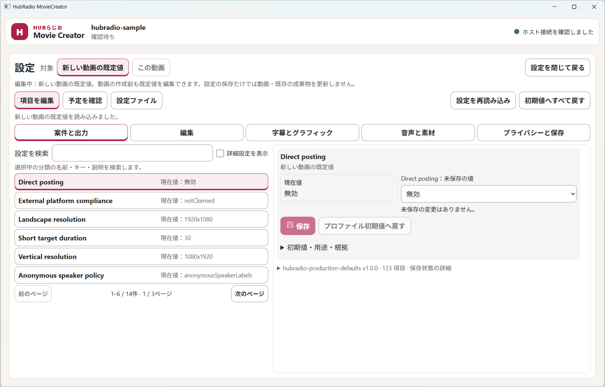

| 場所 | 表示 | 役割 |
|---|---|---|
| 左上のタイトル | 案件名（動画の名前）と状態 | いま扱っている動画と、その状態（「未選択」「確認待ち」など）を示します |
| 右上の緑の丸 | 「ホスト接続を確認しました」 | アプリ内部の処理部分と正しくつながっている印です。緑でないときは操作できないことがあります |
| 「動画の切替」 | ボタン | 別の動画に取り替えるために元動画の画面へ戻ります。保存していない変更がある間は、先に保存するか破棄するよう求められます |
| 「設定」 | ボタン | 設定画面を開きます（[4-3](#4-3-設定画面)） |
| 4つのタブ | 元動画／自動編集／仕上がり／保存 | 作業の場所を切り替えます。順番に進む必要はなく、いつでも行き来できます（切り替えても作業は消えません） |

### 4-2. 「元動画」タブ

**① 案件一覧（動画を選ぶ前）** 最初は「案件はまだありません」と表示されます。作成済みの案件があると、次のようにカードで並びます（`開く`を押すとその案件を開けます。`下書き`は作成前、`作成済み`は作成後の印です）。

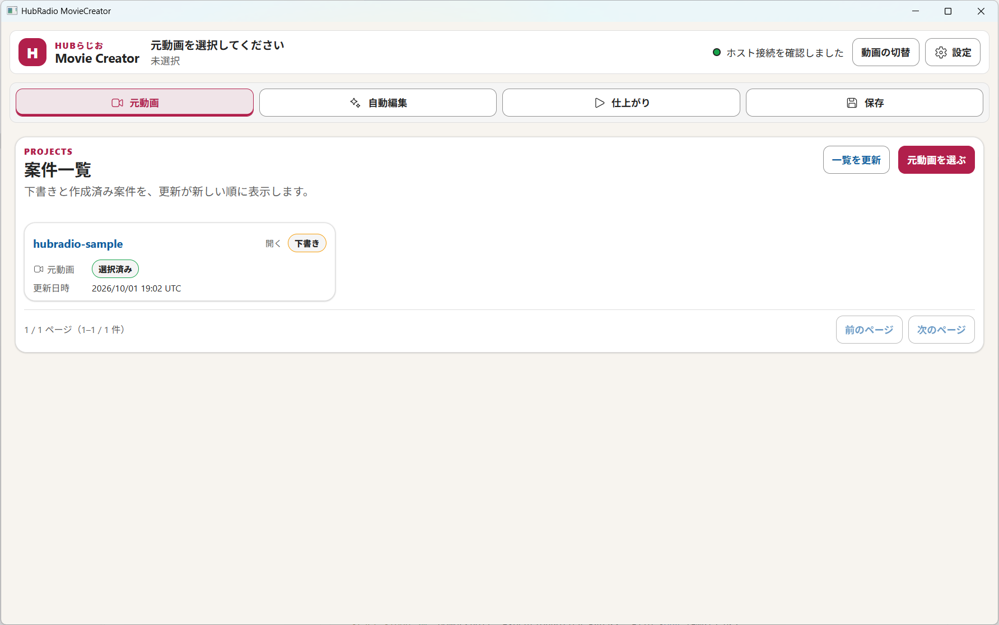

| 操作 | アプリの動き |
|---|---|
| 「新しい案件を作成」を押す | 動画ファイルを選ぶ窓（下図）が出ます。動画を選んで「開く」を押すと、新しい案件が作られ、次の「かんたん編集」画面に進みます。元の動画は変更されません。窓が出るまで数秒かかることがあります |
| 案件カードの「削除」を押す | 確認の窓が出ます。「OK」を押すと、その案件が一覧から消え、アプリの保存領域にあるその案件の作業ファイルと書き出したファイルも削除されます（アプリから元に戻せません）。あなたが選んだ元の動画ファイルは消えません。その案件の処理が動いている間は削除できません（完了または中止してからもう一度押します）。ファイルが他のアプリで使われているなどで一部を消せなかったときは、その旨が表示されます（案件は一覧から消えます） |
| 「一覧を更新」を押す | 作成済みの案件や下書きの一覧を読み込み直します |

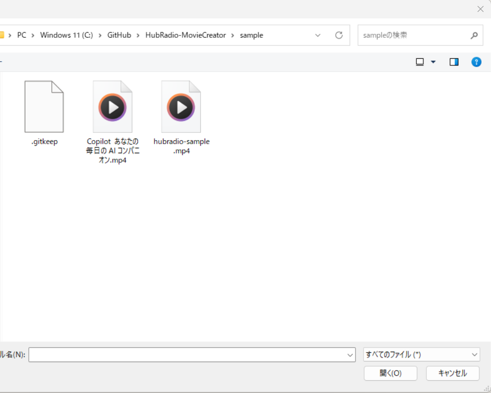

窓の下の「ファイル名」に動画の場所を入力するか、一覧の動画をダブルクリックします。

**② かんたん編集（動画を選んだあと）**

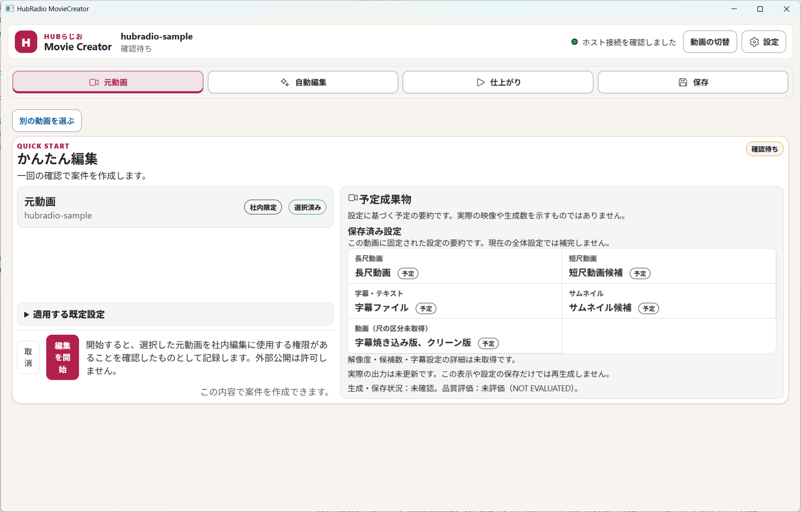

| 場所 | 意味 | 操作とアプリの動き |
|---|---|---|
| 「元動画」の枠（`社内限定`／`選択済み`） | 選んだ動画の名前。「社内限定」は外部公開しない前提で作る、という意味 | 確認するだけです。違う動画なら上の「別の動画を選ぶ」を押して選び直します |
| 「予定成果物」の枠 | 作られる予定の一覧（長尺動画、短尺動画候補、字幕ファイル、サムネイル候補、字幕焼き込み版・クリーン版） | 確認するだけです。`予定`は「作る予定」であり、まだ**できていません** |
| 右上の「確認待ち」 | まだ開始していない状態 | 「編集を開始」を押すと変わります |
| 「取消」 | 作成をやめる | 押すと案件を作らずに一覧へ戻ります |
| **「編集を開始」** | 作成のスタートボタン | 押すと案件が作られ、自動編集が始まります。進み具合は「自動編集」タブで見ます |

「編集を開始」を押して案件が作られると、画面は次のように変わります（右上が「作成済み」、ボタンは「一覧へ戻る」になります）。**ここでは動画はまだ作られていません。**「自動編集」タブへ進んで処理の様子を見ます。

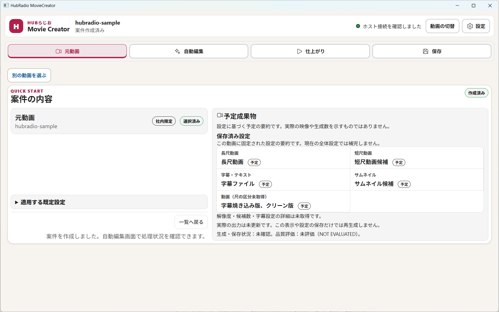

「適用する既定設定」を押すと、自動で使われる設定の情報が開きます。

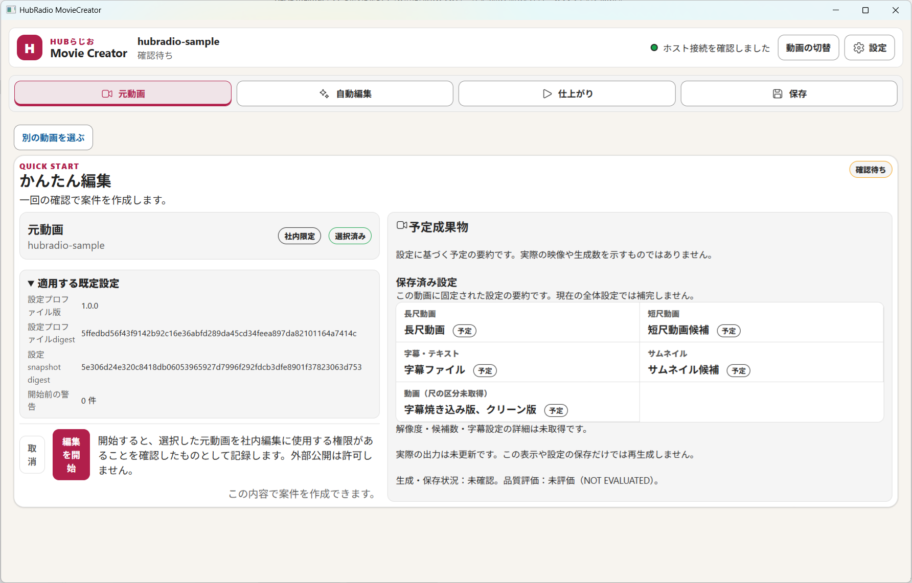

ここは通常は読み飛ばして構いません。「開始前の警告 0 件」なら、開始前に気づくべき注意はない、という意味です。

> [!NOTE]
> 「編集を開始」を押しても「操作を完了できませんでした」と表示され、始まらないことがあります。表示された原因と対処に従い、「もう一度試す（自動で再確認）」を押してください（アプリは自動で再確認します）。直らない場合はアプリを一度閉じて開き直してください。それでも直らない場合は、[トラブルシューティング](dev/troubleshooting.md)の確認や、[GitHub Issues](https://github.com/dahatake/HubRadio-MovieCreator/issues)（個人情報や動画の内容は書かない）への連絡をしてください。
> 起動直後に「Web UI を準備しています」と表示される間は、1分ほど待ちます。

### 4-3. 設定画面

右上の「設定」を押すと開きます。

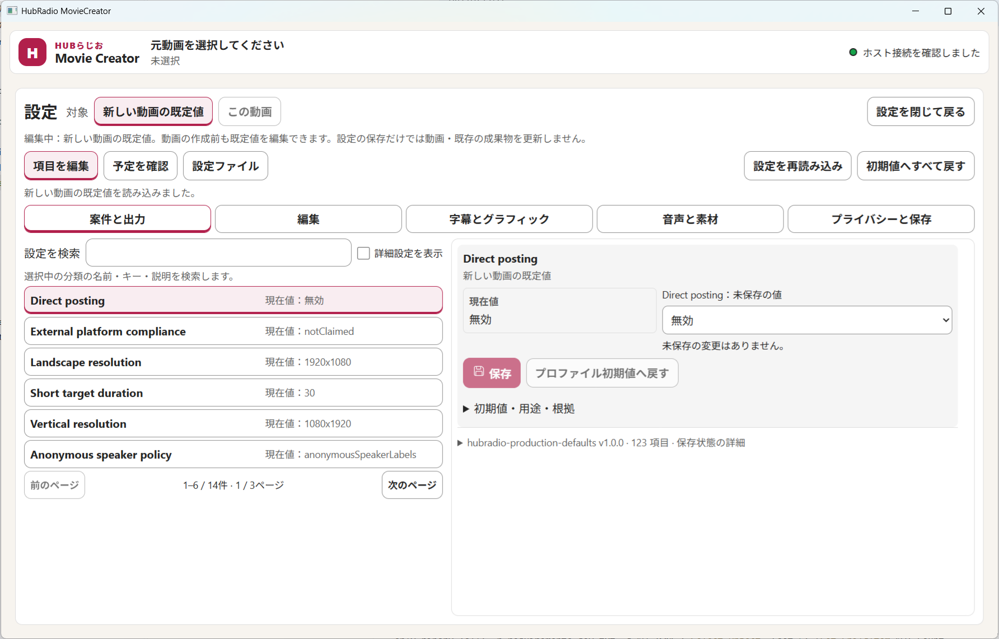

| 場所 | 意味 | 操作とアプリの動き |
|---|---|---|
| 「対象」：`新しい動画の既定値`／`この動画` | 設定をどこに適用するか | 前者は**これから選ぶ動画すべて**、後者は**いま作っている動画だけ**。選んだ対象に切り替わります |
| 「項目を編集」「予定を確認」「設定ファイル」 | 表示の切り替え | 項目を直す／変更後にどうなるか見る／設定を書き出す・読み込む、の画面に切り替わります |
| 5つの分類ボタン（案件と出力／編集／字幕とグラフィック／音声と素材／プライバシーと保存） | 設定の分類 | 押すと、その分類の項目一覧が左に出ます |
| 「設定を検索」と「詳細設定を表示」 | 項目探し | 文字を入れると一覧が絞られます。チェックを入れると上級者向けの項目も出ます |
| 左の項目一覧 | 項目名と「現在値」 | 押すと、右側に詳細が出ます（項目名は英語のものがあります） |
| 右上の「やさしい説明」の枠 | その項目が「何の設定か」「変えるとどうなるか」の説明 | 読むだけです。日本語の名前、専門用語の意味、変えたときの影響が書いてあります。迷ったときは初期値のままにします |
| 右の「現在値」と「未保存の値」の選択欄 | いまの値／変更したい値 | 選択欄で値を選ぶと「未保存の値」になります。まだ保存されていません |
| **「保存」** | 変更の保存 | 押した**その項目だけ**が保存されます。保存だけでは作成済みの動画は変わりません |
| 「プロファイル初期値へ戻す」 | 1項目を初期値へ | 押すとその項目が初期値に戻ります |
| 「初期値へすべて戻す」 | 全項目を初期値へ | 確認画面が出て、了承すると全項目が初期値に戻ります |
| 「初期値・用途・根拠」 | 説明 | 押すと、その項目が何のためのものか、初期値は何かが開きます。迷ったらここを読みます |
| 「設定を閉じて戻る」 | 設定画面を閉じる | 元の画面へ戻ります。未保存の変更があると確認が出ます |

**迷ったら、設定は何も変えずに「設定を閉じて戻る」を押して構いません。**

### 4-4. 「自動編集」タブ

「編集を開始」を押したあとに、処理の様子を見る場所です。画面には「ジョブの進行状況」の枠が出ます。

| 表示 | 意味 | 操作とアプリの動き |
|---|---|---|
| 「ジョブの進行状況」の下の状態文字（処理中／完了／**失敗**／**整合性の再確認が必要** など） | いまの処理の状態 | 処理中は待ちます。画面は自動では切り替わらないことがあるので、「最新状態を取得」を押して確認します |
| 英語の文字（`source_only.…`） | 状態や失敗の理由を表す識別用の文字 | 読めなくて構いません。問い合わせるときにこの文字を伝えると原因を調べやすくなります |
| 「最新状態を取得」 | 状態の読み直し | 押すと、アプリ内部の最新の状態を取得して表示を更新します |
| 「自動編集を再試行」 | 失敗したときのやり直し | 押すと、同じ設定で処理をやり直します。**失敗した場合だけ**表示されます |
| 「実行の参照」 | 処理の詳しい情報 | 押すと開きます。問い合わせのときに使う情報です。通常は開かなくて構いません |
| 「元動画へ戻る」 | 元動画タブへ戻る | 押すと「元動画」タブへ移ります |

**失敗した場合の画面：**

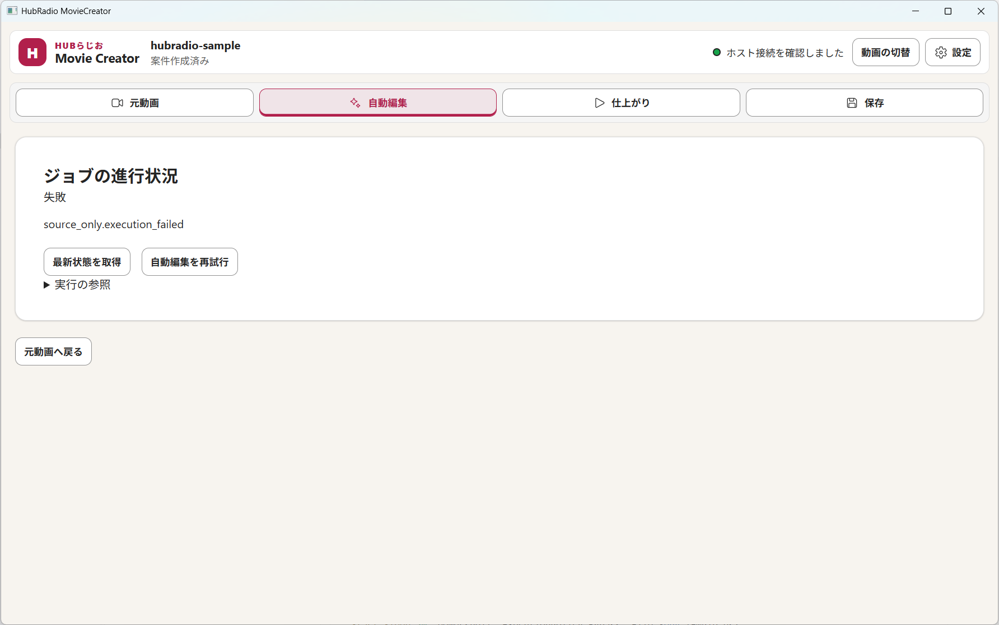

「失敗」と表示され、「最新状態を取得」と「自動編集を再試行」が出ています。まず「自動編集を再試行」を押します。

**「整合性の再確認が必要」の場合の画面：**

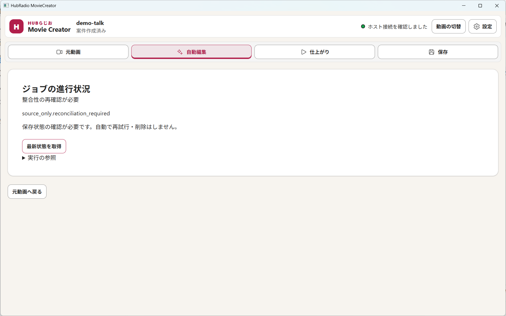

途中で処理が中断され、保存された結果に確認が必要な状態です。「保存状態の確認が必要です。自動で再試行・削除はしません。」と表示され、**アプリは勝手にやり直しません**。「最新状態を取得」を押して状態を確認します。それでも進まないときは、アプリを閉じて開き直して元動画からやり直すか、[トラブルシューティング](dev/troubleshooting.md)を確認してください。

**処理が終わった場合の画面：**

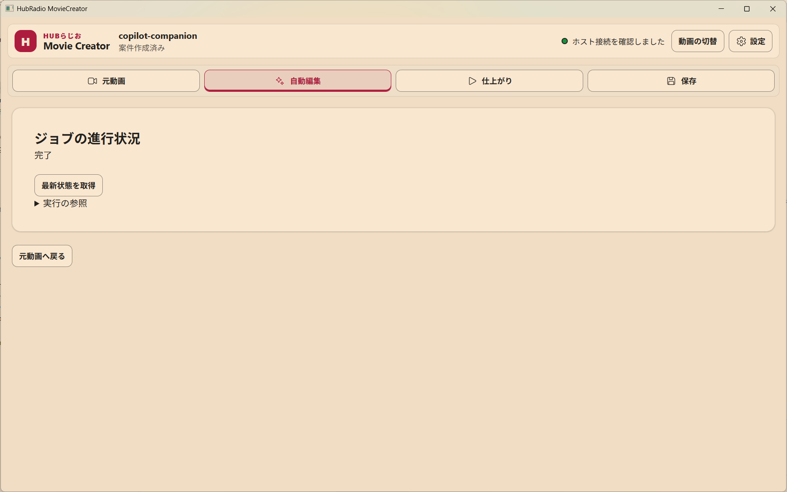

「完了」と表示されます。長い動画ほど、ここまで数分以上かかります。完了したら「仕上がり」タブへ進みます。

> [!NOTE]
> 失敗や「整合性の再確認が必要」の画面は、処理に必要な部品が足りない環境で撮影した例です。通常の環境では、動画の長さや形式によっては失敗することもあります。画面の表示が切り替わるまで時間がかかることがあるため、押したあと30秒〜1分は待ってから画面を見てください。

### 4-5. 「仕上がり」タブ

自動編集が終わると、作られたものがここに並びます。

**作られたあとの画面：**

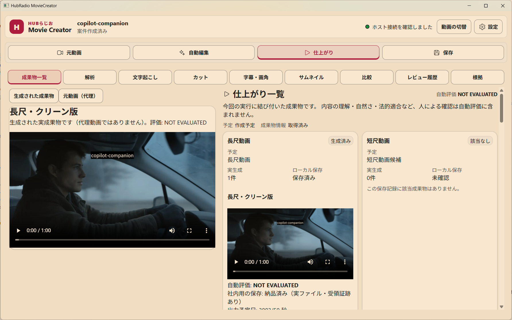

| 場所 | 意味 | 操作とアプリの動き |
|---|---|---|
| 道具のタブ列（成果物一覧／解析／文字起こし／カット／字幕・画角／サムネイル／比較／レビュー履歴／根拠） | 作られたものを見る・直す道具 | 押すと画面が切り替わります。使えない道具は理由が表示されます。最初は「成果物一覧」のままで構いません |
| 左上の「生成された成果物」「元動画（代理）」 | 左のプレビューに何を映すかの切り替え | 「生成された成果物」はアプリが作った動画、「元動画（代理）」は元の動画の確認用映像です。押すと映像が切り替わります |
| 左のプレビュー（再生ボタン、`0:00 / 1:00`、音量、全画面） | 動画の再生画面 | ▶を押すと再生します。音量ボタンで音を調整、右端の枠のボタンで全画面にできます。**必ず自分の目と耳で確認してください** |
| 右の「仕上がり一覧」のカード（長尺動画／短尺動画／字幕・テキスト／サムネイル） | 成果物ごとの状況 | `生成済み`は作られた、`該当なし`は今回は作られなかった、という意味です。**実生成**は作られた件数、**ローカル保存**は保存済みかどうかです。下へスクロールすると他のカードも見られます |
| カード内の動画 | その成果物の動画 | ▶を押して再生できます。カード内の「自動評価」「社内用の保存」が、その成果物の状態です |
| 右上の「自動評価」`NOT EVALUATED` | 機械による自動チェックの結果 | 「評価していない」という意味です。**問題なしという意味ではありません**。人による確認は含まれません |

成果物ができたあと、字幕の誤りなどは「字幕・画角」の道具で直せます。直した内容は保存されますが、動画に反映するにはカード側の**再生成**が必要です。

### 4-6. 「保存」タブ

成果物をパソコンに書き出した記録を見る場所です。

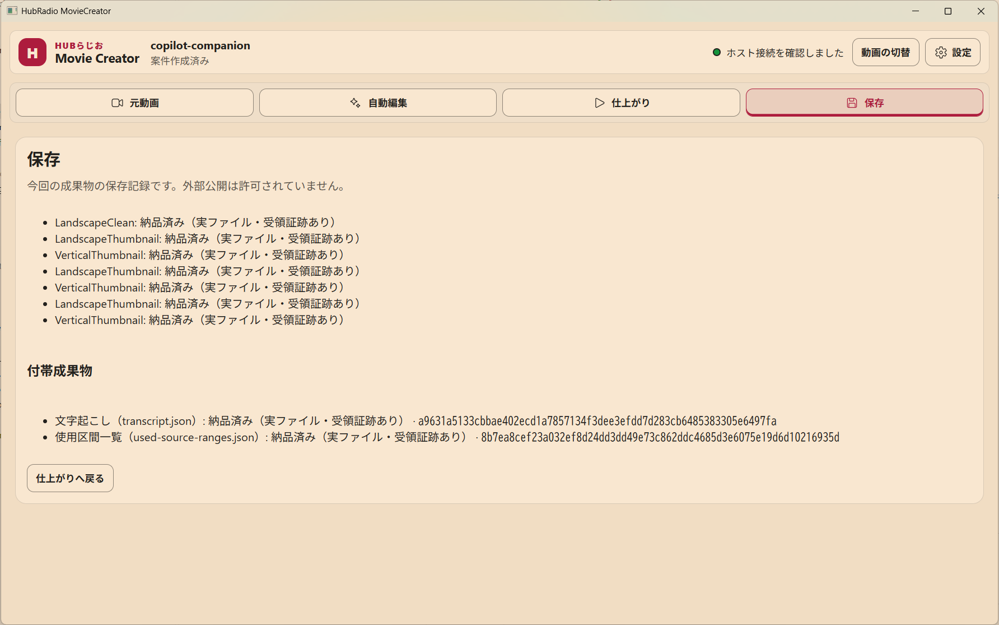

| 場所 | 意味 | 操作とアプリの動き |
|---|---|---|
| 「今回の成果物の保存記録です。外部公開は許可されていません。」 | 社内向けに保存したという記録 | 確認するだけです。**外部公開してよいという意味ではありません** |
| 一覧の各行（`LandscapeClean`＝横長の動画、`LandscapeThumbnail`／`VerticalThumbnail`＝横長／縦長のサムネイル）の「納品済み（実ファイル・受領証跡あり）」 | 実際のファイルが保存され、受け取った証拠もある、という意味 | 「納品済み」と書かれていれば保存できています。まだの場合は「納品済み」とは表示されません |
| 「付帯成果物」の「文字起こし（transcript.json）」「使用区間一覧（used-source-ranges.json）」 | 話した内容の文字と、元動画のどこを使ったかの記録 | 確認するだけです。右の長い英数字は、ファイルが変わっていないことを確かめるための番号です |
| 「仕上がりへ戻る」 | 仕上がりタブへ移動 | 押すと「仕上がり」タブに戻ります |


## 5. 動画を作る流れ（5ステップ）

```text
① 新しい案件を作成（動画を選ぶ） → ② 自動編集を待つ → ③ 仕上がりを見る → ④ 必要なら直す → ⑤ 保存する
```

各ステップの画面は、[4. 画面の見かた](#4-画面の見かたどこを押すと何が起きるか)に載せています。

### ① 新しい案件を作成する（「元動画」タブ）

1. **新しい案件を作成**を押し、編集したい動画を1本選びます。
2. 画面に、動画名、「社内限定」の表示、**作られる予定のもの**が出ます。内容を確かめます。
3. 問題なければ **編集を開始**を押します。やめるときは**取消**です。

### ② 自動編集を待つ（「自動編集」タブ）

文字起こし、長尺・短尺の作成、字幕、音声の調整、BGM、サムネイルが自動で進みます。

- 進み具合と状態がこのタブに表示されます。動画が長いほど時間がかかります。
- 途中で閉じず、画面が終わるのを待ってください。
- 止めたいときは**取消**。失敗したときは理由が表示されるので、**再試行**できる場合は押します。

### ③ 仕上がりを見る（「仕上がり」タブ）

作られた動画・画像・字幕が一覧に出ます。

- 動画はその場で再生して確認できます。**必ず自分の目と耳で確認してください。**
- 一覧には**自動チェックの結果**（音が出ているか、音と映像がずれていないか、字幕が読めるか、音量など）が出ます。
- **警告**が出たら、押すと該当する場所に移動できます。
- 「未評価」は「人がまだ確認していない」という意味です。問題なしという意味ではありません。

### ④ 必要なときだけ直す

まずは直さなくても構いません。直したいときの代表例です。

| やりたいこと | 方法 |
|---|---|
| 字幕の言葉を直す | 仕上がりの**字幕**の道具で、字幕の文を編集します。保存済みでも動画には**まだ反映されません**。下の「動画へ反映する」を行います |
| 見た目や出力形式の設定を変える | 上部の**設定**を開きます（次章） |
| 動画へ反映する | 仕上がりの成果物一覧から**再生成**を実行します。元の版は残り、新しい版が追加されます |

> [!NOTE]
> 画角の手動調整や手動サムネイルなど、現在は使えない道具があります。使えない道具には理由が表示されます。

### ⑤ 保存する（「保存」タブ）

問題のない成果物をパソコンへ書き出します。保存先と受領状況が表示されます。書き出した後に変更した場合も、元の版は上書きされず新しい版として扱われます。

## 6. 設定を変えたいとき

上部の**設定**を開きます。最初に**対象**を選びます。

| 対象 | 意味 |
|---|---|
| 新しい動画の既定値 | これから選ぶ動画に使う標準設定 |
| この動画 | 今作っている案件だけの設定 |

- 設定は**1項目ずつ保存**します。
- **初期値へ戻す**で、いつでも元に戻せます。
- 設定を保存しても、作成済みの動画は変わりません。反映するには**再生成**が必要です。

## 7. オープニング・クロージング動画を付ける（任意）

書き出した動画の前後に、用意した動画を付けて**新しいMP4**を作れます。仕上がりの動画成果物にある**オープニング・クロージングを付けて保存**を開き、動画を選んで**結合して保存**を押し、保存先と名前を決めます。片方だけでも構いません。元の動画は変更されず、既にあるファイルは上書きされません。

## 8. 安全のために

- 利用権を確認できない動画・画像・音楽・ロゴを外部公開しないでください。
- 顧客名や個人情報などは**警告される場合があります**が、見逃すこともあります。公開前に自分で確認してください。
- 自動の字幕・要約・判定を、事実や法的な判断として扱わないでください。
- 動画や音声は、既定では**パソコンの外へ送信されません**。
- 社内限定の成果物を、外部公開用として使わないでください。

## 9. 困ったとき

| 症状 | 対処 |
|---|---|
| アプリが開かない | 初回は1分近くかかる場合があります。待っても開かなければ[トラブルシューティング](dev/troubleshooting.md#限定ローカル技術評価候補を起動できない)を確認 |
| 「操作を完了できませんでした」と出て始まらない | 表示された原因と対処に従い、「もう一度試す（自動で再確認）」を押す。直らなければアプリを閉じて開き直す。それでも直らなければ[トラブルシューティング](dev/troubleshooting.md)を確認 |
| 「編集を開始」を押せない | 動画が選ばれているか、画面の案内（依存の準備中など）を確認 |
| 自動編集が失敗した | 表示された理由を読み、**再試行**。繰り返す場合は動画の形式・容量を確認 |
| 字幕を直したのに動画が変わらない | 字幕の保存と動画の更新は別です。**再生成**を実行 |
| 警告が出た | 警告を押して該当箇所を確認し、必要なら直すか、そのまま社内利用するか判断 |
| 音量が大きい・小さい | 自動チェックの音量項目を確認。設定の「音声と素材」を見直して再生成 |

不具合や要望は [GitHub Issues](https://github.com/dahatake/HubRadio-MovieCreator/issues) へ。**動画の内容、個人情報、機密情報、認証情報は書かないでください。**

## 用語集

| 用語 | 意味 |
|---|---|
| 元動画 | 編集する前の、あなたが選んだ動画ファイル |
| 長尺 / 短尺 | 長い通常動画 / 短く切り出した動画 |
| 16:9 / 9:16 | 画面の縦横比。16:9 は横長（PC・テレビ）、9:16 は縦長（スマホ） |
| 字幕（焼き込み） | 映像に文字が直接入っている字幕。後から消せません |
| 字幕ファイル（SRT/VTT） | 字幕を別ファイルにしたもの。再生ソフト側で表示を切り替えられます |
| 文字起こし | 音声を文字にしたもの |
| サムネイル | 動画の一覧に出る表紙画像 |
| チャプター | 動画内の話題ごとの区切り |
| BGM | 背景音楽 |
| 自動代理評価 | 機械が確認できる項目（再生できるか、音ずれ、音量など）の自動チェック。人の確認の代わりではありません |
| 案件 | 1本の元動画から成果物を作る作業のまとまり |
| 版 / 子版 | 作り直すたびに増える記録。元の版は残ります |
| 再生成 | 保存した設定や字幕修正を使って、新しい版を作り直すこと |
| 社内限定 | 外部公開しない前提の区分。既定値です |
