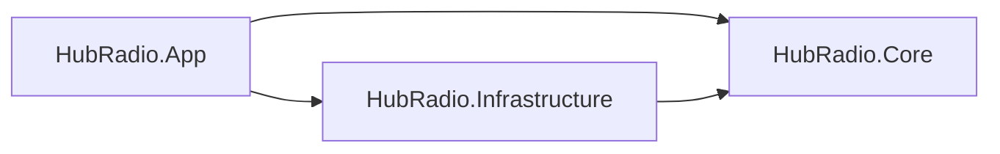

# アーキテクチャ制約

本書は F-009 の自動検査対象と、Accepted ADR が意図的に採用しない技術を明示します。根拠は [ADR-0002](../decisions/ADR-0002-product-scope.md)、[ADR-0007](../decisions/ADR-0007-stage-0-technology-selection.md)、[アーキテクチャ概要](overview.md) です。

## 許可する依存方向

製品内の .NET project reference は次の一方向だけを許可します。

| プロジェクト | 参照してよい製品プロジェクト | 参照してはならない製品プロジェクト |
|---|---|---|
| `HubRadio.Core` | なし | `HubRadio.Infrastructure`、`HubRadio.App` |
| `HubRadio.Infrastructure` | `HubRadio.Core` | `HubRadio.App` |
| `HubRadio.App` | `HubRadio.Core`、`HubRadio.Infrastructure` | なし |

- `HubRadio.Core` は時間、編集、来歴、版、ポリシーなどの純粋なドメイン境界を所有し、UI、永続化、プロセス起動を知りません。
- `HubRadio.Infrastructure` は SQLite、ファイル、FFmpeg、Python worker などの技術詳細を実装します。
- `HubRadio.App` は WinUI 3 ホストとして Core と Infrastructure を組み合わせます。
- React UI と Python worker は .NET project reference を持ちません。React は許可リスト化した WebMessage、Python は版付き NDJSON と標準入出力だけでホストと通信します。
- テストプロジェクトから検査対象プロジェクトへの参照は製品依存方向に含めません。
- 二つ目の実装が現れる前に Strategy／Factory／Provider などの将来用抽象を追加しません。

## shell を使わない子プロセス境界

FFmpeg、ffprobe、Python worker はホストが直接子プロセスとして起動します。

- .NET は `UseShellExecute=false` を維持し、実行ファイルと `ArgumentList` を分離します。
- `cmd`、`powershell`、`pwsh`、`sh`、`bash`、`zsh`、`dash`、`ksh`、`fish` とその `.exe`／絶対パスを process API から起動しません。
- Python の `shell=True`、`os.system`、`os.popen`、`asyncio.create_subprocess_shell` など、暗黙に shell を使う API を使用しません。
- Node の `child_process.exec`／`execSync` や process API の `shell: true` を製品 runtime に使用しません。
- timeout、取消、標準出力と標準エラーの分離、子孫終了、実行ファイル hash は後続の J-003/J-004/J-010 で実装します。F-009 は未実装機能を先取りしません。

## runtime server を置かない境界

製品は単一の `HubRadio.App.exe` と必要な子プロセスで完結し、業務 API や localhost server を起動しません。

禁止する runtime server の導入例:

- `Microsoft.NET.Sdk.Web`、`Microsoft.AspNetCore.App`、`Microsoft.AspNetCore.*`
- ASP.NET Core の `WebApplication`／`WebHost`、Kestrel の構成 API
- `System.Net.HttpListener`
- localhost／loopback URL を bind する runtime endpoint
- Python の `http.server`／Uvicorn 等、Node の HTTP server／listener

Vite と Vitest は **開発時の build/test tool として許可**します。Vite の dev server 設定や `vite --host localhost` は、配布される製品 runtime server ではありません。製品には Vite の静的 build output を組み込み、Vite server 自体は同梱・起動しません。

## 意図的に採用しない技術

要求変更と別の Accepted ADR がない限り、初期製品へ次を導入しません。

- PostgreSQL、Cosmos DB、Blob Storage、Service Bus、Temporal、AKS、コンテナ基盤
- localhost Web API、マイクロサービス、イベントソーシング、CQRS、MediatR
- 汎用プラグインシステム、二つ目の実装がない Strategy／Factory／Provider 階層
- OTIO、C2PA、WORM、外部公開 API、任意 URL の server-side 取得
- クラウドテレメトリ、内容を含む詳細ログ、常時 Azure 接続
- Agent Framework

これらは単語を一律禁止する自動検査にはしません。文書、テスト、build tool、将来の ADR で名称を参照するだけでも誤検知するためです。F-009 の自動検査は、現在の決定に直接対応する project reference、shell 実行、runtime server の強い構文証拠に限定します。

## 自動検査の範囲

`tests/Architecture.Tests` は repository root を `HubRadio.slnx`、`Directory.Build.props`、`src/`、`tests/` の組で上位探索し、次を検査します。

1. `src/HubRadio.Core/**/*.csproj` の `ProjectReference` が Infrastructure または App を指していないこと。
2. `src/` の製品ソースに、上記の shell 実行構文がないこと。
3. `src/` の製品ソースに、ASP.NET Core／HttpListener／Kestrel／明示的な runtime listener がないこと。

`bin`、`obj`、`dist`、`node_modules`、仮想環境、cache、テストディレクトリ、lockfile は走査しません。検出 helper 自体は、禁止文字列の負例と Vite の許可例で試験します。一般的な `server` や `localhost` という単語だけでは失敗させず、実行・bind・server framework を示す構文と組み合わせて判定します。
