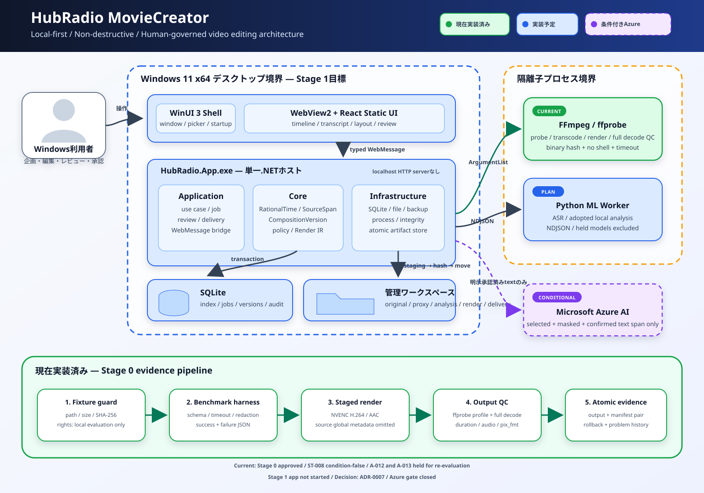

# アーキテクチャ概要

HubRadio MovieCreator は、Windows 11 x64 の単一 PC で動作する、ローカル優先の動画編集支援アプリケーションとして設計しています。

> [!IMPORTANT]
> Stage 0 と Foundation、および既存の一部Stage 1基盤は実装済みです。2026-09-02に[要求版0.2](../../requirement-definition.md)と[ADR-0009](../decisions/ADR-0009-source-only-defaults-and-automated-evaluation.md)でsource-only quick start、版付き既定値、単一利用者、社内限定、自動代理評価へ再baselineし、production実装を再開しました。版付き既定設定のdomain/schemaは実装済みです。新しいquick start、設定store/UI、自動編集の標準成果物、評価flowは**未実装**です。旧review/approval型と試験は履歴・互換資産であり、新要求の完了証拠ではありません。
>
> [ADR-0007](../decisions/ADR-0007-stage-0-technology-selection.md)に従い、condition-falseの話者分離・local text modelと、再評価保留のshot・face detectorを製品critical pathから外す判断は維持します。SQLite業務store、永続job/worker protocol、編集操作、durable媒体取込、proxy・preview素材、境界試験、ACL、audit、backup/restore、Python wheel hash lock等の既存証拠も、要求版0.2と矛盾しない範囲で再利用します。

## 図の読み方

- **緑:** 現在実装・実測済みの経路
- **青:** 一部実装または Stage 1 以降に実装する製品経路
- **紫の破線:** ローカルで不達となり、利用者が送信内容と Azure 利用を明示承認した場合だけ追加する経路

Stage 0で評価しても採用しなかったmodelや再評価保留のdetectorは、製品構成要素として図示していません。対応する要求はtranscript規則、手動speaker割当、manual layout/keyframe、版付きsafe zoneで実装します。

旧taskの実装履歴と、新要求に対する分類・次の作業は、[詳細実装計画](../planning/implementation-plan.md)を正本とします。旧`124/203`、`139/203`、`160/203`等を現在の進捗値として使いません。

## 設計原則

1. **ローカル優先:** 元動画、音声、画像は既定で端末外へ送信しません。
2. **元動画不変:** 取込後の元動画を編集処理で上書きしません。
3. **非破壊編集:** カット、字幕、画角、音声、効果は元素材への参照として保持します。
4. **根拠追跡:** 出力要素を元発言、承認済み素材、または編集者作成要素へ逆引きできるようにします。
5. **版付きsmart defaults:** 元動画以外を安全な既定値から補完し、全設定を確認・変更・resetできるようにします。
6. **自動代理評価の正直な境界:** 機械判定できるclosed contractを自動評価し、人の知覚・理解・法的判断を実施したとは主張しません。
7. **社内限定と可逆性:** 自動decisionは社内限定の子版へ記録し、任意に確認、取消、修正できます。
8. **最小構成:** 正式な要件がないサーバー、分散基盤、汎用拡張点は追加しません。

製品範囲の決定は [ADR-0002](../decisions/ADR-0002-product-scope.md) を参照してください。

## 目標プロセス構成

### 単一 .NET ホスト

startup shellとWebView境界まで実装済みの `HubRadio.App.exe` が、最終的に次を所有します。

- WinUI 3 ウィンドウと WebView2
- ユースケースとジョブ調整
- SQLite 接続
- 管理ワークスペース
- FFmpeg と Python 子プロセスの起動・監視

ASP.NET Core、localhost HTTP サーバー、Windows Service、別の業務 API プロセスは置きません。

### WinUI 3 と React

- **WinUI 3:** ウィンドウ、起動、障害表示、token化するネイティブファイル選択は実装済み
- **WebView2 内の React:** secureなbundled shellと旧案件flowの一部は実装済み。版0.2のかんたん編集、進捗・成果物、全体設定、自動代理評価、詳細編集は未実装
- **通信:** origin、UTF-8 byte size、closed schema、methodを検査する型付き WebMessage。現時点のallowlistは`bridge.ping`だけ

React からファイルパス、SQL、FFmpeg 引数、任意コマンドは送信しません。

WebView2のprofileは`%LOCALAPPDATA%\HubRadio.MovieCreator\WebView2`へ置き、bundled entry pointは`https://appassets.example/index.html`だけを許可します。same-origin以外のresource、任意top-level navigation、popup、downloadを遮断し、raw host objectは公開しません。

unpackaged実プロセスsmokeでは、Web UI Ready、Runtime欠落時のnative recovery、起動前後のinstall tree不変、実行ファイル隣接profile不在を確認済みです。ただし実行場所は開発build出力であり、Program Filesまたはinstalled MSIXのread-only境界ではありません。package install後のread-only受入はPK-006/PK-007に残します。

製品projectはWindows App SDK `2.4.0`を維持します。隔離した最小`ProgressRing` probeでは`2.4.0`がmain windowを作れず`Compatible=false`、`2.4.1-experimental`が`Compatible=true`でした。単一controlの差だけでexperimental SDKへ更新せず、現行startup画面はtext表示を使います。

### 子プロセス

- **FFmpeg／ffprobe:** probe、代理生成、レンダー、全編 decode QC
- **Python ML worker:** ASRと、ADR-0007で採用したローカル解析

製品版では両者を .NET ホストの子プロセスとして実行します。shell は使わず、timeout、取消、子孫終了、実行ファイル hash を検査します。Python は SQLite に直接接続せず、版付き NDJSON 契約とジョブ専用 staging を使います。

Stage 0のshot、face、local text model用probeは不採用・保留判断の証拠として残しますが、現在の製品workerや配布依存には含めません。

PK-001ではruntime 25件とtest固有4件をexact version・SHA-256・binary-onlyで固定し、同一Windows x64 hostのfresh CPython 3.12.10 AMD64 venvへdownload済みwheelhouseだけから再現しました。これはPython runtime、ASR model、CUDA、MSIX、完全license/CVE/SBOM、release readinessの証拠ではありません。

Stage 0のPowerShell／Python検証実装に加え、Foundationでは製品ホスト、Web UI、workerの最小buildable scaffoldを作成しました。ここでのscaffold成功は業務機能の完成を意味しません。

S-014では現在のclosed surfaceだけを対象に、React text interpolationのescapeとraw-HTML/dynamic-code sink不在、bridge/workerのunknown RPC、workerのexact CLI、process argvのstrict UTF-16/NUL境界を合成入力で検証しました。path、秘密非log、typed transition、固定proxy/preview filterは既存試験を再実行しています。これは未実装の業務UI、任意Render IR/filter compiler、環境依存reparse point、別account ACL、統合security受入`Q-008`の代替ではありません。

## 永続化

### SQLite

次の索引と業務状態をSQLiteへ保存します。

- 案件、権限、ジョブ
- 復旧可能な作業コピー
- 不変の編集版索引
- 既定設定snapshot、自動decision、自動代理評価、任意確認
- 既存のレビュー、承認、権利、監査record
- 納品物の索引
- 取込jobのversioned canonical request/checkpoint

単一 PC・単一書込ホストが対象であるため、共有 PostgreSQL やクラウド DB は導入しません。

### 管理ワークスペース

ローカル固定ディスク上の管理workspaceへ、元動画、代理、解析、編集版、プレビュー、レンダー、納品、証拠を保存する基盤を実装済みです。初回起動時の保存先選択UIは未完了です。保存・保持・バックアップの決定は [ADR-0005](../decisions/ADR-0005-storage-retention.md) を参照してください。

ファイルは staging へ書き、hash 検証後に同一ボリューム内で昇格します。SQLite には昇格済み成果物だけを登録します。取込workflowは完了stageごとにcheckpointを先にcommitし、再起動後は登録済みartifactのpath、size、digest、metadataとstaging境界を再検証してから未完了suffixだけを再開します。artifact昇格とcheckpointの間に不一致が残った場合は自動推測修復せず、手動reconciliationを要求します。

## 非破壊編集と追跡性

計画中の主要概念は次のとおりです。

| 概念 | 役割 |
|---|---|
| `RationalTime` / `TimeRange` | VFR を含む時刻を浮動小数点の公称 fps に依存せず保持する |
| `SourceSpan` | 元素材の時間範囲と必要な空間領域を指す |
| `OriginRef` | 元発言、承認済み素材、編集者作成要素を区別する |
| `WorkingCopy` | SQLite に復旧可能な可変 draft として保存する |
| `CompositionVersion` | checkpoint 時に作る不変の編集版 |
| `TimelineMap` | 出力時刻から元素材または編集素材へ逆引きする |
| `RenderProfile` | 縦横比、字幕、codec などの版付き出力仕様 |
| `RenderManifest` | 1回のレンダー入力、実行条件、結果を記録する |
| `DeliveryManifest` | 動画、字幕、画像、文書を同じ承認版へ束ねる |

表の全概念は型として実装済みです。`WorkingCopy`のSQLite永続化、EditOperation、TimelineMap再構築、review/approval基盤は実装済みです。Render IR、render実行、export flowは未完了であり、個別型の存在を完成済み操作フローとは扱いません。

## 処理フロー

1. 利用者が元動画1本を選び、社内限定の既定設定要約に対して`編集を開始`または取消を選びます。
2. ホストがstagingへコピーし、形式、stream、PTS、全編decode、容量を検査します。
3. FFmpegとPythonが解析成果物を返し、根拠付きcandidateとwarningを保存します。
4. closedな版付き規則だけを自動decisionとして子Compositionへ適用します。曖昧な意味判断は候補のまま残します。
5. 同じCompositionから長尺、短尺、字幕、音声、BGM、サムネイル等の型付きRender IRを作ります。
6. codec、duration、A/V同期、字幕、画面領域、音量、全編decode、来歴を自動代理評価します。
7. 技術的破損または来歴欠落はblockし、知覚項目の判断不能はwarningと未評価範囲を残します。
8. QC済みの社内限定成果物だけを納品領域へ昇格し、hash、設定版、元区間、評価結果を記録します。
9. 利用者は任意にpreview、差分、根拠を確認し、修正した子版を再評価・再出力できます。

この流れは [要求定義 §7](../../requirement-definition.md#7-基本処理フロー) を実装へ具体化した計画であり、完成済みの操作フローではありません。

## 評価と任意確認の境界

社内限定quick startの既定経路:

`Editing → AutomatedEvaluation → Ready | ReadyWithWarnings | Failed → Exported`

`Failed`は技術破損、来歴欠落、素材利用範囲違反等のclosedな条件に限定します。自動代理評価を`human PASS`または人手承認と表記しません。利用者は任意に`SelfReviewed`または`ChangesRequested`を記録できます。字幕、カット、音声、レイアウト、テンプレートを変更した場合は子版を作り、自動代理評価を再実行します。

旧review/approval経路は既存データの読取と履歴監査のため残せますが、quick startの必須gateにはしません。詳細は[ADR-0009](../decisions/ADR-0009-source-only-defaults-and-automated-evaluation.md)を参照してください。

## 信頼境界

| 境界 | 強制策と現在状態 |
|---|---|
| React → .NET | **実装済み:** origin、strict UTF-8 byte size、closed schema、methodの許可リスト検査。現在は`bridge.ping`だけ |
| .NET → FFmpeg | **一部実装:** shell無効、引数配列、timeout、子孫終了、binary hash、proxyのNVENC→Media Foundation fallbackと実profile記録。型付きRender IRは未実装 |
| .NET → Python | **実装済み:** closed NDJSON schema、message上限、timeout、SQLite直接接続禁止 |
| ホスト → workspace | path 正規化、ID lookup、staging、hash、atomic move、Windows ACL |
| ホスト → SQLite | parameterized query、transaction、foreign key、migration 前 backup |
| ホスト → Azure | 既定無効。利用者が明示有効化した選択・マスク・確認済み文字起こしspanだけ |

データ分類と Azure 送信条件は [ADR-0004](../decisions/ADR-0004-data-classification.md)、配布と Azure の現状は [ADR-0006](../decisions/ADR-0006-distribution-and-azure.md) を参照してください。

## 初期対象外

- 同時共同編集、複数 PC 同期、マルチテナント
- PostgreSQL、Cosmos DB、Service Bus、AKS、マイクロサービス
- localhost Web API
- 無人での外部公開や媒体への直接投稿
- 多役割、人手承認、cross-account試験、社内法務承認を社内限定quick startの必須gateにすること
- ディープフェイク、発言内容の改変
- 汎用プラグイン基盤や、二つ目の実装がない Provider／Factory
- 正式な必要性が未確定の OTIO、C2PA、WORM

## 判断の優先順位

実装判断が競合する場合は、[ADR-0001](../decisions/ADR-0001-source-of-truth.md) に従い、要求定義、確認済みレビュー、Accepted ADR、技術調査、実装計画の順に優先します。
