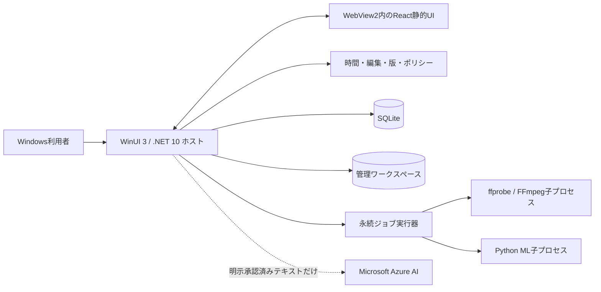
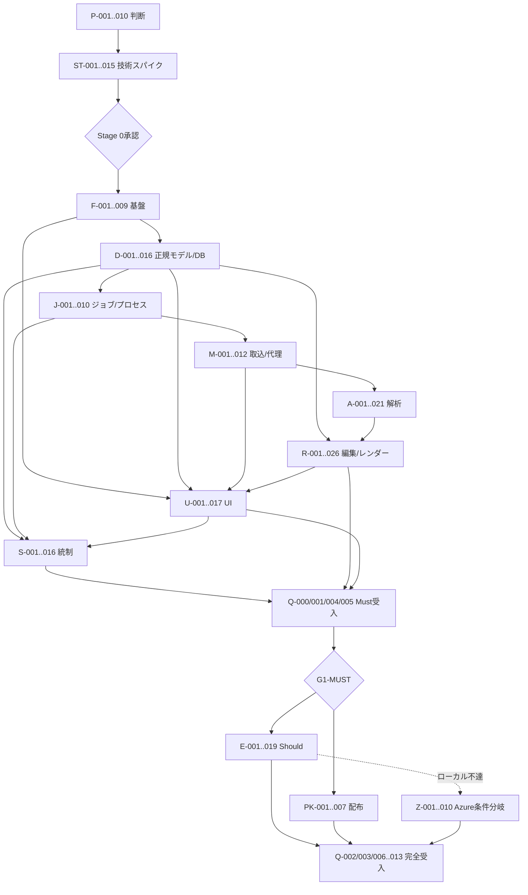

# Hubらじお マルチフォーマット動画編集ソフトウェア 詳細実装計画

**対象:** Windows 11 専用デスクトップアプリケーション  
**要求の正本（暫定既定）:** `docs/requirement-definition.md` 版 0.1 Draft  
**設計根拠:** `docs/implementation-research.md`、`docs/adversarial-review.md`  
**計画日:** 2026年8月26日  
**計画状態:** 実行中。P-001〜P-010、ST-001〜ST-007、ST-009、ST-010、ST-014、ST-016は測定タスクとして完了。ST-007はCUDA版のword/utterance時刻を編集可能な候補としつつexact boundary精度を未測定のまま保持し、parent外0.14秒のwordを各経路1件非clampで記録、発話時刻＋手動字幕調整を必須fallbackとした。production閾値とCUDA配布は未承認。次はST-011。アプリケーション、IaC、Azureリソースは未完了

---

## 1. この計画の読み方

本書は実装そのものではなく、ユーザーの承認後に一つずつ実行するための作業分解である。各タスクは、原則として単独の小さな変更と対応するテストで完結させる。

- **直列:** 依存タスクの成果物が確定するまで開始しない。
- **並列 `L-*`:** 同じレーンまたは別レーンで、記載した依存完了後に並行実行できる。
- **条件付き:** 判定ゲートを満たした場合だけ実行する。未使用の抽象、設定、依存は先に作らない。
- **Azure:** `なし`、`ローカル処理`、または`条件付き Azure`を明記する。`条件付き Azure`は、ローカルで現実的に達成できないことを実測し、ユーザーが改めて作成を指示した後だけ実行する。

### 実行レーン

| レーン | 対象 |
|---|---|
| `L-G` | 要求、判断記録、評価データ、ライセンス |
| `L-C` | .NETドメイン、SQLite、ファイル永続化、ジョブ |
| `L-M` | FFmpeg、Pythonワーカー、ローカルML、レンダー |
| `L-W` | WinUI 3、WebView2、React UI |
| `L-S` | ポリシー、セキュリティ、監査、配布 |
| `L-AZ` | 明示承認後のAzure限定分岐 |

### パス略号

| 略号 | 実パス |
|---|---|
| `APP` | `src/HubRadio.App/` |
| `CORE` | `src/HubRadio.Core/` |
| `INFRA` | `src/HubRadio.Infrastructure/` |
| `WEB` | `src/HubRadio.Web/` |
| `WORKER` | `src/HubRadio.Worker/` |
| `SCHEMAS` | `schemas/` |
| `TESTS` | `tests/` |
| `BENCH` | `benchmarks/` |
| `PKG` | `packaging/HubRadio.Package/` |

---

## 2. 採用する最小アーキテクチャ



### 2.1 プロセス境界

1. **`HubRadio.App.exe` 1プロセス**
   - WinUI 3ウィンドウ、WebView2、ユースケース、SQLite、ファイル、ジョブを所有する。
   - ASP.NET Core、localhost HTTP、Windows Service、別の業務APIプロセスは置かない。
2. **FFmpeg/ffprobe子プロセス**
   - `UseShellExecute=false` と引数配列でのみ起動する。
   - 型付きレンダーIRが許可した入力、フィルター、出力だけを渡す。
3. **Python ML子プロセス**
   - NDJSONを標準入力・標準出力で交換する。PythonはSQLiteへ接続しない。
   - 大きな入力と結果は、ホストが発行したジョブ専用ステージングパスを使う。
4. **Azureは第4経路ではなく条件付き代替**
   - 初期既定では元動画・音声・画像を送らない。
   - ローカル小規模言語モデルで品質または実行可能性を満たせない文章提案だけを候補とする。

### 2.2 UI境界

- WinUI 3はウィンドウ、ネイティブファイル選択、起動・障害表示、WebView2ホストを担当する。
- Reactは案件一覧、解析、タイムライン、字幕、レイアウト、レビュー画面を担当する。
- ReactとC#は`window.chrome.webview.postMessage` / `WebMessageReceived`の小さな許可リスト型メッセージだけで通信する。
- Reactからファイルパス、SQL、FFmpeg引数、任意コマンドを送らない。UIはIDと型付き操作だけを送る。
- React状態は`useReducer`とContextから開始し、実測上必要になるまでRedux等を追加しない。

### 2.3 永続化境界

- **SQLite:** 案件索引、権限、ジョブ、作業コピー、版索引、レビュー、権利、監査、納品索引。
- **JSON成果物:** 文字起こし改訂、検出、提案、編集版、TimelineMap、Render Manifest、Delivery Manifest。
- **ファイル:** 元動画、代理動画、波形、画像、モデル、レンダー、納品物。
- ファイルはステージングへ書き、ハッシュ検証後に同一ボリューム内で原子的に昇格する。SQLiteには昇格済み成果物だけを登録する。

### 2.4 管理ワークスペース

```text
<workspace>/
  hubradio.db
  projects/<project-id>/
    original/
    proxy/
    analysis/
    compositions/
    previews/
    renders/
    deliveries/
    evidence/
    staging/
  cache/
  models/
  logs/
  backups/
```

- 元動画は取込時に管理領域へコピーし、内容ハッシュを記録する。外部ファイルへの参照だけで済ませない。
- 元動画は書込用で開かず、使用前後にハッシュを検査する。
- 代理・解析・プレビューは再生成可能なキャッシュとし、承認版・監査・納品物とは区別する。

### 2.5 意図的に採用しないもの

初期実装では次を作らない。

- PostgreSQL、Cosmos DB、Blob Storage、Service Bus、Temporal、AKS、コンテナ基盤
- localhost Web API、マイクロサービス、イベントソーシング、CQRS、MediatR
- 汎用プラグインシステム、二つ目の実装がないStrategy/Factory/Provider階層
- OTIO、C2PA、WORM、外部公開API、Clipchampプロジェクト往復
- 任意URLのサーバー取得。参考URLは文字列として保存するだけとし、SSRF経路を作らない
- クラウドテレメトリ、内容を含む詳細ログ、常時Azure接続
- Agent Framework。本アプリに自律エージェント要件はない

NFR-007は、版付きJSON Schema、純粋なドメイン境界、モデル実行記録によって満たす。将来機能のための空インターフェースは作らない。

---

## 3. 既定判断と確認待ち事項

回答を取得できなかったため、以下のデフォルトを計画へ適用した。ユーザーは実装開始前に変更できる。

| 不明点 | 選択肢 | デフォルトの選択肢 | その理由 |
|---|---|---|---|
| 要求定義の正本 | `docs/requirement-definition.md` / 後日`hve-dev`版を提供 | `docs/requirement-definition.md` | 指定された`/hve-dev/requirement-definition.md`は存在せず、実在する要求定義は1件だけであるため |
| 利用形態 | 1台・1人 / 複数PC順次利用 / 同時共同編集 | 1台・1アクティブ編集者 | SQLiteとローカルファイルでMust要求を最小構成にできる。共同編集サーバーは不要 |
| Windows最小版 | Windows 11全版 / 23H2 / 24H2 | Windows 11 24H2 | Foundry LocalとWindows MLのハードウェア最適化経路を使いやすい。古い版対応の分岐を避ける |
| CPUアーキテクチャ | x64 / ARM64 / 両方 | x64 | MediaPipe Pythonの公式配布がamd64 Windowsを対象とし、動画・CUDA系の選択肢が最も広い |
| UI | 純WinUI 3 / WinUI 3 + WebView2/React / Electron | WinUI 3 + WebView2/React | Windowsネイティブ配布と複雑なタイムラインUIを両立し、Electronランタイムを増やさない |
| DB | SQLite / ローカルPostgreSQL / Azure DB | SQLite | 単一PC・単一書込ホストに十分で、別サーバー運用を不要にする |
| Azure送信範囲 | 送信不可 / 選択済みテキスト / 音声 / 動画 | 選択・マスキング・確認済みの根拠付き文字起こしspanのみ | 元メディアを端末外へ出さず、クラウド利用をPCで困難な文章推論に限定できる |
| Azureモデル | GPT-5.6系列 / Claude Opus 5 Azure-hosted / 利用しない | ローカル評価不合格時にGPT-5.6系列を評価 | 公式資料上Structured Outputsを持つ。正確なvariant、リージョン、quotaは実行時に選ぶ |
| Claudeの扱い | Azure-hosted版を許可 / Anthropic-hosted版も許可 / 不許可 | Azure-hosted版だけを法務確認後に候補化 | Anthropic-hosted版はAzure限定条件を満たさない。Azure-hosted版もAnthropic利用条件と処理者確認が必要 |
| FFmpeg | LGPL構成 / GPL構成許容 / 商用SDK | LGPL構成を先にPoC | GPL部品を有効化した配布物の義務を初期既定に持ち込まない。H.264はMedia Foundation等を実機検証する |
| pyannote | 利用条件へ同意 / 代替モデル / 手動話者割当 | 同意確認までは導入せず、手動割当を保持 | Community-1はモデル条件への同意が必要。無断取得を避ける |
| 配布 | 社内MSIX / Store / 展開不要 | 署名済み社内MSIX | WinUI 3、Python、FFmpegを1つの配布単位で管理できる。複数実行ファイルのため単一プロジェクトMSIXではなくPackaging ProjectをPoCする |
| WebView2 | Evergreen / Fixed Version | Evergreen + 起動時存在確認 | Windows 11に同梱され、自動セキュリティ更新と小さい配布物を優先できる |
| 保持・バックアップ | 未指定 / 組織規定あり | Stage 0で種類別に決定 | 元、代理、解析、監査、納品で必要期間が異なり、任意の日数を捏造できない |
| 初期評価素材 | Hubらじお実素材あり / 合成・公開素材のみ | 実素材1本と承認済みブランド素材を要求 | 日本語固有名詞、画角、音質、VFR、承認フローは実素材なしに評価できない |

---

## 4. 品質ゲート

数値は要求定義にないため本計画で捏造しない。Stage 0で現行手作業と候補技術を同じ素材で測り、関係者が閾値を承認する。

| Gate | 判定内容 | 通過条件 |
|---|---|---|
| `G0-INPUT` | 正本、素材、権利、ハードウェア、対象OS | Pタスクの判断記録がレビュー済み |
| `G0-MEDIA` | VFR、代理、A/V同期、H.264/AAC出力 | 実素材で時刻写像とエンコーダー経路が評価可能 |
| `G0-ASR` | 日本語ASR、固有名詞、単語/発話時刻、処理時間 | 実測値と手動フォールバックが承認済み |
| `G0-ML` | 話者、ショット、顔、ローカル文章モデル | 各機能を採用、保留、手動化のいずれかへ明示分類 |
| `G0-UI` | WebView2代理表示とFFmpeg忠実プレビュー | 同じCue・LayoutSpecから差分を検査できる |
| `G0-SEC` | 子プロセス制限、パッケージ、ライセンス | 出荷前必須対策と受容する残余リスクが承認済み |
| `G1-MUST` | 要求定義のMust縦切り | Q-000、Q-001、Q-004、Q-005と関連NFR試験が合格 |
| `G2-SHOULD` | Should機能と完全版AC-002/003 | Q-002、Q-003が合格し、実素材評価で現行手動経路を悪化させず、人が常に修正可能 |
| `G-AZURE` | Azure追加 | ローカル不達の証拠、送信データ、リージョン、quota、ユーザー作成指示が揃う |
| `G-RELEASE` | 配布 | 署名、インストール、復旧、SBOM、全受入記録が揃う |

---

## 5. タスク一覧

### 5.1 P — 実装前の判断と入力固定

| ID | 目的 / 入力 | 出力・対象ファイル | 依存 / 実行 | 完了条件・試験 | 要求・根拠 | Azure |
|---|---|---|---|---|---|---|
| P-001 | 実在する3文書を正本集合として固定する | `docs/decisions/ADR-0001-source-of-truth.md` | なし / 直列 | 文書パス、版、優先順位、`hve-dev`不在を記録 | 全要求、AR全件 | なし |
| P-002 | Windows専用・単一PC・ローカル優先の範囲を固定する | `docs/decisions/ADR-0002-product-scope.md` | P-001 / 直列 | 採用範囲、対象外、Stage対応が要求レビュー済み | §4、§16〜19、RS§12 | なし |
| P-003 | 初期検証4種類・計6本を作れる入力を集める | `BENCH/fixtures/fixture-manifest.json`、権利証憑参照 | P-001 / `L-G` | 元動画、ブランド、辞書、出演者、資料のハッシュと利用可否を記録 | §6、§18、BR-004 | なし |
| P-004 | 対象PCのOS、CPU、GPU/NPU、RAM、空き容量、ドライバーを記録する | `BENCH/results/hardware-inventory.json` | P-002 / `L-G` | 再実行可能な取得手順と個人情報を除いた結果がある | NFR-002、RS§11 | ローカル処理 |
| P-005 | 役割と最小承認経路を決める | `docs/decisions/ADR-0003-local-identity-and-review.md` | P-001 / `L-G` | Windows SID、役割兼任、内部/外部の必須レビュー表が合意済み | FR-029、NFR-004、AC-004 | なし |
| P-006 | 公開区分とAI送信区分を決める | `docs/decisions/ADR-0004-data-classification.md` | P-005 / 直列 | 保存、プレビュー、出力、AI送信の許可表がある | §6.3、NFR-004、BR-003 | なし |
| P-007 | ワークスペース、保持、バックアップ対象を決める | `docs/decisions/ADR-0005-storage-retention.md` | P-002 / `L-G` | 元/代理/解析/版/監査/納品を種類別に決定 | §13、NFR-003/006 | なし |
| P-008 | FFmpeg、フォント、BGM、モデルの配布条件を決める | `docs/licenses/third-party-intake.md` | P-003 / `L-G` | GPL許容、フォント埋込、pyannote同意の可否を明記 | FR-019、BR-001/004、RS§13 | なし |
| P-009 | Stage 0の正解データと測定方法を決める | `BENCH/annotations/README.md`、`BENCH/metrics/metric-definitions.md` | P-003,P-004 / 直列 | WER/CER等の算出、層別、評価者、閾値決定者を記録。値自体は実測後 | NFR-002、RS§11 | なし |
| P-010 | 配布先、署名主体、Azureサブスクリプション/リージョン要件の有無を記録する | `docs/decisions/ADR-0006-distribution-and-azure.md` | P-006,P-008 / `L-G` | Azureは「非利用/存在/未定」と所在地要件だけを記録し、resource・region・modelは選択も作成もしない | NFR-004、RS§9.2 | 作成なし |

### 5.2 ST — Stage 0 技術スパイク

| ID | 目的 / 入力 | 出力・対象ファイル | 依存 / 実行 | 完了条件・試験 | 要求・根拠 | Azure |
|---|---|---|---|---|---|---|
| ST-001 | 同じ素材・区間・設定で候補を比較するベンチハーネスを作る | `BENCH/run-benchmarks.ps1`、`BENCH/results/schema.json` | P-003,P-004,P-009 / 直列 | PowerShell 7で結果を機械可読保存し、素材を変更しない | NFR-002/003 | ローカル処理 |
| ST-002 | FFmpeg候補の版、`-buildconf`、ライセンス、実行ファイルhashを採取する | `BENCH/results/ffmpeg-capabilities.json` | ST-001,P-008 / `L-M` | LGPL/GPL状態と必要filter/decoder/encoderの有無が分かる | FR-001/031、RS[S01][S02][S48] | ローカル処理 |
| ST-003 | 実素材をffprobe・全編デコードし、破損/VFR/複数streamを調べる | `BENCH/results/media-ingest.json` | ST-001,ST-002 / `L-M` | PTS、time base、A/V差、警告を保存 | FR-001、RS§5.1 | ローカル処理 |
| ST-004 | CFR代理と元素材PTSの双方向写像を実証する | `BENCH/results/proxy-frame-map.json`、代理動画 | ST-003 / `L-M` | 開始・終了・カット候補を往復し、誤差分布を記録 | FR-026/032、AR-4 | ローカル処理 |
| ST-005 | Windows上のH.264/AACエンコード経路を比較する | `BENCH/results/encoder-matrix.json` | ST-002,P-004 / `L-M` | Media Foundationと存在するHW encoderを実測し、LGPL経路または要判断を確定 | FR-031、RS§5.12/13 | ローカル処理 |
| ST-006 | faster-whisper CPU/CUDAと、利用可能ならFoundry Local Whisperを比較する | `BENCH/results/asr-benchmark.json` | ST-001,P-004 / `L-M` | 日本語、固有名詞、処理時間、メモリ、時刻を同じ形式で保存 | FR-002、RS§5.2、Foundry Local | ローカル処理 |
| ST-007 | 採用版の日本語単語時刻/発話時刻を評価する | `BENCH/results/alignment-benchmark.json` | ST-006,P-009 / `L-M` | 単語時刻が不適なら発話時刻+手動調整へ明示フォールバック | FR-002/012、AR-28 | ローカル処理 |
| ST-008 | 条件同意済みの場合だけpyannote話者分離を評価する | `BENCH/results/diarization-benchmark.json` | P-008,ST-006 / 条件付き `L-M` | 同意記録、モデルhash、失敗条件、手動割当経路を記録 | FR-003、RS[S11][S12] | ローカル処理 |
| ST-009 | PySceneDetectのPTSベース境界を実素材で評価する | `BENCH/results/shot-detection.json` | ST-003 / `L-M` | Adaptive/Content候補を比較し、閾値を実測で選ぶ | FR-006/016、RS[S15] | ローカル処理 |
| ST-010 | MediaPipe Face DetectorをVIDEOモードで評価する | `BENCH/results/face-detection.json` | ST-003,P-004 / `L-M` | 小顔、横顔、複数人、資料共有の失敗を分類 | FR-010/014/021、RS[S17] | ローカル処理 |
| ST-011 | Foundry Localの文章モデルで根拠ID付きJSON候補を評価する | `BENCH/results/local-text-model.json` | P-004,ST-001 / `L-M` | JSON検証、根拠ID、処理時間、メモリ、手動フォールバックを記録 | FR-006/011/022/025 | ローカル処理 |
| ST-012 | 手書きマニフェストから16:9と9:16をレンダーする | `BENCH/manifests/`、`BENCH/results/manual-render.json` | ST-003,ST-005 / `L-M` | trim/concat/crop/subtitle/audioと元時刻逆引きを確認 | FR-008〜010/012/032 | ローカル処理 |
| ST-013 | WebView2 Canvas/SVGと忠実区間レンダーを比較する | `BENCH/web-preview/`、`BENCH/results/preview-fidelity.json` | ST-004,ST-012 / `L-W` | 同一LayoutSpec/Cueで差分を記録できる | FR-026、RS§5.12 | ローカル処理 |
| ST-014 | Job ObjectとAppContainer候補、MSIX複数実行ファイルを検証する | `BENCH/results/process-and-package.json` | ST-002,P-010 / `L-S` | kill-on-close、制限、codec/model読込、1パッケージ化の成否を記録 | NFR-003/004 | ローカル処理 |
| ST-016 | 咳・雑音・待ち・録画トラブル候補のローカル検出方法を比較する | `BENCH/results/audio-event-and-recording-quality.json` | ST-001,ST-003 / `L-M` | audio event分類、波形規則、decode警告を比較し、採用/手動化と誤検出分類を記録 | FR-005 | ローカル処理 |
| ST-015 | Stage 0結果を採用/保留/手動化へ分類する | `BENCH/results/stage-0-report.md`、ADR更新 | ST-004〜ST-014,ST-016 / 直列 | 関係者が閾値、採用技術、フォールバック、残余リスクを承認 | 全AC、RS§11/12 | 作成なし |

### 5.3 F — リポジトリとビルド基盤

| ID | 目的 / 入力 | 出力・対象ファイル | 依存 / 実行 | 完了条件・試験 | 要求・根拠 | Azure |
|---|---|---|---|---|---|---|
| F-001 | 最小ディレクトリ構造と`.gitignore`を作る | `src/`、`tests/`、`schemas/`、`benchmarks/`、`packaging/`、`.gitignore` | ST-015承認 / 直列 | キャッシュ、モデル、動画、秘密をGit対象外にする | NFR-003/006 | なし |
| F-002 | .NET 10 solutionと3プロジェクトを作る | `HubRadio.slnx`、`CORE/*.csproj`、`INFRA/*.csproj`、`APP/*.csproj` | F-001 / `L-C` | CoreはInfrastructure/Appを参照しない。全体build成功 | WinUI/.NET公式資料 | なし |
| F-003 | React/TypeScript/Vite静的UIを作る | `WEB/package.json`、`vite.config.ts`、`src/` | F-001 / `L-W` | 相対base、CSP向けasset inline無効、typecheck/build成功 | React 19、Vite 8 | なし |
| F-004 | Pythonワーカーパッケージとテストを作る | `WORKER/pyproject.toml`、`hubradio_worker/`、`tests/` | F-001,ST-015 / `L-M` | 採用Python版でimport/test成功。モデルは未取得でも起動可能 | ST-006〜010 | なし |
| F-005 | .NET、Web、Pythonのテストプロジェクトを作る | `TESTS/HubRadio.Core.Tests/`、`TESTS/HubRadio.Infrastructure.Tests/`、`WEB/vitest.config.ts` | F-002〜F-004 / 並列 | 空テストではなく各ランナーの1 smoke testが通る | NFR-003 | なし |
| F-006 | PowerShell 7専用の一括検証を作る | `build.ps1`、`test.ps1` | F-005 / 直列 | 依存復元、build、lint、testをfail-fast実行 | 開発規約 | なし |
| F-007 | ゴールデンクリップと期待値の管理形式を作る | `TESTS/Fixtures/README.md`、`fixture-index.json` | P-003,F-005 / `L-G` | 大容量原本をGitへ入れず、hashと取得手順を持つ | RS§11.6 | なし |
| F-008 | 依存・モデル・ツールBOMの雛形を作る | `docs/licenses/dependencies.csv`、`models.csv`、`THIRD-PARTY-NOTICES.md` | F-002〜F-004,P-008 / `L-S` | 版、取得元、hash、license、条件を必須列にする | NFR-006、RS§13 | なし |
| F-009 | 禁止依存方向と禁止技術を自動検査する | `TESTS/Architecture.Tests/`、`docs/architecture/constraints.md` | F-002 / `L-C` | Core→Infrastructure、shell実行、任意HTTP server導入を検出 | YAGNI方針 | なし |

### 5.4 D — 正規モデル、SQLite、成果物ストア

| ID | 目的 / 入力 | 出力・対象ファイル | 依存 / 実行 | 完了条件・試験 | 要求・根拠 | Azure |
|---|---|---|---|---|---|---|
| D-001 | 有理時刻と範囲演算を実装する | `CORE/Time/RationalTime.cs`、`TimeRange.cs`、unit tests | F-002 / `L-C` | 正規化、比較、加減、丸め、NTSC rate、overflowを検査 | FR-002/032、AR-2/4 | なし |
| D-002 | 内容hashと型付きIDを実装する | `CORE/Identity/ContentDigest.cs`、`EntityId.cs` | F-002 / `L-C` | SHA-256形式、等値、無効入力をテスト | NFR-003/006 | なし |
| D-003 | `SourceSpan`と`OriginRef`を定義する | `CORE/Provenance/SourceSpan.cs`、`OriginRef.cs`、schemas/tests | D-001,D-002,F-005 / `L-C` | 元発言・Asset・EditorialRecordを区別し、架空spanを拒否 | FR-032、AC-005、AR-1/5 | なし |
| D-004 | Project、Asset、RightsRecord、Performerを定義する | `CORE/Projects/*.cs`、`SCHEMAS/project.schema.json` | D-002 / `L-C` | 必須入力、公開区分、権利、肩書確認日を検証 | §6/13、BR-002/004 | なし |
| D-005 | TranscriptRevision、Utterance、Tokenを定義する | `CORE/Transcripts/*.cs`、schema/tests | D-001〜D-003 / `L-C` | 改訂ID、話者、確度、AI/人変更元を保持。単語時刻を取得できないTokenは時刻を捏造せず、親Utteranceの範囲と手動調整要否を参照 | FR-002〜004、AR-5/28 | なし |
| D-006 | Detection、Suggestion、ModelRunを定義する | `CORE/Analysis/*.cs`、schema/tests | D-003,D-005 / `L-C` | Proposed/Reviewed/Rejected/Adoptedと送信先・モデルhashを保持。採用Suggestionは監査記録のまま残し、Composition要素がそのIDとOriginRefを参照。人が独自作成した文言だけEditorialRecordにする | FR-005〜007、BR-005、AR-19 | なし |
| D-007 | WorkingCopyと不変CompositionVersionを定義する | `CORE/Compositions/*.cs`、schema/tests | D-001,D-003,D-006 / `L-C` | WorkingCopyはSQLiteへ復旧可能な可変draftとして保存し、checkpoint時に新しい不変CompositionVersionへ昇格。承認版変更不可、子版、親版、変更理由、digestを検査 | FR-027〜030、NFR-003 | なし |
| D-008 | LayoutSpec、Cue、Template、RenderProfileを定義する | `CORE/Layout/*.cs`、`CORE/Rendering/RenderProfile.cs` | D-001,D-003 / `L-C` | RenderProfileは版ID/content digestを持つ出力仕様、RenderManifestは単一実行記録として分離。正規化座標、safe zone、subtitle/graphic/audio cueを表現 | FR-009〜020/026 | なし |
| D-009 | 出力時刻からOriginRefへ逆引きするTimelineMapを定義する | `CORE/Provenance/TimelineMap.cs`、schema/tests | D-003,D-007,D-008 / `L-C` | cut、concat、静止画、opening、CTAの往復をテスト | FR-032、AC-005 | なし |
| D-010 | Render ManifestとDeliveryManifestを定義する | `CORE/Rendering/*Manifest.cs`、schemas/tests | D-002,D-007〜D-009 / `L-C` | 入力、tool/model/font/template hashと全成果物を版へ結ぶ | FR-031、AR-7/18 | なし |
| D-011 | ReviewState、Approval、Comment、AuditEventを定義する | `CORE/Reviews/*.cs`、`CORE/Audit/*.cs` | D-002,D-007 / `L-C` | ChangesRequested/PublicationBlocked、版digest、actor/time/reasonを保持 | FR-029/030、AR-13/14 | なし |
| D-012 | 決定的JSON writerと成果物cache keyを実装する | `CORE/Serialization/CanonicalJson.cs`、`ArtifactCacheKey.cs` | D-002,D-005〜D-010 / `L-C` | property順序差を無視し全入力digest差を検出 | NFR-002/003、AR-3 | なし |
| D-013 | SQLite初期schemaとmigration runnerを実装する | `INFRA/Database/Migrations/001_initial.sql`、`DatabaseMigrator.cs` | D-004〜D-012,F-002 / `L-C` | 空DB作成、再実行、rollback用backup、FK整合をテスト | §13、NFR-003/006 | なし |
| D-014 | 集約単位のSQLite storeを実装する | `INFRA/Database/ProjectStore.cs`、`JobStore.cs`、`ReviewStore.cs` | D-013 / `L-C` | 任意Repository階層を作らず、transaction境界と競合をテスト | NFR-003 | なし |
| D-015 | hash付きArtifactStoreを実装する | `INFRA/Files/ArtifactStore.cs`、tests | D-002,D-012,P-007 / `L-C` | staging→hash→atomic move→DB登録、path traversal拒否 | NFR-003/004 | なし |
| D-016 | 起動時整合性検査と孤児staging清掃を実装する | `INFRA/Recovery/WorkspaceRecovery.cs`、tests | D-013〜D-015 / `L-C` | DB不整合を黙って修復せず、復旧候補と監査を出す | NFR-003 | なし |

### 5.5 J — 永続ジョブと子プロセス

| ID | 目的 / 入力 | 出力・対象ファイル | 依存 / 実行 | 完了条件・試験 | 要求・根拠 | Azure |
|---|---|---|---|---|---|---|
| J-001 | Job、attempt、progress、heartbeatの永続状態を実装する | `CORE/Jobs/*.cs`、migration `002_jobs.sql` | D-013 / `L-C` | queued/running/succeeded/failed/cancelled/interrupted遷移をテスト | NFR-002/003 | なし |
| J-002 | 1本の重いジョブだけを動かすbackground runnerを実装する | `APP/Jobs/LocalJobRunner.cs` | J-001,D-014 / `L-C` | 同時GPU競合を起こさず、UIをblockしない | NFR-002 | ローカル処理 |
| J-003 | shellを使わないProcessRunnerを実装する | `INFRA/Processes/ProcessRunner.cs`、security tests | F-002 / `L-S` | `ArgumentList`、標準出力分離、timeout/cancel、巨大stderr制限を検査 | NFR-003/004、RS[S49] | ローカル処理 |
| J-004 | Windows Job Objectで子孫ごと終了・資源制限する | `INFRA/Processes/WindowsJobObject.cs`、tests | J-003,ST-014 / `L-S` | cancel/crash時に子孫が残らない。値はStage 0結果から固定 | NFR-003/004 | ローカル処理 |
| J-005 | Python NDJSON request/response/progress protocolを実装する | `SCHEMAS/worker-protocol.schema.json`、`WORKER/protocol.py`、`INFRA/Worker/WorkerClient.cs` | F-004,D-012,J-003 / `L-M` | unknown method、巨大message、schema違反、途中終了をfail-closed | NFR-003/004 | ローカル処理 |
| J-006 | progress、cancel、再試行UI通知を実装する | `APP/Jobs/JobCoordinator.cs`、bridge DTO | J-002,J-005 / `L-C` | 再試行可能/不可をerror codeで区別し、二重成果物を作らない | NFR-002/003 | ローカル処理 |
| J-007 | cache hit、stale、再計算、採用差分を実装する | `APP/Jobs/ArtifactPlanner.cs`、tests | D-012,D-015,J-001 / `L-C` | upstream改訂時に旧成果物を残してstale表示 | NFR-002、AR-3 | なし |
| J-008 | app強制終了後のrunning job復旧を実装する | `APP/Jobs/JobRecovery.cs`、integration tests | D-016,J-001,J-004 / `L-C` | kill→restartでinterruptedへ遷移し、安全なstageだけ再開 | NFR-003 | ローカル処理 |
| J-009 | bounded local diagnostic logと安定error codeを実装する | `INFRA/Diagnostics/`、`docs/error-catalog.md` | J-003 / `L-S` | transcript/秘密を記録せず、サイズ上限とredactionをテスト | NFR-003/004 | なし |
| J-010 | tool/model起動前hash検証を実装する | `INFRA/Integrity/BinaryVerifier.cs`、tests | D-002,F-008 / `L-S` | package manifest不一致なら起動を拒否し監査する | NFR-003/006 | なし |

### 5.6 M — 動画取込、代理、プレビュー素材

| ID | 目的 / 入力 | 出力・対象ファイル | 依存 / 実行 | 完了条件・試験 | 要求・根拠 | Azure |
|---|---|---|---|---|---|---|
| M-001 | native file pickerから選択し、UIへpathを返さずasset token化する | `APP/Media/MediaPicker.cs`、bridge tests | F-002,F-003 / `L-W` | UI messageはasset候補IDのみ | FR-001、NFR-004 | なし |
| M-002 | 元ファイルをstagingへstream copyしながらhashする | `INFRA/Media/MediaImporter.cs`、tests | D-015,J-001,M-001 / `L-M` | cancel、disk full、同名、途中失敗で元/既存を壊さない | FR-001、NFR-003 | ローカル処理 |
| M-003 | file signatureとffprobe JSONを検証する | `INFRA/Media/FfprobeClient.cs`、fixtures/tests | ST-002,J-003,M-002 / `L-M` | extension/Content-Typeを信用せず、許可container/streamを解析 | FR-001、RS§5.1 | ローカル処理 |
| M-004 | MediaInfoへ正規化し警告を生成する | `CORE/Media/MediaInfo.cs`、`APP/Media/IngestValidator.cs` | M-003,D-001 / `L-C` | 音声なし、低解像度、duration不整合、VFR等をwarning化 | FR-001 | なし |
| M-005 | 資源制限した子プロセスで全編decode検査を実装する | `INFRA/Media/DecodeValidator.cs`、integration tests | J-004,M-003 / `L-M` | 破損、timestamp逆行、resource上限を検出 | FR-001、NFR-004 | ローカル処理 |
| M-006 | 検査済み原本をoriginalへ昇格し不変性を検査する | `APP/Media/IngestService.cs`、tests | M-002〜M-005,D-015 / `L-C` | 登録後hash変化を検出し、上書きAPIを持たない | §13、NFR-003 | なし |
| M-007 | 元streamのPTS indexを生成する | `INFRA/Media/PtsIndexer.cs`、`SCHEMAS/pts-index.schema.json` | M-003,D-001 / `L-M` | VFR fixtureで単調性、keyframe、durationを検査 | FR-032、AR-4 | ローカル処理 |
| M-008 | 低解像度・短GOP代理を生成する | `INFRA/Media/ProxyGenerator.cs`、tests | M-006,M-007,J-003 / `L-M` | profileはST-004結果に固定し、元を変更しない | FR-026、NFR-002 | ローカル処理 |
| M-009 | ProxyFrameMapを生成・検証する | `CORE/Media/ProxyFrameMap.cs`、schema/tests | M-007,M-008 / `L-C` | proxy frame→source PTS→proxyの往復を検査 | FR-026/032 | なし |
| M-010 | 波形とthumbnail spriteを生成する | `INFRA/Media/PreviewAssetGenerator.cs`、schemas/tests | M-008,J-003 / `L-M` | 時刻、チャンネル、sprite indexが代理と一致 | FR-021/026 | ローカル処理 |
| M-011 | 取込、警告、代理生成を1ジョブ列へ統合する | `APP/Media/IngestWorkflow.cs`、integration test | J-006〜J-008,M-002〜M-010 / 直列 | 中断再開、進捗、部分失敗、再実行が一貫 | FR-001、NFR-002/003 | ローカル処理 |
| M-012 | 悪意ある/巨大/破損媒体とpathを試験する | `TESTS/Security/MediaImportSecurityTests.cs` | M-011,J-004 / `L-S` | traversal、UNC、option風名、resource bombを制限・拒否 | NFR-004、RS§11.5 | ローカル処理 |

### 5.7 A — ローカル解析と人の修正

| ID | 目的 / 入力 | 出力・対象ファイル | 依存 / 実行 | 完了条件・試験 | 要求・根拠 | Azure |
|---|---|---|---|---|---|---|
| A-001 | 採用したASR runnerを1つだけ実装する | `WORKER/tasks/transcribe.py`、worker tests | ST-006,ST-007,J-005,M-006 / `L-M` | 固定model hash・設定でsegment/token/confidenceを出す | FR-002 | ローカル処理 |
| A-002 | 元音声抽出とASR時刻写像を実装する | `INFRA/Analysis/AudioExtraction.cs`、schema/tests | M-007,J-003,A-001 / `L-M` | 解析音声の時刻から元PTSへ戻せる | FR-002/032 | ローカル処理 |
| A-003 | worker結果をTranscriptRevisionへ正規化する | `APP/Analysis/TranscriptImporter.cs`、tests | D-005,A-001,A-002 / `L-C` | 浮動秒を正本にせずRationalTimeへ変換 | FR-002 | なし |
| A-004 | 人による文字修正を新しいTranscriptRevisionとして保存する | `APP/Transcripts/TranscriptEditor.cs`、tests | A-003,D-012 / `L-C` | 原文を残し、修正者、理由、差分、downstream staleを記録 | FR-002/004、NFR-006 | なし |
| A-005 | 案件/シリーズ用語辞書CRUDを実装する | `CORE/Terms/TermEntry.cs`、`INFRA/Database/TermStore.cs` | D-004,D-013 / `L-C` | 読み、表記、範囲、版を検証 | FR-004 | なし |
| A-006 | 用語不一致を候補として提示・採否記録する | `APP/Analysis/TermCandidateService.cs`、tests | A-004,A-005,D-006 / `L-C` | 自動確定せず、採用時だけ新revisionへ反映 | FR-004、NFR-001 | なし |
| A-007 | ffmpeg silence/VAD結果を削除候補化する | `INFRA/Analysis/SilenceDetector.cs`、tests | A-002,D-006,J-003 / `L-M` | 理由、閾値版、SourceSpanを持ち自動削除しない | FR-005 | ローカル処理 |
| A-008 | 「ここはカット」等の明示語句候補を実装する | `APP/Analysis/EditorialPhraseDetector.cs`、tests | A-004,D-006 / `L-C` | 辞書版と根拠tokenを持つ | FR-005 | なし |
| A-009 | 近接反復/言い直し候補の決定論的baselineを実装する | `WORKER/tasks/repetition.py`、tests | A-004,J-005 / `L-M` | 誤削除せずSuggestionのみ。理由特徴を返す | FR-005 | ローカル処理 |
| A-010 | pyannote採用時だけ話者分離taskを実装する | `WORKER/tasks/diarize.py`、model record/tests | ST-008,P-008 / 条件付き `L-M` | 条件不同意/品質不足時はtaskを配布せず手動経路を使う | FR-003 | ローカル処理 |
| A-011 | 匿名speaker clusterを出演者へ手動割当する | `APP/Speakers/SpeakerAssignmentService.cs`、tests | D-005,A-003 / `L-C` | full/姓/役割/非表示と改訂履歴を保持 | FR-003、BR-002 | なし |
| A-012 | shot境界taskを実装し元PTSへ正規化する | `WORKER/tasks/detect_shots.py`、tests | ST-009,J-005,M-007 / `L-M` | 採用detector/threshold版、SourceSpan、statsを保存 | FR-006/016 | ローカル処理 |
| A-013 | face bboxのsampling taskを実装する | `WORKER/tasks/detect_faces.py`、tests | ST-010,J-005,M-009 / `L-M` | VIDEO mode、単調timestamp、bbox/confidenceを保存 | FR-010/014/021 | ローカル処理 |
| A-014 | 発話とshotを使うtopic境界baselineを実装する | `APP/Analysis/TopicBoundaryService.cs`、tests | A-004,A-012,D-006 / `L-C` | 境界理由を表示し、人が開始/終了を修正可能 | FR-006 | なし |
| A-015 | local text model採用時だけtopic名/要約候補を実装する | `INFRA/Analysis/LocalTextSuggestionClient.cs`、schema/tests | ST-011,A-014,D-006 / 条件付き `L-M` | token/span IDのみ採用し、schema違反は破棄。未採用なら手入力 | FR-006 | ローカル処理 |
| A-018 | 咳・雑音・操作待ち・録画品質問題を削除候補化する | `WORKER/tasks/detect_audio_events.py`または採用した決定論的実装、tests | ST-016,A-002,D-006 / `L-M` | 採用方式だけを実装し、SourceSpan・理由・確度を持つSuggestionとして出す | FR-005 | ローカル処理 |
| A-019 | 準備会話とtopic逸脱区間を候補化する | `APP/Analysis/ContextDeviationDetector.cs`、tests | A-004,A-014,D-006 / `L-C` | 冒頭/末尾規則とtopic距離を理由表示し、自動削除しない | FR-005 | ローカル処理 |
| A-020 | topic名、要約、主話者、keyword、重要発言、対象者、公開注意を編集可能にする | `APP/Analysis/TopicMetadataService.cs`、tests | A-004,A-011,A-014。A-015は任意 / `L-C` | 主話者等の決定論的値と手入力を常に提供し、model候補は採用まで分離 | FR-006 | なし |
| A-021 | 結論、数値、製品名、注意、keyword、Q&Aから強調テロップ候補を抽出する | `APP/Analysis/EmphasisCandidateService.cs`、tests | A-004,A-005,A-020,D-006 / `L-C` | SourceSpan、候補理由、原文/要約区分を持ち、自動採用しない | FR-013 | なし |
| A-016 | 提案の採用/却下/修正とstale表示を統合する | `APP/Analysis/SuggestionService.cs`、tests | A-006〜A-015,A-018〜A-021,J-007 / `L-C` | AI候補保存とComposition採用を分離 | FR-005〜007/013、BR-005 | なし |
| A-017 | transcript修正時の最小再処理DAGを実装する | `APP/Analysis/AnalysisDependencyGraph.cs`、tests | A-004,A-016,J-007 / `L-C` | ASRを再実行せず辞書/topic等だけstale化 | NFR-002、AR-3 | なし |

### 5.8 R — 非破壊編集、字幕、レンダー

| ID | 目的 / 入力 | 出力・対象ファイル | 依存 / 実行 | 完了条件・試験 | 要求・根拠 | Azure |
|---|---|---|---|---|---|---|
| R-001 | keep/delete/split/moveを型付きEditOperationで実装する | `CORE/Compositions/EditOperation.cs`、`CompositionEditor.cs` | D-007,D-009 / `L-C` | 範囲外、逆転、overlap、OriginRef欠落を拒否 | FR-027/032 | なし |
| R-002 | 各編集後のTimelineMap再構築を実装する | `CORE/Provenance/TimelineMapBuilder.cs`、property tests | D-009,R-001 / `L-C` | cut/concat/reorderで任意出力時刻を逆引き | FR-032、AC-005 | なし |
| R-003 | checkpoint、親子diff、rollback-as-childを実装する | `APP/Compositions/VersionService.cs`、tests | D-007,D-012,R-001 / `L-C` | 過去版を書換えず、approvalを引き継がない | FR-028/030 | なし |
| R-004 | 版付きbrand templateと変更可能parameterを実装する | `CORE/Templates/*.cs`、schema/tests | D-004,D-008 / `L-C` | Editorは許可parameter以外を変更できない | §10、BR-001 | なし |
| R-005 | 共通LayoutSpecからpreview/render座標を導出する | `CORE/Layout/LayoutResolver.cs`、tests | D-008 / `L-C` | pixel/aspect/DPIに依存しない正規化座標を持つ | FR-009/010/026 | なし |
| R-006 | 16:9長尺/YouTube/横長短尺profileを定義する | `APP/Profiles/16x9/*.json`、validation tests | R-004,R-005,ST-005 / `L-M` | chapter、topic表示、speaker名、資料、CTA、end-card余白を含め、未確認の媒体値は設定せず版管理 | FR-008/009/031 | なし |
| R-007 | 9:16短尺profileを定義する | `APP/Profiles/9x16/*.json`、tests | R-004,R-005,ST-005 / `L-M` | 解像度、safe zone、字幕領域を版付き定義 | FR-010/031 | なし |
| R-008 | 手動レイアウト7種とフォールバックを実装する | `CORE/Layout/ManualLayoutResolver.cs`、tests | R-005,R-007,A-013 / `L-C` | 単一crop、二人上下、話者+資料、資料+小窓、拡大、blur背景、固定templateを選べる | FR-010、AR-15 | なし |
| R-009 | crop/scale/positionの手動keyframe補間を実装する | `CORE/Layout/KeyframeTrack.cs`、tests | R-005,R-008 / `L-C` | shot境界、補間、範囲、preview/render一致を検査 | FR-010/014 | なし |
| R-010 | 発話から字幕Cue候補を生成する | `CORE/Subtitles/SubtitleSegmenter.cs`、tests | D-005,D-008,A-004 / `L-C` | 日本語分割、話者変更、間、修正revisionを反映 | FR-012 | なし |
| R-011 | 字幕hard/soft制約と解なし判定を実装する | `CORE/Subtitles/SubtitleLayoutEngine.cs`、tests | R-005,R-010,A-013 / `L-C` | 画面外/禁止領域はhard fail、解なしは手動へ送る | FR-012/014、AR-17 | なし |
| R-012 | 字幕/強調/注意/引用の編集と版を実装する | `APP/Subtitles/SubtitleService.cs`、tests | R-010,R-011,R-003 / `L-C` | 時刻、文字、style変更を差分・OriginRef付き保存 | FR-012〜014 | なし |
| R-013 | VTT/SRT/ASSを同じCueから出力する | `INFRA/Subtitles/*.cs`、round-trip tests | R-012 / `L-M` | encoding、escape、時刻順、範囲を検証 | FR-012/031 | ローカル処理 |
| R-014 | 強調テロップ候補の採用、手動作成、配置を実装する | `APP/Graphics/EmphasisCueService.cs`、tests | D-003,A-021,R-011,R-012 / `L-C` | 根拠なし引用、過剰同時表示、発話先行を拒否/警告し、全候補を人が変更可能 | FR-013/014 | なし |
| R-015 | opening/title/speaker/topic/CTA/endingをtemplateから構成する | `APP/Compositions/LongFormComposer.cs`、tests | R-004,R-006,A-011,A-014 / `L-C` | 開始/終了余白、番組/episode/出演者、key visual、logo、jingle、公開区分、まとめをON/OFFし、OriginRefと権利を保持 | FR-008/015/024 | なし |
| R-016 | cut、crossfade、fade、wipe、slide、title card、zoomの型付きtransitionを実装する | `CORE/Rendering/Transition.cs`、`INFRA/Rendering/TransitionEmitter.cs`、tests | D-008,R-005 / `L-M` | 任意filter文字列を許さず、軽微cutへ過剰効果を自動適用しない | FR-016 | ローカル処理 |
| R-017 | typed Render IRと検証器を実装する | `CORE/Rendering/RenderGraph.cs`、`RenderGraphValidator.cs` | R-002,R-005〜R-016,D-010 / `L-C` | 全nodeの入力hash、OriginRef、時刻、権利参照を検証 | FR-008〜020/031/032 | なし |
| R-018 | Render IRをFFmpeg引数/filterscriptへcompileする | `INFRA/Rendering/FfmpegCompiler.cs`、golden tests | R-017,ST-002,J-003 / `L-M` | shellなし、allowlist、escape、command length、同一IR同一引数を検証 | FR-031、NFR-003/004 | ローカル処理 |
| R-019 | 区間忠実preview jobを実装する | `APP/Rendering/PreviewRenderService.cs`、integration tests | R-018,J-006,M-008 / `L-M` | 選択区間だけ再renderし、cache keyとLayoutSpecを共有 | FR-026、NFR-002 | ローカル処理 |
| R-020 | 最終render job、進捗、cancel、idempotencyを実装する | `APP/Rendering/FinalRenderService.cs`、tests | R-018,J-006〜J-008 / `L-M` | approved digestを入力にし、同一jobの二重昇格を防ぐ | FR-031、NFR-003 | ローカル処理 |
| R-021 | container/stream/duration/A-V/字幕/画面/音量QCを実装する | `INFRA/Rendering/OutputQc.cs`、fixtures/tests | R-020,M-003,R-011 / `L-M` | 閾値はST-015決定値。内容変更と技術再renderを区別 | FR-020/031、AR-14/18 | ローカル処理 |
| R-022 | DeliveryManifestと使用区間一覧を生成する | `APP/Delivery/DeliveryService.cs`、tests | D-010,R-002,R-013,R-020,R-021 / `L-C` | 動画、字幕、thumbnail、transcript、review、spanを同じ版へ束ねる | FR-031/032、AR-7 | なし |
| R-023 | 人が選んだ元フレームを版付きtemplateへ合成してthumbnail出力する | `APP/Thumbnails/ManualThumbnailService.cs`、tests | M-010,R-004,R-018 / `L-M` | 元PTS、template版、OriginRef、hashを保持し、候補自動評価なしでもPNGを出力 | FR-021/031 | ローカル処理 |
| R-024 | transcript、chapter、投稿文、編集指示、review、使用区間を付帯成果物へserializeする | `APP/Delivery/AncillaryArtifactExporter.cs`、tests | A-004,A-020,R-002,R-003,R-022,S-009。E-013は任意 / `L-C` | 各ファイルがcomposition/review版、language、hash、OriginRefを持ちDeliveryManifestへ登録 | FR-025/031/032 | なし |
| R-025 | 字幕の句読点表示と全文/選択Cue表示を非破壊に切り替える | `CORE/Subtitles/SubtitleDisplayPolicy.cs`、tests | R-010,R-012 / `L-C` | transcript原文を変えず、profileごとの差分をpreview/exportで一致させる | FR-009/012 | なし |
| R-026 | 字幕焼き込み版と字幕なし版を同じCompositionから生成する | `APP/Rendering/SubtitleVariantService.cs`、tests | R-013,R-017〜R-022,R-025 / `L-M` | 版・映像・音声を共有した2出力をDeliveryManifestで区別 | FR-012/031 | ローカル処理 |

### 5.9 U — Windows UI

| ID | 目的 / 入力 | 出力・対象ファイル | 依存 / 実行 | 完了条件・試験 | 要求・根拠 | Azure |
|---|---|---|---|---|---|---|
| U-001 | WinUI 3 shellとWebView2 startup/recovery画面を作る | `APP/App.xaml*`、`MainWindow.xaml*` | F-002,F-003 / `L-W` | Evergreen runtime有無を検査し、欠落時も診断表示可能 | NFR-001、WebView2公式 | なし |
| U-002 | bundled UIを仮想hostで読み、外部navigationを遮断する | `APP/Web/WebViewHost.cs`、`WEB/index.html` CSP | U-001,F-003 / `L-S` | `file://`、remote script、new window、任意navigationを拒否 | NFR-004 | なし |
| U-003 | 許可リスト型WebMessage bridgeを実装する | `SCHEMAS/web-bridge.schema.json`、`APP/Web/Bridge.cs`、`WEB/src/bridge/` | D-012,U-002 / `L-W` | origin、message size、schema、methodを検証。raw host objectを公開しない | NFR-004 | なし |
| U-004 | Reactの単一state/reducerとhost同期を実装する | `WEB/src/state/`、unit tests | F-003,U-003 / `L-W` | derived stateを重複保存せず、unsaved/ack/errorを表現 | NFR-001/003 | なし |
| U-005 | 案件一覧と案件作成wizardを実装する | `WEB/src/features/projects/`、bridge handlers | D-004,D-014,U-004,M-001 / `L-W` | §6必須入力、不足下書き、公開区分、権限制御を試験 | §6、§14.1 | なし |
| U-006 | 取込・解析jobの進捗と警告画面を実装する | `WEB/src/features/jobs/`、tests | J-006,M-011,U-004 / `L-W` | cancel/retry/警告/復旧状態を区別 | NFR-002/003 | なし |
| U-007 | 代理video、waveform、spriteを同期表示する | `WEB/src/features/player/`、tests | M-008〜M-010,U-004 / `L-W` | source/proxy/output時刻を混同せずseekできる | FR-026/032 | なし |
| U-008 | transcript編集、speaker、用語候補を実装する | `WEB/src/features/transcript/`、tests | A-004,A-006,A-011,U-007 / `L-W` | keyboard編集、低確度、差分、再解析範囲を表示 | FR-002〜004 | なし |
| U-009 | 独自timeline Canvasと編集操作を実装する | `WEB/src/features/timeline/`、tests | R-001〜R-003,U-007 / `L-W` | zoom/scroll/select/split/trim/move/undoとstable IDを試験 | FR-027/028、NFR-001 | なし |
| U-010 | 9:16 layout、keyframe、subtitle、terop editorを実装する | `WEB/src/features/layout/`、`subtitles/` | R-008〜R-014,R-025/R-026,U-007,U-009 / `L-W` | face/material/safe zone重ね表示、句読点/全文/焼込切替、解なしCueへ移動 | FR-010/012〜014/026 | なし |
| U-011 | 複数案比較と差分画面を実装する | `WEB/src/features/compare/`、tests | R-003,D-006,U-009 / `L-W` | 使用区間、時間、hook、字幕、効果、CTA、警告を比較 | FR-028 | なし |
| U-012 | review、timecode comment、承認画面を実装する | `WEB/src/features/review/`、tests | D-011,R-003,U-007 / `L-W` | 対象版digest、前版diff、修正依頼、公開不可を明示 | FR-029 | なし |
| U-013 | delivery/QC/traceability画面を実装する | `WEB/src/features/delivery/`、tests | R-021,R-022,U-007 / `L-W` | 成果物hash、review、rights、任意時刻の元spanを表示 | FR-031/032、AC-005 | なし |
| U-014 | thumbnailの元フレーム選択とtemplate確認を実装する | `WEB/src/features/thumbnails/`、tests | M-010,R-023,U-007 / `L-W` | source PTSへ移動し、選択、preview、出力hashを確認できる | FR-021/031 | なし |
| U-015 | keyboard、focus、contrast、非色依存、mute理解を検証する | `WEB/src/styles/`、`TESTS/Accessibility/` | U-005〜U-014,U-016,U-017 / `L-W` | 全主要flowをkeyboardで実行し、自動+手動評価を記録 | NFR-005、RS[S50] | なし |
| U-016 | 解析結果画面でspeaker/topic/削除候補/注意候補を統合表示・編集する | `WEB/src/features/analysis/`、tests | A-011,A-016,A-020,U-007,U-008 / `L-W` | 要求§14.2の全項目から元時刻へ移動し、理由・確度・採否を確認 | §14.2、FR-003/005/006 | なし |
| U-017 | 横/縦、字幕有無、UI mask、thumbnail縮小、mobile、音声のみpreviewを切り替える | `WEB/src/features/preview-modes/`、tests | U-007,U-010,U-014。E-014は任意 / `L-W` | 全preview modeから同じtimeline時刻へ移動し、generic maskはAzure/外部APIなしで動く | FR-026 | なし |

### 5.10 S — ポリシー、レビュー、セキュリティ、復旧

| ID | 目的 / 入力 | 出力・対象ファイル | 依存 / 実行 | 完了条件・試験 | 要求・根拠 | Azure |
|---|---|---|---|---|---|---|
| S-001 | 現在のWindows SIDをactorとして取得する | `INFRA/Identity/WindowsActorProvider.cs`、tests | F-002,P-005 / `L-S` | display nameでなくSIDを識別子にし、取得不能時fail closed | NFR-004/006 | なし |
| S-002 | local role assignmentと操作permissionを実装する | `CORE/Security/Permission.cs`、`APP/Security/AuthorizationService.cs` | S-001,D-004,D-013 / `L-S` | Viewer/Editor/Reviewer/Approver/Adminの許可表を全操作で試験 | NFR-004、AC-004 | なし |
| S-003 | workspace ACL作成・検査を実装する | `INFRA/Security/WorkspaceAcl.cs`、tests | P-007,S-001,ST-014 / `L-S` | 別の非管理者Windows accountから読めないことを試験 | NFR-004、AC-004 | なし |
| S-004 | 公開区分の継承・downgrade・変更権限を実装する | `CORE/Policy/PublicationPolicy.cs`、tests | D-004,S-002 / `L-S` | 子成果物が親より公開範囲を自動拡大しない。人が公開範囲を拡大する場合は子CompositionVersionを作り、既存承認を失効して必要レビューを再実行 | §6.3、NFR-004/006 | なし |
| S-005 | performer氏名/肩書確認と警告を実装する | `APP/Policy/PerformerPolicy.cs`、tests | D-004,A-011 / `L-S` | 未確認時警告、確認者/日付/収録時点を保持 | BR-002 | なし |
| S-006 | RightsRecord警告・保留・根拠付き例外を実装する | `CORE/Policy/RightsPolicy.cs`、tests | D-004,S-002,S-004 / `L-S` | 要求どおり警告し、確認または権限ある例外まで外部出力保留 | BR-004、AR-12 | なし |
| S-007 | 文字起こしのPII/秘密形式/社内辞書候補を実装する | `APP/Policy/TextSensitivityScanner.cs`、tests | A-004,A-005,D-006 / `L-S` | 候補として表示し、人が解消するまで外部出力に警告 | BR-003 | ローカル処理 |
| S-008 | review state machineを実装する | `CORE/Reviews/ReviewStateMachine.cs`、tests | D-011,P-005,S-002 / `L-S` | Editing→各review→Approved→FinalRendering→QualityControl→Exported→PublishedとChangesRequested/PublicationBlockedを全遷移試験 | FR-029、AR-13/14 | なし |
| S-009 | timecode commentと修正依頼を保存する | `APP/Reviews/ReviewService.cs`、tests | S-008,R-002 / `L-S` | output timeとSourceSpanを同時に持つ | FR-029/032 | なし |
| S-010 | approvalをCompositionVersion digestへ固定する | `APP/Reviews/ApprovalService.cs`、tests | R-003,S-008 / `L-S` | 内容変更でapproval失効、技術再renderでは維持 | FR-029/030、AR-14 | なし |
| S-011 | final render/export直前policy gateを実装する | `APP/Policy/ExportPolicy.cs`、tests | S-004〜S-010,R-020 / 直列 | approval、公開区分、rights、未解消注意、OriginRefを同期再検査 | AC-004、RS§11.4 | なし |
| S-012 | 追記専用AuditEventとhash chainを実装する | `INFRA/Audit/AuditLog.cs`、migration/tests | D-011,D-012,S-001 / `L-S` | app APIにupdate/deleteを持たず、chain破損を検出。改ざん防止を過大主張しない | NFR-006 | なし |
| S-013 | AI提案・人修正・ModelRunの来歴を監査へ統合する | `APP/Audit/ProvenanceAuditService.cs`、tests | D-006,A-016,S-012 / `L-S` | provider、model/version/hash、local/cloud、採否を識別 | BR-005、AC-005 | なし |
| S-014 | WebView bridge、process、pathの敵対試験を実装する | `TESTS/Security/`、`WORKER/tests/test_protocol_security.py` | U-003,J-003〜J-005,D-015 / `L-S` | XSS文字列はtext表示、unknown RPC/CLI/filter/pathを拒否、秘密をlogしない | NFR-004、RS§11.5 | なし |
| S-015 | SQLite online backupと検証付きrestoreを実装する | `INFRA/Backup/BackupService.cs`、tests | P-007,D-016,S-012 / `L-S` | DB snapshotとP-007で選んだ成果物を保存し、hash、`integrity_check`、restore rollbackを試験 | NFR-003 | なし |
| S-016 | original変更、tool/model変更、policy変更の検出を実装する | `APP/Integrity/IntegrityMonitor.cs`、tests | J-010,M-006,S-011 / `L-S` | 承認後の差異をPublicationBlockedまたは再reviewへ送る | NFR-003/004/006 | なし |

### 5.11 E — Stage 2 Should機能

これらは要求定義§16で**Should**に分類された機能、またはMustを越える自動化であり、`G1-MUST`通過後に開始する。対象範囲から除外するのではなく、`G2-SHOULD`と最終releaseまでに実装・受入する。各機能は、人の手動経路を残したまま実測で有用性を確認する。

| ID | 目的 / 入力 | 出力・対象ファイル | 依存 / 実行 | 完了条件・試験 | 要求・根拠 | Azure |
|---|---|---|---|---|---|---|
| E-001 | 完結した短尺区間候補を列挙する | `APP/Highlights/CandidateGenerator.cs`、tests | A-014,A-016,S-004 / `L-C` | 文/Q&A/topicを壊さず、公開policyを前段gateにする | FR-007 | なし |
| E-002 | 見どころscore、理由、不足文脈を実装する | `APP/Highlights/HeuristicRanker.cs`、tests | E-001,P-009 / `L-C` | RS§5.5の特徴を版付きで出し、安全性を加重和へ入れない | FR-007、AR-16 | ローカル処理 |
| E-003 | 近似重複除去と採否データ収集を実装する | `APP/Highlights/DiversityService.cs`、tests | E-002,A-016 / `L-C` | 異なる候補を残し、学習は十分なラベルと別承認まで行わない | FR-007/028 | ローカル処理 |
| E-004 | 根拠span付きhook候補を生成する | `APP/Generation/HookService.cs`、schema/tests | E-001,A-004,S-013。A-015/Z-008は任意 / `L-C` | 結論、質問、誤解、数字、禁止、失敗談、意外な事実、問い、印象的発言の抽出候補を作り、model言換えは任意。引用/編集部文を区別 | FR-011 | ローカル優先 |
| E-005 | thumbnail quality候補とtemplate合成を実装する | `APP/Thumbnails/`、tests | M-010,A-013,R-004 / `L-M` | blur/露出/顔/余白を理由表示し、人が選択可能 | FR-021 | ローカル処理 |
| E-006 | 音声検査・補正・A/B previewを実装する | `INFRA/Audio/`、`WEB/src/features/audio/`、tests | M-006,R-019,P-009 / `L-M` | 音量均一化、左右、noise/hum、無音、BGM balance、急変/clip、loudness/true peakをtoggle可能。声質評価を記録 | FR-020 | ローカル処理 |
| E-007 | 資料ページ化、OCR、発話との対応候補を実装する | `WORKER/tasks/ocr_materials.py`、`APP/Materials/`、tests | D-004,A-004,S-004 / `L-M` | page/region/time/source/rightsを保持し、機密資料をgate | FR-018、BR-003 | ローカル処理 |
| E-008 | 権利済みBGM/SFXとduckingを実装する | `APP/Audio/AudioCueService.cs`、`INFRA/Rendering/AudioEmitter.cs` | S-006,E-006,R-017 / `L-M` | RightsRecord未確認素材を参照せず、会話A/B可能 | FR-019 | ローカル処理 |
| E-009 | active speakerと自動reframe候補を実装する | `WORKER/tasks/active_speaker.py`、`APP/Reframe/`、tests | A-010,A-013,R-008,R-009,P-009 / `L-M` | 離散layout選択後にのみcrop経路最適化し、失敗時手動へ戻る | FR-010、AR-15 | ローカル処理 |
| E-010 | jump-cut差と承認素材による緩和候補を実装する | `APP/Editing/JumpCutService.cs`、tests | A-012,A-013,E-007,R-016 / `L-C` | 存在しない映像を事実映像として作らない | FR-017 | ローカル処理 |
| E-011 | 根拠必須quiz/puzzle候補を実装する | `APP/Generation/QuizService.cs`、schema/tests | A-004,A-016,S-013。A-015/Z-008は任意 / `L-C` | 人が根拠spanを選ぶ決定論的構成を常に提供し、model候補は任意。問い/待ち/答え/解説/CTAと曖昧時reviewRequiredを保持 | FR-022、AC-003 | ローカル優先 |
| E-012 | 高関心型の構成templateを実装する | `APP/Templates/ShortForm/`、tests | E-001,E-004,E-011,R-004 / `L-C` | 教育、驚き、誤解訂正、失敗談、比較、ranking、Q&A、story、quiz、demo先出しを持ち、根拠のないrankingを拒否 | FR-023 | なし |
| E-013 | title、概要、chapter、hashtag、投稿文候補を実装する | `APP/Generation/PublishingMetadataService.cs`、tests | A-014,S-013。A-015/Z-008は任意 / `L-C` | topic/出演者/CTAから編集可能なtemplate案を常に作り、model案は任意。固有名詞/URL/OriginRefを検査 | FR-025 | ローカル優先 |
| E-014 | 配信先UI maskとsafe-zone profileを実測更新する | `APP/Profiles/PlatformUi/`、visual tests | R-007,U-010,P-009 / `L-W` | 公式仕様/実機確認日を版に持ち、推測値を固定しない | FR-014/026 | なし |
| E-015 | 見どころ候補とhookの採否・編集UIを実装する | `WEB/src/features/highlights/`、tests | E-001〜E-004,U-009 / `L-W` | score内訳、不足文脈、policy、根拠、採否、hook差分を表示 | FR-007/011/028 | なし |
| E-016 | quiz、構成形式、投稿付帯情報の編集UIを実装する | `WEB/src/features/quiz/`、`WEB/src/features/publishing/`、tests | E-011〜E-013,U-010 / `L-W` | 根拠へ移動し、待ち時間、曖昧性、文言、CTAを修正できる | FR-022/023/025 | なし |
| E-017 | 資料差込とjump-cut緩和候補のUIを実装する | `WEB/src/features/materials/`、tests | E-007,E-010,U-009 / `L-W` | page/region/時刻/出典/公開区分を確認し、承認素材だけ採用 | FR-017/018 | なし |
| E-018 | BGM/SFX選択、rights、ducking A/BのUIを実装する | `WEB/src/features/audio/`、tests | E-006,E-008,U-009 / `L-W` | 未確認素材を選べず、補正前後と音量envelopeを比較 | FR-019/020 | なし |
| E-019 | active speakerと自動reframe候補の確認UIを実装する | `WEB/src/features/reframe/`、tests | E-009,U-010 / `L-W` | layout理由、bbox/軌跡、失敗区間を表示し、手動keyframeへ戻せる | FR-010/026 | なし |

### 5.12 Z — 条件付きAzure分岐

この節は計画だけであり、現時点でAzureリソースを作成しない。全AzureリソースはResource Group **`HubRadio-MovieCreator`**へ作成する。

| ID | 目的 / 入力 | 出力・対象ファイル | 依存 / 実行 | 完了条件・試験 | 要求・根拠 | Azure |
|---|---|---|---|---|---|---|
| Z-001 | ローカル文章処理が不達である実測証拠を作る | `BENCH/results/cloud-necessity.md` | ST-011,E対象機能,P-009 / 条件付き | 品質/メモリ/時間/対応不能のどれが不達かを記録 | ユーザー制約 | 作成なし |
| Z-002 | Foundry catalog、GPT-5.6/Opus 5、region、quotaを当日時点で照会する | `docs/azure/model-selection.md` | Z-001,P-010 / `L-AZ` | 実在model ID、GA/preview、Azure-hosted、Structured Output、日本語評価候補を記録 | Microsoft公式資料 | 読取のみ |
| Z-003 | データ処理者、保持、residency、利用条件を確認する | `docs/azure/data-processing-review.md` | Z-002,P-006 / `L-AZ` | ClaudeはAzure-hostedでもAnthropic条件を明記し、承認のない選択をしない | NFR-004 | 読取のみ |
| Z-004 | 最小Azure構成と権限を設計する | `docs/azure/resource-plan.md` | Z-002,Z-003 / `L-AZ` | RG名、region、model deployment、Entra/RBACだけ。DB/Storage/AKS等を含めない | YAGNI、Azure best practices | 作成なし |
| Z-005 | ユーザーの明示的な「作成」指示後だけresourceを作る | `infra/`または実行記録（指示時に決定） | Z-004 + 明示承認 / 直列 | 作成前what-if、作成後endpoint/model/quota確認 | ユーザー制約 | **条件付き Azure** |
| Z-006 | API keyを保存せずdesktop Entra認証/RBACを実装する | `INFRA/Azure/AzureCredentialProvider.cs`、auth tests | Z-005,S-001,S-002 / `L-AZ` | tokenをlog/DB/backupへ保存せず、sign-out/revokeを試験 | NFR-004 | 条件付き Azure |
| Z-007 | 選択span、周辺最小文脈、mask、送信確認を実装する | `APP/Azure/CloudPayloadBuilder.cs`、tests | P-006,S-007,Z-006 / `L-AZ` | audio/video/path/内部IDを含めず、送信前diffを人が確認 | NFR-004、AR-19 | 条件付き Azure |
| Z-008 | 2つ目の実装が現れた時点で文章候補interfaceを抽出する | `CORE/Generation/ITextSuggestionEngine.cs`、local/Azure implementations | Z-006,Z-007,既存local実装 / `L-AZ` | 先にinterfaceを作らず、同じschema/OriginRefを両実装が返す | NFR-007、YAGNI | 条件付き Azure |
| Z-009 | Structured Output後の根拠・数値・固有名詞検査を実装する | `APP/Azure/AzureSuggestionValidator.cs`、adversarial tests | Z-008,D-003,D-006 / `L-AZ` | schema適合を真実性とみなさず、根拠なしを採用不可 | FR-006/011/022/025 | 条件付き Azure |
| Z-010 | local/cloud比較、fallback、ModelRun監査、利用停止を実装する | `BENCH/results/azure-evaluation.md`、`APP/Azure/CloudFeatureGate.cs` | Z-008,Z-009,S-013 / `L-AZ` | offline/auth/quota失敗時に手動またはlocalへ戻り、編集を失わない | NFR-003/004/006 | 条件付き Azure |

### 5.13 PK — 配布と供給網

| ID | 目的 / 入力 | 出力・対象ファイル | 依存 / 実行 | 完了条件・試験 | 要求・根拠 | Azure |
|---|---|---|---|---|---|---|
| PK-001 | 採用ML wheelが共存するPython版を固定する | `WORKER/requirements.lock`または採用lockfile、wheel matrix | ST-006〜ST-010,F-004 / `L-S` | Windows x64 clean環境でhash固定依存を再現 | NFR-003/006 | なし |
| PK-002 | Python runtime/workerをself-contained配布物へ組み立てる | `packaging/python/`、build script、license | PK-001,J-005 / `L-S` | system Python/PATHへ依存せず、書込はworkspaceだけ | NFR-003/004 | なし |
| PK-003 | FFmpeg LGPL build、source/build config、noticeを固定する | `packaging/ffmpeg/manifest.json`、build instructions | ST-002,ST-005,P-008 / `L-S` | binary hash、`-buildconf`、license、source入手方法を一致 | FR-031、RS[S48] | なし |
| PK-004 | model取得、同意、hash、cache、offline起動を実装する | `packaging/models/catalog.json`、`APP/Models/ModelManager.cs` | F-008,ST-006〜ST-011 / `L-S` | silent upgradeせず、未取得/破損/不同意を明示 | NFR-003/006 | ローカル処理 |
| PK-005 | React production assetsをApp packageへ組み込む | `APP/WebAssets/`生成規則、build integration | F-003,U-002 / `L-W` | CDN/remote scriptなし、source mapは配布方針に従う | NFR-004 | なし |
| PK-006 | 複数実行ファイルを1つのMSIX Packaging Projectへ収める | `PKG/*.wapproj`、`Package.appxmanifest` | PK-002〜PK-005,ST-014 / `L-S` | WinUI、worker、FFmpeg、licenseをclean Windowsへinstall | Windows packaging公式 | なし |
| PK-007 | package署名、upgrade、rollback、uninstall、cache保持を検証する | `docs/release/package-runbook.md`、test records | PK-006,P-010 / 直列 | 署名信頼、上書きupgrade、DB migration、uninstall後の利用者データ方針を確認 | NFR-003/004 | 署名方式により条件付き |

### 5.14 Q — 受入、回帰、リリース判定

| ID | 目的 / 入力 | 出力・対象ファイル | 依存 / 実行 | 完了条件・試験 | 要求・根拠 | Azure |
|---|---|---|---|---|---|---|
| Q-000 | Mustの9:16手動縦切りを試験する | `TESTS/Acceptance/Must_VerticalManual.*`、visual evidence | R-007〜R-026,U-010,U-017,S-011 / 直列 | 人が選択した1区間を手動layout/keyframe、字幕、generic safe zone、承認付きで出力 | FR-010/012〜015/026/031 | ローカル処理 |
| Q-001 | 長尺版の受入flowを自動+手動試験する | `TESTS/Acceptance/AC001_LongForm.*`、evidence | M-011,A-004/A-006〜A-009/A-011/A-014/A-016/A-018〜A-021,R-003〜R-026,U-005〜U-017,S-011 / 直列 | 削除候補→構成→speaker/topic→字幕/強調修正→thumbnail→追跡→承認→出力を通す | AC-001 | ローカル処理 |
| Q-002 | 完全版AC-002を手動fallback込みで試験する | `TESTS/Acceptance/AC002_Vertical.*`、visual evidence | Q-000,E-014,E-015,E-019,U-011 / 直列 | 複数候補、顔/資料指定、hook変更、配信先safe zone、意味確認を通す | AC-002 | ローカル処理 |
| Q-003 | quiz版を根拠・曖昧性込みで試験する | `TESTS/Acceptance/AC003_Quiz.*`、review evidence | E-011,E-016,S-011 / 直列 | 根拠移動、待ち時間、複数解釈、根拠なし拒否を確認 | AC-003 | ローカル優先 |
| Q-004 | Windows actor/role/公開区分/承認gateを試験する | `TESTS/Acceptance/AC004_Security.*` | S-001〜S-016 / 直列 | 権限外閲覧、外部誤出力、未承認final、audit閲覧を検査 | AC-004 | なし |
| Q-005 | 任意出力時刻、AI/人、素材権利の追跡を試験する | `TESTS/Acceptance/AC005_Traceability.*` | D-003,D-009,R-022,S-013 / 直列 | 逆引き不能/OriginRefなしを0件にして証跡を保存 | AC-005 | なし |
| Q-006 | 部分再処理、UI応答、render、disk/DBを実測する | `BENCH/results/stage-1-performance.md` | J-007,A-017,R-019,R-020,U-015 / `L-G` | P-009/ST-015で承認した指標へ照合。未達は手動fallbackまたはblock | NFR-001/002 | ローカル処理 |
| Q-007 | crash、disk full、process kill、DB/成果物restoreを試験する | `TESTS/Reliability/`、`BENCH/results/recovery.md` | J-008,D-016,S-015 / `L-S` | 元動画/承認版を失わず、再開または明確な手動復旧が可能 | NFR-003 | ローカル処理 |
| Q-008 | media/bridge/worker/FFmpeg/promptの敵対試験をまとめる | `TESTS/Security/`、`docs/security/test-report.md` | M-012,S-014,Z-009該当時 / `L-S` | Critical未解決0。残余リスクは責任者承認 | NFR-004、BR-003 | ローカル/条件付き Azure |
| Q-009 | accessibilityと字幕/音声なし理解を人が確認する | `docs/accessibility/test-report.md` | U-015,R-011,R-013 / `L-W` | keyboard、focus、contrast、色、字幕、mute flowを記録 | NFR-005 | なし |
| Q-010 | SBOM/Model BOM/license/脆弱性をrelease候補で検査する | `artifacts/sbom.*`、`docs/licenses/release-review.md` | F-008,PK-001〜PK-006 / `L-S` | 未確認license/model/CVEを出荷しない | NFR-006、RS§13 | なし |
| Q-013 | FR-031の全成果物種別を1つの承認版から生成・照合する | `TESTS/Acceptance/FR031_OutputMatrix.*`、artifact inventory | R-006/R-007/R-013/R-020〜R-026,E-013,E-016 / 直列 | 長尺/縦型/横長短尺、字幕有無、字幕、transcript、thumbnail、chapter、投稿文、編集指示、review、使用区間を検査 | FR-031 | ローカル優先 |
| Q-011 | 要求定義§18の4種類・計6本を実素材で生成する | `BENCH/results/initial-pilot.md`、DeliveryManifests | Q-000〜Q-010,Q-013 / 直列 | 採用区間、字幕修正、固有名詞、画角、効果、承認修正を記録 | §18、AR-30 | ローカル優先 |
| Q-012 | 要求traceability、未決、既知制限を最終レビューする | `docs/release/readiness-review.md`、本書status更新 | Q-011,PK-007 / 直列 | 全IDが実装/条件付き/対象外のどれかで証拠を持ち、`G-RELEASE`承認 | 全要求 | 作成なし |

---

## 6. 依存DAGと並列実行



### 主な並列化ポイント

1. `ST-006〜ST-011`は、`ST-001`と各入力が揃えば並列。
2. `F-002`、`F-003`、`F-004`は`F-001`後に並列。
3. `D-001〜D-006`は型依存を守りつつ、UIはmock bridgeで`U-001〜U-004`を並行可能。
4. `M`と`R`のpure core部分は`D`後に並列。ただし統合は`A`の実成果物を待つ。
5. `S-001〜S-007`はCore完成後に並列。`S-008〜S-011`は版・レビュー実装と直列。
6. `E-004`、`E-011`、`E-013`は共通の文章候補基盤が決まった後に並列。対応UIの`E-015〜E-019`も各service完了後に並列。
7. `Z`は通常critical pathに含めない。`Z-001`とユーザー承認がなければ全件skipする。

---

## 7. 要求トレーサビリティ

### 7.1 機能要求

| 要求 | 主タスク | 受入証拠 |
|---|---|---|
| FR-001 | M-001〜M-012 | Q-001、M security tests |
| FR-002 | A-001〜A-004、U-008 | Q-001 |
| FR-003 | ST-008、A-010/A-011 | Q-001、手動fallback記録 |
| FR-004 | A-005/A-006、U-008 | Q-001 |
| FR-005 | A-007〜A-009、A-016、A-018/A-019、U-016 | Q-001 |
| FR-006 | A-012、A-014/A-015/A-020、U-016 | Q-001 |
| FR-007 | E-001〜E-003、E-015 | Q-002、pilot採否記録 |
| FR-008 | R-001〜R-006、R-015〜R-022 | Q-001 |
| FR-009 | R-006、R-015〜R-022 | Q-001 |
| FR-010 | R-007〜R-009、U-010、E-009/E-019 | Q-002 |
| FR-011 | E-004/E-015 | Q-002 |
| FR-012 | R-010〜R-013、U-010 | Q-001/Q-002 |
| FR-013 | A-021、R-014、U-010 | Q-001/Q-002 |
| FR-014 | R-005、R-011/R-014、E-014 | Q-002 |
| FR-015 | R-004、R-015 | Q-001/Q-002 |
| FR-016 | A-012、R-016 | Q-001 |
| FR-017 | E-010/E-017 | Q-011 |
| FR-018 | E-007/E-017、S-006/S-007 | Q-011 |
| FR-019 | E-008/E-018、S-006 | Q-011 |
| FR-020 | E-006/E-018、R-021 | Q-011 |
| FR-021 | M-010、R-023、U-014、E-005 | Q-001/Q-011 |
| FR-022 | E-011/E-016 | Q-003 |
| FR-023 | E-012/E-016 | Q-003/Q-011 |
| FR-024 | R-015 | Q-001/Q-002 |
| FR-025 | E-013/E-016、R-024 | Q-011/Q-013 |
| FR-026 | M-008〜M-010、R-019、U-007/U-010/U-017 | Q-000〜Q-002 |
| FR-027 | R-001、U-008〜U-010 | Q-001/Q-002 |
| FR-028 | R-003、U-011 | Q-002 |
| FR-029 | S-008〜S-011、U-012 | Q-001/Q-004 |
| FR-030 | D-007、R-003、S-010 | Q-001/Q-005 |
| FR-031 | R-013、R-020〜R-026、PK | Q-000〜Q-003/Q-011/Q-013 |
| FR-032 | D-003/D-009、R-002/R-022、U-013 | Q-005 |

### 7.2 非機能・ブランド・受入

| 要求 | 主タスク | 証拠 |
|---|---|---|
| NFR-001 | U-004〜U-017、R-019 | Q-006/Q-009 |
| NFR-002 | J-001/J-002/J-006/J-007、A-017、R-019 | Q-006 |
| NFR-003 | D-015/D-016、J-004/J-008/J-010、S-015/S-016 | Q-007 |
| NFR-004 | P-006、S-001〜S-011/S-014、Z-007 | Q-004/Q-008 |
| NFR-005 | R-010〜R-013、U-015 | Q-009 |
| NFR-006 | D-010/D-011、S-012/S-013、F-008、Q-010 | Q-005/Q-010 |
| NFR-007 | F-009、versioned schemas、Z-008は必要時のみ | architecture tests |
| BR-001 | R-004、R-015、S-002 | Q-001/Q-011 |
| BR-002 | D-004、A-011、S-005 | Q-001/Q-004 |
| BR-003 | S-007、E-007、S-011 | Q-004/Q-008 |
| BR-004 | D-004、S-006、E-008 | Q-004/Q-010 |
| BR-005 | D-006、S-013、R-022 | Q-005 |
| AC-001 | Q-001 | AC-001 evidence bundle |
| AC-002 | Q-002 | AC-002 evidence bundle |
| AC-003 | Q-003 | AC-003 evidence bundle |
| AC-004 | Q-004 | AC-004 evidence bundle |
| AC-005 | Q-005 | AC-005 evidence bundle |

---

## 8. 実装時の禁止事項チェック

各タスク完了時に次を確認する。

1. そのタスクで実際に二つ目の実装を追加していないのに、Strategy/Factory/Providerを新設していないか。
2. 将来用の設定キー、feature flag、空plugin hookを追加していないか。
3. 例外を握り潰す「念のため」のfallbackを増やしていないか。fallbackは要求またはStage 0失敗条件に対応しているか。
4. transcript、PII、秘密、動画pathを通常logへ出していないか。
5. UI文字列をSQL、filterscript、shell、Python codeへ連結していないか。
6. 元動画や承認版を上書きしていないか。
7. AI候補保存と、人による採用を同じ操作にしていないか。
8. 数値閾値にStage 0測定・責任者・根拠があるか。
9. Azureを使う理由が「便利そう」ではなく、ローカル不達の証拠に結び付いているか。
10. 変更した要求ID、テスト、成果物ファイルが本書と一致しているか。

---

## 9. 公式資料と外部根拠

本計画では調査書の[S01]〜[S50]を継承し、Windows専用化の判断には以下を追加参照した。実装開始時に最新版とサポート状態を再確認する。

- Microsoft, **WinUI 3**: https://learn.microsoft.com/windows/apps/winui/winui3/
- Microsoft, **WebView2 in WinUI 3**: https://learn.microsoft.com/windows/apps/develop/ui/controls/webview2
- Microsoft, **Evergreen vs Fixed WebView2 Runtime**: https://learn.microsoft.com/microsoft-edge/webview2/concepts/evergreen-vs-fixed-version
- Microsoft, **Windows app packaging overview**: https://learn.microsoft.com/windows/apps/package-and-deploy/packaging/
- Microsoft, **Single-project MSIX limitations**: https://learn.microsoft.com/windows/apps/windows-app-sdk/single-project-msix
- Microsoft, **Foundry Local**: https://learn.microsoft.com/azure/foundry-local/what-is-foundry-local
- Microsoft, **Foundry Local on Windows**: https://learn.microsoft.com/windows/ai/foundry-local/get-started
- Microsoft, **Windows ML**: https://learn.microsoft.com/windows/ai/new-windows-ml/overview
- Microsoft, **Azure OpenAI GPT-5.6 models**: https://learn.microsoft.com/azure/foundry/foundry-models/concepts/models-sold-directly-by-azure#gpt-56
- Microsoft, **Claude models in Microsoft Foundry**: https://learn.microsoft.com/azure/foundry/foundry-models/concepts/claude-models
- React official documentation: https://react.dev/
- Vite production build documentation: https://vite.dev/guide/build
- ONNX Runtime DirectML Execution Provider: https://onnxruntime.ai/docs/execution-providers/DirectML-ExecutionProvider.html
- faster-whisper official repository: https://github.com/SYSTRAN/faster-whisper
- PySceneDetect documentation: https://www.scenedetect.com/docs/latest/
- MediaPipe official repository/documentation: https://github.com/google-ai-edge/mediapipe

### 現時点で確認できた事実と計画上の扱い

- WinUI 3は新規Windowsデスクトップアプリの推奨native UIである。Windows App SDKの正確なstable版は実装開始時に固定する。
- WebView2のEvergreen RuntimeはWindows 11に含まれるが、起動時の存在・互換性検査を行う。
- Single-project MSIXは単一実行ファイルに制限されるため、本構成はPackaging Projectで複数実行ファイルを1パッケージへ収めるPoCを先に行う。
- Foundry Localは入力を端末内で処理し、model取得後はoffline実行できる。model downloadと実行providerの取得は別途ネットワークを使い得る。
- Windows MLはONNX Runtimeを基盤にCPU/GPU/NPUを扱う。特定modelが対象PCで動くことは個別PoCで確認する。
- faster-whisperの現行GPU経路はCUDA/cuDNN版の制約を持つ。CPU経路を普遍的fallbackとみなして速度を保証しない。
- ONNX Runtime DirectMLはsequential executionとmemory pattern無効化等の制約があり、同じsessionへの並列Runを前提にしない。
- PySceneDetect 0.7系はAPI pinが推奨され、PTSベースVFR対応を持つ。採用時はexact versionをlockする。
- MediaPipe Pythonの公式配布対象にはamd64 Windowsが含まれるが、Python上のGPU delegateを前提にせずCPUでPoCする。
- GPT-5.6系列とClaude Opus 5は調査時点のMicrosoft公式資料に存在する。ただしmodel ID、region、quota、hosting、利用条件はAzure分岐開始時に再照会する。

---

## 10. レビュー時に確認する順序

1. §3のデフォルト判断、とくに正本パス、単一PC、Windows 11 24H2 x64、Azure送信範囲。
2. §2の「1ホスト + FFmpeg/Python子プロセス、HTTP serverなし」。
3. P/STタスクだけを先に実行し、数値と採用技術をStage 0で決める方針。
4. `G1-MUST`までに実装する要求と、Stage 2へ置いたShould機能。
5. Azure分岐が通常critical pathから外れ、明示指示までresourceを作らないこと。
6. 1タスク1成果物群・1試験という粒度と、並列レーン。
7. トレーサビリティ表に要求の抜けがないこと。

**次の未完了実行対象はST-011である。F-001以降のscaffoldはST-015承認後、Azure作成はZ-005の明示指示後に限る。**
