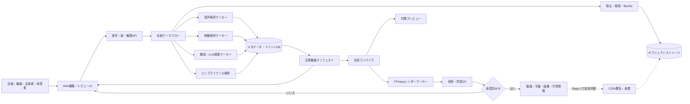
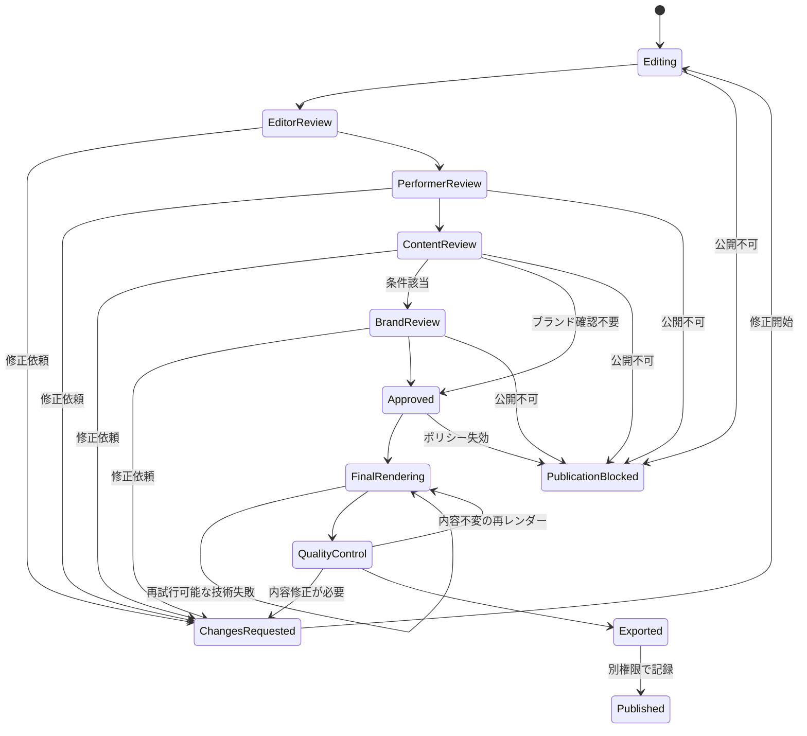

# Hubらじお マルチフォーマット動画自動編集ソフトウェア 実現方式調査

**対象文書:** `docs/requirement-definition.md` 版 0.1 Draft  
**調査日:** 2026年8月26日  
**調査範囲:** 既成の動画編集アプリケーションを利用せず、ライブラリ、SDK、API、機械学習モデル、および必要な独自実装を組み合わせて要求を実現する方法  
**費用条件:** 上限を置かず、技術的実現性を優先  

---

## 1. 結論

本要求は**技術的に実現可能**である。ただし、単一のAIモデルや単一の動画処理SDKで実現するものではない。次の4つを独立させたシステムとして構築する必要がある。

1. **非破壊編集データ層** — 元動画を変更せず、使用区間、字幕、画角、音量、効果を構造化データとして版管理する。
2. **交換可能な解析パイプライン** — 音声認識、話者分離、シーン検出、OCR、顔・対象物追跡、トピック分割、LLM提案を個別ワーカーとして実行する。
3. **決定論的な合成計画とレンダリング層** — 承認された編集データから同じ処理グラフを再生成し、記録済みの実行条件でFFmpeg等を実行する。異なるハードウェアエンコーダー間のバイト同一性までは保証しない。
4. **人中心の統制層** — AI出力を候補として扱い、元発言への根拠、差分、公開区分、権利、レビュー、承認を強制する。

FFmpegはメディアの解析・変換・フィルタリングに必要な機能を持ち、`ffprobe` は機械可読なメタデータを返せる [S01][S02]。OpenTimelineIO（OTIO）はカット順、時間、トラック、トランジション、マーカー、外部メディア参照を表現できるが、メディア自体の格納・処理はしない [S03][S04]。したがって、Stage 0/1は**独自の正規編集マニフェスト + FFmpegレンダーコンパイラ**に限定し、OTIOは交換要件が確定した後の任意アダプターとする。

### 推奨する最初の技術構成

> **Windows 11単一PC実装の後続決定:** 本表は調査時点の汎用候補である。現在の採用判断は`docs/decisions/ADR-0002-product-scope.md`を優先し、Stage 0/1のメタデータはSQLite、UIはWinUI 3 + WebView2/React、処理は単一.NETホストと子プロセスで実装する。

| 領域 | 推奨構成 | 理由 |
| --- | --- | --- |
| Web編集画面 | TypeScript + React + Canvas/WebGL + WebCodecs | タイムライン、セーフゾーン、字幕、画角を低解像度代理動画上で即時表示する。WebCodecsはフレーム単位の低レベル処理を提供するが、コンテナの多重化・分離は別実装が必要 [S34]。 |
| 業務API | .NET / ASP.NET Core | 認証、権限、案件、版、レビュー、承認、監査の制御プレーンに使う。実装言語は交換可能。 |
| 解析ワーカー | Python | PyTorch系のASR、話者分離、映像モデル、NLPモデルのエコシステムを利用しやすい。 |
| ワークフロー | Stage 0/1はDBに永続化するジョブ表 + バックグラウンドワーカー | まず取込、解析、レンダーの再試行と再開だけを最小実装する。デプロイをまたぐ長期承認待ちや複雑な補償処理が実測で必要になった場合のみ、Temporal等を採用する [S05][S06]。 |
| 最終レンダー | FFmpegをサンドボックス実行する専用ワーカー | トリム、連結、クロップ、スケール、合成、字幕、音声処理、トランジション、エンコードを一貫して実行できる [S02]。 |
| 編集交換形式 | 独自JSONを正本 | Stage 0/1では正本と成果物出力に限定する。OTIOは交換先と必要性が確定し、対象ツールで往復試験が通った場合だけ追加する [S03][S04]。 |
| 大容量データ | S3互換オブジェクトストレージ、またはAzure Blob Storage | 元動画、代理動画、中間生成物、出力をDB外に保存する。元動画には保持・不変ポリシーを適用できる [S43]。 |
| メタデータ | Stage 0/1はPostgreSQLを既定候補 | 案件、版、承認、権利、監査は関係整合性とトランザクションを優先する。Cosmos DBは、グローバル分散、スループット、アクセスパターン、データ量から採用根拠が得られた場合の代替候補とする [S44][S45]。 |

この表は論理構成であり、各項目を最初から別サービスへ分割する指示ではない。Stage 0/1は業務API、ジョブ実行、各解析アダプターを少数のデプロイ単位にまとめ、独立スケール、障害分離、権限分離の必要性が計測できた箇所だけを分割する。

### 独自開発が必要になる中核

- 正規編集マニフェストと、そこからFFmpegフィルターグラフを生成する**合成コンパイラ**
- 音声話者、画面上の顔、資料領域、手動指定対象を融合する**インテリジェント・リフレーミングエンジン**
- 日本語の語境界、表示幅、読速、セーフゾーン、顔・資料との競合を同時に解く**字幕・テロップ配置エンジン**
- 根拠区間、文脈独立性、映像・音声品質、公開可否を統合する**短尺候補ランキングエンジン**
- AI生成物を必ず元発言・承認資料へ結び付ける**証拠グラフとポリシーエンジン**
- 同じ編集版をブラウザー代理表示と最終レンダーで一致させる**共通レイアウト仕様**

---

## 2. 調査上の事実性ルール

本書では情報を次の3種類に分ける。

| 表記 | 意味 |
| --- | --- |
| **確認済み** | 公式仕様、公式ドキュメント、査読論文、著者公式リポジトリ、公式モデルカードで確認した能力または制限 |
| **設計提案** | 確認済み要素を組み合わせた本案件向けのアーキテクチャ判断。製品の公式保証ではない |
| **PoC必須** | 日本語、社内用語、収録条件、画角、実データで精度・性能を測定するまで採否を確定できないもの |

調査中に題名と一致しない論文識別子が見つかった場合は採用せず、題名、著者、要旨、公式コードの対応が確認できた資料だけを出典一覧に残した。API、モデル、仕様、ライセンスは変更され得るため、実装開始時と各リリース時に再確認する。

論文や公開ベンチマークの結果は、その論文のデータセットと条件における結果である。本案件の日本語企業トーク動画に同じ精度が出るとはみなさない。

### 用語

| 用語 | 本書での意味 |
| --- | --- |
| `SourceSpan` | 元素材上の時刻・必要時の空間・文字起こし改訂を指す直接根拠 |
| `OriginRef` | `SourceSpan`、承認済み素材、編集部由来記録のいずれかを指す出自参照 |
| `CompositionVersion` | 人が比較・レビュー・承認する不変の編集内容版 |
| Render Manifest | 1回のレンダーを再構成する入力、設定、ツール、フォント、成果物条件の記録 |
| `DeliveryManifest` | 1つの承認版から出力された動画・字幕・画像・文書を束ねる納品一覧 |
| digest / 内容ハッシュ | 特記がなければSHA-256等で計算した内容識別値。表示名やURLを同一性判定に使わない |

---

## 3. 参照アーキテクチャ



### 3.1 制御プレーンとデータプレーン

**制御プレーン**は案件、役割、状態遷移、提案、編集版、承認、監査、ジョブを扱う。動画バイト列は通さず、オブジェクトIDと署名付き短期URLだけを扱う。

**データプレーン**は動画・音声・画像を処理する隔離ワーカー群である。入力は不正なコンテナやコーデックを含み得るため、ネットワーク出口、CPU、GPU、メモリ、ディスク、実行時間を制限する。FFmpegには継続的に脆弱性修正が公開されているため、固定した古いバイナリを無期限に使わない [S38]。

### 3.2 必須の設計原則

1. **元動画不変** — 取込後に内容ハッシュを計算し、元動画は上書きしない。保持要件がある場合はWORMを使う [S43]。
2. **非破壊編集** — カットはファイルを書き換えず、元動画の時間範囲への参照として保存する。
3. **時間を浮動小数点で持たない** — `value/rate` の有理数、または整数tickで保持する。OTIOも `RationalTime` と `TimeRange` を持つ [S03]。座標やML計算に浮動小数点を使う場合でも、保存する時刻はこの規則へ正規化する。
4. **AIは提案者** — 削除、フック、要約、クイズ、公開可否は自動確定しない。
5. **確定要素には出自を必須にする** — 公開版へ採用する字幕、要約、テロップ、フック、クイズ回答は1個以上の根拠`SourceSpan`を持つ。オープニング、ロゴ、BGM、CTA等は承認済み`Asset`または人が作成・承認した`EditorialRecord`を出自とし、架空の`SourceSpan`を付けない。未採用のAI候補は監査用`Suggestion`として隔離する。
6. **再処理単位を小さくする** — 解析段階ごとに成果物と依存関係を保存し、字幕修正でASRや映像解析を再実行しない。
7. **合成計画と実行条件を固定する** — 入力ハッシュ、設定、モデルIDと重みハッシュ、コード版、FFmpegの版・`-buildconf`・実行ファイルハッシュ・コンテナイメージdigest、フォント、テンプレート版をRender Manifestに記録する。同一条件から同一の合成グラフを作れることを保証対象とし、異なるCPU/GPU・エンコーダー間のバイト同一性は別途検証する。
8. **公開区分をデータ境界として扱う** — 表示ラベルだけでなく、保存先、AI送信先、出力先、ダウンロード権限をポリシーで分離する。

---

## 4. 正規データモデル

### 4.1 主要エンティティ

| エンティティ | 主な責務 |
| --- | --- |
| `Organization`（必要時）/ `Series` / `Project` | 組織、シリーズ、案件、公開区分、担当者、期限。単一組織で開始する場合はマルチテナント機構を作らない |
| `Asset` | 元動画、音声、画像、資料、ロゴ、BGM、代理動画、出力。内容ハッシュと権利状態を持つ |
| `MediaStream` | 映像・音声・字幕トラック、コーデック、time base、解像度、FPS、チャンネル |
| `TranscriptRevision` | ASR原文、人の修正版、作成主体、モデル実行、版 |
| `TranscriptToken` | 単語または文字、開始・終了、確度、話者、辞書修正履歴 |
| `SpeakerCluster` | 話者分離上の匿名クラスタと、利用者が確認した出演者名の対応 |
| `Shot` / `Topic` / `Detection` | ショット、意味トピック、顔、人物、資料、OCR、音声イベント、品質警告 |
| `SourceSpan` | 元素材上の時間・フレーム・空間・テキスト範囲を統一的に表す根拠 |
| `EditorialRecord` | CTA、番組名、説明文等、人が作成・承認した編集部由来要素の出自 |
| `OriginRef` | 確定要素が参照する`SourceSpan`、承認済み`Asset`、または`EditorialRecord`の判別共用体 |
| `Suggestion` | 削除候補、見どころ、フック、テロップ、クイズ、画角。理由、信頼度、根拠、警告を持つ |
| `CompositionVersion` | 編集版。トラック、クリップ、変換、字幕、音量、テンプレート参照を持つ不変スナップショット |
| `RenderProfile` | 16:9、9:16、コーデック、解像度、音量、字幕、セーフゾーン等の出力仕様 |
| `Review` / `Approval` | 対象版、担当役割、タイムコードコメント、判断、理由、日時 |
| `RightsRecord` | 素材ごとの出典、権利者、用途、地域、期間、確認者、証憑 |
| `ModelRun` | モデル、版、重みハッシュ、パラメーター、入力・出力、実行環境、確度、送信先、リージョン、送信データ区分、保持条件 |
| `AuditEvent` | 誰が、何を、どの版に対し、いつ、なぜ行ったかを追記専用で記録 |
| `DeliveryManifest` | 出力成果物の種類、媒体型、言語、内容ハッシュ、サイズ、対象版、Render Manifest参照を束ねる |

### 4.2 `SourceSpan` を追跡性の中心にする

```json
{
  "id": "span-...",
  "assetId": "source-video-...",
  "streamId": "video:0",
  "timingAuthority": "timeRange",
  "timeRange": {
    "start": { "value": 5406, "rate": 30 },
    "duration": { "value": 3780, "rate": 30 }
  },
  "frameRange": { "start": 5406, "endExclusive": 9186 },
  "transcriptRevisionId": "transcript-revision-...",
  "transcriptTokenIds": ["tok-..."],
  "spatialRegionIds": ["face-track-..."],
  "sourceDigest": "sha256:..."
}
```

上記は30 fps CFR素材の整合する例である。`timeRange`を正本とし、`frameRange`はCFRで一意に対応できる場合だけ補助情報として持つ。VFRでは`frameRange`を省略でき、フレーム表示が必要な場合は元PTS表から導出する。文字起こしの根拠には`transcriptRevisionId`を必須とし、改訂後の同名・同位置トークンとの混同を防ぐ。

**設計提案:** 生成された字幕、要約、テロップ、フック、クイズ回答、短尺クリップは、必ず1個以上の `SourceSpan` を参照する。ブランド素材や編集部文言は`Asset`または`EditorialRecord`を参照する。各出力要素には1個以上の`OriginRef`を要求し、出力タイムラインの時刻から元動画または編集素材へ逆引きする`TimelineMap`を版ごとに生成する。C2PA 2.4も時間・フレーム・空間・トラックの範囲、編集アクション、素材関係を表現できる [S42]。本設計では内部モデルから公開可能な範囲だけを来歴へ変換する。

### 4.3 正規編集マニフェスト

正本は独自JSON Schemaで定義する。最低限、次を持つ。

- `schemaVersion`, `compositionId`, `parentVersionId`
- 入力アセットと内容ハッシュ
- 映像・音声・字幕・グラフィックのトラック
- 各クリップの `sourceSpanId`, 出力範囲、速度、クロップ、位置、拡大率
- トランジション、音量エンベロープ、BGMダッキング
- テンプレート、フォント、ロゴ、色、セーフゾーンの版
- AI提案ID、人による修正イベント、承認スナップショット
- レンダー用ツール・モデル・設定の版、実行ファイルまたはイメージのdigest

Stage 0/1ではこの独自JSONだけを正本とし、外部交換はレンダー済み動画、字幕、`DeliveryManifest`、使用区間一覧で行う。OTIOは編集プロジェクト交換が正式要件になり、対象ツールで往復試験が通った後の任意アダプターとする。OTIOはカット、時間、トラック、トランジション、マーカー等を表現するが、すべての映像・音声効果を保持できるわけではない [S03][S04]。

#### OTIO交換ポリシー

OTIO本体が持つ機能と、各アダプターが読み書きできる機能は同一ではない。公式Feature Matrixでも、トランジションの対応は形式ごとに異なり、一般的な映像・音声エフェクトはOTIO列で非対応とされている [S04]。本設計では、FR-016の全効果をOTIO往復で保存できるとは仮定しない。

| 編集要素 | 正規編集マニフェスト | OTIO交換時の扱い |
| --- | --- | --- |
| カット、クリップ順、時間範囲、トラック | 完全保持 | OTIOの基本編集情報として交換する。ただし出力先アダプターの対応を事前検査する |
| クロスフェード等のトランジション | 種類、時間、曲線、パラメーターを完全保持 | 対応アダプターでは`Transition`へ変換し、非対応時はsidecarと警告を出す |
| フェード、ワイプ、スライド | 種類とパラメーターを完全保持 | 一般エフェクトとしての可逆往復を保証せず、sidecarまたは事前レンダーで渡す |
| 拡大・縮小、パン、クロップ経路 | キーフレームを完全保持 | OTIOだけへ依存せず、sidecarまたは焼き込み代理動画を添付する |
| タイトルカード、字幕、テロップ、アニメーション | テキスト、レイアウト、素材、時刻を完全保持 | 交換先が明示対応しない限りsidecarまたは焼き込みで渡す |
| 音量エンベロープ、BGMダッキング、音声補正 | パラメーターと順序を完全保持 | OTIOでの完全往復を保証せず、音声stemとsidecarを渡す |

インポート時は「表現されていない効果」を削除扱いにしない。交換前後で正規マニフェストの対応要素を比較し、欠落・近似変換を利用者へ表示する。最終レンダーは常に正規編集マニフェストから生成し、OTIOから直接生成しない。

### 4.4 成果物キャッシュ

各解析成果物のキーを、区切りなし文字列連結ではなく正規化済み構造のハッシュとして作る。

$$
K = \operatorname{SHA256}(\operatorname{CanonicalJSON}(N, D_i, V_s, D_m, C))
$$

- $D_i$: 当該ステージが実際に読む全入力成果物の内容ハッシュ集合。元アセットだけでなく、文字起こし改訂、用語辞書、検出結果、テンプレート、フォント等を含む
- $N$: ステージ名
- $V_s$: ステージ実装版
- $D_m$: モデルまたは重みのハッシュ
- $C$: 正規化済み設定JSON

例えばトピック分割は、元動画ハッシュだけでなく採用中の`TranscriptRevision`と辞書のハッシュを入力にする。字幕修正、辞書変更、上流バグ修正で入力ハッシュが変われば、旧成果物は監査用に残したまま`stale`と表示し、新キーで再計算する。自動的に既存の採用・承認を上書きせず、利用者が差分を確認して新しい版へ採用する。

---

## 5. 処理機構

### 5.1 取込、検疫、代理動画

1. 認証済み利用者へ期限付きアップロードURLを発行する。
2. 拡張子だけでなく、ファイル署名、コンテナ、ストリームを検査する。HTTP `Content-Type` は信頼しない [S39]。
3. `ffprobe` のJSON出力で、形式、各ストリーム、時間、解像度、フレームレート、音声有無、タグ、timecode、エラーを取得する [S01]。
4. 隔離ワーカーでデコード検査を行い、破損、極端な解像度、欠損音声、非単調タイムスタンプ等を警告する。
5. SHA-256等の内容ハッシュ、登録者、登録日時、検査結果を保存し、元ファイルを不変領域へ移動する。
6. 編集UI向けに、低解像度・短GOP・波形・サムネイルスプライトを生成する。
7. 元動画と代理動画間のPTS対応表を保存する。

#### 可変フレームレート（VFR）

**設計提案:** 元素材の時刻軸は、公称FPSから計算したフレーム番号ではなく、各ストリームのtime baseと実際のPTSを正本にする。`ffprobe`はフレーム単位情報を機械可読形式で取得できるため、取込時にPTS、duration、key frame、decode/presentation順を検査する [S01]。

- 解析・UI用代理動画をCFRへ変換する場合も、各代理フレームから元ストリームのPTS範囲へ戻れる`ProxyFrameMap`を保存する。
- ASR、ショット、顔、OCR等の解析結果は、代理フレーム番号ではなく元素材の時間範囲へ正規化して保存する。
- `frameNumber / nominalFps`で元時刻を復元しない。VFRではこの計算がドリフトを生むためである。
- 最終レンダーでは、出力プロファイルごとにCFR/VFR、重複・間引き、音声同期方針を明示し、開始・終了・全カット境界で元PTSとのずれをQCする。
- PTS欠損・逆行等で安全に写像できない素材は自動修復して黙って進めず、隔離するか、修復済み中間素材と元素材の時刻写像を新しい版として作る。元素材自体は変更しない。

**PoC必須:** スマートフォン、画面収録、Web会議等の実VFR素材で、プロキシ往復、A/V同期、フレーム境界、字幕同期を評価する。

アップロードされたメディアはパーサー攻撃の入口になり得る。拡張子許可リスト、実型検査、ランダムな保存名、サイズ制限、Webルート外保存、マルウェア検査、サンドボックスを多層で適用する [S39]。参考URLをサーバーが取得する場合は、HTTP/HTTPSのみ、名前解決後の全IP検査、プライベート・ループバック・メタデータIP遮断、リダイレクトごとの再検査、容量・時間上限、出口FWを実装する [S46]。

### 5.2 音声認識、単語時刻、話者

#### 推奨パイプライン

1. 元音声を可逆PCMへデコードし、解析用音声と元音声の時刻対応を保持する。
2. VADで発話候補を抽出する。
3. ASRで発話テキストを得る。
4. 強制アラインメントで単語・文字時刻を補正する。
5. 話者分離で匿名話者クラスタを得る。
6. 単語時刻と話者区間を統合する。
7. 用語辞書との不一致、低確度語、固有名詞を確認候補にする。
8. 利用者が話者クラスタを正式名へ割り当てる。

Whisperは多言語音声認識・翻訳・言語識別の基盤として利用でき、コードと重みはMITライセンスで公開されている [S07][S08]。WhisperXはVAD、バッチ推論、音素強制アラインメント、pyannoteによる話者分離を組み合わせ、単語単位時刻を提供する [S09][S10]。ただしWhisperX自身が、重なり発話、話者分離、一部の辞書外記号・数値、言語別アラインメントモデルに制限があると明記している [S10]。

**PoC必須:** この能力記述は本案件の日本語精度保証ではない。Stage 0で、社内用語、固有名詞、複数話者、重なり発話、早口、雑音、遠距離マイクを層別化し、CER、WER、固有名詞誤り率、単語・文字境界の時刻絶対誤差（中央値と上位分位）を測る。モデルサイズ、VAD、言語別アラインメントモデル、セルフホスト/APIの採否は測定後に決め、評価時間数や合格値はデータ確認前に固定しない。

WhisperXの既定アラインメントモデルは言語別で、対応一覧にない言語では利用者が音素ASRモデルを選び実データで試験する必要がある [S10]。日本語モデルの有無や品質を固定前提にせず、Stage 0で使用する版の対応一覧、重み、ライセンス、文字・単語時刻精度を確認する。条件を満たさない場合は、WhisperXの時刻を採用せず、発話単位時刻と手動字幕調整でStage 1を成立させる。

pyannote.audioはVAD、話者変化、重なり発話、話者埋め込み等を構成できる [S11]。`speaker-diarization-community-1` はローカル実行可能だが、モデル利用条件への同意が必要で、出力は本人名ではなく話者クラスタである [S12]。

クラウド代替としてAzure Speechの高速・バッチ文字起こしは、構成により単語時刻と話者ラベルを返す。公式文書は候補言語、話者分離、最大話者数を明示し、バッチ話者分離ではモノラル音声を使う等の条件を示している [S13]。よって実装は `TranscriptionProvider` インターフェースでセルフホストとAPIを交換可能にする。

#### 用語辞書

- ASRへ語句ヒントを渡せるプロバイダーでは人名、製品名、略語を投入する。
- ASR後は、読み、文字類似度、周辺文脈、認識確度から**修正候補**を作る。
- 原文、候補、適用者、自動・手動区分を保持する。
- 自動置換は、完全一致ルール等の決定論的かつ承認済みルールに限定する。
- 日本語ではWERだけでなくCER、固有名詞誤り率を測る。

#### 不要区間

- 無音: VADとFFmpeg `silencedetect` の候補を統合する [S02]。
- 言い直し・反復: 近接発話の文字・埋め込み類似度、言い直し表現、構文未完了を特徴量にする。
- 咳・雑音: 音響イベント分類を候補生成にだけ使う。
- 編集指示: 「ここはカット」等の辞書・分類器で検出する。
- 脱線: トピック類似度低下を使うが、意味変更リスクが高いため自動削除しない。

### 5.3 ショット、顔、資料、対象追跡

#### ショット境界

- 第1段階はPySceneDetectのContent/Adaptive/Histogram等で高速に候補を得る [S15]。
- 急な照明変化やフェードで誤検出が多い素材にはTransNet V2を比較候補とする。同モデルはハードカットと段階的遷移を扱う学習済みコードを公開している [S14]。
- 企業トーク固有の画面共有、カメラ切替、タイトルカードを注釈した検証セットで閾値を決める。

#### 顔・人物・アクティブ話者

- MediaPipe Face Detector等で顔bboxとランドマークを検出できる [S17]。
- bboxをショット内で関連付け、顔トラックを作る。
- 音声だけの話者分離と画面上の人物は同一ではないため、TalkNetのような音声映像アクティブ話者検出を併用する [S18]。
- 手動で人物または資料領域を指定した後、SAM 2の動画マスク伝播を高度な対象追跡候補として利用できる [S19]。
- 画面外話者、重なり発話、口元が小さい、資料共有中等では自動対応を確定せず、レイアウトを固定または要確認にする。

**PoC必須:** 検出・伝播APIが存在することは、本案件で必要な追跡品質を保証しない。MediaPipe等は小顔、横顔、逆光、複数人、部分遮蔽で、TalkNet等は口元が小さい・音声が重なる条件で評価する。SAM 2等は10〜20分素材での長時間伝播、ショット跨ぎ、遮蔽後の再出現、対象の取り違え、GPUメモリと処理時間を測り、失敗時はショット単位の再初期化または手動キーフレームへフォールバックする。

#### 資料とOCR

- フレーム差分、矩形構造、OCR文字密度、縁の安定性からスライド・画面共有区間を検出する。
- OCR結果には文字、bbox、時刻、確度を保存する。
- 登録資料の各ページを画像化してOCR・画像埋め込みを作り、発話と画面を照合する。
- Azure Video Indexerを選ぶ場合、文字起こし、OCR、顔、物体、ショット、キーフレーム、トピック等を時間範囲付きJSONで取得できる [S23]。公式Transparency Noteは低品質映像、重なり話者、小さい人物・物体、OCR、非英語要約等の制限と人の監督を明記している [S24]。本設計ではこの制限を踏まえ、完成編集を委任せず解析候補を返すアダプターとしてだけ使う。

### 5.4 トピック分割

1. 発話を文単位にし、話者、時間、ショット、OCRを付ける。
2. TextTilingのような語彙凝集性ベースラインを実装する [S20]。
3. 多言語文埋め込みの隣接類似度低下、質問から回答への構造、長い間、ショット切替を特徴量に加える。
4. 候補境界をLLMへ渡し、タイトル、要約、キーワードをJSON Schemaで返させる。
5. 利用者が境界とタイトルを修正し、その差分を将来のランキング学習データにする。

LLMには全文を自由要約させるのではなく、ID付き発話列を渡し、`startTokenId`、`endTokenId`、`evidenceTokenIds` を必須出力にする。Structured Outputsを持つAPIではJSON Schemaに従う出力形を要求できる [S25][S26]。ただし、スキーマ適合は元発話との意味的一致を検証する処理ではないため、本設計では根拠span、数値、固有名詞、境界を別途検査する。

LLMが生成したトピック名・要約・キーワードは、`Suggestion(origin=AI, reviewRequired=true)`として監査用に保存するが、その保存を人の採用と同一視しない。状態を`Proposed → Reviewed/Rejected → Adopted`とし、利用者が採用または修正するまで`CompositionVersion`の確定要素、承認済み情報、公開出力には入れない。

### 5.5 見どころ・短尺候補

動画要約研究では、人が付けた区間重要度を用いるTVSumのようなベンチマークがある [S21]。しかし企業トークの「公開可能で、単独で意味が通り、長尺への入口になる」価値は一般動画の視覚的重要度と一致しない。したがって、既存モデルのスコアをそのまま採用せず、本案件用の多目的ランキングを作る。

#### 候補生成

- **公開ポリシーゲート:** 公開不可span、権利未確認素材、必須レビュー未完了、根拠不足を先に判定する。外部公開へ不適合な候補は、魅力度スコアで相殺せず、外部候補のランキング対象から除外または「社内限定」と表示する。
- 文、質問回答対、トピック、ショットを壊さない開始・終了候補を列挙する。
- 冒頭の代名詞、前方参照、「先ほど」等を検出して文脈不足を推定する。
- 低音質、顔切れ、資料欠損、公開不可区間を除外または減点する。
- 近似重複候補をクラスタ化し、多様な候補を残す。

#### 本案件向けスコアの設計提案

$$
S(c)=w_1M+w_2H+w_3L+w_4Q+w_5V+w_6D-w_7C
$$

| 記号 | 内容 |
| --- | --- |
| $M$ | 単独で意味が完結する度合い |
| $H$ | 質問、結論、意外性等のフック適合度 |
| $L$ | 具体的な学び・行動可能性 |
| $Q$ | 音声・映像品質 |
| $V$ | 顔・資料等の視覚的利用可能性 |
| $D$ | 他候補との差別化 |
| $C$ | 必要な前後文脈の量 |

この式と重みは**設計提案**であり、論文の既成式ではない。機密、権利、古い情報、意味変更は加重和へ入れず、前段のポリシーゲートと人の確認で扱う。最初は各特徴の値とルールを版管理し、採用・却下・手動境界修正を収集する。Learning-to-Rankは、十分な案件横断ラベルが集まり、動画単位で分離した未使用評価データ上で現行ルールを上回り、担当者が差分を承認した場合だけ採用する。件数や合格値は実データを確認してから決める。各候補には構成要素別スコア、選定理由、不足文脈、根拠区間、ポリシー判定を表示する。

CLIP型の視覚言語表現はキーフレームとトピック文の関連度特徴として使える [S22]。本設計では、ゼロショット分類の結果だけで重要性や公開可否を決めない。

### 5.6 長尺版

長尺版はAIに自由編集させず、要求定義の標準構成をテンプレート化する。

1. 開始余白
2. 見どころまたはタイトル
3. オープニング
4. 番組・エピソード・出演者カード
5. 採用された元動画区間
6. トピック境界カード
7. まとめ
8. CTA
9. エンディング
10. 終了余白

不要区間候補の採否を反映した後、ジャンプ量、顔位置差、音声不連続を計測する。軽微なカットは単純カット、大きな話題転換だけテンプレート化したトランジションを入れる。ジャンプカットが大きい場合は資料、承認済みBロール、拡大、別カメラ、短いクロスフェードを候補にする。

### 5.7 フック、クイズ、投稿文

#### 生成ルール

- 出演者の引用として表示できる文は、元発話の連続または明示的に承認された抜粋だけにする。
- LLMが言い換えたフックは「編集部テロップ」「ナレーション案」等として区別し、出演者の引用にしない。
- フック、要約、クイズ、ランキングのJSONには `claim`, `evidenceSpanIds`, `transformationType`, `uncertainty`, `reviewRequired` を必須にする。
- クイズ回答は元動画または承認済み資料の根拠を最低1件必要とし、複数解釈がある場合は自動で `reviewRequired=true` にする。
- 順位の根拠データがないランキングはスキーマ検証後のポリシー検証で拒否する。

JSON Schema準拠は形式を安定させる [S25][S26]。内容面では、生成後に根拠spanの語彙・数値・固有名詞との整合を決定論的に検査し、必要なら別モデルまたはGroundedness検査を補助利用する。ただしAzure AI Content SafetyのGroundedness機能は調査時点で英語最適化等の制限があるため、日本語の最終判定器にはしない [S41]。

### 5.8 16:9から9:16へのリフレーミング

AutoFlipが示す実用的な構造は、ショット分割、重要対象検出、追跡、クロップ経路平滑化、収まらない場合の余白・ぼかしへのフォールバックである [S16]。本案件ではこれを再実装・拡張し、古いサンプル実装への直接依存は避ける。

#### 入力する重要領域

- アクティブ話者の顔・上半身
- 非発話でも画面に残すべき相手
- スライド、コード、製品デモの領域
- OCRで検出した重要文字
- ロゴ・既存テロップ等の保護領域
- 利用者が指定した固定または追跡対象
- プラットフォームUIと字幕のセーフゾーン

#### クロップ経路の設計提案

最初に、FR-010で要求される単一話者、二人上下、話者+資料、資料+小窓、ぼかし背景、固定テンプレート等から、重要領域が収まるレイアウトモードを離散的に選ぶ。単一クロップで成立するモードに限り、フレーム$t$のビューポート中心を$p_t$として次を最小化する。

$$
J=\sum_t\left(
\lambda_s L_{\text{outside}}(p_t)+
\lambda_v\lVert p_t-p_{t-1}\rVert^2+
\lambda_a\lVert p_t-2p_{t-1}+p_{t-2}\rVert^2+
\lambda_z L_{\text{zoom}}(p_t)
\right)
$$

- $L_{\text{outside}}$: 重み付き重要領域がクロップ外へ出る損失
- 速度項: 不要なパンを抑える
- 加速度項: ジッターを抑える
- ズーム項: 急な倍率変化を抑える

ショット境界では経路をリセットする。二人が9:16へ同時に入らない場合は、上下分割、話者+資料、資料中央+小窓、ぼかし背景へ切り替える。どのモードでも重要領域を満たせない場合は自動確定せず、利用者がモードとキーフレームを指定する。Stage 1はこの手動フォールバックを必須機能とし、自動追尾はStage 2のPoC合格後に有効化する。

#### モデル構成

- 顔bbox: MediaPipe等 [S17]
- 発話中の顔: TalkNet等 [S18]
- 選択対象の高精度追跡: SAM 2等 [S19]
- ショット境界: PySceneDetect + 必要に応じTransNet V2 [S14][S15]

自動顔識別は不要であり、顔検出・追跡と出演者名の確認を分離する。顔認識を追加する場合は生体情報として別途法務・プライバシー審査を行う。

### 5.9 字幕と強調テロップ

#### 字幕生成手順

1. 単語・文字時刻から文候補を作る。
2. 形態素・句構造、間、話者変更、句読点から分割候補を作る。
3. フォント実測幅、行数、表示時間、読速、セーフゾーン違反を評価する。
4. 最小コストとなる改行・イベント分割を動的計画法で選ぶ。
5. 顔、資料、既存文字、UIマスクとの衝突を検出し、位置またはレイアウトを提案する。
6. WebVTT/SRT/ASS/IMSC等へ出力し、焼き込み版は同じ内部Cueから生成する。

`SubtitleProfile`は制約を次の順序で扱う。

1. **ハード制約:** Cueが媒体時間内にある、発話より許容値を超えて先行しない、文字が画面外へ出ない、禁止領域へ重ならない、空文字や逆転時刻を持たない。
2. **ソフト制約:** 意味単位の改行、読速、行数、顔・資料との距離、表示の安定性。重みと許容値はプロファイルで版管理する。
3. **解なし:** ハード制約を黙って緩和せず、Cueを要手動調整にして忠実プレビューへ移動できるようにする。

WebVTTは開始・終了・本文・位置等を持つCueとして字幕、キャプション、チャプター、時刻同期メタデータを表現できる [S31]。一方、VTT Region等にはブラウザー差があるため、編集プレビューのブランド字幕は独自Canvas/SVGオーバーレイで描画し、WebVTTは交換・アクセシビリティトラックにも使う [S31]。

字幕規則は固定値にせず、`SubtitleProfile` として版管理する。例えばNetflixの日本語ガイドでも通常字幕とSDHで文字数・読速が異なり、最大2行、位置回避等の詳細な規則がある [S33]。これはNetflix納品規則の例であり、本アプリ全体の普遍的基準ではない。Hubらじお、YouTube、社内配信等のプロファイルを関係者と定義する。

WCAGの録画済みキャプション解説は、会話だけでなく話者識別と意味のある非発話音も含む同期テキストを求めている [S32]。全文字幕とSDHを別プロファイルにする。

#### 強調テロップ

- LLMまたは抽出器が、結論、数値、製品名、注意、質問回答を候補化する。
- 表示文は元発話の部分文字列、または「要約」と明示した根拠付き文に限定する。
- 画面ごとの総文字面積、同時Cue数、顔・資料との重なりに上限を持たせる。
- 発話開始前に答えを露出しないポリシーをタイムライン検証器で検査する。

### 5.10 音声補正、BGM、効果音

音声は次の順で処理し、各段階を有効・無効にできるようにする。

1. DC・チャンネル・位相・クリップ検査
2. 必要時のみノイズ・ハム低減
3. 発話区間ごとのゲイン・ダイナミクス調整
4. BGMサイドチェーンまたは音量エンベロープ
5. 最終ラウドネス・True Peak検査

ITU-R BS.1770-5は番組ラウドネスとTrue Peakの測定アルゴリズムを規定する [S27]。EBU R128はBS.1770系測定を用いた運用推奨であり、平均番組ラウドネス等を示す [S28]。配信先ごとの目標は `AudioDeliveryProfile` に設定し、EBU値を全出力へ無条件適用しない。

RNNoiseはDSPとニューラルネットを組み合わせたリアルタイム音声強調の研究例である [S29]。DeepFilterNetは48 kHzフルバンド音声強調のコード・モデルを公開している [S30]。いずれも声色や語尾を損なう可能性があるため、補正前後のA/B試聴、適用量、元音声参照、無効化を必須にする。

BGM・効果音は `RightsRecord.status=approved` の素材だけをレンダーコンパイラが参照できるようにする。LLMがURLや音源を任意取得する設計にはしない。

### 5.11 サムネイル

1. ショットごとのキーフレームを抽出する。
2. ブレ、黒フレーム、露出、顔サイズ、目・口の状態、テキスト余白を評価する。
3. トピック・タイトルとの視覚言語類似度を補助特徴にする [S22]。
4. 同じ表情・構図の近似重複を除く。
5. ブランドテンプレートへ配置し、顔・文字・ロゴの衝突を検査する。
6. 複数案を人が選ぶ。

「目を閉じていない」等は顔ランドマークの幾何ヒューリスティックと小規模分類器を比較し、Hubらじおの実フレームで評価する。スコアだけで最終選択しない。

### 5.12 プレビューと最終レンダー

#### プレビュー

- 代理動画をブラウザーで再生し、共通レイアウト仕様からCanvas/SVGへ字幕、テロップ、クロップ、UIマスクを描く。
- WebCodecsは低レベルのフレーム処理に使えるが、ファイルのdemux/muxは提供しない [S34]。通常再生は`HTMLVideoElement`/MSEを使い、精密フレーム処理が必要な箇所だけWebCodecsを使う。
- 低解像度区間レンダーをバックエンドで生成する「忠実プレビュー」も用意する。
- Canvas/SVG表示、忠実プレビュー、焼き込みレンダーは同じ内部Cueとレイアウト値を読む。WebVTTのブラウザー描画を焼き込み版の正本にせず、差がある場合は忠実プレビューを承認対象にする。

#### 最終レンダー

1. 正規編集マニフェストを検証する。
2. 参照アセット、フォント、テンプレート、権利、承認、公開区分を解決し、同期のポリシー検査を通す。
3. フィルターグラフを中間表現へコンパイルする。
4. FFmpeg引数配列を生成する。利用者文字列をシェル文字列へ連結しない。
5. CPU/GPU、メモリ、ディスク、時間、ネットワークを制限したワーカーで実行する。
6. コマンド、ビルド情報、ログ、進捗、終了コード、成果物ハッシュを保存する。
7. QC後にだけ最終成果物へ昇格する。

FFmpegのフィルター群でトリム、連結、スケール、クロップ、オーバーレイ、字幕、無音検出、フェード等を構成できる [S02]。FFmpegのライセンスは基本LGPL 2.1-or-laterだが、GPL部品を有効化すると全体へGPLが適用されるため、ビルド設定と外部コーデックを法務確認する [S48]。

本書でいう再現性は、同じRender Manifestから同じ合成グラフと引数列を再構成できることを指す。ソフトウェアエンコードではデコード後フレームと音声の一致試験を行う。GPUエンコーダー、CPU命令、ドライバー、ライブラリ差によるバイト差はあり得るため、内容ハッシュの一致を全環境へ約束しない。許容差と採用ハードウェアはStage 0の比較結果を基にRender Profileごとに決定する。

#### 出力プロファイルと`DeliveryManifest`

要求上の成果物を「作れる」とだけ記述せず、次のプロファイルを正規編集マニフェストから生成できるようにする。

| 出力 | 初期の扱い |
| --- | --- |
| 社内向け16:9長尺 / YouTube向け16:9 | Stage 1で対応 |
| 9:16短尺 | Stage 1は手動レイアウトを含めて対応。自動追尾はStage 2 |
| 16:9横長短尺 | Stage 1で短尺Compositionに16:9 Render Profileを適用 |
| LinkedIn / Viva Engage向け告知版 | 配信先固有の時間・セーフゾーン要件が確定するまでは、汎用告知Render Profileと投稿文案で対応 |
| クイズ9:16 | Stage 2。Stage 1では手動テンプレート組立を許可 |

`DeliveryManifest`は少なくとも`projectId`、`compositionVersionId`、`renderManifestId`、`profileId`と、成果物ごとの`type`、`mediaType`、`language`、`byteSize`、`sha256`、保存先参照を持つ。動画、字幕、文字起こし、サムネイル、チャプター、投稿文、編集指示、レビュー記録、使用区間一覧を同じ対象版へ結び付ける。コーデック、解像度、字幕形式等は配信先要件を確認したRender Profileで決め、未確認の固定値を本書では捏造しない。

### 5.13 QCと来歴

#### 技術QC

- コンテナ、コーデック、解像度、縦横比、FPS、色空間、音声ストリーム
- 期待時間と実時間、無音、黒・静止フレーム、デコードエラー
- 字幕範囲、オーバーフロー、セーフゾーン、重複Cue
- 音量、True Peak、クリッピング、左右バランス
- A/V同期、元区間マッピング、欠落アセット
- 代理レンダーと最終レンダーの構図差
- 再エンコード品質の相対比較。VMAFは参照映像との知覚品質評価手段の一つで、FFmpeg連携も提供される [S35]

#### 内容QC

- すべての生成文に根拠があるか
- 引用と要約が区別されているか
- 公開不可spanや未承認素材を含まないか
- 肩書・製品名・日付・数値が確認済みか
- クイズ・ランキングの根拠が一意か
- 字幕・テロップが意味を先取りまたは変更していないか

#### C2PA

C2PAはBR-005と追跡性を補強する**Stage 3の任意機能**であり、Stage 1の出力条件ではない。採用しない場合も、内部の`ModelRun`、`OriginRef`、`AuditEvent`、`DeliveryManifest`で要求を満たす。

C2PA 2.4は署名されたManifest、編集アクション、素材（ingredient）、時間・空間範囲、ハードバインディング、AI開示を定義し、MP4/MOV等へ埋め込み可能である [S42]。最終出力に、元素材、トリム、クロップ、追加テキスト、音声強調、トランスコード、AI利用、人の確認状態を記録できる。

ただしC2PAは**内容が真実であることを保証するものではない**。署名者、来歴データ、改ざん有無を評価するための信頼シグナルである [S42]。内部監査DBとC2PAの両方を持ち、C2PA SDKは調査時点で0.x系のため、安定版リリースに固定し互換試験を行う [S42A]。

C2PA Manifestは埋め込みまたは外部保存され、Manifest Consumerが来歴情報を取得・提示できる。仕様も、作成者・公開者が含める来歴データを制御できるようにすることを推奨している [S42]。したがって、内部監査情報をそのまま公開Manifestへ複製しない。

**設計提案:** 公開区分と配布先ごとに`C2paDisclosureProfile`を版管理し、署名前にポリシー評価する。外部配布用は、公開して安全な編集アクション、AI開示、匿名化または公開可能な素材関係だけを許可し、内部オブジェクトURL、案件ID、文字起こし、個人情報、秘密情報、非公開素材名、不要な元時刻・空間範囲を含めない。社内用は、認可された利用者だけが取得できる外部Manifestまたは最小限の埋め込みManifestを選べるようにする。生成後はManifestをダンプして機密データ検査を行い、C2PA署名済みであることを秘匿化とみなさない。

公開署名を有効化する前に、署名主体、鍵の保管、ローテーション、失効、タイムスタンプ、鍵アクセス監査、対象公開先でのConsumer互換性を決定して試験する。これらが未決ならC2PA出力を無効のままにする。C2PAは閲覧者向け来歴であり、内部監査DBや不変証拠の代替にはしない。

---

## 6. 独自コンポーネント境界

| コンポーネント | 提供API | 実装上の要点 |
| --- | --- | --- |
| `media-contracts` | JSON Schema / protobuf | 時間、span、検出、提案、編集、レンダー、監査の言語中立契約 |
| `timeline-core` | `compose`, `mapToSource`, `diff`, `validate` | 有理時間、非破壊編集、出力↔元動画の双方向写像 |
| `analysis-adapters` | ASR、話者、ショット、OCR、顔、LLM共通I/F | プロバイダー固有JSONを正規モデルへ変換し、モデル版と確度を保持 |
| `highlight-engine` | `generateCandidates`, `rank`, `explain` | 多目的特徴、公開ポリシー、文脈不足、採否学習 |
| `reframe-engine` | `solveViewport`, `solveLayout` | 重要領域、アクティブ話者、経路平滑化、手動キーフレーム、フォールバック |
| `subtitle-layout` | `segment`, `layout`, `validate` | 言語別分割、実測幅、読速、衝突、Cue形式変換 |
| `composition-compiler` | `compilePreview`, `compileRender` | 正規編集IRをブラウザー描画命令とFFmpegグラフへ変換 |
| `policy-engine` | `evaluate(action, context)` | 公開区分、権利、承認、AI送信、出力先、ダウンロードを強制 |
| `provenance-service` | `hash`, `sign`, `verify`, `emitC2PA` | 内容ハッシュ、版、監査、C2PA変換、鍵管理 |

外部モデルやAPIが変更されても、この境界より内側の案件・編集・レビュー形式を変えないことが重要である。

上表は論理モジュール境界であり、マイクロサービス一覧ではない。Stage 0/1は同一リポジトリ・少数プロセスで実装し、Provider抽象も二つ目の実装を実際に導入する箇所だけに置く。

---

## 7. レビューと承認の状態機械



### 強制規則

- 承認は`CompositionVersion`の内容ハッシュに対して行う。
- 承認済み版を変更せず、変更時は子版を作り承認を失効させる。
- `ChangesRequested`と`PublicationBlocked`は監査可能な永続状態とし、理由、担当者、対象版を記録する。
- コメントは出力時刻と元動画spanの両方を持つ。
- 公開区分、権利、必須レビューが満たされない版には最終レンダージョブを発行しない。
- QCのデコード失敗等、内容を変えない再実行は同じ承認版で許可する。カット、字幕、音声、レイアウト等を変える修正は必ず子版を作り、レビューをやり直す。
- PII・機密候補は`ContentReview`でコンテンツ責任者または情報管理担当が個別に解消する。別の固定ロールやレビュー段階は、運用要件が決まるまで追加しない。
- AI、管理者、レンダーワーカーに「承認者」権限を与えない。
- 公開操作は最終出力とは別イベントにし、初期リリースでは自動公開しない。

Temporal型ワークフローでは、外部処理をActivityに分離し、イベント履歴から状態を復元する。ハートビートで長時間処理の進捗・中断を検出し、Signal/Updateで人の承認を待機できる [S05][S06]。レンダー等の副作用Activityは、`renderJobId` と成果物キーで冪等にする。

---

## 8. セキュリティ、プライバシー、コンプライアンス

| 脅威 | 必須対策 | 根拠 |
| --- | --- | --- |
| 悪意ある動画・画像・文書 | 型・署名・容量検査、マルウェア検査、隔離、非root、読み取り専用入力、リソース制限、最新パッチ | [S38][S39] |
| 古いFFmpeg・依存ライブラリ | 版、`-buildconf`、実行ファイルハッシュ、イメージdigest、SBOMを記録。公式Security情報と脆弱性DBを監視し、影響評価、再ビルド、回帰試験、段階展開を行う。既存成果物の再レンダー要否は脆弱性と公開範囲に基づき判断 | [S38] |
| 任意URLによるSSRF | URL取得専用サービス、許可scheme、DNS/IP再検査、リダイレクト無効または再検査、内部IP遮断、出口FW | [S46] |
| FFmpegコマンド注入 | シェルを使わず実行ファイルと引数を分離し、型付きIR、許可値、`--`相当のオプション終端を使う。任意コマンド・任意フィルターを許可しない | [S49] |
| 文書・文字起こし経由のPrompt Injection | 入力を命令ではなくデータとして区切る、ツール権限を与えない、Structured Output、出力検証 | [S36][S37] |
| LLMの誤情報 | 根拠span必須、引用保全、数値・固有名詞照合、二次検査、人の承認 | [S24][S36][S41] |
| 個人情報・機密・秘密情報 | 文字起こしPII、OCR、正規表現・秘密形式、社内辞書、画面bboxを統合し候補化。最終判断は人 | [S40][S47] |
| AIサービスへの過剰送信 | `ModelRun`へ送信先、リージョン、入力アセット、送信データ区分、事前マスキング、保持条件、要求・応答digestを記録。案件の公開区分で許可されたProviderだけへ送信 | 要求定義 NFR-004 |
| 権限越境 | テナント・案件・公開区分を全クエリ、オブジェクトパス、ジョブ、出力先へ伝播。短期署名URL | 要求定義 NFR-004 |
| モデル・依存関係の供給網 | SBOM、モデルカード、重みハッシュ、ライセンス、取得元、脆弱性、署名を記録 | [S36][S37] |
| 監査改ざん | 追記専用イベント、ハッシュ連鎖、WORM保管、別権限、C2PA最終署名 | [S42][S43] |
| C2PA経由の情報漏えい | 公開区分別の開示プロファイル、field allowlist、匿名化、署名前の機密検査。埋め込み・外部Manifestの取得権限を配布先と一致させる | [S42] |
| C2PA署名鍵の漏えい・失効 | 公開署名を採用する場合だけ、HSM等で鍵を分離し、ローテーション、失効、タイムスタンプ、アクセス監査、Consumer互換性を運用開始条件にする | [S42] |
| 未確認素材の公開 | `RightsRecord`とポリシーゲート。外部出力時に警告し、権利確認完了または権限を持つ担当者が根拠付き例外を記録するまで出力を保留 | 要求定義 BR-004 |

PresidioはテキストのPII検出・匿名化と、OCRを使った画像内PIIのマスキングを提供するが、公式文書も全件検出を保証しないと警告している [S47]。Azure Language PIIもテキスト、会話、文書向けにカテゴリ・確度・マスキング結果を返す選択肢である [S40]。どちらも「候補検出器」として扱う。

NIST AI RMFのGovern、Map、Measure、Manageに沿い、モデルごとに用途、対象外用途、評価データ、失敗モード、監視、責任者を登録する [S36]。LLM部分はOWASPのPrompt Injection、Sensitive Information Disclosure、Improper Output Handling、Excessive Agency、Misinformation、Unbounded Consumption等を脅威モデルへ含める [S37]。

---

## 9. ストレージと展開方式

### 9.1 ベンダー非依存構成

| 種別 | 構成 |
| --- | --- |
| オブジェクト | S3互換ストレージ。`original/`, `proxy/`, `analysis/`, `render/`, `delivery/`, `evidence/` を分離 |
| メタデータ | PostgreSQL。案件集約、イベント、レビュー、権利をトランザクションで保存。マルチテナント要件が確定した場合だけ行レベル分離を追加 |
| ワークフロー | Stage 0/1はDB永続ジョブ + バックグラウンドワーカー。複雑な長期待機が必要になった場合のみTemporal等へ移行 |
| キュー | Stage 0/1はジョブ種別と状態をDBで管理。独立スケールが必要な種別だけメッセージブローカーへ分離 |
| 計算 | Stage 0/1は隔離コンテナまたは専用VM。複数GPUノード、オートスケール、障害分離が必要になった場合のみKubernetes等を採用 |
| 検索 | PostgreSQL全文・ベクトル、または専用検索インデックス。正本にはしない |

### 9.2 Azureを採用する場合の対応例

| 論理機能 | Azure候補 |
| --- | --- |
| 認証・グループ | Microsoft Entra ID |
| 元動画・中間・出力 | Azure Blob Storage。保持期間が決まるまでは版管理・削除保護を使い、WORMは法務・情報管理が対象と期間を承認したデータだけに適用 [S43] |
| 案件・イベント・監査メタデータ | 既定はAzure Database for PostgreSQL等。Cosmos DB for NoSQLはアクセスパターンと規模から適合すると確認した場合の候補 |
| ジョブ通知 | Stage 0/1はDB永続ジョブ。独立ワーカーの負荷分離が必要になった場合はAzure Service Bus等を検討 |
| CPU/GPUワーカー | 専用VMまたは要件に合うコンテナ実行基盤。AKSは複数ノード運用の必要性が確認できた場合だけ検討 |
| 文字起こし | Azure Speechアダプター [S13] |
| 統合映像解析 | Azure Video Indexerアダプター [S23][S24] |
| LLM | JSON Schema Structured Outputs対応モデル [S26] |
| PII | Azure Language PII [S40] |
| 鍵 | Key Vault / Managed HSM |
| 監視 | Azure Monitor / Application Insights |

#### Cosmos DBを選ぶ場合の判断

Cosmos DBは本案件の既定ではない。採用前に、項目サイズ、年間案件数、読み書き頻度、頻出クエリ、同時更新する業務集約、リージョン要件、RU見積りを実データで確認する。メディア本体はBlobに置き、Cosmos DBには小さいメタデータだけを保存する。

- 単一組織・案件単位アクセスが中心なら、まず`/projectId`を候補にする。
- HPKは、マルチテナントが正式要件であり、先頭キーのカーディナリティ、プレフィックスクエリ、20 GB超の可能性から必要性が確認できた場合だけ検討する [S44]。
- Transactional Batchの範囲は完全な論理パーティションキーである。案件状態、版、承認を原子的に更新する必要があるなら、その項目が同じ完全キーへ入る設計をPoCで確認する [S45]。
- パーティションキーは後から簡単に変更できないため、代表クエリと障害復旧を試験してからコンテナを確定する。

Cosmos DBの階層パーティションは最大3段で、先頭から高カーディナリティと均等な負荷が重要である。プレフィックスを含むクエリは対象パーティションへ絞れる [S44]。Transactional Batchは同じ論理パーティションキー内に限定される [S45]。したがって、パーティションキーは「検索」だけでなく「同時に確定すべき業務集約」から設計する。

---

## 10. 機能要求への対応

### FR-001〜FR-008

| 要求 | 実現機構 | 主な検証 |
| --- | --- | --- |
| FR-001 動画取り込み | Upload Gateway、型・署名検査、`ffprobe`、隔離デコード、内容ハッシュ、代理動画 | 破損、音声なし、低解像度、VFR、複数音声、巨大ファイル |
| FR-002 文字起こし | ASR Provider + VAD + 強制アラインメント + `TranscriptRevision` | WER/CER、単語時刻、低確度表示、人修正反映 |
| FR-003 話者識別 | pyannote/Azure Speech等のクラスタ + 人による出演者割当 | DER、重なり発話、話者数、表示形式 |
| FR-004 用語辞書 | 案件・シリーズ辞書、語句ヒント、読み・類似度・文脈による候補、修正監査 | 人名・製品名誤り率、自動修正の可視化 |
| FR-005 不要区間検出 | VAD、無音、音響イベント、反復・言い直し、編集指示、トピック逸脱の候補 | 誤削除を防ぐため自動確定不可 |
| FR-006 トピック分割 | TextTiling + 埋め込み + Q&A + ショット + 根拠付きLLMタイトル | 境界F1、人の境界修正量、要約根拠 |
| FR-007 見どころ候補 | 多目的候補生成・ランキング、理由・不足文脈・公開リスク表示 | Precision@K、採用率、境界修正率、意味変更率 |
| FR-008 長尺版生成 | テンプレート + 正規編集マニフェスト + 合成コンパイラ | 構成要素ON/OFF、元区間、差分、再現性 |

### FR-009〜FR-016

| 要求 | 実現機構 | 主な検証 |
| --- | --- | --- |
| FR-009 YouTube横長版 | 16:9 Render Profile、チャプター、話者名、資料、CTA、サムネイル | セーフゾーン、エンドカード余白、字幕衝突 |
| FR-010 縦型ショート版 | Reframe Engine、顔・話者・資料追跡、分割・小窓・ぼかしレイアウト | 主要対象カバー率、手動修正率、経路ジッター |
| FR-011 フック生成 | 根拠span付き抽出・言換え、引用/編集文ラベル、意味整合検査 | 元発言にない断定、先出し、文脈欠落を拒否 |
| FR-012 字幕生成 | 単語時刻、言語別分割、実測幅、読速、WebVTT/SRT/ASS/IMSC、焼込切替 | 同期、行数、オーバーフロー、人修正反映 |
| FR-013 強調テロップ | 結論・数値・固有名詞抽出、総文字量制限、根拠span | 過剰表示、要約誤り、字幕との競合 |
| FR-014 テロップのタイミング | Cue制約、Protected Region、UIマスク、キーフレーム編集 | 音声先行、残留、顔・資料・UI重なり |
| FR-015 オープニング | 版管理された長尺・短尺テンプレート、公開区分カード | 短尺の本題到達時間、必須素材・権利 |
| FR-016 シーンチェンジ | トピック・ショット境界、階層別Transition Policy、FFmpeg合成 | 軽微カットへの過剰効果、シリーズ一貫性 |

### FR-017〜FR-024

| 要求 | 実現機構 | 主な検証 |
| --- | --- | --- |
| FR-017 ジャンプカット緩和 | 顔姿勢差・画面差検出、資料/Bロール/拡大/別カメラ候補 | 未実在映像を事実映像として生成しない |
| FR-018 資料・画像差し込み | 資料ページOCR・埋め込み、発話対応、レイアウト・出典・公開ポリシー | 外部不可資料の混入拒否、ページ根拠 |
| FR-019 BGMと効果音 | RightsRecord、場所別Audio Cue、サイドチェーン、音量エンベロープ | 権利未確認素材拒否、会話明瞭度 |
| FR-020 音声補正 | チャンネル・ノイズ・ハム・ラウドネス・True Peak処理、A/B | 音質劣化、音割れ、目標プロファイル |
| FR-021 サムネイル候補 | キーフレーム、ブレ・顔状態・余白・内容関連度、ブランド合成 | 誤解表現、顔品質、縮小可読性 |
| FR-022 クイズ・パズル | 問い・選択肢・答え・解説の構造化生成、根拠必須、曖昧性フラグ | 根拠へ移動、複数解釈、待ち時間編集 |
| FR-023 高関心型短尺 | 構成テンプレート + 根拠制約 + ランキング根拠ポリシー | 根拠なし順位・誇張・意味変更を拒否 |
| FR-024 CTA | 配信先別CTAテンプレート、1つに制限可能なPolicy | リンク権限、社内・外部切替 |

### FR-025〜FR-032

| 要求 | 実現機構 | 主な検証 |
| --- | --- | --- |
| FR-025 投稿付帯情報 | 根拠付きLLM、チャプターはTopic時刻、編集・公開チェックリスト | 人修正、リンク、固有名詞、公開範囲 |
| FR-026 プレビュー | 代理動画 + 共通レイアウト + UIマスク + 区間忠実レンダー | 横/縦、字幕有無、モバイル、音声のみ、タイムライン移動 |
| FR-027 編集指示 | 自然文を型付きEdit Operationへ変換し、スキーマ・権限・差分確認後に適用 | 適用前後diff、曖昧指示の確認、Undo |
| FR-028 複数案比較 | 同一親版から分岐したCompositionVersionと特徴サマリー | 区間、時間、フック、字幕、効果、CTA、警告比較 |
| FR-029 レビューと承認 | 不変版への状態機械、役割、タイムコードコメント、ポリシーゲート | 無権限承認、承認失効、必須レビュー |
| FR-030 バージョン管理 | 不変スナップショット + 親版 + 追記イベント + 内容ハッシュ | 差分、復元、出力・承認との対応 |
| FR-031 出力 | Render Profile、合成コンパイラ、字幕・画像・JSON/CSV生成 | 全成果物のハッシュ、版、承認、再現条件 |
| FR-032 元動画との追跡性 | SourceSpan、TimelineMap、根拠グラフ、C2PA ingredient/action | 任意出力時刻から元区間へ双方向移動 |

### 非機能・ブランド要求

| 要求 | 設計対応 |
| --- | --- |
| NFR-001 操作性 | 文字起こし編集とタイムラインを同じOperationへ変換、即時代理プレビュー、提案理由・確度・根拠を表示 |
| NFR-002 性能 | ステージDAG、内容アドレスキャッシュ、区間再処理、代理と最終レンダー分離、CPU/GPUキュー |
| NFR-003 信頼性 | 永続ワークフロー、ハートビート、冪等Activity、元動画不変、Render Manifest、失敗ログ |
| NFR-004 セキュリティ | Entra等のID、RBAC/ABAC、公開区分伝播、隔離ワーカー、暗号化、短期URL、監査 |
| NFR-005 アクセシビリティ | 字幕/SDH、コントラスト自動検査、色以外の強調、キーボード操作、音声なしプレビュー |
| NFR-006 監査性 | 追記専用AuditEvent、主体・版・理由・AI/人区分。WORMとC2PAは保持・外部来歴要件が確定した場合の追加策 |
| NFR-007 拡張性 | Provider I/F、言語・カメラ・公開先・モデル・テンプレートをプラグイン化 |
| BR-001 ブランド | テンプレートを署名・版管理し、案件側は許可されたパラメーターだけ変更可能 |
| BR-002 人物・役職 | 出演者マスター、肩書の確認日、収録時点、確認者、未確認警告 |
| BR-003 機密情報 | ASR PII + OCR + 秘密形式 + 社内辞書 + 人レビュー。AIだけで公開可にしない |
| BR-004 権利管理 | AssetごとのRightsRecord、証憑、用途・期限・地域。外部出力時に警告し、確認完了または権限ある例外判断まで保留 |
| BR-005 AI生成表示 | ModelRun、Suggestion、AI/人差分、C2PA AI Disclosure、公開先別ラベル |

### 入力・データ・画面要求

| 要求定義の領域 | 実現機構 | 検証観点 |
| --- | --- | --- |
| 6.1 必須入力 | 案件作成ウィザード、型付き`Project`、必須項目検証、公開期限・言語・出演者・テンプレート参照 | 不足項目を示した下書き保存、解析・処理開始時の拒否、修正可能性、監査 |
| 6.2 任意入力 | `Asset`と用途別メタデータ、辞書、保護span、権利・公開区分を同一案件へ関連付ける | 資料、URL、BGM、必須保持・削除禁止区間が解析とレンダーへ伝播するか |
| 6.3 公開区分 | `policy-engine`、案件・素材・span・成果物への区分継承、遷移権限 | 社内限定から外部承認済みまでの遷移、判定待ち・公開不可の出力拒否 |
| 13 データ管理 | 案件集約、オブジェクトストレージ、メタデータDB、版・監査・権利の参照整合性 | 要求された全データ種別の一覧・保持・削除・復元、元動画非上書き |
| 14.1 案件一覧 | 案件検索APIと一覧View Model | 定義された表示項目、権限による行・列・操作制御 |
| 14.2 解析結果 | 時刻同期したプレビュー、Transcript、Topic、Suggestion、Detection、タイムライン | 各候補から元区間へ移動し、理由・確度・注意を確認できるか |
| 14.3 編集 | 同一Edit Operationを文字起こし・タイムライン・フォームから操作 | 字幕、テロップ、素材、音量、トランジション、縦型、履歴の即時差分 |
| 14.4 レビュー | 不変版プレビュー、タイムコードコメント、版diff、承認状態、注意一覧 | 対象版の取り違え防止、修正依頼、公開区分、必須レビューの強制 |

---

## 11. 評価計画

要求定義の初期検証1本を最初の縦切りデータとし、その後、話者数、画面共有、音質、照明、発話速度、専門用語、VFR/CFRが異なる動画を追加する。評価数は事前に捏造せず、利用可能な実データと統計的検出力に基づいて確定する。Stage 0では評価データを話者数、重なり発話、マイク距離、雑音、固有名詞密度、顔サイズ、資料共有、遮蔽等で層別化し、注釈方法と評価者間一致を記録してからモデル・閾値・合格値を決める。

### 11.1 指標

| 領域 | 自動指標 | 人による指標 |
| --- | --- | --- |
| 取込 | 解析成功率、メタデータ一致、全編デコード、再実行一致 | 警告の有用性 |
| ASR | WER、CER、固有名詞誤り率、単語・文字境界の時刻絶対誤差（中央値・上位分位） | 修正文字数、修正時間 |
| 話者 | DER、話者数誤差、重なり発話誤り | 名前割当修正数 |
| ショット | 境界Precision/Recall/F1、許容窓別F1 | 不要・欠落境界 |
| トピック | 境界Precision/Recall、タイトル根拠率 | 境界修正量、要約妥当性 |
| 見どころ | Precision@K、採用率、重複率 | 文脈独立性、学び、意味保全 |
| リフレーム | 重要領域カバー率、クロップ外面積、速度・加速度、レイアウト切替数 | 不自然な画角、手動キーフレーム数 |
| 字幕 | オーバーフロー、読速違反、Cue重複、音声先行、保護領域重なり | 読みやすさ、意味単位、修正数 |
| 音声 | LUFS、True Peak、クリップ、無音、左右差 | A/B明瞭度、声質劣化 |
| レンダー | 時間、失敗率、再実行ハッシュ、A/V同期、VMAF等 | 見た目と代理プレビューの一致 |
| コンプライアンス | 既知PII・秘密・公開不可の再現率と適合率 | 見逃し、過検出、候補件数、判断時間、警告疲れ |
| 追跡性 | 根拠なし要素数、逆引き不能シーン数 | 元発言へ正しく移動できるか |
| アクセシビリティ | コントラスト検査違反、キーボードのみで完了できない操作、色だけに依存する状態、字幕なし区間 | 音声なし理解、キーボード操作、字幕・SDHの分かりやすさ [S50] |
| 業務効果 | 案件の総リードタイム、人の編集・レビュー時間、手戻り回数、出力本数 | 別担当者への引継ぎ時間、属人性、提案理由の理解しやすさ |
| 運用 | ジョブ失敗・再試行・滞留、復旧時間、バックアップ復元結果 | 障害時に案件を再開できるか |

### 11.2 合格値の決定

本要求定義には性能・精度・業務効果の数値目標がないため、本書で任意の値を捏造しない。Stage 0で現行手作業と各候補技術のベースラインを同じ検証素材で計測し、評価データ版、算出式、上位分位、除外条件を固定する。その結果をコンテンツ企画、編集、情報管理、開発の担当者がレビューし、Stage 1開始前に合格値と手動フォールバック条件を記録する。

### 11.3 受入基準トレーサビリティ

| 受入基準 | 実装対象 | 受入試験 |
| --- | --- | --- |
| AC-001 長尺版 | 不要区間`Suggestion`、長尺テンプレート、`TranscriptRevision`、Topic、`TimelineMap`、承認状態機械、Render Compiler | 候補確認→構成生成→字幕修正→見出し設定→元位置移動→承認済み版出力を同一案件で通す。未承認版の最終出力は拒否する |
| AC-002 縦型短尺版 | Highlight Engine、Reframe Engine、Hook Suggestion、Subtitle Layout、UIマスク、SourceSpan比較 | 16:9から複数の9:16案を生成し、顔/資料指定とフック変更を行う。字幕・主要対象・UIの衝突をプレビューと忠実レンダーで検査し、人が元spanと並べて意味保全を確認する |
| AC-003 クイズ版 | 根拠必須の構造化生成、`evidenceSpanIds`、Timeline Cue、`reviewRequired` | 問題・答え・解説を生成し根拠へ移動する。待ち時間を変更し、複数解釈または根拠不足の候補が確定・出力されないことを確認する |
| AC-004 セキュリティ | 認証、RBAC/ABAC、公開区分伝播、保存先Policy、承認ゲート、AuditEvent | 権限外閲覧を拒否し、社内限定素材の外部用出力を警告・拒否する。承認前最終出力の禁止設定と操作履歴を確認する |
| AC-005 追跡性 | SourceSpan、TimelineMap、Transcript差分、RightsRecord、AuditEvent | 任意出力時刻から元区間へ往復し、AI生成と人修正を区別し、全使用素材の権利状態を一覧できることを確認する |

### 11.4 構造的な合格ゲート

- 全出力要素に`OriginRef`がない場合はレンダーを拒否する。元発言由来の字幕、要約、テロップ、フック、クイズ回答には1個以上の`SourceSpan`を要求し、番組素材・CTA等には承認済み`Asset`または`EditorialRecord`を要求する。
- 引用テロップが元発話と一致しない場合は引用としての出力を拒否する。
- クイズ回答・ランキングに根拠がない場合は承認へ進めない。
- 公開不可span、未確認権利素材、未完了必須レビューがあれば警告して外部用出力を保留し、権限ある担当者の根拠付き解消記録を要求する。
- AI提案と人修正の区分が欠ける版は最終化しない。
- 同一条件の再レンダーで差が出た場合は、差の原因となる非決定要素を記録する。

### 11.5 セキュリティ・復旧試験

- 権限の異なる利用者で、案件一覧、動画、文字起こし、出力、署名URL、ダウンロードの越境を試験する。
- 悪意あるファイル名、破損コンテナ、巨大メタデータ、FFmpeg引数風文字列で、シェル・引数注入とリソース制限を試験する [S39][S49]。
- 参考URLで、内部IP、名前解決変更、リダイレクト、巨大応答、遅延応答を使いSSRF対策を試験する [S46]。
- 文書・文字起こしへ命令文を混入し、LLM出力が権限変更、公開、素材取得、任意ツール実行へ進まないことを試験する [S37]。
- 公開区分、権利、必須レビューを処理途中で変更し、最終ポリシー検査が出力を保留することを試験する。
- メタデータDBのバックアップとオブジェクト参照から、別環境へ案件、版、承認、監査を復元する。RPO/RTOはStage 0の復元時間と業務影響を基に関係者が決める。

### 11.6 回帰評価

- 短い「ゴールデンクリップ」と期待する解析・編集・レンダーを版管理する。
- モデル、辞書、FFmpeg、フォント、テンプレート変更ごとに全評価を再実行する。
- 精度平均だけでなく、重なり発話、固有名詞、画面共有、暗い映像等の失敗カテゴリ別に比較する。
- 採用率を上げるために安全性や意味保全を下げない。安全ゲートはランキング学習の外側に置く。

---

## 12. 実装順序

### Stage 0: 技術スパイク

- 1本の元動画を取込し、`ffprobe`、代理動画、波形を生成
- セルフホストASRと少なくとも1つのAPIを同じ正規形式へ変換
- 話者、ショット、顔、OCR、トピックの最低限の成果物を生成
- 手書きの正規編集マニフェストから16:9と9:16をFFmpegで出力
- 出力時刻から元時刻へ逆引き
- ブラウザーのクロップ・字幕プレビューと最終レンダーを比較
- 現行手作業の時間、精度、修正量と各技術候補のベースラインを計測し、Stage 1の合格値と手動フォールバックを関係者が承認

### Stage 1: Must要求の縦切り

- 非破壊タイムライン、字幕修正、削除候補、長尺、縦型、横長短尺、告知、テンプレート。縦型は手動レイアウトとキーフレームで必ず完了可能にする
- 版、差分、レビュー、承認、権限、監査
- 動画、字幕、サムネイル、使用区間一覧の出力
- 不変元動画、ジョブ再開、部分再処理、QC

### Stage 2: Should要求

- 見どころランキング、フック、アクティブ話者、資料レイアウト
- 音声補正、クイズ、投稿文、複数サムネイル、プラットフォームUIマスク
- 採否データによるランキング改善

### Stage 3: 運用高度化

- 公開履歴、保持・削除ポリシー。C2PA署名は鍵運用と公開先互換性が確認できた場合だけ採用
- モデル評価ダッシュボード、ドリフト監視、シリーズ横断検索
- 多言語、複数カメラ、外部連携はProviderとして追加

要求定義のPhaseとの対応は、Stage 0がリリース前の技術検証、Stage 1がPhase 1とMust運用要件、Stage 2がPhase 2、Stage 3がPhase 3である。要求定義ではレビュー・権利管理がPhase 3にも記載される一方でMustにも含まれるため、Stage 1では外部出力を安全に保留できる最小のレビュー・権利ゲートを実装し、高度な運用連携をStage 3へ残す。

初期検証は要求定義に並ぶ**4種類、計6本**、すなわち社内16:9長尺1本、YouTube 16:9版1本、9:16短尺3本、9:16クイズ1本とする。各成果物について自動候補、採用区間、字幕修正、固有名詞誤り、不要テロップ、画角修正、トランジション修正、承認修正を記録する。

初期リリースでは、完全無人の外部公開、発言・口形・表情の合成、権利未確認素材の自動利用、視聴回数保証、AIだけによる機密・法的判断、ライブ編集を実装しない。これは将来拡張点ではなく、別途要求・リスク審査が行われるまでの明示的な対象外である。

---

## 13. 技術選択とライセンス上の注意

| 技術 | 用途 | 調査時点の注意 |
| --- | --- | --- |
| FFmpeg | probe、変換、合成、字幕、音声、エンコード | LGPL 2.1-or-laterが基本。GPL部品を有効化したビルドはGPL。コーデック特許は別問題 [S48] |
| OpenTimelineIO | 編集データ交換 | Apache-2.0。メディアコンテナではなく、効果アダプターには制限 [S03A][S04] |
| Whisper | セルフホストASR | コード・重みMIT。言語・条件別評価が必要 [S08] |
| WhisperX | 単語時刻・話者統合 | BSD-2-Clause。重なり発話、話者、言語別alignment等に明示的制限 [S10] |
| pyannote.audio / Community-1 | VAD・話者分離 | コードMIT、モデルCC-BY-4.0かつ利用条件同意。モデルカードを保存 [S12] |
| TransNet V2 | ショット境界 | MIT。公開ベンチマーク値を本案件精度とみなさない [S14] |
| MediaPipe Face Detector | 顔bbox・ランドマーク | プラットフォーム・モデル別性能をPoC。公式サンプルコードはApache-2.0 [S17] |
| TalkNet | アクティブ話者 | MIT。公開実装は古い依存を含むため、移植・再評価が必要 [S18] |
| SAM 2 | 手動指定対象の動画追跡 | Apache-2.0。GPU、対象・映像条件別評価が必要 [S19] |
| DeepFilterNet | 音声強調 | MIT/Apache-2.0。声質劣化をA/B評価 [S30] |
| VMAF | 相対的映像品質評価 | BSD+Patent。モデル選択と入力条件を固定 [S35] |
| C2PA Rust SDK | 任意の来歴作成・検証 | 調査時点でSDK `c2pa-v0.90.15`はpre-release、CLI `c2patool-v0.27.15`はlatest releaseとして掲載され、いずれも0.x系。SDKとCLIを混同せず、採用時の正確なtag・commit・成果物hashを固定して互換試験 [S42A] |
| Azure各API | ASR、映像解析、LLM、PII | 商用条件、地域、データ処理、上限、モデルライフサイクルを契約前に再確認 |

すべての依存とモデルについて、名称だけでなく、版、配布元URL、取得日、ファイルハッシュ、ライセンス本文、モデルカード、利用条件、変更履歴をSBOM/Model BOMとして保存する。採用候補は、保守状況、既知脆弱性、配布物と重みのライセンス、対象OS/GPU、実データPoCを通るまで本番依存へ昇格しない。SBOMはSPDXまたはCycloneDX等、既存ビルドで自動生成できる形式を選び、独自形式を新設しない。

---

## 14. 主要な未決事項への技術的回答

以下は要求の決定を代替するものではなく、すべて**設計提案**である。採否、責任者、期限は要求レビューで決定し、未決のまま本番機能を有効化しない。

| 未決事項 | 技術的推奨 |
| --- | --- |
| 外部公開版を初期正式対象にするか | 外部出力ゲートはStage 1で実装するが、運用開始は承認フローと権利・機密評価が安定してから判断 |
| YouTube/TikTok直接投稿 | 初期は対象外。出力と公開を別権限・別イベントに保つ |
| 全文字幕か要約字幕か | 同じTranscriptから両方作る。標準は配信先別`SubtitleProfile`で決定 |
| サムネイル生成 | 候補フレーム選定とテンプレート合成は内製可能。最終選択は人 |
| 自動生成BGM | 初期は不採用。権利と生成表示が解決した承認済み音源だけをAsset登録 |
| 出演者確認 | 公開区分・発言リスクに基づくPolicyで必須化。外部公開候補は原則必須を推奨 |
| ブランド確認条件 | 外部公開、テンプレート逸脱、未承認素材、独自文言、AI生成画像等を条件化 |
| 保持期間 | 元、代理、中間、最終、監査、PIIごとに別ポリシー。法務・情報管理決定が必要 |
| 保存先 | 元動画・出力はオブジェクトストレージ、メタデータはDB、証拠はWORMを推奨 |
| AI処理環境 | 公開区分ごとに許可Providerを定義。社内限定はセルフホストまたは契約済み閉域APIを選択可能にする |
| Clipchamp受け渡し | ClipchampがOTIO/FCP XML/EDLを読み書きできるとは仮定しない。実装時点の公式なプロジェクト交換形式/APIを確認し、存在しなければレンダー済み中間動画、字幕、素材、使用区間JSON/CSV、編集指示書を受け渡す。完全往復はPoCで実証できた範囲だけを対象にする |
| テンプレート管理責任者 | `TemplatePublisher`権限をブランド管理者へ限定し、署名・版・適用案件を監査 |
| 「バズ型」許容表現 | 許可・禁止例をPolicy辞書と評価データにし、根拠なし誇張・断定・ランキングを構造的に拒否 |
| C2PA署名 | Stage 3の任意候補。鍵運用、開示範囲、公開先Consumer互換性、SDK版が確定しなければ無効のままにする |

---

## 15. 最終推奨

最初に作るべきものは「AI動画生成器」ではなく、**根拠付き非破壊編集プラットフォーム**である。その上に解析・提案モデルを交換可能に載せる。

優先順位は次のとおり。

1. 正規時間モデル、SourceSpan、CompositionVersion、Render Manifest
2. 取込・代理動画・文字起こし・字幕修正・FFmpegレンダー
3. 16:9/9:16の共通レイアウトと手動編集
4. 版・レビュー・承認・公開区分・権利・監査
5. トピック、不要区間、顔・資料追跡
6. 見どころ、フック、クイズ等のAI提案
7. 採否データによるランキング改善
8. 必要性が確認された外部連携、多言語、複数カメラ。C2PAは別途採用判断

この順序なら、AI精度が不十分でも人が編集でき、モデルやAPIを交換しても案件・編集・監査データを失わず、Must要求を先に成立させられる。

---

## 16. 出典

すべて2026年8月26日に確認した。URL先の最新版・利用条件は実装時に再確認する。

- **[S01]** FFmpeg, “ffprobe Documentation.” https://ffmpeg.org/ffprobe.html
- **[S02]** FFmpeg, “FFmpeg Filters Documentation.” https://ffmpeg.org/ffmpeg-filters.html
- **[S03]** Academy Software Foundation, “OpenTimelineIO Documentation / Overview.” https://opentimelineio.readthedocs.io/en/latest/
- **[S03A]** Academy Software Foundation, “OpenTimelineIO” official repository. https://github.com/AcademySoftwareFoundation/OpenTimelineIO
- **[S04]** Academy Software Foundation, “OpenTimelineIO Feature Matrix.” https://opentimelineio.readthedocs.io/en/latest/tutorials/feature-matrix.html
- **[S05]** Temporal, “Temporal Workflow.” https://docs.temporal.io/workflows
- **[S06]** Temporal, “Message Passing / Signals and Updates.” https://docs.temporal.io/develop/typescript/message-passing
- **[S07]** Radford et al., “Robust Speech Recognition via Large-Scale Weak Supervision,” 2022. https://arxiv.org/abs/2212.04356
- **[S08]** OpenAI, “Whisper” official repository and model card. https://github.com/openai/whisper
- **[S09]** Bain et al., “WhisperX: Time-Accurate Speech Transcription of Long-Form Audio,” INTERSPEECH 2023. https://arxiv.org/abs/2303.00747
- **[S10]** Bain et al., “WhisperX” official repository, including Limitations. https://github.com/m-bain/whisperX
- **[S11]** Bredin et al., “pyannote.audio: neural building blocks for speaker diarization,” ICASSP 2020. https://arxiv.org/abs/1911.01255
- **[S12]** pyannote, `pyannote.audio` and `speaker-diarization-community-1` official pages. https://github.com/pyannote/pyannote-audio ; https://huggingface.co/pyannote/speaker-diarization-community-1
- **[S13]** Microsoft Learn, “Configure language identification and diarization for speech transcription.” https://learn.microsoft.com/azure/ai-services/speech-service/configure-language-identification-diarization
- **[S14]** Souček and Lokoč, “TransNet V2: An effective deep network architecture for fast shot transition detection,” 2020; official repository. https://arxiv.org/abs/2008.04838 ; https://github.com/soCzech/TransNetV2
- **[S15]** PySceneDetect Documentation. https://www.scenedetect.com/docs/latest/
- **[S16]** Google Research, “AutoFlip: An Open Source Framework for Intelligent Video Reframing,” 2020. https://research.google/blog/autoflip-an-open-source-framework-for-intelligent-video-reframing/
- **[S17]** Google AI Edge, “MediaPipe Face Detector.” https://developers.google.com/edge/mediapipe/solutions/vision/face_detector
- **[S18]** Tao et al., “Is Someone Speaking? Exploring Long-term Temporal Features for Audio-visual Active Speaker Detection,” ACM MM 2021; official repository. https://arxiv.org/abs/2107.06592 ; https://github.com/TaoRuijie/TalkNet-ASD
- **[S19]** Ravi et al., “SAM 2: Segment Anything in Images and Videos,” 2024; official repository. https://arxiv.org/abs/2408.00714 ; https://github.com/facebookresearch/sam2
- **[S20]** Hearst, “TextTiling: Segmenting Text into Multi-paragraph Subtopic Passages,” Computational Linguistics 23(1), 1997. https://aclanthology.org/J97-1003/
- **[S21]** Song et al., “TVSum: Summarizing Web Videos Using Titles,” CVPR 2015. https://openaccess.thecvf.com/content_cvpr_2015/html/Song_TVSum_Summarizing_Web_2015_CVPR_paper.html
- **[S22]** Radford et al., “Learning Transferable Visual Models From Natural Language Supervision,” 2021. https://arxiv.org/abs/2103.00020
- **[S23]** Microsoft Learn, “Azure AI Video Indexer insights.” https://learn.microsoft.com/azure/azure-video-indexer/insights-overview
- **[S24]** Microsoft Learn, “Transparency note for Azure Video Indexer.” https://learn.microsoft.com/legal/azure-video-indexer/transparency-note
- **[S25]** JSON Schema, “Specification 2020-12.” https://json-schema.org/specification
- **[S26]** Microsoft Learn, “Structured outputs.” https://learn.microsoft.com/azure/ai-foundry/openai/how-to/structured-outputs
- **[S27]** ITU-R, “BS.1770-5: Algorithms to measure audio programme loudness and true-peak audio level.” https://www.itu.int/rec/R-REC-BS.1770/en
- **[S28]** European Broadcasting Union, “EBU R 128 Loudness normalisation and permitted maximum level of audio signals,” v5.0, 2023. https://tech.ebu.ch/publications/r128
- **[S29]** Valin, “A Hybrid DSP/Deep Learning Approach to Real-Time Full-Band Speech Enhancement,” MMSP 2018. https://arxiv.org/abs/1709.08243
- **[S30]** Schröter et al., “DeepFilterNet” official repository and linked papers. https://github.com/Rikorose/DeepFilterNet
- **[S31]** W3C WebVTT specification repository; MDN WebVTT API. https://github.com/w3c/webvtt ; https://developer.mozilla.org/en-US/docs/Web/API/WebVTT_API
- **[S32]** W3C, “Understanding Captions (Prerecorded).” https://github.com/w3c/wcag/blob/main/understanding/20/captions-prerecorded.html
- **[S33]** Netflix, “Japanese Timed Text Style Guide.” https://partnerhelp.netflixstudios.com/hc/en-us/articles/215767517-Japanese-Timed-Text-Style-Guide
- **[S34]** W3C WebCodecs specification repository; MDN WebCodecs API. https://github.com/w3c/webcodecs ; https://developer.mozilla.org/en-US/docs/Web/API/WebCodecs_API
- **[S35]** Netflix, “VMAF - Video Multi-Method Assessment Fusion.” https://github.com/Netflix/vmaf
- **[S36]** NIST, “AI Risk Management Framework.” https://www.nist.gov/itl/ai-risk-management-framework
- **[S37]** OWASP, “Top 10 for LLM Applications 2025.” https://genai.owasp.org/llm-top-10/
- **[S38]** FFmpeg, “Security.” https://ffmpeg.org/security.html
- **[S39]** OWASP Cheat Sheet Series, “File Upload Cheat Sheet.” https://cheatsheetseries.owasp.org/cheatsheets/File_Upload_Cheat_Sheet.html
- **[S40]** Microsoft Learn, “What is PII detection in Azure Language?” https://learn.microsoft.com/azure/ai-services/language-service/personally-identifiable-information/overview
- **[S41]** Microsoft Learn, “Groundedness detection,” including limitations. https://learn.microsoft.com/azure/ai-services/content-safety/concepts/groundedness
- **[S42]** C2PA, “Content Credentials: C2PA Technical Specification 2.4,” April 2026. https://spec.c2pa.org/specifications/specifications/2.4/specs/C2PA_Specification.html
- **[S42A]** Content Authenticity Initiative, `c2pa-rs` official releases. https://github.com/contentauth/c2pa-rs/releases
- **[S43]** Microsoft Learn, “Store business-critical blob data with immutable storage in a WORM state.” https://learn.microsoft.com/azure/storage/blobs/immutable-storage-overview
- **[S44]** Microsoft Learn, “Hierarchical partition keys in Azure Cosmos DB.” https://learn.microsoft.com/azure/cosmos-db/hierarchical-partition-keys
- **[S45]** Microsoft Learn, “Transactional batch operations in Azure Cosmos DB.” https://learn.microsoft.com/azure/cosmos-db/transactional-batch
- **[S46]** OWASP Cheat Sheet Series, “Server-Side Request Forgery Prevention Cheat Sheet.” https://cheatsheetseries.owasp.org/cheatsheets/Server_Side_Request_Forgery_Prevention_Cheat_Sheet.html
- **[S47]** Data Privacy Stack, “Presidio.” https://presidio.dataprivacystack.org/
- **[S48]** FFmpeg, “License and Legal Considerations.” https://ffmpeg.org/legal.html
- **[S49]** OWASP Cheat Sheet Series, “OS Command Injection Defense Cheat Sheet.” https://cheatsheetseries.owasp.org/cheatsheets/OS_Command_Injection_Defense_Cheat_Sheet.html
- **[S50]** W3C, WCAG Understanding documents: “Contrast (Minimum),” “Keyboard,” and “Use of Color.” https://github.com/w3c/wcag/blob/main/understanding/20/contrast-minimum.html ; https://github.com/w3c/wcag/blob/main/understanding/20/keyboard.html ; https://github.com/w3c/wcag/blob/main/understanding/20/use-of-color.html
