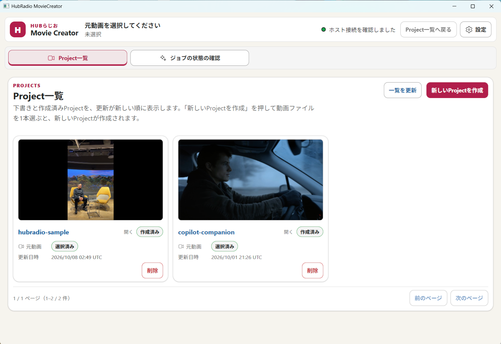
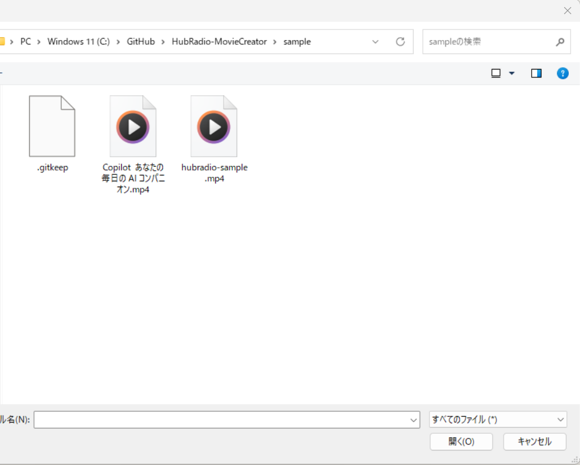
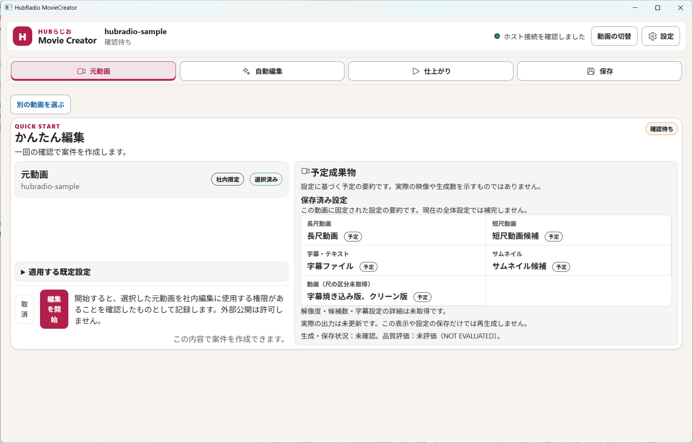
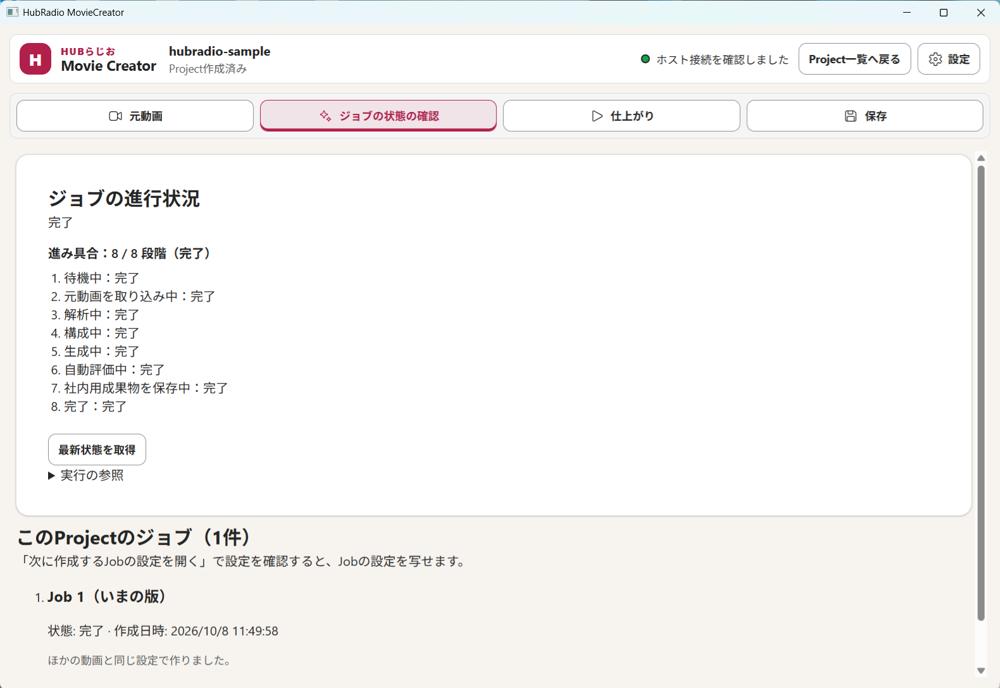
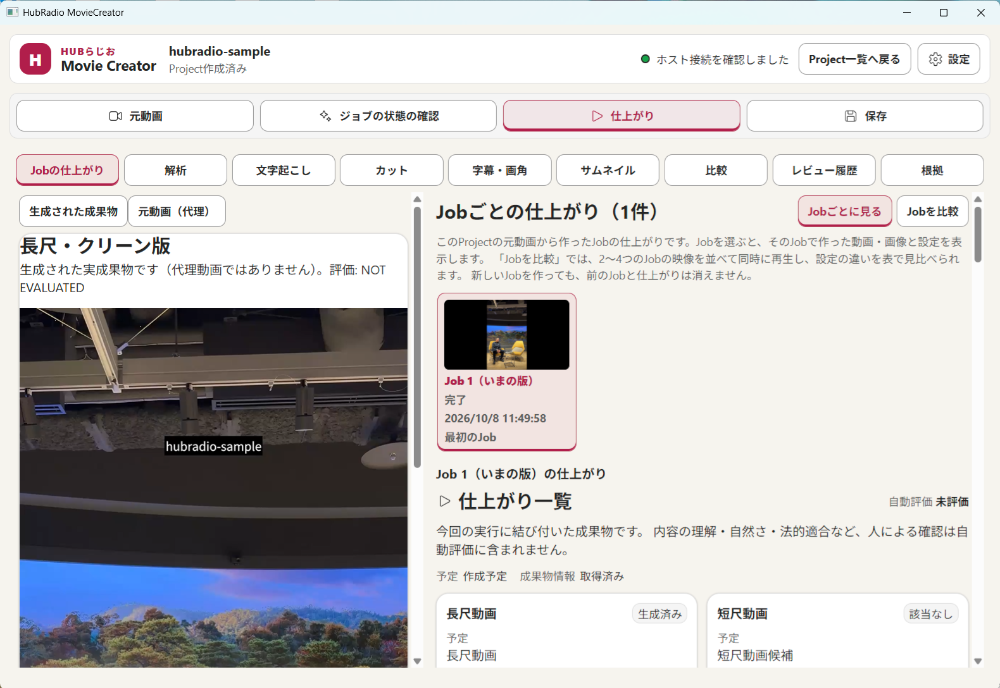
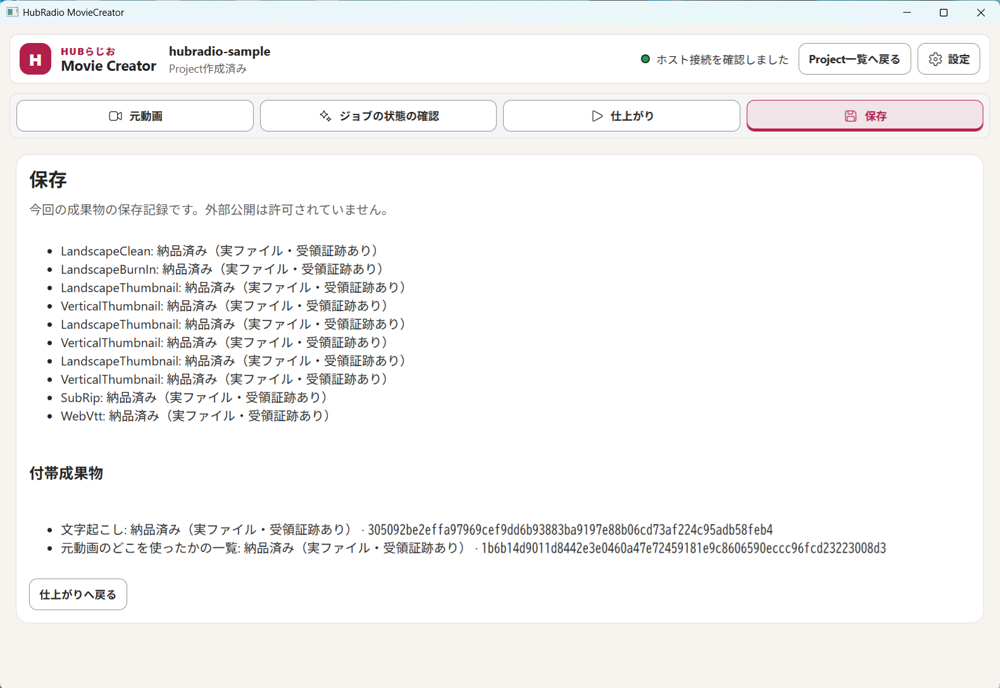

# QuickStart：動画1本から成果物を作る（約10分＋処理待ち）

初めてアプリを使う方向けに、**起動 → 動画を選ぶ → 待つ → 確認する → 保存を確かめる**までを最短で説明します。画面の各部分の意味は[画面ガイド](02-screen-guide.md)を参照してください。

> [!IMPORTANT]
> 一般利用者向けのインストーラーは未提供です。評価担当者から受け取った起動ファイル、またはリポジトリのソースから起動できる環境が前提です。現在の提供状況は[README](../README.md#現在の提供状況)を参照してください。

## 0. 準備するもの

| 項目 | 内容 |
|---|---|
| パソコン | Windows 11（64ビット） |
| 元動画 | 編集してよい動画 1 本（`.mp4` `.mov` など）。元動画は上書きされません |
| 空き容量 | 動画の 2〜3 倍程度 |
| 起動方法 | 受け取った `HubRadio.App.exe`、またはソースから `pwsh scripts\run.ps1`（.NET SDK と PowerShell 7 が必要）。ビルド済みなら `pwsh scripts\run.ps1 -SkipBuild` |

## 1. 起動する

1. `HubRadio.App.exe` をダブルクリックします（ソースからは上記コマンド）。
2. 初回は「Web UI を準備しています」と表示され、**1分ほど**かかることがあります。そのまま待ちます。
3. 次の **Project一覧** が表示され、右上に緑の丸と「ホスト接続を確認しました」が出れば成功です。

## 2. 動画を選んで Project を作る

1. 右上の **新しいProjectを作成** を押します。
2. ファイルを選ぶ窓が開くので、動画を 1 本選んで **開く** を押します（窓が出るまで数秒かかります）。

   

3. **元動画** タブに、動画名・「社内限定」・**予定成果物**が表示されます。内容を確認します。設定は触らなくて構いません（初期値が自動で入ります）。

   

## 3. 編集を開始して待つ

1. **編集を開始** を押します。Project が作成され、自動で **ジョブの状態の確認** タブへ切り替わります。
2. 進み具合（例：`8 / 8 段階（完了）`）が出るまで待ちます。動画が長いほど数分以上かかります。
3. 表示が更新されないときは **最新状態を取得** を押します。

> [!NOTE]
> 失敗したときは「エラーの内容」に原因と対応策が出ます。順に試し、**自動編集を再試行** を押します。詳しくは[困ったとき](04-faq-troubleshooting.md)を参照してください。

## 4. 仕上がりを見る

**仕上がり** タブを開き、作られた動画を再生して**自分の目と耳で確認**します。右の「仕上がり一覧」で、長尺動画・短尺動画・字幕・サムネイルの状況を確認できます。

- `生成済み` は作られた、`該当なし` は今回作られなかった、という意味です。
- `自動評価 未評価（NOT EVALUATED）` は「人が確認していない」という意味です。**問題なしではありません。**

## 5. 保存を確かめる

**保存** タブで、各成果物が「納品済み（実ファイル・受領証跡あり）」になっていることを確認します。外部公開は許可されていません。

## 6. 終了・次の動画へ

- 別の動画を扱うには、画面上部の **Project一覧へ戻る** を押します。作った Project は一覧に残ります。
- アプリはウィンドウの × で閉じます。

## 次に読むもの

| やりたいこと | 読むもの |
|---|---|
| 画面のどこで何ができるか知りたい | [画面ガイド](02-screen-guide.md) |
| 字幕を直す・設定を変える・Opening/Closingを付ける | [やりたいこと別ガイド](03-tasks.md) |
| うまくいかない・用語が分からない | [困ったとき・用語集](04-faq-troubleshooting.md) |
