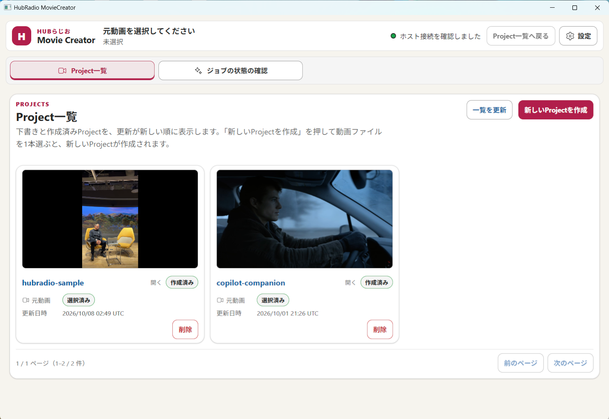
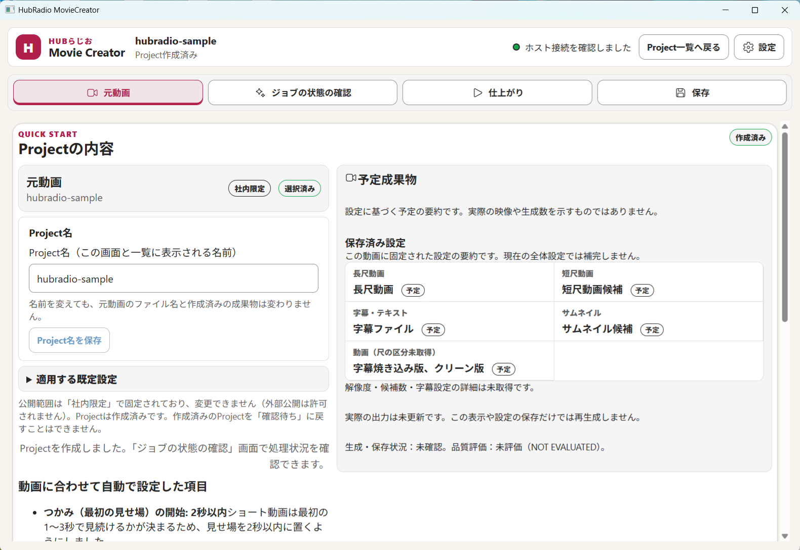
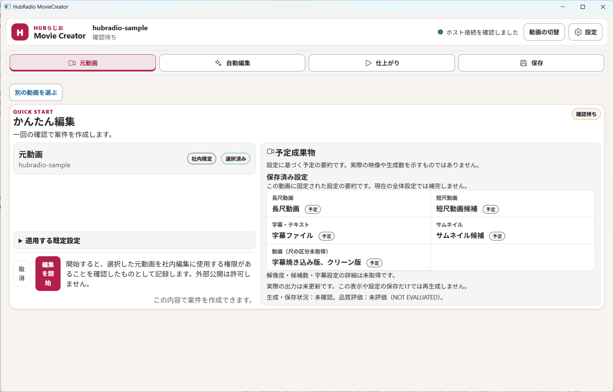
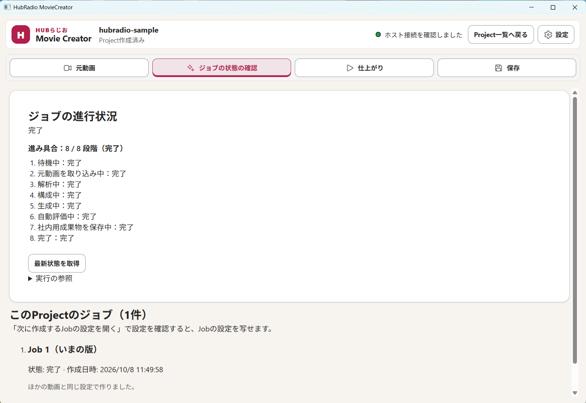
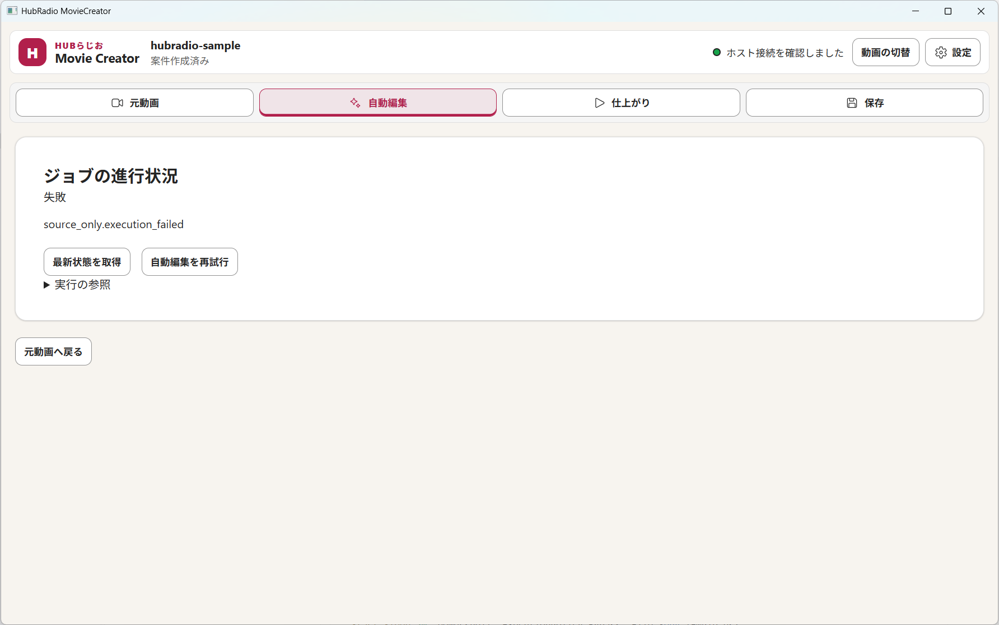
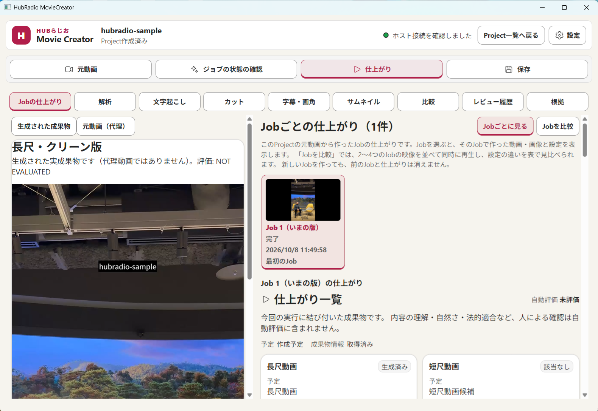
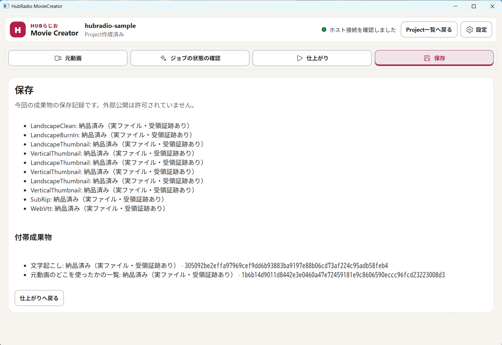
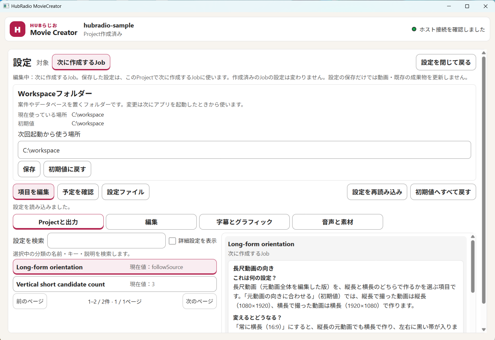
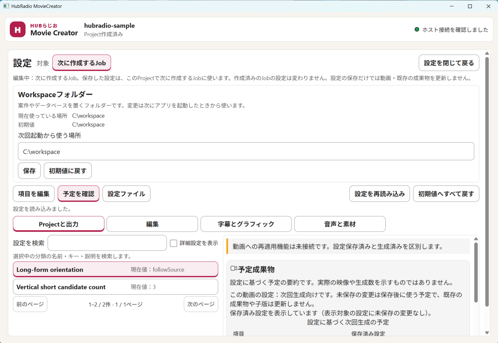
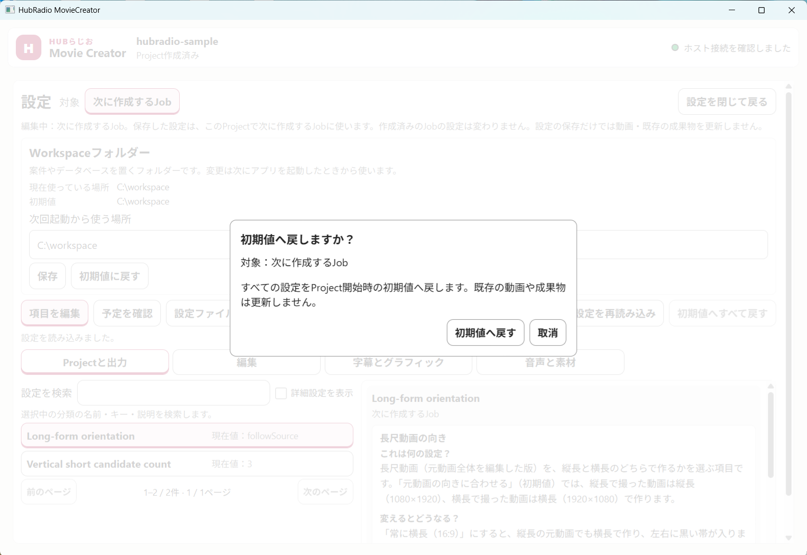

# 画面ガイド：どこで何ができるか

アプリの画面は、**①ヘッダー**、**②タブ**、**③作業エリア**の 3 つの領域でできています。以下の画像は実際のアプリ画面です（サンプル動画 `hubradio-sample` の Project）。

```text
┌─────────────────────────────────────────────────────────────┐
│ ① ヘッダー：ロゴ／Project名と状態／接続表示／[Project一覧へ戻る][設定] │
├─────────────────────────────────────────────────────────────┤
│ ② タブ：[元動画][ジョブの状態の確認][仕上がり][保存]               │
├─────────────────────────────────────────────────────────────┤
│ ③ 作業エリア（選んだタブの内容）                                    │
└─────────────────────────────────────────────────────────────┘
```

## 1. 画面の一覧

| 画面 | 開く方法 | 主な用途 |
|---|---|---|
| [Project一覧](#2-project一覧) | 起動直後／「Project一覧へ戻る」 | Project を選ぶ・作る・削除する |
| [元動画タブ](#3-元動画タブ) | Project を開く | 予定成果物の確認、Project名の変更、編集の開始 |
| [ジョブの状態の確認タブ](#4-ジョブの状態の確認タブ) | タブ／編集開始後に自動 | 進み具合・失敗理由・再試行 |
| [仕上がりタブ](#5-仕上がりタブ) | タブ | 動画の再生、成果物と自動評価の確認、字幕の修正、Job の比較 |
| [保存タブ](#6-保存タブ) | タブ | 保存（納品）記録の確認 |
| [設定画面](#7-設定画面) | ヘッダーの「設定」 | 初期値・次に作る Job の設定 |

## 2. Project一覧



| 場所 | できること |
|---|---|
| ヘッダー左：Project名と状態 | いま扱っている Project と状態（「未選択」「Project作成済み」など） |
| ヘッダー右：緑の丸「ホスト接続を確認しました」 | アプリ内部の処理部分とつながっている印。緑でないと操作できないことがあります |
| 「Project一覧へ戻る」 | 開いている Project を閉じて一覧へ戻る（一覧表示中は押せません。未保存の変更があると先に確認が出ます） |
| 「設定」 | [設定画面](#7-設定画面)を開く（一覧では「全体の初期値」を編集） |
| タブ「Project一覧」「ジョブの状態の確認」 | 一覧／全 Project のジョブをまとめて確認 |
| **新しいProjectを作成** | 動画ファイルを 1 本選び、新しい Project を作る |
| 一覧を更新 | 一覧を読み込み直す |
| Project カード | サムネイル、Project名、`作成済み`/`下書き` の印、元動画の選択状況、更新日時。名前を押すと開きます |
| カードの「削除」 | 確認後、その Project の作業ファイルと書き出し済みファイルを削除します（元に戻せません。**選んだ元動画は消えません**） |
| 前のページ／次のページ | Project が多いときのページ移動 |

## 3. 元動画タブ

Project を作る前は **QUICK START「Projectの内容」**、作成後も同じ場所で内容を確認できます。



| 場所 | できること |
|---|---|
| 「元動画」枠（`社内限定`／`選択済み`） | 選んだ動画名を確認。違う動画なら Project一覧へ戻って選び直します |
| 「Project名」枠 | 名前を入力して「Project名を保存」（1〜100文字）。元動画ファイル名や成果物名は変わりません |
| 「適用する既定設定」 | 自動で使う設定の要約を開く（通常は読み飛ばして構いません） |
| 「動画に合わせて自動設定した項目」 | 元動画から自動で決めた値の説明 |
| 右の「予定成果物」 | 長尺動画、短尺動画候補、字幕ファイル、サムネイル候補、字幕焼き込み版／クリーン版の予定。**実際に作られたかどうかではありません** |
| 右上の `確認待ち` → `作成済み` | **編集を開始** で `作成済み` に変わります。`社内限定` は変更できません |
| **編集を開始**（作成前のみ） | Project を作り、自動編集を始める |
| Project削除（画面下部） | 一覧の「削除」と同じ |

作成前の画面（編集を開始ボタンあり）：



## 4. ジョブの状態の確認タブ



| 場所 | できること |
|---|---|
| 「ジョブの進行状況」と状態（処理中／完了／失敗／整合性の再確認が必要） | いまの状態を確認 |
| 「進み具合：8 / 8 段階」と一覧 | 待機中 → 取り込み → 解析 → 構成 → 生成 → 自動評価 → 社内用成果物の保存 → 完了。各段階が「完了」「実行中」「未着手」で出ます |
| **最新状態を取得** | 表示を最新にする（自動で切り替わらないときに押す） |
| 実行の参照 | 問い合わせ用の詳しい情報（通常は開かなくて構いません） |
| 「このProjectのジョブ」 | 作った Job の一覧（`Job 1（いまの版）` など）と、作成日時・設定の由来 |
| 自動編集を再試行（失敗時のみ） | 同じ設定でやり直す |
| 元動画へ戻る | 元動画タブへ移動 |

失敗時は「エラーの内容」（原因・対応策・エラーコード）が出ます。



## 5. 仕上がりタブ



| 場所 | できること |
|---|---|
| 道具のタブ列：Jobの仕上がり／解析／文字起こし／カット／字幕・画角／サムネイル／比較／レビュー履歴／根拠 | 作られたものを見る・直す。使えない道具は理由が表示されます（手動の画角調整・手動サムネイルなどは現在利用不可） |
| 左：「生成された成果物」「元動画（代理）」 | プレビューの切り替え（アプリが作った動画／元動画の確認用映像） |
| 左のプレビュー | 再生・音量・全画面。**必ず自分の目と耳で確認してください** |
| 右：「Jobごとに見る」「Jobを比較」 | Job 単位で見る／2〜4つの Job を並べて同時再生し、設定の違いを比較 |
| Job のカード | 状態・作成日時。選ぶとその Job の成果物を表示 |
| 「仕上がり一覧」の成果物カード | 長尺動画・短尺動画・字幕・サムネイルごとの `生成済み`／`該当なし`、実生成数、ローカル保存の状況 |
| 「自動評価」`未評価` | 機械チェックの結果。**問題なしの意味ではなく、人の確認は含みません** |
| オープニング・クロージングを付けて保存 | 動画成果物の前後に別動画を付けた新しい MP4 を作る（[手順](03-tasks.md#opening--closing-動画を付ける)） |

## 6. 保存タブ



| 場所 | 意味 |
|---|---|
| 一覧の各行（`LandscapeClean`＝横長・字幕なし、`LandscapeBurnIn`＝横長・字幕焼き込み、`…Thumbnail`＝サムネイル、`SubRip`／`WebVtt`＝字幕ファイル） | 「納品済み（実ファイル・受領証跡あり）」なら、ファイルが保存され受領の証跡もあります |
| 「付帯成果物」：文字起こし／元動画のどこを使ったかの一覧 | 話した内容と使用区間の記録。右の長い英数字は、ファイルが変わっていないことを確かめる番号です |
| 仕上がりへ戻る | 仕上がりタブへ移動 |

「外部公開は許可されていません」は、社内向けの保存であることを示します。外部公開してよいという意味ではありません。

## 7. 設定画面

ヘッダーの **設定** で開きます。**迷ったら何も変えず「設定を閉じて戻る」** で構いません。



| 場所 | できること |
|---|---|
| 「対象」`全体の初期値`／`次に作成するJob` | 一覧で開くと「全体の初期値」（これから作る Project すべて）、Project 内で開くと「次に作成するJob」（その Project の次の Job だけ）。作成済みの Job は変わりません |
| Workspaceフォルダー | Project やデータベースを置く場所。変更は**次回起動から**有効（現在値・初期値・変更後の場所を表示） |
| 「項目を編集」「予定を確認」「設定ファイル」 | 項目の編集／変更後にどうなるかの確認／設定の書き出し・読み込み |
| 分類ボタン（Projectと出力／編集／字幕とグラフィック／音声と素材） | 項目の分類を切り替える |
| 「設定を検索」「詳細設定を表示」 | 項目名で絞り込む／上級者向け項目も表示 |
| 項目一覧と右側の詳細 | 項目の現在値と「やさしい説明」（何の設定か・変えるとどうなるか）。選択肢から選ぶと「未保存の値」になり、**保存**で確定します（1項目ずつ） |
| 設定を再読み込み | 保存済みの設定を読み直す |
| 初期値へすべて戻す | 確認の窓の後、全項目を初期値へ戻す（既存の動画・成果物は更新されません） |
| 設定を閉じて戻る | 元の画面へ戻る（未保存の変更があると確認が出ます） |

「予定を確認」では、設定を保存したとき次に作る成果物の予定を確認できます（動画への再適用は別操作です）。



「初期値へすべて戻す」を押すと、次の確認が出ます。「取消」で何も変わりません。



> 設定を保存しても、作成済みの動画は変わりません。反映するには**再生成**（新しい Job の作成）が必要です。
