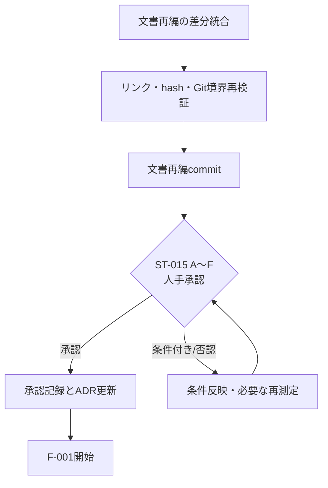

# 残作業 実行プラン（ドキュメント再編完了後）

**作成日:** 2026年8月27日
**最終更新:** 2026年8月31日
**対象リポジトリ:** HubRadio-MovieCreator
**正本:** `docs/dev/planning/implementation-plan.md`（全203タスク、SHA-256 `581206c67364ff8f7f5f5088a00661c1359cb821d8236694dd9b07e74f6aec1b`）
**本書の位置付け:** 正本の実行順序を、これまでの実測結果に基づいて具体化した作業計画。要求・ADRを変更するものではない。

---

## 1. 現在地（実測値）

### 1.1 完了済み

| 区分 | タスク | 状態 |
|---|---|---|
| P | P-001〜P-010 | 完了・コミット済み |
| ST | ST-001〜ST-005、ST-009、ST-010、ST-014、ST-016 | 完了・コミット済み |
| ST | ST-006 | 測定、canonical、敵対的レビュー、実在指摘の反映、コミットまで完了 |
| ST | ST-007、ST-011、ST-012、ST-013 | 測定、canonical、敵対的レビュー、実在指摘の反映、コミットまで完了 |
| ST | ST-008 | 利用条件不同意のため条件不成立。手動話者割当を維持 |
| ST | ST-015 | 14 canonicalを統合した承認資料のA〜Fを人手承認済み。commit `79ecdad` |
| F | F-001〜F-009 | scaffold、3言語test、一括検証、fixture registry、BOM、architecture制約を個別review・commit済み |
| D | D-001〜D-016 | 正規model、SQLite migration/store、ArtifactStore、WorkspaceRecoveryまでreview・commit済み |
| J | J-001〜J-010 | 永続job、runner、closed worker protocol、progress/cancel/retry、restart recoveryまでreview・commit済み |
| M | M-001〜M-012 | picker、取込、probe/decode、原本、PTS、NVENC/MF proxy、frame map、preview素材、durable restart、媒体敵対試験までreview・commit済み |
| A | A-001〜A-009 | pinned CPU int8 ASR runner、固定PCM抽出、first decoded frame基準の元時刻写像、raw timing evidence付きTranscriptRevision正規化、人による不変Human child revisionと別canonical edit record保存、案件/シリーズ用語辞書CRUD、用語修正候補と明示採否、versioned FFmpeg無音候補、明示編集語句候補、決定論的な隣接反復候補をreview済み |
| R | R-001〜R-009、R-016 | typed edit、version、profile、manual layout/keyframe、transitionまでreview・commit済み |
| U | U-001〜U-004 | WinUI/WebView2 startup、secure host/bridge、React state同期までreview・commit済み |
| S | S-001、S-002、S-004、S-006〜S-010、S-012、S-014、S-015 | actor/role/text sensitivity/review/approval/audit/backupと横断敵対試験をreview済み。S-003はcode済み・別account受入待ち |
| Z | Z-001〜Z-007 | local model不達/cloud necessity未証明、28 Region/model/quota、data processing、最小Japan East resource、desktop Entra authentication、local payload確認境界をreview済み |
| PK | PK-001〜PK-005 | Python wheel lock/self-contained runtime、FFmpeg manifest、offline model catalog/cache、closed React production bundleをreview・commit済み。PK-006はcode/同一host unpack検証済み・clean Windows受入待ち |

**完了: 118 / 203タスク（2026-08-31時点）**。`S-003`はコード実装済みだが別account受入待ちで完了数へ含めない。`ST-008`、`A-010`、`A-015`はcondition-false、`A-012`、`A-013`は再評価保留である。未完了85件のうち5件が現在condition-falseまたは保留である。PK-001〜PK-005は完了した。PK-006はWAP/manual fallback/strict unpack verifierまで実装したが、別のclean Windowsへのinstall証拠がないため未完了として保持する。A-009まで完了し、次は`A-011`から実行可能なtaskを継続する。`Z-008`は2つ目の実在する生成系文章候補実装が現れるまで開始せず、A-009の削除候補をその条件へ読み替えない。

### 1.2 直近の統合作業

- developer documentation再編、canonical参照更新、ST-015 pending report: commit `840d1ab`
- 新たに出現したlocal `video/`資産6件を削除せずGit対象外にする安全対策: commit `9deb319`
- ST-015 A〜Fの人手承認記録: commit `79ecdad`
- ADR-0007、正本task dependency、navigation、hashの同期: ST-015-CLOSEとして完了
- F-001〜F-009: commit `e47f095`、`f8582f1`、`420a558`、`33b0784`、`c14e6fb`、`6968d99`、`f90adfe`、`8738497`、`1749a9d`（補正`09bc76f`）
- D-001〜D-004、D-008: commit `1e2e037`、`e0e84e1`、`66222bb`、`9d88284`、`068ec87`
- D-005: commit `0020951`
- J-003: commit `d02a170`。PID公開testの競合補正はcommit `791afb7`
- J-009: commit `fd5229b`。Unicode同形文字の敵対的レビュー補正はcommit `6dfc063`
- J-010: commit `99a93fa`
- D-006: commit `c1f27f5`
- J-004: commit `e02dff0`
- M-001: commit `f8ce851`
- R-004、R-005: commit `69456ac`、`6cd0576`。formatting gate補正はcommit `7287c7a`
- S-001: commit `b730713`
- U-001: commit `0e5bb09`。WebView2 profile配置補正はcommit `cad5dca`、実プロセス保証追加はcommit `8d6936c`
- U-002、U-003: commit `d40ed75`、`f39427a`
- D-007、D-009、D-010、D-012: commit `c889ba6`、`31fda38`、`2452ccf`、`b6cc7b8`
- 以後のD/J/M/R/U/S完了taskは各独立commitとして`git log`に記録済み。M-011/M-012/S-014はdurable restart、媒体・横断敵対試験として完了済み
- Z-001〜Z-006: commit `10c3b2a`、`f4efbb3`、`2c51182`、`84012a4`、`449cc0b`、`c418224`
- A-001: pinned model/configのunit test 24件、worker全66件、canonical controlのoffline CPU実モデルrun（2 segment、43 token、本文非出力）を完了。accuracy、production latency、CUDA再配布は未承認
- A-002: 固定16 kHz mono PCM WAVとclosed timeline成果物、first decoded audio frame基準の双方向写像を実装。負の開始、1秒遅延開始、AAC priming、実FFmpeg/FFprobeを含む対象test 13件を完了。cross-build byte同一性とproduction性能は未測定
- A-003: A-001のraw秒・review要否を保持し、nearest-to-evenでA-002のsource timelineへ写像してTranscriptRevisionとSourceSpanを構築。範囲外、欠落、zero-duration、丸め後zero、overlapをclampせずmanual timing fallbackへ落とし、対象test 11件と全runnerを完了
- A-004: 原revisionを変更せずHuman childを生成し、stable IDs/timing/confidence/speakerを保持。actor SID、理由、typed diff、revision-bound SourceSpan、旧新digest、downstream staleを別canonical edit recordとしてArtifactStoreへ保存する。親artifactの保存前後検証、論理revision重複、曖昧文字階層、stale expected text、部分昇格のfail-closed/reconciliationを含む対象test 15件と全runnerを完了
- A-005: 不変`TermEntry`とProject/Series typed XOR scope、STRICT schema v5、scope別partial unique index、Project RESTRICT FK、version 0 createとOCC付きupdate/deleteを実装。架空のSeries table/FKは作らず、Core 548件、Infrastructure 597件中579成功・18環境skip、App 273件中272成功・1環境skip、Architecture 25件、Web 22件、Python 66件のRelease一括runnerを完了
- S-007: email、内部network location、credential形式、適用済み辞書snapshotをローカルで検出し、本文を保持せずrevision/utterance/source-span IDと原文UTF-16範囲だけを返す`TextSensitivityScanner`を実装。text element単位NFKC、無効Unicodeのfail-closed、同種包含除去、異種overlap保持を含む対象test 17件を完了し、Release一括runnerでArchitecture 25/25、Core 548/548、Infrastructure 579成功・18環境gate・0失敗、App 289成功・1環境gate・0失敗、Web 22/22、Python 66/66を確認した。これはS-011のexport gateやZ-007の送信確認を代替しない
- Z-007: 主選択と直接隣接する明示contextだけをrequest-scoped evidence IDへ変換するlocal-only `CloudPayloadBuilder`を実装。exact revision/dictionary snapshotへS-007を再適用し、URL、path、file name、Windows SID、GUID形式内部IDもNFKC逆写像後にmaskする。local provenance付きdiff、Azure送信先/model/region/deployment/data-zone/retention表示、canonical payloadと表示条件を結合したdigest、one-shot/16並行確認を対象test 21件で検証した。Release一括runnerはArchitecture 25/25、Core 548/548、Infrastructure 579成功・18環境gate・0失敗、App 310成功・1環境gate・0失敗、Web 22/22、Python 66/66。sender、credential、永続化、ModelRun、Z-008 interfaceは追加せず、実コンテンツ送信は行っていない
- PK-004: 12候補をclosed catalogへ固定し、CPU/int8 ASR model 1件だけにoffline install経路を与えた。個別size/hashと集約manifestをcopy前後に検証し、workspace stagingから非上書きmoveでcacheへ昇格する。未取得・破損・不同意・非採用を区別し、network取得、silent update、held/condition-false bundleを拒否する。focused 12成功・symlink環境gate 1件、実cache 4 file / 486,212,372 bytes照合、全Release runnerを完了した。最終MSIX、完全notice/CVE/SBOM、法務・release承認は未完了
- PK-005: React/React DOM/Schedulerの3 tarballとViteのindex/CSS/JSをSHA-256 manifestへ固定し、lock drift、source map、remote/inline entry、CSS/SVG remote、unsupported fileをfail closedで拒否する。App buildはverified manifestを必須化し、出力4 fileを完全照合した。同一host 2 build、Web 23件、Node負例6件、App 4件、bundle欠落negative、3つのworkspace task、全Release runnerを完了した。cross-machine、installed MSIX、完全SBOM/legal/releaseは未完了
- PK-002: 公式CPython 3.12.10 Windows x64 embeddable ZIP、runtime 25 wheel、worker source 6 filesを固定し、2,695 files / 268,442,311 bytes / 集合SHA-256 `1ef1e9fc…412ab7f`のread-only payloadを生成した。2 build同一hash、空PATH native imports、health、protocol、前後不変、改ざん/余分wheel/上書き拒否を完了した。clean machine、installed MSIX、完全SBOM/legal/releaseは未完了
- PK-006: x64 WAP projectとunsigned manual fallbackを実装し、A-009統合後の3,266 payload files / 1,224,383,084 bytes / 集合SHA-256 `b15f5b96…5928e73`を独立2 buildで一致させた。MakeAppx unpack後に全path/size/hashとblock map、WinUI/WebView2、worker health/protocol、FFmpeg/ffprobe、offline CPU/int8 model、Web bundleを実行検証した。WAP workload、署名、install、identity launch、別のclean Windows、upgrade/rollback/uninstall、SBOM/legal/releaseは未完了
- A-006: NFKC表記、大文字小文字、辞書読みのexact rulesだけで理由付き`TermCorrection`候補を生成し、source revision digest/SourceSpan/token/TermEntry OCC snapshotへ結合した。却下はrevisionを作らず、明示採用時だけA-004のHuman child revisionを生成する。focused App 11/11、Core analysis/schema 27/27を完了した
- A-007: 固定FFmpeg `silencedetect=-50 dB/2 s`をversioned Stage 0候補規則として実装した。analysis秒を16 kHz sampleへnearest-to-evenで変換し、A-002のdecoded-frame基準SourceSpanへ写像する。confidenceなし・threshold未承認・自動削除不可を保持し、strict parserと実2〜5秒controlを含むfocused 10/10を完了した
- A-008: FR-005に明記された`ここはカット`だけをclosed dictionary v1へ固定し、sentence内のNFKC token sequenceへexact matchする。dictionary version、normalized位置、根拠token、revision digestを保持し、partial token/untimed fallbackを明示する。fuzzy/cross-sentence/自動削除を拒否し、focused 9/9を完了した
- A-009: 構造的に隣接する同一話者の発話全体とsentence内の直結token blockをNFKC exact一致だけで検出し、後側をrevision/source/token証拠と決定的keyへ結合したimmutable Proposed候補として返す。rolling hash後のexact確認、比較work budget、nested型/output整合性、private failureをfocused 23/23で検証し、worker 104/104、2-build runtime、空PATH実行、2-build unsigned MSIX payload、strict unpack検証を完了した。canonical Release runnerはArchitecture 46/46、Core 548/548、Infrastructure 613/631成功・18環境gate、App 373/375成功・2環境gate、Web 23/23、Node asset負例6/6、Python 104/104で失敗0。時間・類似度閾値、clean-machine install、release承認は未完了

旧ADR重複は削除済みで、`docs/dev/decisions/`だけがADR正本である。DOC-001〜DOC-004は敵対的レビュー、修正、再検証、commitまで完了した。

### 1.3 後続計画を左右する実測事実

| 事実 | 出典 | 後続への影響 |
|---|---|---|
| 素材はVFR（公称59.94 / 平均57.62 fps、パケット長44種） | `media-ingest.json` | フレーム番号÷fpsでの時刻復元は全面禁止。観測PTS写像が必須 |
| 負の開始オフセット（映像 −0.0833秒、音声 −0.044秒） | `media-ingest.json` | 取込は容器の開始オフセットを保持する。先頭5フレームは代理上で選択不可 |
| 全編ソフトウェアデコード11.4分 | `media-ingest.json` | 対話編集で全編デコードを要求してはならない |
| 代理は元の1.23%（80 MB）、往復誤差 中央値0.0333秒 / 最大0.635秒 | `proxy-frame-map.json` | 代理経路が編集の基盤。カット精度の上限は元フレームの表示時間 |
| NVENC: VMAF 96.22 / 10.1 MB / Main、MF: VMAF 95.46 / 15.5 MB / Constrained Baseline | `encoder-matrix.json` | NVENCを既定、MFをフォールバック。MF経由の出力にはプロファイル差を記録 |
| GPLエンコーダ無しで納品経路が成立 | `encoder-matrix.json` | LGPLビルド継続が可能 |
| fixtureにハードカットが存在しない（対照動画で検出器の正常動作を確認済み） | ST-009測定 | FR-016のシーンチェンジとFR-006のトピック分割は映像境界に依存できない。音声・文字起こし側の手がかりが主経路になる |
| faster-whisper smallはCPU int8で384.895秒、CUDA float16で46.719秒。両方が全入力とsegment/word時刻を返した | `asr-benchmark.json` | ST-007はCUDA版を暫定対象、CPU版をfallback候補とする。単回実測であり精度・production閾値は未確定 |
| Foundry Local 30秒adapterは41.579秒だがengine duration/segment/word時刻を返さない | `asr-benchmark.json` | submission coverageをengine coverageと扱わず、FR-002時刻providerとしては保留 |
| CUDA成功はFoundry Local CUDA EP cacheのchild-only PATH注入に依存し、再配布承認はない | `asr-benchmark.json`、`docs/dev/licenses/third-party-intake.md` | Stage 1配布ではこのcacheを転用せず、CPU fallbackを維持してPK-001/PK-004で正規runtimeを決める |
| CPU/CUDAは全emitted wordに有限時刻を返すがoutput自体が異なり、parent外0.14秒が各1件。exact boundary正解はない | `alignment-benchmark.json` | CUDA word timeはeditable candidateのみ。発話時刻＋手動調整fallbackを必須維持し、非clamp |
| Foundry Local Qwen3 0.6B/4B CUDAは根拠ID付きJSONの全gateを通過した候補0件。4Bはsynthetic schema/IDを通したが期待3 topic中1件、両候補ともfixture 3 windowはaccepted JSON 0件 | `local-text-model.json` | A-015は未採用。A-014/A-020と手入力を主経路にし、semantic groundedness・意味保全・quiz回答根拠を未測定のまま保持 |
| 手書きmanifestの16:9/9:16はtrim/concat/crop/subtitle/audioを実行し、4 outputが全編decode、同一環境2回でbyte/decoded hash一致。4点のsource-frame選択誤差最大0.01417秒 | `manual-render.json` | typed render IRとobserved PTS mappingの実装根拠。知覚品質、subtitle内容traceability、cross-machine再現性、production閾値は未測定 |
| actual WebView2 Canvas/SVG各3 captureとFFmpeg 2.002秒/60 frame区間が同一LayoutSpec/Cueを消費し、6組の差分を記録した | `preview-fidelity.json` | 直接previewと忠実区間を同じcontractへ結べる。pixel同一性、moving-video、audio、cross-DPI/runtime/GPU、知覚品質は未測定 |
| unpackaged実プロセスでWeb UI Ready、Runtime欠落時のnative recovery、起動前後のinstall tree不変、実行ファイル隣接profile不在がすべてtrue | `tests/smoke/Test-WebViewStartup.ps1`、commit `8d6936c` | U-001〜U-003の開発build保証。実行場所は書込み可能なbuild出力であり、Program Files／installed MSIXのread-only受入ではない。後者はPK-006/PK-007で実施 |
| WebView2は`https://appassets.example/index.html`だけをtop-level許可し、same-origin resource以外、popup、downloadを遮断。bridgeはstrict UTF-8、128-byte上限、closed schema、lowercase nonzero UUID、`bridge.ping`だけを許可 | `WebViewHost.cs`、`Bridge.cs`、`web-bridge.schema.json`、commit `d40ed75`/`f39427a` | localhost serverやraw host objectを追加せず、業務RPCは必要なtaskで別途追加する |
| 隔離`ProgressRing` probeはWindows App SDK `2.4.0`で`Compatible=false`・main window未作成、`2.4.1-experimental`で`Compatible=true` | `tests/smoke/Test-ProgressRingCompatibility.ps1` | 製品projectは`2.4.0`を維持しstartupをtext表示する。単一controlの差だけでexperimental SDKへ更新しない |
| U-003統合後のRelease一括検証は.NET 507件中504 pass/3 environment skip、Web 10/10、Python 3/3 | `test.ps1`、commit `f39427a`直後のlocal run | 既知3 skipはreparse point 2件とnon-Windows SID経路1件。機能成功へ読み替えず、対応環境で別途実行する |

### 1.4 ドキュメント再編の検証結果

| 検査 | 結果 | 扱い |
|---|---:|---|
| `docs/dev/**/*.md` | 26文書 | developer向け入口、architecture、benchmark、ADR、license、plan、research、review、error catalogを分離済み |
| Git対象Markdown相対リンク | 全32文書の94件中broken 0件 | 再編後、Foundation、J-009追加文書の相対リンクは有効 |
| Implementation plan SHA-256 | `581206c67364ff8f7f5f5088a00661c1359cb821d8236694dd9b07e74f6aec1b` | 2026-08-31更新時点で`docs/dev/decisions/ADR-0001-source-of-truth.md`と一致 |
| `git diff --check` | staged / unstagedともexit 0 | whitespace errorなし |
| 旧ADR重複 | 0件 | 削除済み。`docs/dev/decisions/`だけをADR正本として使用 |
| Git staging | D-005、J-009、J-010と補正の個別commit後はclean | 本進捗同期だけを次のcommit対象にする |

---

## 2. 実行原則

1. **1タスクずつ完了させ、完了ごとに敵対的レビューを行い、実在する指摘のみ反映する。** 指摘は生データで検証してから採否を決める。
2. **測定していないことを結論として書かない。** 未測定は`openQuestions`として明示する。
3. **0件・失敗・想定外の結果は対照実験で解釈可能にしてから記録する。** ST-009で確立した方式を全ML系タスクへ適用する。
4. **成果物はcanonical（レビュー済み要約）とraw run（ローカル証跡）を分離する。** rawはGit対象外。
5. **文書更新時は`docs/dev/planning/implementation-plan.md`・`README.md`・`docs/dev/decisions/ADR-0001-source-of-truth.md`のhashを同時に同期する。**
6. **Azureは確認したlocal model不達とユーザーの明示指示が揃った限定評価範囲だけ実行する。** Z-001はcloud necessityを未証明のまま保持しており、Z-001〜Z-007完了をproduction必要性へ読み替えない。Z-007はlocal確認境界だけであり、実コンテンツ送信はZ-008〜Z-010の個別gate完了まで行わない。

---

## 3. フェーズ別実行順序

### Phase A: ドキュメント統合とStage 0 gate

| 順 | ID | 内容 | 完了条件 | 停止条件 |
|---|---|---|---|---|
| A-00 | DOC-001 | **完了。** 旧locationのuntracked ADR重複を削除し、`docs/dev/decisions/`を唯一のADR正本にする | 旧locationを参照する実ファイル0件 | 互換pathを残す要件が見つかった場合はredirect文書へ変更し、正本ではないと明記 |
| A-01 | DOC-002 | **完了。** rename、新規developer guide、本文修正、canonical参照更新、`stage-0-report.md`、本計画を意図した集合としてstageする | staged diffにraw run、media、model、秘密なし | 意図外のsource/code変更を検出したら分離 |
| A-02 | DOC-003 | **完了。** Markdown link、ADR hash、`git diff --check`、private trackingを再検証する | link broken 0、hash一致、diff check 0、private tracked 0 | 1件でも失敗したらcommitしない |
| A-03 | DOC-004 | **完了。** developer documentation再編とST-015 pending reportをcommitする | commit `840d1ab`。commit後に出現したlocal `video/`は安全対策commit `9deb319`でGit対象外化 | A〜Fを承認済みとは書かない |
| A-04 | ST-015 | **完了。** `stage-0-report.md` §9 A〜Fを人が承認した | approver、役割、日時、理由、条件を記録。commit `79ecdad` | production/release/Azureのgateは解除しない |
| A-05 | ST-015-CLOSE | **完了。** 承認後にStage 0 technology selection ADRを作り、実装計画の条件付きtask/dependencyをrebaselineする | `A-010`/`A-015`を条件不成立、`A-012`/`A-013`を再評価待ち、全ての直接・範囲依存を任意またはmanual-firstとして記録し、ADR、plan hash、report承認記録、敵対的レビューを揃える | held taskを`Q-000`/`Q-001`/`Q-004`/`Q-005`のG1-MUST critical pathへ残さず、Azureを暗黙に有効化しない |

**ST-008（pyannote話者分離）は条件不成立として閉じる。** 将来、権限ある人が利用条件へ明示同意し、license/hashを固定した場合だけ別の再評価taskとして開く。

### Phase B: 基盤構築（F・D・J、35タスク）

ST-015承認後に着手する。

| 群 | 件数 | 内容 | 並列化 |
|---|---|---|---|
| F-001〜F-009 | 9 | **完了。** ディレクトリ、.NET solution、React、Python worker、テスト、build.ps1、アーキテクチャ検査 | F-002/F-003/F-004とF-007/F-008/F-009を並列実行済み |
| D-001〜D-016 | 16 | **完了。** 正規model、SQLite migration/store、ArtifactStore、WorkspaceRecoveryまで実装済み | 完了 |
| J-001〜J-010 | 10 | **完了。** 永続job、runner、worker protocol、進捗・取消・再試行・restart recoveryまで実装済み | 完了 |

**設計上の必須反映事項（Phase A実測より）**
- `RationalTime`は有理数保持。浮動小数点秒を正本にしない
- `ProxyFrameMap`は観測PTS由来。公称fpsからの算出を実装しない
- 容器の開始オフセットを`Asset`に保持
- カット精度の下限を「元フレーム表示時間」としてUIへ表示できる形で保持

### Phase C: 取込・解析（M・A、33タスク）

| 群 | 件数 | 内容 |
|---|---|---|
| M-001〜M-012 | 12 | 完了。proxyのNVENC→Media Foundation固定fallback、durable request/checkpoint、Asset/warning復元、媒体敵対試験を含む |
| A-001〜A-021 | 21 | A-001〜A-009完了。咳検出、話者割当、topic、強調候補、横断採否管理、再処理DAGは未完了 |

**Phase Aの結果に依存する分岐**
- ST-006/007に従い、A-001はraw word時刻を候補として保持し、欠落・zero-duration・親segment外はreview-requiredとした。A-003はraw値を保持したままA-002のRationalTimeと手動調整fallbackへ変換した
- ST-009の結果により、A-012（shot境界）は本fixtureでは境界を返さない前提でテストを設計する
- ST-008未実行のため、A-010は配布せずA-011（手動割当）を主経路とする

### Phase D: 編集・レンダー・UI（R・U、43タスク）

| 群 | 件数 | 内容 |
|---|---|---|
| R-001〜R-026 | 26 | R-001〜R-009/R-016完了。Render IR以降と字幕系は依存待ち |
| U-001〜U-017 | 17 | U-001〜U-004完了。業務画面U-005以降は未完了 |

### Phase E: 統制・受入・配布（S・Q・PK、37タスク）

| 群 | 件数 | 内容 |
|---|---|---|
| S-001〜S-016 | 16 | S-001/S-002/S-004/S-006〜S-010/S-012/S-015完了。S-003は別account受入待ち |
| Q-000〜Q-013 | 14 | Must受入、長尺・縦型・クイズ、セキュリティ、追跡性、性能、復旧、敵対試験、アクセシビリティ、SBOM、初期パイロット |
| PK-001〜PK-007 | 7 | PK-001〜PK-005完了。PK-006は同一host実装済み・clean Windows受入待ち。PK-007の署名・upgrade検証はPK-006受入後 |

### Phase F: Stage 2 Should機能（E、19タスク）

`G1-MUST`通過後。見どころ、フック、サムネイル品質、音声補正、資料OCR、BGM、自動リフレーミング、ジャンプカット緩和、クイズ、構成テンプレート、投稿文、UI群。

### Phase G: 条件付きAzure（Z、10タスク）

**Z-001〜Z-007とS-007は完了。** Japan Eastの最小resource、desktop Entra authentication、ローカルsensitivity candidate scan、local-only payload preview/mask/confirmation境界まで成立した。実コンテンツのnetwork送信、response採用、fallback、ModelRun監査は未実装である。

---

## 4. 並列実行の方針

| 並列化する対象 | 理由 |
|---|---|
| F-002 / F-003 / F-004 | 言語基盤が独立 |
| D-001 / D-002 | 時刻とidentityは相互参照せず開始可能 |
| D-004 / D-008 | D-002またはD-003完了後に別集約として進められる |
| J-003 / J-009 | F-002後のprocess/diagnostic基盤としてDB critical pathと並行可能 |
| F-007 / F-008 / F-009 | 各依存が揃えばfixture索引、BOM、architecture testを並行可能 |
| S-014 / PK-001 / PK-003〜PK-005 | M-011の直列修正と変更境界が独立し、各task固有gateを満たすものだけ並行可能 |
| U-005以降 / R-010以降 | 対応serviceとmanual-first依存が解放された単位だけ並行可能 |

| 並列化しない対象 | 理由 |
|---|---|
| DOC-001〜DOC-004とST-015承認 | 正本path、hash、承認対象を先に固定する必要がある |
| D-003より前のdownstream provenance型 | `SourceSpan`/`OriginRef`の仮interfaceを作らず、正規型を待つ |
| D-013〜D-016 | migration、store、artifact、recoveryの順序を守る |
| J-001/J-002/J-006〜J-008 | Job schema・store・process/protocolの統合順序を守る |
| M-002〜M-011 | 元素材昇格、PTS、proxy、workflowの順序を守る |
| Render/QC/acceptanceの実測 | GPU/IO競合で性能値を歪めない |

---

## 5. 人の判断・外部提供が必要な項目

これらは私では解消できない。該当タスクは到達時点で保留し、代替経路を実装する。

| # | 項目 | 影響するタスク | 未解決時の代替 |
|---|---|---|---|
| 1 | 元動画の権利証憑（現在 `unconfirmed`） | 外部公開出力全般、Q-011 | 社内限定出力のみで受入試験を行う |
| 2 | 出演者の氏名・肩書 | A-011、S-005、Q-001 | 仮名のまま機能検証し、公開判定は保留 |
| 3 | ブランドテンプレート、ロゴ、キービジュアル | R-004、R-015、E-005 | 開発用ニュートラルテンプレートで代替 |
| 4 | 案件固有の用語データ | A-006、U-008、Q-001 | A-005のCRUD機構は空辞書で検証済み。実データ未提供時も空辞書で後続機構を検証 |
| 5 | 承認済みBGM・ジングル・SFX | E-008、FR-019 | 音源を参照しない経路で検証 |
| 6 | 公開期限 | 案件必須入力 | 未設定のまま下書き保存で検証 |
| 7 | pyannote利用条件への同意 | ST-008、A-010 | 手動話者割当を既定として実装 |
| 8 | **ST-015 A〜Fの人手承認** | Phase B以降すべて | ローカルStage 1開始分は承認済み。組織上のrelease承認権限は未提示のためrelease blockerは維持 |
| 9 | 要求定義の未決事項13件と関係者合意 | 受入基準の確定 | 既定判断をADRへ記録して進行 |
| 10 | 配布の署名主体・証明書・配布経路 | PK-007、G-RELEASE | 署名なしパッケージまで検証 |
| 11 | production-channel Windows 11 24H2実機 | PK-007、リリース判定 | Insider機で検証し差異を明記 |
| 12 | Azure着手指示 | Z-001〜Z-006 | 2026-08-30に成立。後続は各payloadの人による送信確認とtask依存を別途満たす |
| 13 | 保持期間の未確定（ADR-0005は日数を設定せず、時間だけを理由とする自動削除を禁じている） | S-015、Phase Eの削除・バックアップ範囲 | 明示削除のみ実装し、期限基準の自動削除は実装しない |

### 5.1 正解データ（annotation）の不在

ST-007（時刻精度）、ST-010（顔検出）、ST-016（音声イベント）は、本来は人が作成した正解データとの比較で精度を測る。現時点で正解データは存在しない。

**方針:** 精度指標を捏造せず、次を測定・記録する。
- 検出結果の分布と処理時間（客観的に測定できる）
- 対照実験による「機構が動作していること」の実証
- 正解データが必要な指標は`openQuestions`として未測定と明記

`docs/dev/benchmarks/annotation-policy.md`の形式に沿った正解データが提供された時点で、精度指標を追加測定する。

---

## 6. リスクと対処

| リスク | 兆候 | 対処 |
|---|---|---|
| 測定コードの誤りが誤った結論を生む | summaryが個別実測値と矛盾 | 全canonical作成時に派生値を生データへ突き合わせる検証を必須にする（ST-005で実際に検出） |
| 「0件」「失敗」を機構の欠陥と誤認 | 想定外の空結果 | 対照実験を測定へ組み込む（ST-009で確立） |
| レビューの誤指摘を反映して破壊 | `git rm`等の破壊的修正提案 | 指摘は必ず生データで検証してから採否。破壊的操作は実行前に実在確認 |
| 編集ツールによる意図しない削除 | 関数・節の消失 | 編集後にAST/関数集合をHEADと比較（ST-004で実際に検出） |
| 長時間測定の中断で子プロセス残留 | 孤児ffmpeg | 全stageでtimeout・子孫kill・Disposeを維持 |
| 大容量成果物の誤コミット | リポジトリ肥大 | `.gitignore`と`git ls-files`検査を各コミット前に実施 |
| 依存版の推測 | 存在しないバージョン指定 | PyPI等で実在確認してから固定（実際に誤りを検出） |

---

## 7. 完了判定

| ゲート | 判定内容 | 承認者 |
|---|---|---|
| `G0-*` | Stage 0各測定の完了 | 測定結果で自動判定 |
| **ST-015** | 閾値・採用技術・フォールバックの確定 | **人** |
| `G1-MUST` | 要求定義Must縦切り（Q-000/001/004/005） | 受入試験 + 人 |
| `G2-SHOULD` | Should機能（Q-002/003） | 受入試験 + 人 |
| `G-AZURE` | Azure追加 | **人の明示指示** |
| `G-RELEASE` | 署名・インストール・復旧・SBOM | **人** |

---

## 8. 直近の実行順序

1. `PK-006`の別clean Windows install gateは外部証拠待ちとして保持し、`A-011`から依存解放済みの実行可能taskを継続する。Z-008は2つ目の実在する生成系文章候補実装が現れるまで開始せず、A-009をその条件へ読み替えない。
2. 各taskを個別にbuild/testし、敵対的レビューの実在する指摘だけを反映して独立commitする。
3. 完了ごとに依存DAGを再評価する。`S-003`とheld/condition-false taskは外部証拠または別承認なしに完了扱いにせず、Azure後続はpayload/validation/fallbackの個別gateを省略しない。

各ステップで、実測できなかった項目は`openQuestions`に残し、推測で埋めない。

---

## 9. 承認後の詳細実行wave

### Wave 1: F — repository/build基盤（完了）

以下は完了済みの実行記録である。各taskは個別の敵対的レビュー、修正確認、commitまで完了した。

| 順序 | Task | 実行 | Exit evidence |
|---|---|---|---|
| 1 | F-001 | 既存`.gitignore`を再利用・拡張し、`src/`、`tests/`、`schemas/`、`packaging/`を作る | private artifactがGit対象外、空の将来用抽象を作らない |
| 2 | F-002 / F-003 / F-004 | .NET、React/Vite、Python workerを並列scaffold | 各言語でrestore/build/import成功。model未取得でもworker起動可 |
| 3 | F-005 | 各runnerへ実処理を通るsmoke testを1件以上追加 | .NET/Web/Python test runnerが全てexit 0 |
| 4 | F-007 / F-008 / F-009 | fixture索引、BOM雛形、architecture制約testを並列実装 | 大容量原本非追跡、dependency列完備、禁止依存を自動拒否 |
| 5 | F-006 | restore/build/lint/testをPowerShell 7でfail-fast統合 | clean checkout相当で一括検証exit 0 |

各task完了時に3軸（correctness、security/privacy、plan/schema consistency）の敵対的レビューを行い、修正後再実行して個別commitする。

### Wave 2: D + early J — 正規model、SQLite、process基盤

1. `D-001`と`D-002`を並列実装し、有理時刻、overflow、SHA-256、型付きIDを試験する。
2. `D-003`を単独gateにし、架空spanとorigin欠落を拒否する。仮`ISourceSpan`は作らない。
3. **完了。** `D-003〜D-016`を依存順に実装し、Project/Asset/Rights、Transcript/Analysis、Layout、Composition/Timeline、review/audit、SQLite、ArtifactStore、recoveryを固定した。
4. **完了。** `J-001〜J-010`を実装し、永続job、単一heavy runner、Job Object、closed NDJSON、progress/cancel/retry、cache planning、restart recoveryを固定した。

### Wave 3: M + approved A — 取込と解析

1. **完了。** `M-001`〜`M-006`でtoken化picker、stream copy/hash、ffprobe、warning、full decode、original昇格を直列化した。
2. **完了。** `M-007`〜`M-010`でobserved PTS index、NVENC/MF proxy、ProxyFrameMap、waveform/spriteを実装した。
3. **完了。** `M-011`はdurable request/checkpoint・Asset/warning persistenceとfresh-instance suffix resumeを実装し、`M-012`は破損媒体、UNC、option風filename、resource bomb境界を敵対試験した。
4. **完了。** `A-001`はCPU int8の単一経路を成立させた。CUDAは正規runtimeと再配布承認がないため製品runnerへ追加していない。
5. **完了。** `A-002`は固定PCM抽出とfirst decoded frame基準の元時刻写像を成立させた。packet/container startを補正値として適用しない。
6. **完了。** `A-003`はraw ASR秒とreview要否を別証拠として保持し、nearest-to-evenでA-002のRationalTimeへ変換した。範囲外をclampせずmanual timing fallbackを維持する。
7. **完了。** `A-004`は原revisionを不変のままHuman child revisionと別canonical edit recordをArtifactStoreへ保存し、人修正とdownstream staleの証拠を固定した。
8. **A-009完了。** `A-011`、`A-014`、`A-016`〜`A-021`はmanual fallbackを主経路として実装する。
9. `A-010`と`A-015`は条件不成立として実装しない。`A-012`と`A-013`は選定済みproduction detectorとしてcritical pathへ置かず、正例annotationと別承認が成立するまでholdする。
10. `A-014`、`A-016`、`R-008`、`R-011`、`E-005`、`E-009`、`E-010`、`PK-001`、`PK-004`はheld/condition-false taskへ必須依存しないmanual-first baselineとする。`Q-000`/`Q-001`/`Q-004`/`Q-005`がheld taskなしで通ることを依存表で確認する。
11. `A-018`はtechnical warningと人手review候補だけを出し、自動削除APIを持たない。

### Wave 4: R + U + S — 編集、render、UI、統制

| Lane | 先行可能部分 | 統合gate |
|---|---|---|
| R | R-001〜R-009/R-016完了。次は依存解放後のR-010以降 | D-009とapproved manual fallback |
| U | U-001〜U-004完了。次は対応service完成後のU-005以降 | 業務method追加ごとのorigin/size/schema/method review |
| S | 主要基盤taskとS-007完了。S-003 codeは別account受入待ち、S-014等は依存解放を再確認 | 別非管理者account ACL試験と公開範囲拡大時の再承認 |

統合順は、`R-008〜R-016`（manual layout、subtitle、graphic、transition）→`R-017`（typed Render IR gate）→`R-018`（FFmpeg compiler）→`R-019/R-020`（preview/final jobs）→`R-021/R-022`（QC/delivery）とする。UIは対応service完成ごとにU-005〜U-017へ接続し、S-008〜S-016のreview/export/audit/backup gateを通す。

### Wave 5: G1-MUST

1. `Q-000`で9:16 manual layout、字幕、generic safe zone、承認付き出力を通す。
2. `Q-001`で長尺の取込→解析→manual correction→version→review→render→deliveryを通す。
3. `Q-004`でSID、role、公開区分、rights、approval、auditを検査する。
4. `Q-005`で任意output時刻、字幕/要約、素材権利をOriginRefへ逆引きする。
5. 4試験と関連NFR evidenceが揃うまで`G1-MUST`を通過扱いにせず、E群を開始しない。

### Wave 6: Should、package、最終受入

- `G1-MUST`後にE-001〜E-019を開始する。自動化を追加してもStage 1のmanual pathを削除しない。
- `PK-001`〜`PK-005`は依存が揃い次第並行し、Python direct/transitive lock、FFmpeg source/config/notice、model catalog、Web assetを固定する。
- `PK-006`でmulti-executable Packaging Project、`PK-007`で署名、install、upgrade、rollback、uninstallをproduction-channel clean Windows上で検証する。
- Q-002/Q-003/Q-006〜Q-010/Q-013を完了後、Q-011の6成果物pilot、最後にQ-012のrelease readinessを実施する。
- `G-RELEASE`はrights、retention、recovery、SBOM/license、security、accessibility、traceability、全受入記録が揃うまで閉じる。

### Conditional Azure

`Z-001〜Z-007`は評価したlocal modelの不達、cloud necessity未証明、data processor/residency、Subscription/Region/model、利用者の限定評価指示、local payload確認境界を分離して完了した。S-007のローカル候補をexact snapshotへ再適用し、選択・mask・diff・送信条件をdigestへ結合するが、senderは持たない。`Z-008〜Z-010`は実在する2つ目の実装と依存が揃った後だけ実行し、Azure resourceが存在してもaudio/video/image/path/SID/project IDは送信対象にしない。

---

## 10. 全task共通の完了手順

1. 正本の要求ID、依存、完了条件を読み、対象外と未測定を先に固定する。
2. 実装前に関連fileを読み、変更範囲を最小化する。
3. 小さな変更単位でbuild/test/schema/parser/lintを実行する。
4. success、failure、timeout、cancel、source不変、privacy、path、orphan processの該当負例を追加する。
5. task成果物とraw evidenceを照合し、canonicalには非機密のreview済み要約だけを書く。
6. correctness、security/privacy、requirements/schemaの3軸で敵対的レビューする。
7. 指摘を実データで再現し、実在する指摘だけを修正する。修正後に同じ検証を再実行する。
8. `git diff --check`、private tracking、意図したfile集合を確認してtask単位でcommitする。
9. 未測定値、条件付きtask、外部入力を次taskへ黙って持ち越さず、`openQuestions`またはblockerへ記録する。
