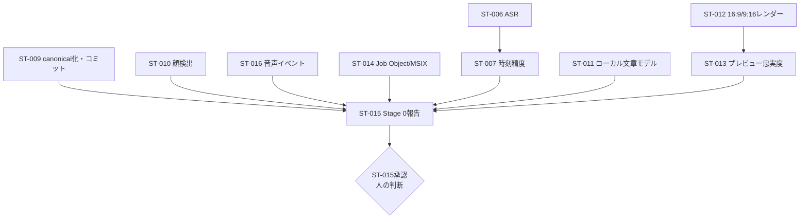

# 残作業 実行プラン

**作成日:** 2026年8月27日
**対象リポジトリ:** HubRadio-MovieCreator
**正本:** `docs/implementation-plan.md`（全203タスク）
**本書の位置付け:** 正本の実行順序を、これまでの実測結果に基づいて具体化した作業計画。要求・ADRを変更するものではない。

---

## 1. 現在地（実測値）

### 1.1 完了済み

| 区分 | タスク | 状態 |
|---|---|---|
| P | P-001〜P-010 | 完了・コミット済み |
| ST | ST-001〜ST-005、ST-009、ST-010、ST-014、ST-016 | 完了・コミット済み |
| ST | ST-006 | 測定、canonical、敵対的レビュー、実在指摘の反映、コミットまで完了 |
| ST | ST-007、ST-011 | 測定、canonical、敵対的レビュー、実在指摘の反映、コミットまで完了 |

**完了: 22 / 203タスク**。Stage 0の未完了実行対象はST-012、ST-013、ST-015の3件（ST-008は利用条件不同意のため条件不成立）

### 1.2 未コミットの作業

- なし。private transcript、生成文章、normalized audio、model、raw runはGit対象外のまま保持

### 1.3 後続計画を左右する実測事実

| 事実 | 出典 | 後続への影響 |
|---|---|---|
| 素材はVFR（公称59.94 / 平均57.62 fps、パケット長44種） | `media-ingest.json` | フレーム番号÷fpsでの時刻復元は全面禁止。観測PTS写像が必須 |
| 負の開始オフセット（映像 −0.0833秒、音声 −0.044秒） | `media-ingest.json` | 取込は容器の開始オフセットを保持する。先頭5フレームは代理上で選択不可 |
| 全編ソフトウェアデコード11.4分 | `media-ingest.json` | 対話編集で全編デコードを要求してはならない |
| 代理は元の1.23%（80 MB）、往復誤差 中央値0.0333秒 / 最大0.635秒 | `proxy-frame-map.json` | 代理経路が編集の基盤。カット精度の上限は元フレームの表示時間 |
| NVENC: VMAF 96.22 / 10.1 MB / Main、MF: VMAF 95.46 / 15.5 MB / Constrained Baseline | `encoder-matrix.json` | NVENCを既定、MFをフォールバック。MF経由の出力にはプロファイル差を記録 |
| GPLエンコーダ無しで納品経路が成立 | `encoder-matrix.json` | LGPLビルド継続が可能 |
| fixtureにハードカットが存在しない（対照動画で検出器の正常動作を確認済み） | ST-009測定 | FR-016のシーンチェンジとFR-006のトピック分割は映像境界に依存できない。音声・文字起こし側の手がかりが主経路になる |
| faster-whisper smallはCPU int8で384.895秒、CUDA float16で46.719秒。両方が全入力とsegment/word時刻を返した | `asr-benchmark.json` | ST-007はCUDA版を暫定対象、CPU版をfallback候補とする。単回実測であり精度・production閾値は未確定 |
| Foundry Local 30秒adapterは41.579秒だがengine duration/segment/word時刻を返さない | `asr-benchmark.json` | submission coverageをengine coverageと扱わず、FR-002時刻providerとしては保留 |
| CUDA成功はFoundry Local CUDA EP cacheのchild-only PATH注入に依存し、再配布承認はない | `asr-benchmark.json`、`third-party-intake.md` | Stage 1配布ではこのcacheを転用せず、CPU fallbackを維持してPK-001/PK-004で正規runtimeを決める |
| CPU/CUDAは全emitted wordに有限時刻を返すがoutput自体が異なり、parent外0.14秒が各1件。exact boundary正解はない | `alignment-benchmark.json` | CUDA word timeはeditable candidateのみ。発話時刻＋手動調整fallbackを必須維持し、非clamp |
| Foundry Local Qwen3 0.6B/4B CUDAは根拠ID付きJSONの全gateを通過した候補0件。4Bはsynthetic schema/IDを通したが期待3 topic中1件、両候補ともfixture 3 windowはaccepted JSON 0件 | `local-text-model.json` | A-015は未採用。A-014/A-020と手入力を主経路にし、semantic groundedness・意味保全・quiz回答根拠を未測定のまま保持 |

---

## 2. 実行原則

1. **1タスクずつ完了させ、完了ごとに敵対的レビューを行い、実在する指摘のみ反映する。** 指摘は生データで検証してから採否を決める。
2. **測定していないことを結論として書かない。** 未測定は`openQuestions`として明示する。
3. **0件・失敗・想定外の結果は対照実験で解釈可能にしてから記録する。** ST-009で確立した方式を全ML系タスクへ適用する。
4. **成果物はcanonical（レビュー済み要約）とraw run（ローカル証跡）を分離する。** rawはGit対象外。
5. **文書更新時は`docs/implementation-plan.md`・`README.md`・`ADR-0001`のhashを同時に同期する。**
6. **Azureはローカル不達の実測とユーザーの明示指示が揃うまで着手しない。**

---

## 3. フェーズ別実行順序

### Phase A: Stage 0 完了（残り5タスク）

Stage 1以降のゲートであるST-015まで到達させる。

| 順 | ID | 内容 | 依存（正本） | 並列可否 | 想定される難所 |
|---|---|---|---|---|---|
| A0 | ST-009 | canonical作成、対照検証結果の記録 | ST-003（済） | — | 「0件」の解釈を誤らせない記述 |
| A1 | ST-010 | MediaPipe顔検出（代理300フレーム層化抽出） | ST-003, P-004（済） | A0/A2/A3と並列 | モデル取得とhash固定。顔が小さい区間の扱い |
| A2 | ST-016 | 咳・雑音・操作待ち・録画品質の検出 | ST-001, ST-003（済） | A0/A1/A3と並列 | 決定論的規則とMLの比較。誤検出の分類 |
| A3 | ST-014 | Job Object制限、MSIX複数実行ファイル | ST-002, P-010（済） | A0/A1/A2と並列 | 署名なしでのパッケージ検証範囲 |
| A4 | ST-006 | faster-whisper日本語ASR（CPU/CUDA比較） | ST-001, P-004（済） | 単独（GPU占有） | CUDA/cuDNN依存。モデル取得量。処理時間 |
| A5 | ST-007 | 単語・発話時刻の精度評価 | ST-006, P-009 | 単独 | **正解データ不在**。§5参照 |
| A6 | ST-011 | Foundry Localの文章モデル評価 | P-004, ST-001（済） | A4と直列（GPU競合回避） | Foundry Localの実際の利用可否 |
| A7 | ST-012 | 手書きマニフェストから16:9・9:16をレンダー | ST-003, ST-005（済） | 単独 | 元時刻逆引きの実証 |
| A8 | ST-013 | WebView2 Canvasと忠実レンダーの差分 | ST-004, ST-012 | 単独 | ブラウザ描画と焼き込みの一致検証 |
| A9 | ST-015 | Stage 0報告と閾値決定 | ST-004〜ST-014, ST-016 | — | **承認は人の判断** |

正本の依存関係上、A0・A1・A2・A3は相互に独立している。上図の矢印は実行上の順序であり、技術的な前提条件ではない。

**ST-008（pyannote話者分離）は実行しない。** 利用条件へ未同意のため、`third-party-intake.md`の方針どおり手動話者割当を既定とする。同意が得られた場合のみA4の後に挿入する。

### Phase B: 基盤構築（F・D・J、35タスク）

ST-015承認後に着手する。

| 群 | 件数 | 内容 | 並列化 |
|---|---|---|---|
| F-001〜F-009 | 9 | ディレクトリ、.NET solution、React、Python worker、テスト、build.ps1、アーキテクチャ検査 | F-002/F-003/F-004はF-001後に並列 |
| D-001〜D-016 | 16 | 有理時刻、SourceSpan、Project、Transcript、Suggestion、CompositionVersion、TimelineMap、SQLite、ArtifactStore | D-001〜D-006は型依存を守りつつ並列 |
| J-001〜J-010 | 10 | ジョブ状態機械、ProcessRunner、Job Object、NDJSON protocol、cache、復旧、hash検証 | J-003/J-009/J-010は独立 |

**設計上の必須反映事項（Phase A実測より）**
- `RationalTime`は有理数保持。浮動小数点秒を正本にしない
- `ProxyFrameMap`は観測PTS由来。公称fpsからの算出を実装しない
- 容器の開始オフセットを`Asset`に保持
- カット精度の下限を「元フレーム表示時間」としてUIへ表示できる形で保持

### Phase C: 取込・解析（M・A、33タスク）

| 群 | 件数 | 内容 |
|---|---|---|
| M-001〜M-012 | 12 | file picker、stream取込、ffprobe検証、全編decode検査、PTS index、代理生成、波形・sprite、セキュリティ試験 |
| A-001〜A-021 | 21 | ASR、用語辞書、無音・言い直し・咳検出、話者割当、shot、顔、トピック、強調候補、採否管理、再処理DAG |

**Phase Aの結果に依存する分岐**
- ST-006/007の結果次第でA-001の実装対象（単語時刻採用か発話時刻＋手動調整か）が決まる
- ST-009の結果により、A-012（shot境界）は本fixtureでは境界を返さない前提でテストを設計する
- ST-008未実行のため、A-010は配布せずA-011（手動割当）を主経路とする

### Phase D: 編集・レンダー・UI（R・U、43タスク）

| 群 | 件数 | 内容 |
|---|---|---|
| R-001〜R-026 | 26 | EditOperation、TimelineMap再構築、版管理、テンプレート、レイアウト、字幕、テロップ、トランジション、Render IR、FFmpegコンパイラ、QC、納品 |
| U-001〜U-017 | 17 | WinUI shell、WebView2、bridge、状態管理、案件一覧、解析画面、タイムライン、字幕編集、比較、レビュー、納品、サムネイル、アクセシビリティ |

### Phase E: 統制・受入・配布（S・Q・PK、37タスク）

| 群 | 件数 | 内容 |
|---|---|---|
| S-001〜S-016 | 16 | Windows SID、権限、ACL、公開区分、権利、機密検出、レビュー状態機械、承認digest、出力ゲート、監査、backup |
| Q-000〜Q-013 | 14 | Must受入、長尺・縦型・クイズ、セキュリティ、追跡性、性能、復旧、敵対試験、アクセシビリティ、SBOM、初期パイロット |
| PK-001〜PK-007 | 7 | Python固定、self-contained worker、FFmpeg固定、モデル管理、React組込、MSIX、署名・upgrade検証 |

### Phase F: Stage 2 Should機能（E、19タスク）

`G1-MUST`通過後。見どころ、フック、サムネイル品質、音声補正、資料OCR、BGM、自動リフレーミング、ジャンプカット緩和、クイズ、構成テンプレート、投稿文、UI群。

### Phase G: 条件付きAzure（Z、10タスク）

**着手条件が未成立。** Z-001（ローカル不達の実測）とユーザーの明示指示が揃うまで全件skip。

---

## 4. 並列実行の方針

| 並列化する対象 | 理由 |
|---|---|
| ST-010 / ST-016 / ST-014 | 依存が独立。ST-014はCPU負荷が低い |
| F-002 / F-003 / F-004 | 言語基盤が独立 |
| D-001〜D-006 | 型定義が独立 |
| M系coreとR系core | 統合前は独立 |
| S-001〜S-007 | Core完成後に独立 |

| 並列化しない対象 | 理由 |
|---|---|
| ST-006とST-011 | いずれもGPU/メモリを占有し、測定時間が相互に歪む |
| ST-012とST-013 | 前者の出力を後者が参照する |
| レンダー系の測定全般 | 実行時間を測定値として記録するため、負荷競合を避ける |

---

## 5. 人の判断・外部提供が必要な項目

これらは私では解消できない。該当タスクは到達時点で保留し、代替経路を実装する。

| # | 項目 | 影響するタスク | 未解決時の代替 |
|---|---|---|---|
| 1 | 元動画の権利証憑（現在 `unconfirmed`） | 外部公開出力全般、Q-011 | 社内限定出力のみで受入試験を行う |
| 2 | 出演者の氏名・肩書 | A-011、S-005、Q-001 | 仮名のまま機能検証し、公開判定は保留 |
| 3 | ブランドテンプレート、ロゴ、キービジュアル | R-004、R-015、E-005 | 開発用ニュートラルテンプレートで代替 |
| 4 | 用語辞書 | A-005、A-006 | 空辞書で機構のみ検証 |
| 5 | 承認済みBGM・ジングル・SFX | E-008、FR-019 | 音源を参照しない経路で検証 |
| 6 | 公開期限 | 案件必須入力 | 未設定のまま下書き保存で検証 |
| 7 | pyannote利用条件への同意 | ST-008、A-010 | 手動話者割当を既定として実装 |
| 8 | **ST-015の閾値承認** | Phase B以降すべて | 承認まで基盤構築へ進まない |
| 9 | 要求定義の未決事項13件と関係者合意 | 受入基準の確定 | 既定判断をADRへ記録して進行 |
| 10 | 配布の署名主体・証明書・配布経路 | PK-007、G-RELEASE | 署名なしパッケージまで検証 |
| 11 | production-channel Windows 11 24H2実機 | PK-007、リリース判定 | Insider機で検証し差異を明記 |
| 12 | Azure着手指示 | Z群全件 | ローカル経路のみで完結させる |
| 13 | 保持期間の未確定（ADR-0005は日数を設定せず、時間だけを理由とする自動削除を禁じている） | S-015、Phase Eの削除・バックアップ範囲 | 明示削除のみ実装し、期限基準の自動削除は実装しない |

### 5.1 正解データ（annotation）の不在

ST-007（時刻精度）、ST-010（顔検出）、ST-016（音声イベント）は、本来は人が作成した正解データとの比較で精度を測る。現時点で正解データは存在しない。

**方針:** 精度指標を捏造せず、次を測定・記録する。
- 検出結果の分布と処理時間（客観的に測定できる）
- 対照実験による「機構が動作していること」の実証
- 正解データが必要な指標は`openQuestions`として未測定と明記

`benchmarks/annotations/README.md`の形式に沿った正解データが提供された時点で、精度指標を追加測定する。

---

## 6. リスクと対処

| リスク | 兆候 | 対処 |
|---|---|---|
| 測定コードの誤りが誤った結論を生む | summaryが個別実測値と矛盾 | 全canonical作成時に派生値を生データへ突き合わせる検証を必須にする（ST-005で実際に検出） |
| 「0件」「失敗」を機構の欠陥と誤認 | 想定外の空結果 | 対照実験を測定へ組み込む（ST-009で確立） |
| レビューの誤指摘を反映して破壊 | `git rm`等の破壊的修正提案 | 指摘は必ず生データで検証してから採否。破壊的操作は実行前に実在確認 |
| 編集ツールによる意図しない削除 | 関数・節の消失 | 編集後にAST/関数集合をHEADと比較（ST-004で実際に検出） |
| 長時間測定の中断で子プロセス残留 | 孤児ffmpeg | 全stageでtimeout・子孫kill・Disposeを維持 |
| 大容量成果物の誤コミット | リポジトリ肥大 | `.gitignore`と`git ls-files`検査を各コミット前に実施 |
| 依存版の推測 | 存在しないバージョン指定 | PyPI等で実在確認してから固定（実際に誤りを検出） |

---

## 7. 完了判定

| ゲート | 判定内容 | 承認者 |
|---|---|---|
| `G0-*` | Stage 0各測定の完了 | 測定結果で自動判定 |
| **ST-015** | 閾値・採用技術・フォールバックの確定 | **人** |
| `G1-MUST` | 要求定義Must縦切り（Q-000/001/004/005） | 受入試験 + 人 |
| `G2-SHOULD` | Should機能（Q-002/003） | 受入試験 + 人 |
| `G-AZURE` | Azure追加 | **人の明示指示** |
| `G-RELEASE` | 署名・インストール・復旧・SBOM | **人** |

---

## 8. 直近の実行順序

1. ST-012を実装 → 実行 → canonical → 敵対的レビュー → コミット
2. ST-013を実装 → 実行 → canonical → 敵対的レビュー → コミット
3. ST-015報告書を作成し、**閾値・採用技術・fallbackの人手承認を依頼して停止**

各ステップで、実測できなかった項目は`openQuestions`に残し、推測で埋めない。
