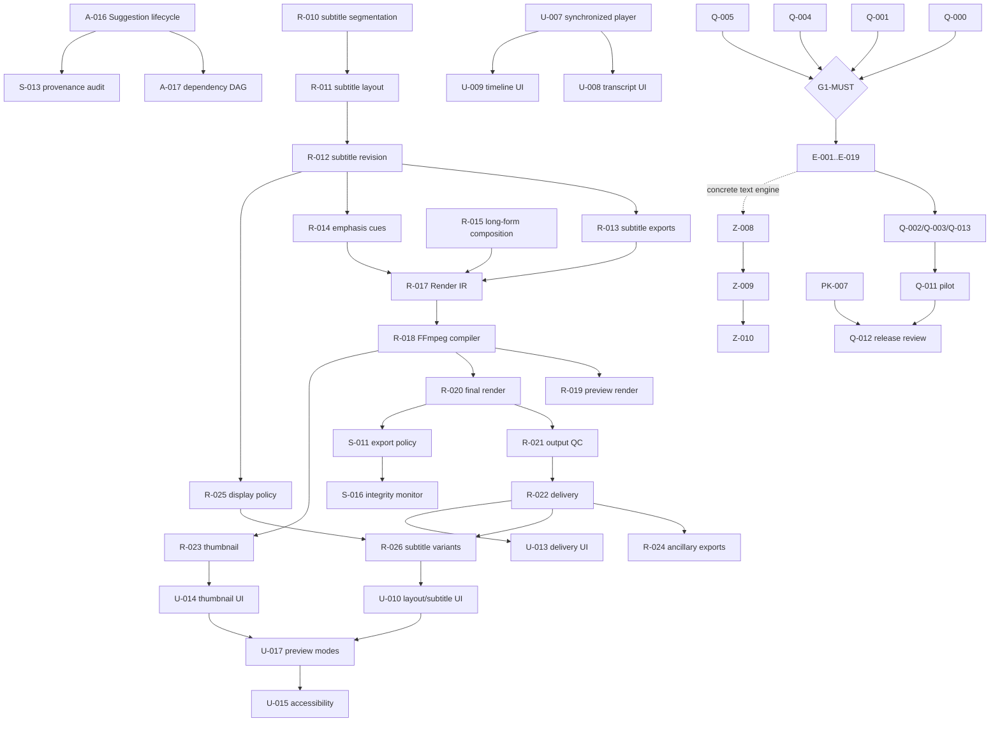

# HubRadio MovieCreator 残作業詳細実装計画

**作成日:** 2026年8月31日  
**対象ブランチ:** `main`  
**基準コミット:** `b0aaad53c660be15600d6c05ae528b252cb39e77`  
**正本:** [`../docs/dev/planning/implementation-plan.md`](../docs/dev/planning/implementation-plan.md)  
**正本 SHA-256:** `90b398c6bb80f529664905b88a74e310523b0865f2c0b5e2fdcef62982d5d726`  
**要求定義:** [`../docs/requirement-definition.md`](../docs/requirement-definition.md) 版 0.1 Draft  
**現在地:** 124 / 203 task 完了、79 task 未完了  
**本書の位置付け:** 正本の未完了taskを、現在の実装状態に合わせて依存順へ展開した実行計画。正本・要求・ADRを変更するものではない。

---

## 1. 結論

未完了は **79 task** である。内訳は次のとおり。

| 群 | 未完了数 | ID |
|---|---:|---|
| ST | 1 | ST-008 |
| A | 6 | A-010、A-012、A-013、A-015〜A-017 |
| R | 16 | R-010〜R-015、R-017〜R-026 |
| U | 13 | U-005〜U-017 |
| S | 5 | S-003、S-005、S-011、S-013、S-016 |
| E | 19 | E-001〜E-019 |
| Z | 3 | Z-008〜Z-010 |
| PK | 2 | PK-006〜PK-007 |
| Q | 14 | Q-000〜Q-013 |
| **合計** | **79** | |

79件を同じ意味の「未着手」として扱ってはならない。

| 分類 | 対象 | 扱い |
|---|---|---|
| 即時に実装開始できる | A-016、R-010、R-015、U-005〜U-007、S-005 | 1 taskずつ実装・レビュー・全回帰・独立commit |
| 既存作業を保護して継続できる | Q-007 | 未追跡`tests/Reliability/Invoke-Q007ProcessRecovery.ps1`を上書きせず、内容を監査して不足scenarioを追加 |
| 直前依存の完了後に実装 | A-017、R-011〜R-014/R-017〜R-026、U-008〜U-017、S-011/S-013/S-016、Q-000/Q-001/Q-004/Q-005/Q-006/Q-009 | 本書のwave順を守る |
| `G1-MUST`後のみ開始 | E-001〜E-019、Q-002/Q-003/Q-013 | Q-000/Q-001/Q-004/Q-005と人のgate承認まで開始しない |
| 条件付きAzure | Z-008〜Z-010 | 2つ目の実在する生成系文章候補実装、grounded validation、明示確認が揃うまで送信経路を作らない |
| 実装済み・外部受入待ち | S-003、PK-006 | コードは実装済みだが完了数には含めない。重複実装せず、別account／別clean Windowsの実証だけを行う |
| condition-false | ST-008、A-010、A-015 | 条件が変わらない限り実装しない |
| 再評価保留 | A-012、A-013 | 正例annotationと別承認なしにthresholdやproduction detectorを選ばない |
| 最終受入・人の判断が必須 | PK-007、Q-008〜Q-012 | coding agentのunit testだけで完了扱いにしない |

---

## 2. 作業ツリー保護境界

計画作成時点で、次は本計画とは別の利用者作業である。

| パス | 状態 | ルール |
|---|---|---|
| `infra/main.bicep` | modified | 読み取りのみ。明示的なAzure IaC統合作業まで編集・stage・revertしない |
| `infra/foundry.bicep` | modified | 同上 |
| `.vscode/tasks.json` | untracked | 一時script参照を含む利用者ファイル。編集・stageしない |
| `tests/Reliability/Invoke-Q007ProcessRecovery.ps1` | untracked | Q-007の既存作業として最初にread-only監査する。所有意図を確認できない場合は既存fileを編集せず、不足scenarioを別fileへ追加する。無断削除・上書きしない |

各taskでは `git add -A` を使用せず、意図したpathだけを明示stageする。上記4系統がcached diffへ入った場合はcommitしない。

---

## 3. 全task共通の実行契約

各taskを次の順序で完了させる。複数taskを1commitへまとめない。

1. 正本のtask行、直接依存、要求ID、成果物、完了条件を読み直す。
2. 関連実装・schema・testを読み、既存public API、保存境界、error contractを確認する。
3. 未測定値、外部入力、condition-false、任意依存を先に明記する。
4. 最小の型とAPIを実装する。2つ目の実装がない抽象、将来用feature flag、汎用pluginは作らない。
5. success、invalid input、stale binding、duplicate ID、cancel、timeout、partial failure、privacyの該当caseをfocused testへ追加する。
6. `get_errors`、formatter、analyzer、対象testを実行する。0件testを成功証拠にしない。
7. correctness、security/privacy、requirements/schemaの3方向で独立した敵対的レビューを行う。
8. 指摘を実コード・実行結果で再現し、実在する指摘だけを修正する。
9. `test.ps1 -Configuration Release`で.NET、Web、Node負例、Pythonを全回帰する。
10. 必要な正本・開発者README・作業計画を同期し、正本SHAをADR参照へ反映する。
11. Markdown相対リンク、schema/JSON/XML parse、依存脆弱性、秘密・path・model/media tracking、`git diff --check`を検証する。
12. task固有pathだけをstageし、1 task 1独立commitとして確定する。

### 3.1 常時維持する技術境界

- 時刻正本は`RationalTime`と観測PTS。浮動秒、公称fps、任意clampを正本にしない。
- 全確定要素を`SourceSpan`、`Asset`、`EditorialRecord`のいずれかへ結び、架空の出自を作らない。
- 元動画、承認版、過去revision、採用済みSuggestionを上書きしない。
- path、SID、token、credential、transcript本文、prompt/response本文を通常log・例外へ複製しない。
- SQLiteはparameter化し、JSON成果物はclosed schema・canonical bytes・SHA-256で結ぶ。
- ファイル保存はstaging → size/hash検証 → 同一volume atomic promotion → DB登録を維持する。
- UI/worker/processはexact allowlist。UI文字列をSQL、shell、Python、FFmpeg filterへ連結しない。
- AI候補の保存と、人による採用を別操作にする。Structured Output適合を真実性・根拠性とみなさない。
- Azureは既存Entra/RBACを使い、API keyを導入しない。Z-007のone-shot確認をnetwork送信許可へ読み替えない。
- 任意の時間、件数、文字数、confidence、品質thresholdを新規に捏造しない。安全上限は既存実測・既存bounded contractへ結ぶ。

### 3.2 現在の回帰baseline

基準コミット時点で正本に記録された最新結果は次のとおり。今後のtaskで件数が増えても、失敗0と既知environment gateの分離を維持する。

| Runner | 基準結果 |
|---|---|
| Architecture | 46 / 46 success |
| Core | 548 / 548 success |
| Infrastructure | 625 success / 18 environment gate / 0 failure |
| App | 431 success / 2 environment gate / 0 failure |
| Web | 23 / 23 success |
| Node packaging negative controls | 6 / 6 success |
| Python worker | 104 / 104 success |

---

## 4. 依存順の実行wave

### Wave 0 — 保護・外部環境の並行準備

実装critical pathを止めずに次を並行準備する。

1. **S-003受入環境:** ownerとは別の非管理者Windows account、対象workspace、owner/unauthorized SID、実行記録保存先を用意する。
2. **PK-006受入環境:** WAP/MSIX workloadを持つ別のclean Windows 11 x64を用意する。証明書や秘密はagentへ渡さず、利用者が端末上で管理する。
3. **Q-007:** 既存未追跡scriptを保護し、process kill以外のdisk-full、DB/成果物restore、actual app restart scenarioを設計する。
4. **実素材・権利:** Q-011用の4種類・計6本を作れるrights-cleared素材、出演者、ブランド、資料、音源を準備する。未提供ならinternal-only代替を維持する。

### Wave 1 — 解析統合と独立して開始できるMust基盤

次を独立taskとして実行できる。並行作業は可能だが、commitは分ける。

1. `A-016` Suggestion lifecycle統合。
2. `R-010` Transcriptから字幕Cue候補。
3. `R-015` long-form構成。
4. `U-005` project wizard。
5. `U-006` job進捗・復旧UI。
6. `U-007` proxy/waveform/sprite同期player。
7. `S-005` performer確認policy。
8. `Q-007`の既存probe監査と不足scenario追加。

### Wave 2 — 解析DAG、字幕revision、基本業務UI

1. `A-016`後に`A-017`と`S-013`を並行実装する。
2. `R-010 → R-011 → R-012`を直列実装する。
3. `R-012`後、`R-013`、`R-014`、`R-025`を並行実装する。
4. `U-007`後、`U-008`と`U-009`を実装する。
5. `U-009`後に`U-011`、`U-007`後に`U-012`を実装する。
6. `A-016 + U-007 + U-008`後に`U-016`を実装する。

### Wave 3 — Render、Delivery、policy、残UI

1. `R-010〜R-015`完了後に`R-017`を実装する。
2. `R-017 → R-018`を直列実装する。
3. `R-018`後に`R-019`、`R-020`、`R-023`を並行実装する。
4. `R-020 → R-021 → R-022`を直列実装する。
5. `R-022`後に`R-024`、必要依存完了後に`R-026`を実装する。
6. `S-005 + R-020`後に`S-011`、続けて`S-016`を実装する。
7. `R-021/R-022`後に`U-013`、`R-023`後に`U-014`を実装する。
8. `R-026 + U-007/U-009`後に`U-010`、続けて`U-017`を実装する。
9. `U-005〜U-014/U-016/U-017`完了後に`U-015`を実装・人手評価する。

### Wave 4 — G1-MUST前の受入

1. `R-022 + S-013`後に`Q-005`を実施する。
2. `A-017 + R-019/R-020 + U-015`後に`Q-006`を実施する。
3. `Q-007`をactual crash/disk-full/restoreまで完了する。
4. `U-015 + R-011/R-013`後に`Q-009`の自動部分と人手確認を実施する。
5. `R-007〜R-026 + U-010/U-017 + S-011`後に`Q-000`を実施する。
6. Must全機能完了後に`Q-001`を実施する。
7. `S-003`外部証拠、`S-005/S-011/S-013/S-016`完了後に`Q-004`を実施する。
8. `Q-000/Q-001/Q-004/Q-005`を人が承認した時点でのみ`G1-MUST`を通過する。

### Wave 5 — G1後のShould機能

`G1-MUST`前にE群を開始しない。通過後は次の順で進める。

1. 第1並列群: `E-001`、`E-005`、`E-006`、`E-007`、`E-009`、`E-011`、`E-013`、`E-014`。
2. 第2並列群: `E-002`、`E-004`、`E-008`、`E-010`、`E-019`。
3. 第3並列群: `E-003`、`E-012`、`E-016`、`E-017`、`E-018`。
4. 第4群: `E-001〜E-004`が全て完了した後に`E-015`。
5. 各producerはA-016のappend-only decision/stale契約へ接続し、自動採用しない。

### Wave 6 — 条件付きAzureとStage 2受入

1. `E-004`、`E-011`、または`E-013`の少なくとも1つが具体的なlocal生成実装として成立してから、Z-008開始条件を再評価する。
2. Azure側の同一schemaを返す具体実装が必要になった場合だけ、local/Azureの2実装を先に作り、その共通部分として`Z-008` interfaceを抽出する。
3. `Z-009`でevidence ID、引用、数値、固有名詞、URL、SourceSpanをsource snapshotへ照合する。schema適合だけでは採用不可とする。
4. `Z-010`でoffline/auth/quota/timeout/cancel時のmanual/local fallback、one-shot確認、feature disable、ModelRun監査、内容非保持logを実装する。
5. `E-014/E-015/E-019`後に`Q-002`、`E-011/E-016`後に`Q-003`、`E-013/E-016`後に`Q-013`を実施する。
6. Azure分岐を使う場合は`Z-009`後、使わない場合はnot-applicable根拠を記録して`Q-008`を完了する。

### Wave 7 — Package、SBOM、pilot、release

1. Must機能を含むpackageを再構築し、別clean Windowsで`PK-006`のWAP build、install、identity launch、worker/FFmpeg/model/Web起動を実証する。
2. E群完了後のrelease candidateでもpackage evidenceを更新する。
3. `Q-010`でSBOM、Model BOM、license、source offer/build instructions、脆弱性をrelease candidateへ照合する。
4. 署名主体・証明書・配布経路が決まった後に`PK-007`を実施する。署名秘密は利用者が端末へ直接入力・管理する。
5. `Q-000〜Q-010/Q-013`完了後、rights-cleared実素材で`Q-011`を実施する。
6. `Q-011 + PK-007`後に`Q-012`を実施し、人が`G-RELEASE`を承認する。

---

## 5. 未完了taskマスター一覧と実装詳細

この節の表が79件の完全な一覧である。状態は本書作成時点のもの。

### 5.1 条件付き・解析統合（7件）

| ID | 状態 / 開始条件 | 実装・成果物 | focused検証 / 完了証拠 |
|---|---|---|---|
| ST-008 | **condition-false**。pyannote利用条件への権限ある人の同意、model license/hash固定、別承認が揃った場合だけ再開 | `benchmarks/results/diarization-benchmark.json`。同意証拠、model/runtime hash、入力分類、失敗条件、A-011手動fallbackを記録 | rights-cleared正例で話者数・誤割当をannotationへ照合。条件不成立なら実装せず、Q-012でcondition-false証拠を維持 |
| A-010 | **condition-false**。ST-008が採用判定へ変わった場合のみ | 採用済みdiarization結果を匿名speaker clusterへ正規化するworker/host境界。A-011手動割当を置換しない | model不同意、未取得、hash不一致、話者数不整合、stale transcriptをfail closed。現状は成果物を作らない |
| A-012 | **再評価保留**。shot正例annotationと別承認が必要 | 採用する場合だけPTS-based shot boundary producerを実装。R-016の手動transitionを必須fallbackとして維持 | fixtureとpositive controlのprecision/recall、VFR PTS、threshold版を検証。annotationなしでthresholdを選ばない |
| A-013 | **再評価保留**。代表fixtureのface bbox annotationと別承認が必要 | 採用する場合だけface region evidenceを生成。R-008/R-009のmanual subject/keyframeを主経路として維持 | bbox IoU、small/profile/multiple face失敗、frame PTS、confidence版を検証。検出0件を成功扱いしない |
| A-015 | **condition-false**。grounded JSON候補が正例で成立し、別承認された場合のみ | local text model clientを追加する場合もA-014/A-020 manual-first経路を残す。Z-008条件へ勝手に読み替えない | evidence ID、意味保全、固有名詞、数値、offline、memory/time、invalid JSONを再評価。accepted 0件の現証拠では実装しない |
| A-016 | **即時開始**。全必須producerとJ-007完了済み | `src/HubRadio.App/Analysis/SuggestionService.cs`、tests。producer固有payloadを潰さず、共通のcandidate identity、source digest、status、actor、reason、decision time、stale reasonをappend-only decisionへ統合。採用・却下・修正を分離し、採用時だけtyped Transcript/Composition/Cue操作を返す | 全実装producer、duplicate decision、stale digest、modified-as-child、rejected不変、term correctionの非Composition採用、delete/highlight/topicのOriginRef、private errorを検証。A-010/A-012/A-013/A-015を依存にしない |
| A-017 | **A-016後** | `src/HubRadio.App/Analysis/AnalysisDependencyGraph.cs`、tests。入力digestから成果物種別への明示edgeを定義し、text修正ではASR/audio extraction/silenceを再実行せず、term/editorial/repetition/topic/context/metadata/emphasisとspeaker assignment bindingだけをstale化。J-007へ新cache keyを渡す | graph cycle、未知node、同digest、部分token変更、採用済み候補、unaffected audio成果物、retry/cancelを検証。任意の「前後N発話」thresholdを作らない |

### 5.2 字幕・構成・Render・Delivery（16件）

| ID | 状態 / 依存 | 実装・成果物 | focused検証 / 完了証拠 |
|---|---|---|---|
| R-010 | **即時開始**。D-005/D-008/A-004完了 | `src/HubRadio.Core/Subtitles/SubtitleSegmenter.cs`、tests。Human child Transcriptのsentence/token順、話者変更、実在gap、untimed token fallbackからCue候補を作る。文字数・秒数は既存profileに値がある場合だけ適用 | 日本語句読点、話者変更、negative source start、untimed token、overlap、revision mismatch、原文不変を検証 |
| R-011 | **R-010後** | `SubtitleLayoutEngine.cs`、tests。LayoutSpec safe zoneをhard constraint、読みやすさを版付きsoft costとして分離。face領域はA-013採用時だけ任意入力。解なしをtyped resultでmanualへ送る | 画面外・禁止領域hard fail、複数overlay競合、境界接触、解なし、optional face absence、preview/render同一座標を検証 |
| R-012 | **R-011後** | `src/HubRadio.App/Subtitles/SubtitleService.cs`、tests。通常/強調/注意/引用Cueをimmutable child revisionとして編集し、actor/reason/diff/OriginRefを保存 | text/time/style変更、no-op、stale base、範囲外、根拠なし引用、過去版不変、approval非継承を検証 |
| R-013 | **R-012後** | `src/HubRadio.Infrastructure/Subtitles/`、round-trip tests。同一Cue snapshotからVTT/SRT/ASSを別writerで出力し、encoding/escape/order/rangeを検証 | BOM/改行、HTML/ASS escape、Unicode、negative/overflow、同時Cue、round-trip、path非開示を検証 |
| R-014 | **R-011/R-012後** | `src/HubRadio.App/Graphics/EmphasisCueService.cs`、tests。A-021 candidate採用と手動EditorialRecordを分離し、timing/layout/styleをchild revisionへ保存 | 根拠なし引用、発話先行、topic外、同時表示競合、manual edit、rejected candidate、SourceSpan staleを検証。過剰数の任意閾値を作らずLayoutSpecで判定 |
| R-015 | **即時開始**。R-004/R-006/A-011/A-014完了 | `src/HubRadio.App/Compositions/LongFormComposer.cs`、tests。opening/title/speaker/topic/summary/CTA/endingと前後余白をtyped elementで構成し、各要素をSourceSpan/Asset/EditorialRecordへ結ぶ | 要素ON/OFF、missing optional asset、権利未確認、topic順、speaker snapshot、同一入力の決定性、元素材非変更を検証 |
| R-017 | **R-010〜R-015完了後** | `RenderGraph.cs`、`RenderGraphValidator.cs`、schema/tests。video/audio/subtitle/graphic/transition node、入力artifact digest、OriginRef、time mapping、profile/template/font/rightsをclosed IRへ固定 | unknown node/filter、cycle、dangling input、範囲外、hash mismatch、権利欠落、非単調timeline、架空OriginRefを拒否 |
| R-018 | **R-017後** | `src/HubRadio.Infrastructure/Rendering/FfmpegCompiler.cs`、golden tests。Render IRだけをfixed executable、ArgumentList、allowlisted filterscriptへcompile | shell/metacharacter、改行/NUL/invalid Unicode、filter injection、path token、command length、同一IR同一引数、固定FFmpeg hashを検証 |
| R-019 | **R-018後** | `PreviewRenderService.cs`、integration tests。選択区間だけをjob化し、LayoutSpecとcache keyをfinal renderと共有。staging/promote/cancelを既存job契約へ統合 | 区間外入力、cache hit/stale、cancel、timeout、duplicate job、partial file、proxy/source時刻を検証 |
| R-020 | **R-018後** | `FinalRenderService.cs`、tests。approved Composition digestだけを入力にし、進捗・cancel・restart・idempotent promotionを実装 | approval mismatch、policy drift、二重昇格、process kill、output hash mismatch、cancel後clean/reconciliationを検証 |
| R-021 | **R-020 + R-011後** | `OutputQc.cs`、fixtures/tests。container/stream/duration/A-V/subtitle bounds/blank frame/loudnessを検査し、内容変更と同一版の技術再renderを区別 | ST-015で採用済みの値だけを判定に使う。破損、missing stream、PTS drift、字幕領域、音量metadata、tool failureを検証 |
| R-022 | **R-021後** | `DeliveryService.cs`、tests。video、subtitle、thumbnail、transcript、review、rights、render manifest、使用SourceSpanを同一Composition/approval digestへ束ねる | cross-version混在、欠落artifact、hash/size不一致、stale approval、OriginRef断線、duplicate outputを拒否 |
| R-023 | **R-018後** | `ManualThumbnailService.cs`、tests。人が選んだsource PTS frameを版付きtemplateへ合成し、PNG・OriginRef・hashを保存 | VFR source PTS、frame不存在、template drift、権利、atomic promotion、元frame非変更を検証。自動face/quality採点はしない |
| R-024 | **R-022後** | `AncillaryArtifactExporter.cs`、tests。transcript、chapter、投稿文、編集指示、review、使用区間をversion/language/hash/OriginRef付きでserialize | E-013不在でもmanual/template値で成立。encoding、closed schema、cross-version、秘密/path非出力、DeliveryManifest登録を検証 |
| R-025 | **R-012後** | `SubtitleDisplayPolicy.cs`、tests。句読点表示、全文/選択Cueをprofile別の表示変換として実装し、Transcript/Cue原本を変更しない | policy version、preview/export一致、Unicode punctuation、no-op、原文/digest不変を検証 |
| R-026 | **R-013/R-017〜R-022/R-025後** | `SubtitleVariantService.cs`、tests。同じComposition、映像、音声から焼込版/字幕なし版を作り、DeliveryManifestでvariantを明示 | shared input digest、異なるoutput ID/hash、二重render防止、subtitle sidecar整合、QC/approval共有条件を検証 |

### 5.3 Windows / React業務UI（13件）

各bridge methodは、origin、method、size、closed schema、lowercase UUID、authorizationをC#とTypeScriptの両側で検査する。raw path、SQL、FFmpeg引数、credentialをWebへ返さない。

| ID | 状態 / 依存 | 実装・成果物 | focused検証 / 完了証拠 |
|---|---|---|---|
| U-005 | **即時開始** | `src/HubRadio.Web/src/features/projects/`、typed bridge handlers。案件一覧、draft作成wizard、必須入力、公開区分、権限、native picker tokenを統合 | 不足draft、permission deny、stale revision、unknown field、path非公開、keyboard基本flowを検証 |
| U-006 | **即時開始** | `features/jobs/`。J-006/M-011のqueued/running/retry/cancel/interrupted/reconciliation warningを区別 | out-of-order progress、duplicate completion、cancel race、retry不可、restart後snapshot、本文非表示を検証 |
| U-007 | **即時開始** | `features/player/`。proxy video、waveform、spriteを同じtyped time stateへ結合し、source/proxy/output timeを明示分離 | seek往復、negative source start、VFR、end boundary、missing asset、stale index、keyboard操作を検証 |
| U-008 | **U-007後** | `features/transcript/`。A-004 text edit、A-011 speaker表示、A-006 term candidate、low confidence/manual timing、A-017 stale範囲を表示 | keyboard edit、optimistic concurrency、no-op、stale base、untimed token、candidate adopt/reject、差分表示を検証 |
| U-009 | **U-007後** | `features/timeline/`。R-001〜R-003のtyped keep/delete/split/move、zoom/scroll/select/undoをCanvasへ実装 | stable ID、hit test、out-of-range drag、VFR mapping、undo/redo、DPI/resize、raw command非送信を検証 |
| U-010 | **R-026 + U-007/U-009後** | `features/layout/`、`features/subtitles/`。9:16 layout、manual subject/keyframe、safe zone、Cue/terop editing、解なしnavigation、焼込切替 | face候補なしのmanual path、normalized coordinates、overlap、keyboard、preview/render consistencyを検証 |
| U-011 | **U-009後** | `features/compare/`。複数CompositionVersionの使用区間、duration、hook、subtitle、effect、CTA、warningをdigest付き比較 | 異project、同version、stale snapshot、順序差、採用前後、本文escapeを検証 |
| U-012 | **U-007後** | `features/review/`。対象version digest、timecode comment、修正依頼、role別承認、公開不可、前版diffを表示 | role deny、stale version、comment source mapping、approval invalidation、double submitを検証 |
| U-013 | **R-021/R-022後** | `features/delivery/`。QC、artifact hash、review、rights、任意output timeのTimelineMap/OriginRef逆引きを表示 | broken trace、missing artifact、wrong digest、QC fail、internal-only download、keyboard navigationを検証 |
| U-014 | **R-023後** | `features/thumbnails/`。source PTSへseekし、人がframe/templateを選び、previewと出力hashを確認 | VFR、invalid PTS、template stale、rights warning、no face automation、cancelを検証 |
| U-015 | **他の全業務UI後** | `src/HubRadio.Web/src/styles/`、`tests/Accessibility/`。keyboard、focus、contrast、非色依存、字幕、mute理解を自動＋人手評価 | axe相当の自動検査だけで完了扱いにせず、主要flowのkeyboard実行と人の確認記録を必須化 |
| U-016 | **A-016 + U-007/U-008後** | `features/analysis/`。speaker/topic/delete/highlight/sensitivity/technical warningを統合し、理由・confidence有無・採否・元時刻jumpを表示 | producer差、null confidence、stale candidate、manual-only、unknown kind、XSS text、採用と保存の分離を検証 |
| U-017 | **U-010/U-014後** | `features/preview-modes/`。横/縦、字幕有無、generic UI mask、thumbnail縮小、mobile、audio-onlyを同一timeline stateで切替 | mode切替時刻保持、missing media、mute、generic mask offline動作、no Azure dependencyを検証 |

### 5.4 Policy・監査・整合性（5件）

| ID | 状態 / 依存 | 実装・成果物 | focused検証 / 完了証拠 |
|---|---|---|---|
| S-003 | **実装済み・外部受入待ち** | 既存`WorkspaceAcl`を変更せず、ownerとは別の非管理者accountでworkspace列挙・読取・作成が拒否されることを実証。環境変数とSIDは記録へ値を露出しない | owner操作成功、unauthorized access denied、継承/owner/DACL検査、reparse point環境gateを記録。別accountなしでは完了にしない |
| S-005 | **即時開始** | `src/HubRadio.App/Policy/PerformerPolicy.cs`、tests。Performer snapshot、A-011 assignment、`TitleConfirmedAt`、確認actor/time/reason、収録時点を照合し、未確認氏名/肩書をtyped warningへする | 任意の「N日経過」thresholdを作らない。確認なし、収録後変更、stale Project/assignment、hidden label、role permissionを検証 |
| S-011 | **S-005 + R-020後** | `ExportPolicy.cs`、tests。approval、publication scope、rights、performer、text sensitivity、未解消warning、OriginRef、render/QC digestを出力直前に同期再検査 | approval後変更、policy race、rights exception、sensitivity残存、missing trace、internal/external destination、TOCTOUをfail closed |
| S-013 | **A-016後** | `ProvenanceAuditService.cs`、tests。Suggestion/Detection/ModelRun、人修正、decision、adoption、Composition/Deliveryへの参照をS-012 append-only auditへ統合 | provider/model/version/hash/local-cloud、source/output digest、actor/reason、採否を識別。本文・prompt・response・tokenをauditへ複製しない |
| S-016 | **S-011後** | `IntegrityMonitor.cs`、tests。approved snapshotとcurrent original/tool/model/policy/template/fontを再検証し、差異をPublicationBlockedまたは再reviewへ送る | digest/size/version/policy drift、missing file、reparse point、same-ID mutation、technical rerenderとの差を検証。自動修復しない |

### 5.5 G1後のShould機能（19件）

| ID | 直接依存 | 実装・成果物 | focused検証 / 完了証拠 |
|---|---|---|---|
| E-001 | A-014/A-016/S-004 | `CandidateGenerator.cs`。人が確定したtopic/utterance/SourceSpanから単独で閉じる短尺rangeを列挙し、公開policyを前段gateにする | 文/Q&A/topicを途中で切らない、必要contextを保持、unsafe candidateをscoreで相殺しない |
| E-002 | E-001/P-009 | `HeuristicRanker.cs`。採用済みの客観featureだけを版付きscore/reasonへする | feature欠落、tie、決定性、score内訳、不足contextを検証。安全性はranking外のhard gate |
| E-003 | E-002/A-016 | `DiversityService.cs`。近似重複を理由付きclusterへし、全候補と人の採否を保持 | 異なる候補を消さない、順序決定性、label不足時に学習しない、decision provenanceを検証 |
| E-004 | E-001/A-004/S-013 | `HookService.cs`、schema/tests。結論・質問等の根拠spanから引用候補またはEditorialRecordを作り、model言換えを任意にする | 元発言の意味変更、根拠なし断定、話者偽装、stale spanを拒否。manual template pathを常設 |
| E-005 | M-010/R-004 | `src/HubRadio.App/Thumbnails/`、tests。blur/露出/余白等、実装済み決定論featureを理由表示し、template合成候補を返す | face scoreはA-013採用時だけ。目/口の意味推定を捏造せず、人選択を必須化 |
| E-006 | M-006/R-019/P-009 | `src/HubRadio.Infrastructure/Audio/`、Web A/B tests。補正をtoggle可能なtyped chainとして実装 | loudness/true peak等は承認済み値のみ。clip、左右、noise/hum、before/after hash、voice quality人手評価を記録 |
| E-007 | D-004/A-004/S-004 | `worker/tasks/ocr_materials.py`、`App/Materials/`、tests。page/region/source/rights/publication scopeを保持したOCR候補 | arbitrary URL取得なし、resource limit、malformed document、secret scan、rights、SourceSpan対応を検証 |
| E-008 | S-006/E-006/R-017 | `AudioCueService.cs`、`AudioEmitter.cs`。承認済みBGM/SFXだけをtyped cueとducking envelopeへする | RightsRecord未確認素材、path/filter injection、dialogue masking、A/B、source asset hashを検証 |
| E-009 | A-011/R-008/R-009/P-009 | `TranscriptDrivenReframeService.cs`。speaker turnと人が指定したsubject keyframeから離散layout候補を作る | A-010/A-013なしで成立。subject欠落、複数話者、manual fallback、keyframe範囲を検証 |
| E-010 | R-001/R-002/E-007/R-016 | `JumpCutService.cs`。実edit境界と承認素材からB-roll/資料/zoom/crossfade候補を作る | 存在しない映像を生成しない。source continuity、rights、manual transition、A-012/A-013任意を検証 |
| E-011 | A-004/A-016/S-013 | `QuizService.cs`、schema/tests。人が選ぶ根拠spanから問い/情報/待ち/答え/元発言/解説/CTAを構成 | 複数解釈、根拠なし答え、数値/固有名詞driftをreviewRequiredへする。modelなしのdeterministic pathを必須化 |
| E-012 | E-001/E-004/E-011/R-004 | `Templates/ShortForm/`。教育、驚き、誤解訂正、失敗談、比較、ranking、Q&A、story、quiz、demo先出しをtyped template化 | ranking根拠、必須slot、OriginRef、template version、unsupported combinationを検証 |
| E-013 | A-014/S-013 | `PublishingMetadataService.cs`。topic/出演者/CTAから編集可能なtitle/summary/chapter/hashtag/post templateを作る | 固有名詞、URL、SourceSpan/EditorialRecord、publication scope、manual edit provenanceを検証 |
| E-014 | R-007/U-010/P-009 | `Profiles/PlatformUi/`、visual tests。公式仕様・実機確認日付きでplatform UI mask/safe zoneを版管理 | 推測値を固定しない。仕様不明/期限切れはgeneric maskへfallbackし、外部APIなしで動作 |
| E-015 | E-001〜E-004/U-009 | `features/highlights/`。score内訳、不足context、policy、根拠、採否、hook差分を表示 | rankingとsafety gate分離、keyboard、stale candidate、元時刻jump、manual editを検証 |
| E-016 | E-011〜E-013/U-010 | `features/quiz/`、`features/publishing/`。根拠、wait、ambiguity、wording、CTA、metadataを編集 | 根拠移動、manual override、reviewRequired、XSS text、version conflictを検証 |
| E-017 | E-007/E-010/U-009 | `features/materials/`。page/region/time/source/rightsを確認して資料/jump-cut候補を採用 | external-publication deny、missing page、stale OCR、manual placement、OriginRefを検証 |
| E-018 | E-006/E-008/U-009 | `features/audio/`。BGM/SFX、rights、ducking、補正before/afterを比較 | 未確認素材を選択不可、mute、keyboard、envelope bounds、A/B stateを検証 |
| E-019 | E-009/U-010 | `features/reframe/`。layout reason、subject keyframe、失敗区間、manual fallbackを表示 | bboxなしでも成立、speaker change、preview sync、manual keyframe復帰を検証 |

### 5.6 条件付きAzure（3件）

Azure実装では、既存のEntra public-client/RBAC、Z-007のmasked payloadとone-shot confirmationを使う。API key、任意endpoint、background送信、prompt/response本文logを導入しない。

| ID | 状態 / 直接依存 | 実装・成果物 | focused検証 / 完了証拠 |
|---|---|---|---|
| Z-008 | **条件付き**。Z-006/Z-007に加え、E-004/E-011/E-013の具体local実装が成立し、同じ用途のAzure concrete実装が必要になった場合のみ | 2つのconcrete実装を先に成立させ、その共通DTO・cancel・result schemaだけを`ITextSuggestionEngine`へ抽出。Azure adapterはfixed endpoint/deployment/model、existing credential、bounded retryを使用 | interface先取り禁止、local/manual path常設、auth/quota/offline failure、one-shot確認、request digest、no raw IDs/path/mediaを検証 |
| Z-009 | **Z-008後** | `AzureSuggestionValidator.cs`、adversarial tests。Structured Outputをclosed schemaへparse後、全evidence ID、引用、数値、固有名詞、URL、rangeを送信前snapshotへ再照合 | unknown/missing/duplicate evidence、hallucinated number/name、prompt injection、Unicode spoof、oversized output、partial responseを採用不可にする |
| Z-010 | **Z-009 + S-013後** | `azure-evaluation.md`、`CloudFeatureGate.cs`。local/manual/cloud比較、offline/auth/quota/timeout fallback、disable、ModelRun監査を実装 | fallbackで編集を失わない、cloud結果を自動採用しない、provider/model/version/region/input/output digestを監査。内容非保持telemetryだけを許可 |

`infra/main.bicep`と`infra/foundry.bicep`は利用者変更中である。Z群着手時も、現差分のownerと意図を確認し、別taskのIaC変更と混ぜない。

### 5.7 Package・外部受入（2件）

| ID | 状態 / 直接依存 | 実装・成果物 | focused検証 / 完了証拠 |
|---|---|---|---|
| PK-006 | **実装済み・外部受入待ち** | 既存WAP/manual fallback/verifierを別clean WindowsのWAP workloadでbuildし、test-signed install、package identity launch、App/worker/FFmpeg/model/Web、read-only install tree、workspace-only writesを実証 | 同一host unpackを代替にしない。fresh VM snapshot、install log、package identity、component hash、launch、uninstall前状態を非機密evidenceへ保存 |
| PK-007 | **PK-006後、署名主体決定待ち** | `docs/dev/release/package-runbook.md`、test records。trusted signing、upgrade、rollback、uninstall、DB migration、workspace/cache保持方針を検証 | 秘密は利用者がterminalへ直接入力。旧版→新版、失敗upgrade、rollback-as-new-install、uninstall後data、revocation、timestampを実機確認 |

### 5.8 受入・回帰・release判定（14件）

| ID | 状態 / 直接依存 | 実施内容 | 完了証拠 |
|---|---|---|---|
| Q-000 | R-007〜R-026/U-010/U-017/S-011後 | 人が選んだ1区間を9:16 manual layout/keyframe、字幕、generic safe zone、承認付きで出力 | 自動test、visual evidence、元時刻、approval/output digest、人の判定を保存 |
| Q-001 | Must全実装後 | 元動画→解析→候補採否→speaker/topic→字幕/強調→thumbnail→trace→review→render→deliveryの長尺flow | AC-001各項目、手動修正、再処理範囲、使用span、承認版、出力hashを一体記録 |
| Q-002 | Q-000/E-014/E-015/E-019/U-011後 | 複数縦型候補、manual subject/資料、hook、safe zone、意味確認を通す | AC-002 visual/human evidence。顔自動検出なしのmanual fallbackも合格必須 |
| Q-003 | E-011/E-016/S-011後 | quizの問い、待ち、答え、元発言、解説、CTA、ambiguity reviewを通す | AC-003。根拠なし・複数解釈を確定不可にし、人が根拠へ移動できることを記録 |
| Q-004 | S-001〜S-016後 | actor/role/publication/rights/approval/audit/downloadをcross-roleで試験 | S-003別account証拠、unauthorized deny、未承認final deny、audit閲覧、外部誤出力warningを保存 |
| Q-005 | R-022/S-013後 | 任意output timeからTimelineMap→OriginRef→SourceSpan/Asset/EditorialRecord→AI/人→rightsを逆引き | 逆引き不能0、revision/digest一致、broken evidence負例、使用区間一覧を保存 |
| Q-006 | A-017/R-019/R-020/U-015後 | 部分再処理、UI応答、preview/final render、disk/DBを実測 | P-009/ST-015の承認済み指標へ照合。未達はmanual fallbackまたはblock。新thresholdを後付けしない |
| Q-007 | 依存済み。既存未追跡scriptあり | process crashだけでなくactual app/job restart、disk full、DB/成果物破損、backup restore、partial stagingを試験 | 元動画/承認版不変、orphan process 0、再開または明確なmanual recovery、RPO/RTO実測を`recovery.md`へ記録 |
| Q-008 | M-012/S-014、Azure使用時Z-009後 | media/bridge/worker/FFmpeg/promptの敵対試験をrelease candidateへ集約 | Critical未解決0。環境gate、not-applicable Azure、残余リスク、責任者承認を`security/test-report.md`へ保存 |
| Q-009 | U-015/R-011/R-013後 | keyboard、focus、contrast、非色依存、subtitle、mute理解を人が確認 | 自動scannerと人手flowの両方、OS/DPI/runtime、既知制限、修正結果を保存 |
| Q-010 | PK-001〜PK-006後 | release candidateからSBOM/Model BOM、license、source/build、hash、CVE、noticeを照合 | 未確認license/model/CVEを出荷不可。legal/security ownerの判断と例外根拠を保存 |
| Q-013 | R出力群/E-013/E-016後 | 1つの承認版から長尺、縦型、横長短尺、字幕有無、字幕、transcript、thumbnail、chapter、投稿文、編集指示、review、使用区間を生成 | artifact inventory、各hash/size/version/OriginRef、DeliveryManifest完全性を検証 |
| Q-011 | Q-000〜Q-010/Q-013後 | rights-cleared実素材で要求§18の4種類・計6本を生成 | 採用区間、字幕修正、固有名詞、画角、効果、承認修正、既知制限、人の評価を記録 |
| Q-012 | Q-011/PK-007後 | 全要求、未決13件、condition-false/held、known limitation、release blockerを最終レビュー | 全IDを実装/条件付き/対象外/保留へ証拠付き分類し、権限ある人が`G-RELEASE`を承認 |

---

## 6. 外部入力・人の判断が必要なgate

| Gate | 解除主体 | 必要証拠 | 影響task | 未解除時の扱い |
|---|---|---|---|---|
| pyannote利用条件 | 権限ある利用者・法務 | 明示同意、license、model hash、配布可否 | ST-008/A-010 | condition-false、A-011 manual path |
| shot/face annotation | content/domain reviewer | 正例annotation、評価規則、別承認 | A-012/A-013 | hold、manual topic/layout/keyframe |
| local text model再採用 | product owner | grounded JSON正例、意味保全、性能、別承認 | A-015/Z-008 | condition-false、manual/template path |
| cross-account ACL | Windows環境owner | 別非管理者accountでaccess denied | S-003/Q-004 | G1-MUST未通過 |
| performer/肩書 | content owner | 正式名、肩書、確認actor/time/収録時点 | S-005/Q-001 | 匿名label、warning、external export block |
| rights-cleared assets | rights owner | 元動画、brand、資料、音源のRightsRecord | R-015/E-007/E-008/Q-011 | internal-only、未確認素材不採用 |
| platform UI仕様 | UI/QA owner | 公式仕様URL、確認日、実機capture | E-014/Q-002 | generic safe zoneのみ |
| clean Windows/WAP | QA環境owner | clean snapshot、WAP build、install、identity launch | PK-006/Q-010 | package/release gate未通過 |
| signing | distribution owner | certificate trust、timestamp、配布経路 | PK-007/Q-012 | unsigned evaluation packageのみ |
| accessibility | human evaluator | keyboard/visual/mute flow記録 | U-015/Q-009 | release不可 |
| security/legal release review | security/legal owner | residual risk、SBOM/license/CVE判断 | Q-008/Q-010/Q-012 | release不可 |
| initial pilot | content/review approvers | rights-cleared実素材、4種6本の承認 | Q-011/Q-012 | release不可 |

---

## 7. Azure / AI実装時の追加規則

Microsoft Foundry/Azure AI分岐では次を必須とする。

1. model/deployment/regionは実行時に再照会し、既存deployment recordと一致する固定値だけを使う。
2. desktop authenticationは既存のEntra credential providerとleast-privilege RBACを使い、API keyを保存しない。
3. Z-007のselected span、明示context、mask diff、target disclosure、one-shot confirmationを必ず通す。
4. promptへaudio/video/image/path/SID/project IDを入れない。request-scoped evidence IDだけを送る。
5. Structured Outputは構文保証としてのみ扱い、Z-009でSourceSpan、引用、数値、固有名詞を再検証する。
6. prompt injectionをデータとして扱い、tool、URL fetch、code execution、任意system instructionへ昇格させない。
7. timeout、quota、auth、offline、content filter、invalid responseではmanual/localへ戻り、編集内容を失わない。
8. ModelRunにはprovider、model/version、hash availability、configuration/input/output digest、region、sent-data classification、retention、outcomeを記録する。
9. telemetryはcontent-freeのstatus、latency、token count、stable codeへ限定し、prompt/response本文をlogしない。
10. cloud候補を自動採用しない。local/manual結果との比較と人のdecisionを別記録にする。

---

## 8. 完了判定

### 8.1 `G1-MUST`

次の4受入と関連NFRがすべて成立し、人が承認した場合だけ通過する。

- Q-000: 9:16 manual縦切り
- Q-001: 長尺Must flow
- Q-004: security/authorization/approval
- Q-005: traceability

`S-003`の別account証拠がない状態でQ-004を合格にしない。E群はG1通過前に開始しない。

### 8.2 `G2-SHOULD`

Q-002/Q-003とShould機能の人手評価が成立し、manual pathを悪化させない場合だけ通過する。

### 8.3 `G-RELEASE`

少なくとも次が必要。

- S-003 cross-account ACL
- PK-006 clean Windows install
- PK-007 trusted signing/upgrade/rollback/uninstall
- Q-007 reliability
- Q-008 security
- Q-009 accessibility
- Q-010 SBOM/license/CVE
- Q-011 rights-cleared pilot
- Q-012 final traceability/readiness approval

同一host、unsigned MSIX、unit test、synthetic mediaだけで`G-RELEASE`を通過させない。

---

## 9. 各wave終了時の監査チェックリスト

- [ ] 正本§5の203 task IDが203件・一意である。
- [ ] 完了数・未完了数・condition-false/hold数が正本、ADR、開発README、本計画で一致する。
- [ ] 正本SHA-256がADR参照と一致する。
- [ ] Git追跡Markdownの相対リンクがbroken 0である。
- [ ] JSON Schema、JSON、XML、CSV、Bicepの該当構文検証が成功する。
- [ ] .NET formatter/analyzer、PowerShell parser/PSScriptAnalyzer、TypeScript、Python syntax/type diagnosticsが成功する。
- [ ] focused testsが1件以上実行され、0件実行を成功扱いしていない。
- [ ] `test.ps1 -Configuration Release`が失敗0である。
- [ ] environment-gated inconclusiveを成功へ読み替えていない。
- [ ] dependency auditで未解決脆弱性を隠していない。
- [ ] transcript本文、PII、credential、path、SID、tokenが例外/log/evidenceへ不用意に複製されていない。
- [ ] model、runtime、media、package、raw benchmarkをGitへ誤追跡していない。
- [ ] `infra/*.bicep`、`.vscode/tasks.json`、利用者の`tests/Reliability/`作業が意図せずstageされていない。
- [ ] task固有の独立commitであり、次taskの先取りを含まない。

---

## 10. 最初に着手する順序

1. **A-016** — 全producerのSuggestion lifecycle、decision、stale、adoption分離。
2. **A-017** と **S-013** — dependency DAGとprovenance auditをA-016の確定契約へ接続。
3. 並行laneとして **R-010**、**R-015**、**U-005〜U-007**、**S-005** を1件ずつ実装。
4. **R-011 → R-012 → R-013/R-014/R-025**。
5. **U-008/U-009/U-011/U-012/U-016**。
6. **R-017 → R-018 → R-019/R-020/R-023 → R-021 → R-022 → R-024/R-026**。
7. **S-011 → S-016**、残る**U-010/U-013〜U-015/U-017**。
8. 外部laneの**S-003**、**PK-006**の環境準備と、既存作業を保護して引き継ぐ**Q-007**を並行で進める。
9. **Q-000/Q-001/Q-004/Q-005**を通し、人が`G1-MUST`を判断。
10. G1後に**E-001〜E-019**、条件成立時だけ**Z-008〜Z-010**を実装し、**Q-002/Q-003/Q-008/Q-013**へ進む。
11. **Q-010/PK-007/Q-011/Q-012**を順に閉じ、人が`G-RELEASE`を判断する。

この順序は、condition-false/holdをcritical pathから外し、Mustのmanual-first縦切りを最短で成立させる。外部証拠が不足するtaskは、実装済みと完了済みを混同せず保留する。