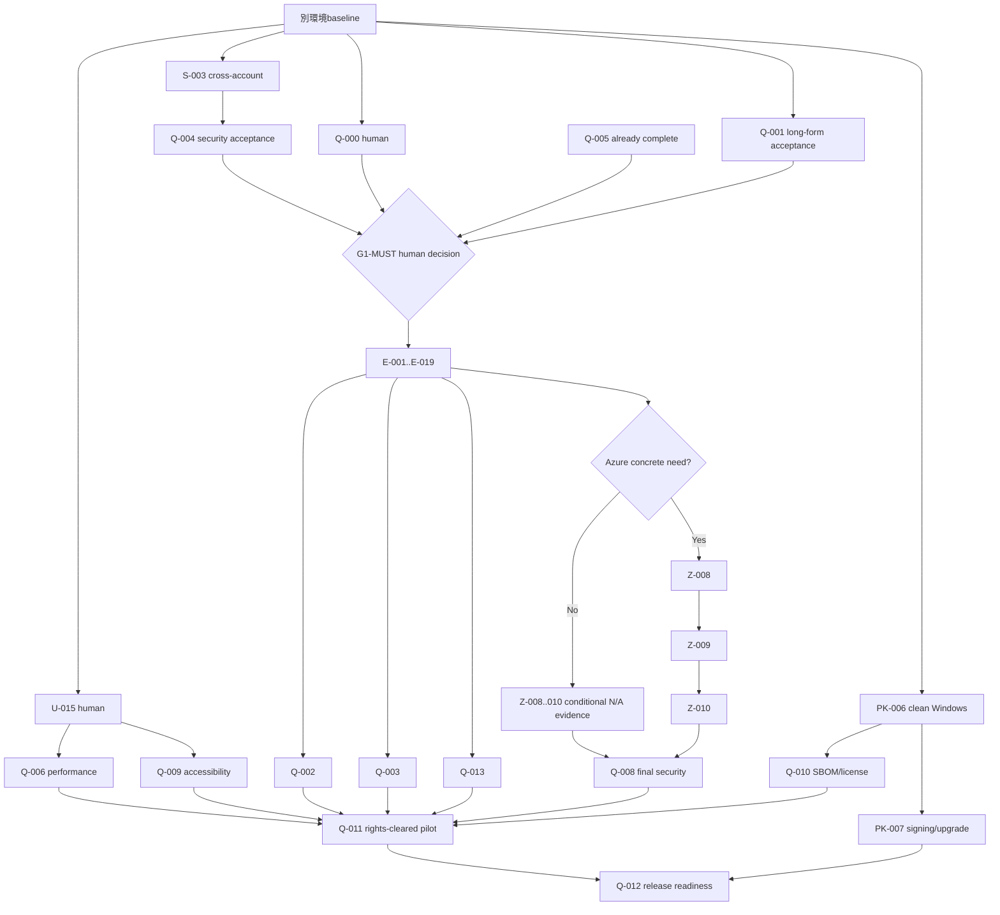

# HubRadio MovieCreator 全残作業 実行・移行計画

**識別子:** 20260902-0645  
**作成日:** 2026-09-02  
**対象:** 別環境での継続実行  
**基準ブランチ:** `main`  
**基準commit:** `e46f1777209d974c417be0c516c5833a8b5234cf`  
**要求の正本:** [`../docs/requirement-definition.md`](../docs/requirement-definition.md) 版 0.1 Draft  
**task定義の正本:** [`../docs/dev/planning/implementation-plan.md`](../docs/dev/planning/implementation-plan.md)  
**現時点:** **160 / 203 task完了、43 task未完了**  
**重要:** 本書は実行計画であり、外部承認、権利、品質、法務、release readinessを承認する文書ではない。

---

## 1. 捏造防止原則

1. 完了状態は、正本のtask ID、Git commit、実在するtest/evidence、外部または人手の受入記録を突き合わせて判定する。ファイル名だけ、空test、0件実行、reviewerの推測だけでは完了にしない。［SRC-01］［SRC-02］［SRC-13］
2. `PENDING`、`condition-false`、`held`、`not applicable`、`inconclusive`を`PASS`へ読み替えない。特に`U-015`と`Q-000`は自動部分が存在しても人手gate未完了である。［SRC-07］［SRC-08］
3. 数値の精度・品質・性能閾値は、正解注釈、複数fixture、人手評価、責任者の承認がない限り作らない。Stage 0で未承認とされた値をproduction合否値へ転用しない。［SRC-04］［SRC-05］
4. 敵対的レビューは必須だが、存在しない問題を作らない。指摘は実コード、正本、再現test、実行結果のいずれかで立証し、立証できないものは「不採用」と理由を記録する。
5. 外部入力が必要なtaskは、入力がないままplaceholder、架空の承認、架空のrights、架空のplatform仕様、架空の署名証拠を作らない。代替経路または明示的な停止状態を維持する。［SRC-03］［SRC-04］［SRC-11］
6. Azureは、既存の限定評価resourceがあることと、実コンテンツ送信・production利用を分離する。`Z-008`〜`Z-010`完了前はend-user cloud featureを有効化しない。［SRC-06］［SRC-15］

---

## 2. 出典台帳

本書中の事実は、次の出典IDを参照する。Git管理ファイルはすべて基準commit `e46f177...`で読んだ内容である。

| ID | 出典 | 用途・確認事項 | SHA-256 / 識別情報 |
|---|---|---|---|
| SRC-01 | `git rev-parse HEAD`、`git status --short --branch --untracked-files=all`、`git log -50`、task inventory検算 | 現在HEAD、177 commit ahead、未コミット6path、task commit、203/160/43の集合検算 | HEAD `e46f1777209d974c417be0c516c5833a8b5234cf`、観測日2026-09-02 |
| SRC-02 | [`../docs/dev/planning/implementation-plan.md`](../docs/dev/planning/implementation-plan.md) | 203 taskのID、依存、成果物、完了条件、G1/G2/release gate | `9636d74bae66519cc9a5097d46c33d499ea4e71574ddc879d23c898c8b548feb` |
| SRC-03 | [`../docs/requirement-definition.md`](../docs/requirement-definition.md) | FR-001〜032、NFR-001〜007、BR-001〜005、AC-001〜005、Must/Should、初期検証4種6本 | `f28c24f9c5f72859ebb71503a6242703ec5225b329e3aa3a7face56fd73e60a9` |
| SRC-04 | [`../benchmarks/results/stage-0-report.md`](../benchmarks/results/stage-0-report.md) | 採用・保留・手動fallback、未承認閾値、release blocker | `c450dd8413977f6790aed3e015edad8b27dbf215b14278e99989eb704ab5c093` |
| SRC-05 | [`../docs/dev/decisions/ADR-0007-stage-0-technology-selection.md`](../docs/dev/decisions/ADR-0007-stage-0-technology-selection.md) | `ST-008`/`A-010`/`A-015` condition-false、`A-012`/`A-013` held、manual-first再baseline | `62e9dfc6d631596bf8bbaf8c9bdef7723455c71e0aaa110f501116e3ec061b0a` |
| SRC-06 | [`../docs/dev/decisions/ADR-0008-bounded-azure-evaluation.md`](../docs/dev/decisions/ADR-0008-bounded-azure-evaluation.md) | Z-001〜007完了、Z-008〜010のruntime gate、API key禁止、送信境界 | `c7985bd64f5b4398e984d402fb2dc86a172f843a160d7f18aa0e09b6f538b580` |
| SRC-07 | [`../tests/Acceptance/Must_VerticalManual.cs`](../tests/Acceptance/Must_VerticalManual.cs)、[`../tests/Acceptance/Invoke-Q000VerticalManualAcceptance.ps1`](../tests/Acceptance/Invoke-Q000VerticalManualAcceptance.ps1) | Q-000自動証拠、7件の人手`PENDING`、`q000Complete=false` | C# `3c4d08d43bef8d11f8c6c90f02d8b0b071bf2e1591d9ead40a0ed55b31c805b3` |
| SRC-08 | [`../docs/dev/accessibility/test-report.md`](../docs/dev/accessibility/test-report.md)、[`../tests/Accessibility/theme-contrast.test.mjs`](../tests/Accessibility/theme-contrast.test.mjs) | U-015自動評価結果、17件の人手`PENDING`、Q-009 gate | report `97e7eb64b7542eb6a21c64c1d022568e4dbba16c0eb8ad23792bacf0fcdd7150` |
| SRC-09 | [`../tests/Acceptance/AC005_Traceability.cs`](../tests/Acceptance/AC005_Traceability.cs)、[`../tests/Acceptance/Invoke-Q005TraceabilityAcceptance.ps1`](../tests/Acceptance/Invoke-Q005TraceabilityAcceptance.ps1) | Q-005のclosed reverse traceability、rights、AI/人、negative control | C# `2f177c5f47a8e889cd882762b0871574f9412c274c654560ae3da1ad074e80c0` |
| SRC-10 | [`../benchmarks/results/recovery.md`](../benchmarks/results/recovery.md) | Q-007合格、5/5 scenario、RPO/RTO単回観測、残余範囲 | `b25cdcb7924455c9b4cdc54c1f3d9d6cc0102384b56cffa73d152c9eee50e772` |
| SRC-11 | [`../packaging/HubRadio.Package/README.md`](../packaging/HubRadio.Package/README.md)、[`../packaging/HubRadio.Package/PACKAGE-NOT-FOR-RELEASE.txt`](../packaging/HubRadio.Package/PACKAGE-NOT-FOR-RELEASE.txt) | PK-006同一host開発証拠、unsigned、clean install/upgrade等未完了 | README `b8a2a39b305956f3ca2a495aac893c1e87089df17d5baffe458d08c4edd65def`、NOT-FOR-RELEASE `615a2ae82e905576477bdc5dcb4114e4f61c5c27d2e11e2ef214ac214b914f20` |
| SRC-12 | [`../docs/dev/licenses/THIRD-PARTY-NOTICES.md`](../docs/dev/licenses/THIRD-PARTY-NOTICES.md)、[`../docs/dev/licenses/dependencies.csv`](../docs/dev/licenses/dependencies.csv)、[`../docs/dev/licenses/models.csv`](../docs/dev/licenses/models.csv) | 非最終notice、未完了SBOM/license/CVE/legal gate | notice `33dcbab20bf36d40aaa167df37931d19be0702b2ef0fcf18fabecc3abbdfb35f` |
| SRC-13 | [`../build.ps1`](../build.ps1)、[`../test.ps1`](../test.ps1)、[`../global.json`](../global.json)、[`../Directory.Build.props`](../Directory.Build.props) | PowerShell 7、.NET 10.0.400、warnings-as-errors、format、Web/Python/.NET全runner | build `f22d6d0599204b2efbea89a9b963e97119d4e1ed7a97ba28f97c4fc92daa69`、test `03a4c7487153ba21de312cfb61042cb0387726ecf2d35ed873f1fb54d0c42027` |
| SRC-14 | [`20260831-0707-plan.md`](20260831-0707-plan.md) | 過去の依存waveと共通実行契約。件数は古いため状態判定には使わない | 基準commit `b0aaad5...`、124/203時点 |
| SRC-15 | [`../docs/dev/azure/deployment-record.md`](../docs/dev/azure/deployment-record.md)、[`../docs/dev/azure/identity-record.md`](../docs/dev/azure/identity-record.md)、[`../docs/dev/azure/data-processing-review.md`](../docs/dev/azure/data-processing-review.md) | Azure実resource、Entra public client、RBAC、data processing、production未承認境界 | 基準commit内の追跡ファイル |

### 出典の優先順位

1. 要求の意味は`SRC-03`。
2. task ID・依存・成果物は`SRC-02`。
3. 採用・保留・条件付き判断は`SRC-04`〜`SRC-06`。
4. 現在の完了状態は`SRC-01`と実在evidence (`SRC-07`〜`SRC-12`)。
5. `SRC-02`冒頭の139/203および`SRC-14`の124/203は過去時点の記録であり、現在件数には使わない。

---

## 3. 現在状態の再計算

全task集合は、`P 10 + ST 16 + F 9 + D 16 + J 10 + M 12 + A 21 + R 26 + U 17 + S 16 + E 19 + Z 10 + PK 7 + Q 14 = 203`である。残taskリストを一意集合として機械検算した結果、完了160、未完了43である。［SRC-01］［SRC-02］

| 群 | 完了 | 未完了 | 残ID | 状態根拠 |
|---|---:|---:|---|---|
| P | 10 | 0 | — | SRC-02 §5.1 |
| ST | 15 | 1 | `ST-008` | SRC-04、SRC-05 |
| F | 9 | 0 | — | SRC-02 §5.3 |
| D | 16 | 0 | — | SRC-02 §5.4 |
| J | 10 | 0 | — | SRC-02 §5.5 |
| M | 12 | 0 | — | SRC-02 §5.6、SRC-10 |
| A | 17 | 4 | `A-010`,`A-012`,`A-013`,`A-015` | SRC-02 §5.7、SRC-05 |
| R | 26 | 0 | — | SRC-01 task commits、SRC-02 §5.8 |
| U | 16 | 1 | `U-015` | SRC-01、SRC-08 |
| S | 15 | 1 | `S-003` | SRC-02 §5.10 |
| E | 0 | 19 | `E-001`〜`E-019` | G1未通過、SRC-02 §5.11 |
| Z | 7 | 3 | `Z-008`〜`Z-010` | SRC-06 |
| PK | 5 | 2 | `PK-006`,`PK-007` | SRC-11、SRC-12 |
| Q | 2 | 12 | `Q-000`〜`Q-004`,`Q-006`,`Q-008`〜`Q-013`（`Q-005`,`Q-007`除外） | SRC-07、SRC-09、SRC-10 |
| **合計** | **160** | **43** |  | SRC-01 machine check |

### 3.1 部分完了を完了へ数えないtask

- `U-015`: 自動keyboard/contrast/focus/mute検査は存在するが、実WebView2、物理keyboard、DPI、High Contrast、screen reader、代表素材による17項目が`PENDING`である。［SRC-08］
- `Q-000`: synthetic contract、自動determinism、privacy、negative controlsは通るが、実素材選択、実manual crop/keyframe、実face/safe-zone確認、実FFmpeg、実QC/visual review、人のapprovalの7項目が`PENDING`で、`q000Complete=false`である。［SRC-07］
- `Q-001`: synthetic contract、byte-level determinism、privacy、候補decision、speaker/topic、長尺plan写像、修正字幕のWebVTT/RenderGraph結合、trace、合成delivery、3負例は通るが、実素材/ASR、人手修正・採否・目視、S-011、実FFmpeg/final render/QC、権限者承認の8項目が`PENDING`で、`q001Complete=false`である。自動証拠は実行していない境界を明示的にfalseとする。
- `PK-006`: 同一hostのunsigned pack/unpackは成立したが、clean Windowsへのinstall、package identity launch、署名、upgrade/rollback/uninstallは未成立である。［SRC-11］
- `S-003`:実装は存在するが、ownerと異なる非管理者accountからの拒否証拠がない。［SRC-02 §5.10］

### 3.2 完了済み受入を再実装しない

- `Q-005`はcommit `b448b8e...`と専用harnessにより、synthetic closed traceability、rights、AI/人の識別、broken evidence負例を検証済みである。実素材・human acceptanceは主張していない。［SRC-01］［SRC-09］
- `Q-007`は5/5 scenarioと9/9 aggregate gateを通過済みである。残余範囲はrelease reviewへ引き継ぐが、同じtaskを重複実装しない。［SRC-10］

---

## 4. 別環境への移行手順

### 4.1 移行前の保護対象

基準時点の`main`には次の未コミット変更がある。所有意図を確認するまで、revert、stage、上書き、削除をしない。［SRC-01］

- tracked: `.vscode/settings.json`、`infra/foundry.bicep`、`infra/main.bicep`
- untracked: `.vscode/tasks.json`、`tests/Reliability/Invoke-Q007ProcessRecovery.ps1`、`work/20260831-0707-plan.md`
- 本書作成後: `work/20260902-0645-ExectionPlan.md`もuntrackedとして追加される。

### 4.2 commit履歴の移送

`main`は観測時点で`origin/main`より177 commit先行しているため、別環境で単に`origin/main`をcloneしても現状態にならない。［SRC-01］

次のどちらかを選ぶ。

1. **承認済みremoteへpush**: `e46f177...`がremoteから取得可能になったことを別環境で確認する。
2. **Git bundle**: 現環境で全commitをbundle化し、別環境でimportする。bundleのSHA-256も別経路で照合する。

移行後の必須照合:

- `git rev-parse HEAD`が`e46f1777209d974c417be0c516c5833a8b5234cf`または、その内容を含む明示的な後続commitである。
- `git merge-base --is-ancestor e46f177... HEAD`が成功する。
- `git log --oneline --decorate -20`にQ-000、U-015、U-017、U-010、Wave 4 task commitsが存在する。［SRC-01］

### 4.3 未コミット変更の移送

- tracked 3pathはbinary-safe patchとして別保存し、適用前後の`git diff --check`とpath一覧を比較する。
- untracked 4pathは個別にcopyし、sizeとSHA-256を照合する。
- `.vscode/tasks.json`は絶対一時pathを含み得るため、新環境で存在確認できないtaskは実行しない。
- 複数の旧worktree directoryは移送しない。正規の継続点はmainの`e46f177...`であり、旧worktreeは履歴調査用にのみ残す。［SRC-01］

### 4.4 新環境bootstrap

1. Windows x64、PowerShell 7+、.NET SDK 10.0.400、Node/npm、CPython 3.12を確認する。SDK selectorとrunnerはrepositoryに固定されている。［SRC-13］
2. repository rootで`pwsh.exe -NoLogo -NoProfile -File .\test.ps1 -Configuration Release`を実行する。これはrestore、hash-locked Python依存、Web typecheck/build、dotnet format、warnings-as-errors build、PowerShell parse/lint、.NET/Web/Python testを実行する。［SRC-13］
3. environment-gated inconclusiveは件数と理由を保存し、PASSへ数えない。
4. baseline失敗時は残taskへ進まず、基準commitとの差、toolchain、ignored artifact、環境gateを切り分ける。

---

## 5. 全task共通の実行契約

各taskは次の順で処理する。外部受入taskでも、実装stepを「環境準備・証拠採取」に読み替えて同じreview disciplineを適用する。［SRC-02］［SRC-13］

1. **隔離:** 最新mainから`<repo>-<task-id>`のdetached worktreeを作る。1 task 1 worktree、1 task 1 logical commitとする。
2. **正本再読:** SRC-02のtask行、SRC-03の要求、直接依存の実装・test・schemaを読む。
3. **入力gate:** 権利、署名、annotation、品質profile、人手判断が不足していれば、実装前に停止条件として記録する。
4. **最小実装:** 既存型を再利用し、2つ目の実装がないinterface、未来用flag、汎用plugin、任意thresholdを作らない。
5. **focused tests:** success、invalid、stale、duplicate、cancel、timeout、partial failure、privacy、authorization-before-existenceの該当caseを追加する。
6. **静的検証:** IDE diagnostics、`git diff --check`、JSON/schema/XML/CSV/Bicep parse、0-byte source scan（`bin/`/`obj/`除外）を行う。
7. **実行検証:** warnings-as-errors buildと、必ず1件以上discoverするfocused testを実行する。MSTestはMTP executableまたは`dotnet run ... -- --filter ... --minimum-expected-tests 1`を使う。［SRC-13］
8. **敵対的レビュー:** 実装担当とは別に、(a) correctness、(b) security/privacy/reliability、(c) requirements/schema/traceabilityの3方向でreviewする。
9. **指摘の立証:** file/symbol、違反契約、再現入力、失敗testの4点を確認する。外部worktreeをmainと取り違えた検索、build成功と矛盾する「未定義」、正本にない件数/閾値は不採用にする。
10. **反映:** 立証できた指摘だけ修正し、reviewerとは別に再レビューする。指摘0件も、その根拠を記録する。
11. **全回帰:** `test.ps1 -Configuration Release`を実行し、失敗0を確認する。環境gateは分離する。
12. **commit:** 意図したpathだけを明示stageする。`git add -A`は禁止。cached stat、cached diff、空白を確認してcommitする。
13. **統合:** 共有bridge/schema/App shellを触るtaskは専用integration worktreeへ順次cherry-pickし、closed unionを構成する。統合後も3方向reviewと全回帰を行う。
14. **main反映:** mainの未コミットstatusを前後比較し、無関係な変更が1行でも変化したら停止する。
15. **状態同期:** taskの証拠、commit、test件数、残余範囲を本書とSRC-02へ反映する。完了数を再計算する。

---

## 6. 依存順ロードマップ

### 並列化方針

- **今すぐ並列:** `U-015/Q-009`人手準備、`S-003/Q-004`環境準備、`Q-000`人手受入、`Q-001`harness、`PK-006`clean Windows準備。
- **G1後 第1群:** `E-001`,`E-005`,`E-006`,`E-007`,`E-009`,`E-011`,`E-013`,`E-014`。
- **第2群:** `E-002`,`E-004`,`E-008`,`E-010`,`E-019`。
- **第3群:** `E-003`,`E-012`,`E-016`,`E-017`,`E-018`。
- **第4群:** `E-015`（E-001〜004完了後）。
- shared bridge/UI integrationは並列実装後、1件ずつ専用integration worktreeへ合成する。

---

## 7. Gate待ち・条件付きtask（7件）

### ST-008 — pyannote diarization評価

- **現在:** condition-false。利用条件へ同意せずmodel未取得。手動speaker割当が正規fallback。［SRC-04 §4/§5］［SRC-05］
- **開始条件:** 権限ある利用者・法務による明示同意、exact model revision/license/hash、再配布可否、rights-cleared speaker annotation、別の採用判断。
- **実行:** 条件成立後だけ隔離benchmark環境でmodelを取得し、話者数・誤割当・失敗条件・resource使用をannotationへ照合する。取得物を直ちにproduct lockへ入れない。
- **敵対検証:** 条件不同意、hash drift、offline、話者数不一致、重複speaker、PIIを含むlogを拒否する。
- **完了証拠:** `benchmarks/results/diarization-benchmark.json`、同意/版/hash、採否記録、manual fallback不変。
- **条件不成立時:** 実装しない。Q-012でcondition-falseとして根拠を再確認する。
- **出典:** SRC-02 `ST-008`、SRC-03 FR-003、SRC-04、SRC-05。

### A-010 — diarization結果のproduct統合

- **現在:** condition-false。`ST-008`が採用へ変わらない限り開始禁止。［SRC-05］
- **開始条件:** ST-008の採用決定とPK用artifact evidence。
- **実行:** 匿名speaker clusterだけをTranscript revision/digestへ結び、A-011のmanual assignmentを置換せず任意候補として追加する。
- **検証:** model不在/不同意/hash不一致/stale transcript/話者数不整合でfail closed。自動で氏名を確定しない。
- **完了証拠:** worker/host境界、closed schema、focused tests、A-011 fallback test、3方向review。
- **出典:** SRC-02 `A-010`、SRC-03 FR-003、SRC-05。

### A-012 — shot detector再評価

- **現在:** held。fixture 3構成で境界0件、synthetic controlのみ成功、正例annotationなし。［SRC-04］［SRC-05］
- **開始条件:** 代表fixtureの正例shot annotation、評価規則、detector/threshold候補、別の人手承認。
- **実行:** PTSを正本にしたcandidate producerを比較し、thresholdはannotation結果から版付きで決定する。R-016/manual edit boundaryをfallbackとして維持する。
- **検証:** VFR、hard cut、gradual transition、境界なし、false positive/negative、version drift。公称fpsで時刻を作らない。
- **完了証拠:** benchmark、annotation hash、採用規則、focused tests、fallback不変。
- **出典:** SRC-02 `A-012`、SRC-03 FR-006/FR-016、SRC-04、SRC-05。

### A-013 — face detector再評価

- **現在:** held。positive control 1件、fixture 300/300 frame検出0、bbox annotationなし。［SRC-04］［SRC-05］
- **開始条件:** small/profile/multiple-faceを含む代表bbox annotation、IoU等の評価定義、別承認。
- **実行:** face evidenceをsource PTS/frameへ結ぶ候補producerとして実装する。manual subject/keyframe/safe zoneを主経路として残す。
- **検証:** 0件、複数顔、横顔、小顔、資料共有、stale frame map、confidence/version drift。
- **完了証拠:** annotation、benchmark、採否記録、manual fallback tests。
- **出典:** SRC-02 `A-013`、SRC-03 FR-010/014/021、SRC-04、SRC-05。

### A-015 — local text model再採用

- **現在:** condition-false。Stage 0のaccepted grounded JSONは0件。［SRC-04］［SRC-05］
- **開始条件:** 新しいmodel/runtimeで、根拠ID、意味保全、固有名詞、数値、offline/resource制約を満たす正例と別承認。
- **実行:** A-014/A-020のmanual-first経路を残し、model結果はProposed候補に限定する。
- **検証:** invalid JSON、unknown evidence、意味変更、数値/名称hallucination、timeout、memory、offline、stale input。
- **完了証拠:** benchmark、exact artifact hash、採用判断、manual path不変。
- **出典:** SRC-02 `A-015`、SRC-03 FR-006、SRC-04、SRC-05。

### U-015 — accessibility人手受入

- **現在:** 自動部分PASS、人手17項目PENDING、総合未受入。［SRC-08］
- **実行環境:** 実WinUI/WebView2 host、物理keyboard、light/dark、100/125/150%以上DPI、High Contrast/forced colors、320px相当、対象screen reader、代表字幕/音声素材。
- **実行:** SRC-08の17項目を順番どおり実施し、評価者、OS build、WebView2 runtime、display、DPI、theme、素材、時刻、観測、修正を追記する。
- **不合格時:** 最小修正→focused automated test→該当人手flow→全回帰→独立reviewの順で再確認する。
- **完了条件:** 全項目に実測結果があり、`HUMAN EVALUATION`と`U-015 acceptance`を権限ある人が明示判定する。
- **出典:** SRC-02 `U-015`、SRC-03 NFR-005、SRC-08。

### S-003 — cross-account workspace ACL受入

- **現在:** code/同一account testは存在するが、別の非管理者account証拠待ち。［SRC-02 `S-003`］
- **環境準備:** owner accountで専用workspaceを作成し、別の標準非管理者accountを用意する。SID/絶対pathをevidence本文へ出さない。
- **実行:** unauthorized accountで`HUBRADIO_ACL_UNAUTHORIZED_TEST_WORKSPACE`、`HUBRADIO_ACL_OWNER_SID`、`HUBRADIO_ACL_UNAUTHORIZED_TEST_SID`をprocess-localに設定し、`WorkspaceAclAcceptanceTests.UnauthorizedNonAdministratorAccountCannotEnumeratePreparedWorkspace`を実行する。
- **検証:** 列挙、読取、作成が拒否され、owner操作は成功し、DACL/継承/owner検査が一致する。reparse-point環境gateは別に記録する。
- **後処理:** process-local環境変数とfixtureを安全に撤去し、値をlogへ残さない。
- **完了証拠:** OS/account種別、test名、結果、redacted ACL shape、日時。実SID値は保存しない。
- **出典:** SRC-02 `S-003`、SRC-03 NFR-004/AC-004、`tests/HubRadio.Infrastructure.Tests/WorkspaceAclAcceptanceTests.cs`。

---

## 8. G1-MUST前に完了する受入task

### Q-000 — 9:16手動縦切り（自動部分済み、人手7項目残り）

1. 新環境で既存harnessを再実行し、deterministic synthetic evidenceとsource fingerprintを基準化する。［SRC-07］
2. rights-cleared実素材から人が1区間を選び、その選択者・理由・source PTSを記録する。
3. manual crop/keyframeを実操作し、顔/資料など主要対象とgeneric safe zoneを人が確認する。platform-specific safe zoneを使う場合はE-014の実測profileを待つ。
4. 固定hashのFFmpegを使い、tokenized argumentで実renderする。legal/release gateが閉じている場合は外部公開せず、承認者の判断を待つ。
5. 実OutputQcとvisual reviewを行い、字幕位置・同期・画角・元時刻逆引きを確認する。
6. stale approval、broken provenanceの負例を再実行する。
7. 権限ある人が7 checklistを判定し、`humanDecision`と`q000Complete`を事実に合わせて更新する。
8. **完了条件:** 実素材・実render・実QC・人のapprovalが揃い、PENDINGが0。自動証拠だけでは完了不可。
9. **出典:** SRC-02 `Q-000`、SRC-03 FR-010/012〜015/026/031、SRC-07、SRC-04。

### Q-001 — AC-001長尺Must flow（自動契約済み、人手8項目残り）

1. `tests/Acceptance/AC001_LongForm.cs`と`Invoke-Q001LongFormAcceptance.ps1`を作成済み。1件以上をdiscoverするfocused test、strict/canonical privacy-safe JSON、byte-identical repeat、source fingerprint、warnings-as-errors build、全回帰を通し、synthetic contract testと人手flowを分離した。
2. 元動画取込→ASR→人修正→候補採否→speaker/topic→長尺構成→字幕/強調→thumbnail→trace→review/approval→render/QC→deliveryを同一Project/Composition digestで通す。
3. A-010/A-012/A-013/A-015は必須にせず、manual speaker/topic/layout/text経路を使う。
4. 不要区間候補を自動削除せず、人のdecisionをappend-onlyで残す。
5. 負例: stale revision、stale approval、権利未確認、broken OriginRef、render hash mismatch、cancel/restart、cross-version artifact。
6. 人がAC-001各項目、字幕修正、元位置、承認済み出力を確認する。
7. **現在の自動証拠:** 候補の合成decision、speaker/topic、長尺planからCompositionへの写像、修正字幕のWebVTT/RenderGraph結合、13 output probe、2 source round-trip、合成QC/approval/delivery、broken provenance・stale approval・権利未確認の負例を検証した。実素材、実ASR、S-011 authorization、実FFmpeg/final render、実媒体QC、thumbnail、人手承認は実行しておらず、8項目を`PENDING`、`q001Complete=false`としている。
8. **完了証拠:** canonical privacy-safe evidence、使用commit/source fingerprints、artifact hashes、human checklist、known limitations。自動証拠だけでは完了不可。
9. **出典:** SRC-02 `Q-001`、SRC-03 AC-001/§7/FR-001〜031、SRC-04 manual fallback。

### Q-004 — AC-004 security/authorization/approval

1. S-003 cross-account証拠を先に完了する。
2. Viewer/Editor/各Reviewer/Approver/Adminの許可・拒否matrixを、実Windows actorでcross-role実行する。
3. unauthorized project/media enumeration、社内限定から外部destination、未承認final、stale approval、rights exception、sensitivity未解消、audit閲覧を検査する。
4. 認可はresource existence確認より前に行われることを負例で確認する。
5. Bridge/media/process/pathの既存敵対testも同一release候補で再実行する。
6. **完了条件:** S-003を含むcross-account結果、誤出力block、audit閲覧、残余リスクが記録され、人がAC-004を承認する。
7. **出典:** SRC-02 `Q-004`、SRC-03 AC-004/NFR-004/BR-002〜004、SRC-05。

### Q-006 — Stage 1性能・部分再処理

1. U-015の人手受入後に開始する。
2. `benchmarks/results/stage-1-performance.md`へ、部分再処理、UI応答、preview/final render、disk/DB、CPU/RAM/GPUが取得可能な範囲を実測する。
3. subtitle修正でASR/audio抽出を再実行しないこと、previewとfinalを分離することをA-017/J-007 evidenceで確認する。
4. percentileや合格値を新規に作らず、P-009/ST-015で承認済みの判定規則だけへ照合する。未承認値は測定値として残す。
5. 未達時はmanual fallbackまたはblockを明記し、成功へ丸めない。
6. **完了証拠:** hardware/toolchain、入力hash、run境界、raw/canonical evidence、human disposition。
7. **出典:** SRC-02 `Q-006`、SRC-03 NFR-001/002、SRC-04 §6。

### Q-009 — accessibility最終受入

1. U-015の17項目を完了し、同じ結果をQ-009として要求へtraceする。
2. keyboard、focus、contrast、非色依存、字幕、SDH、mute、音声のみ、screen readerを実WebView2で確認する。
3. 自動scanner/component testと人手flowの両方を記録する。
4. 不合格修正後は自動全回帰と該当人手flowを再実行する。
5. **完了条件:** SRC-08のPENDINGが0、評価者と環境が記録され、NFR-005を人が承認する。
6. **出典:** SRC-02 `Q-009`、SRC-03 NFR-005、SRC-08。

### G1-MUST判定

- 必須task: `Q-000`,`Q-001`,`Q-004`,`Q-005`。Q-005は完了済み。関連NFRとしてQ-006/Q-009の結果も確認する。［SRC-02 §4/§6］
- 4件すべてと関連NFR evidenceが揃うまでE群を開始しない。
- gate判定は権限ある人が日時・根拠・残余リスクを記録する。coding agentが自動で承認しない。

---

## 9. G1後のShould実装（19件）

以下の各taskでも§5の共通実行契約と3方向reviewを必須とする。

### 第1並列群

#### E-001 — 完結短尺候補

- **実装:** `APP/Highlights/CandidateGenerator.cs`。人が確定したtopic/utterance/SourceSpanから、文・Q&A・topicを途中で切らないrangeを列挙し、公開policyをhard gateにする。
- **禁止:** unsafe候補を魅力度scoreで相殺しない。semantic completenessをmodelなしに捏造しない。
- **tests:** source boundary、必要context、topic外、stale span、internal-only、決定性、重複ID、cancel。
- **完了証拠:** candidate reason/context deficit/policy dispositionとOriginRef。
- **出典:** SRC-02 `E-001`、SRC-03 FR-007、SRC-04 manual-first。

#### E-005 — thumbnail quality候補

- **実装:** blur/露出/余白など決定論的に算出できる測定値と理由を提示し、R-023 template合成へ人が選ぶ候補を渡す。
- **禁止:** face scoreはA-013採用前に使わない。目・口・表情の意味を推定しない。未承認thresholdで自動reject/rankしない。
- **tests:** raw measurement、missing frame、VFR PTS、template/rights drift、manual selection、同一入力決定性。
- **出典:** SRC-02 `E-005`、SRC-03 FR-021、SRC-05 A-013 fallback。

#### E-006 — 音声検査・補正・A/B

- **開始入力:** 権限ある人が版付きAudioDeliveryProfileを承認する。loudness/true peak targetが未承認なら測定とtoggle UIだけを実装し、自動補正合格を主張しない。
- **実装:** `INFRA/Audio/`とWeb A/B。補正chainをtyped allowlistにし、before/after hashを保持する。
- **tests:** clip、左右、noise/hum、無音、toggle、cancel、path/filter injection、source不変、A/B state。
- **人手:** 声質を代表素材で比較し、機械値だけで採用しない。
- **出典:** SRC-02 `E-006`、SRC-03 FR-020、SRC-04未承認loudness/true peak。

#### E-007 — 資料OCR

- **実装:** `WORKER/tasks/ocr_materials.py`と`APP/Materials/`。page/region/source/right/publication scopeを保持する候補を生成する。
- **境界:** 任意URLを取得しない。host発行stagingだけを読み、既存process/resource envelopeを使う。
- **tests:** malformed/oversized/deep document、timeout/cancel、secret candidate、rights deny、stale source、SourceSpan mapping、内容非log。
- **出典:** SRC-02 `E-007`、SRC-03 FR-018/BR-003/004。

#### E-009 — transcript-driven reframe

- **実装:** speaker turn、A-011手動割当、人が指定したsubject keyframeから離散layout候補を生成する。
- **禁止:** diarization/faceを必須にしない。連続追尾精度を捏造しない。
- **tests:** subject欠落、複数話者、speaker change、keyframe範囲、stale assignment、manual fallback、preview/render座標一致。
- **出典:** SRC-02 `E-009`、SRC-03 FR-010、SRC-05 manual-first再baseline。

#### E-011 — grounded quiz候補

- **実装:** 人が選ぶ根拠spanから問い、情報、待ち、答え、元発言、解説、CTAを決定論的に構成し、曖昧時`reviewRequired`にする。
- **禁止:** 根拠なしの答え・数値・固有名詞を作らない。modelなしでもmanual/template pathを成立させる。
- **tests:** multiple interpretation、missing evidence、stale span、number/name drift、wait編集、CTA、採否分離。
- **出典:** SRC-02 `E-011`、SRC-03 FR-022/AC-003。

#### E-013 — publishing metadata

- **実装:** topic/performer/CTAから編集可能なtitle、summary、chapter、hashtag、post templateを作り、manual edit provenanceを保持する。
- **禁止:** 入力にない名称、URL、事実を補完しない。E-013だけでexternal publicationを許可しない。
- **tests:** name/URL grounding、OriginRef/EditorialRecord、publication scope、stale topic、manual child revision、XSS text。
- **出典:** SRC-02 `E-013`、SRC-03 FR-025/BR-003。

#### E-014 — platform UI mask/safe-zone

- **開始入力:** 対象platformごとの公式仕様URL、確認日、実機capture、reviewerを用意する。
- **実装:** 版付きprofileとして保存し、期限切れ/不明時は既存generic maskへfallbackする。
- **禁止:** 推測pixel、古いblog、単一端末値を普遍値にしない。外部APIをruntime依存にしない。
- **tests:** profile version、expiry/unknown fallback、縦横、DPI、offline、visual regression、人手capture照合。
- **出典:** SRC-02 `E-014`、SRC-03 FR-014/026、SRC-04 cross-DPI未承認。

### 第2並列群

#### E-002 — heuristic ranking

- **開始入力:** E-001完了と、P-009に沿ったfeature/normalization/weight/tie規則の版付き承認。承認がない場合はunranked feature vectorに留め、E-002完了を主張しない。
- **実装:** 客観feature、score内訳、理由、不足contextを保存し、安全policyをscore外hard gateにする。
- **tests:** missing feature、tie、順序決定性、overflow、version drift、policy gate不可侵。
- **出典:** SRC-02 `E-002`、SRC-03 FR-007、SRC-04数値threshold未承認。

#### E-004 — grounded hook

- **実装:** E-001候補と実SourceSpanから、結論/質問等の引用候補または明示EditorialRecordを作る。model paraphraseは任意で未開始でもよい。
- **tests:** 意味変更、根拠なし断定、話者偽装、stale span、manual template、adopt/reject。
- **出典:** SRC-02 `E-004`、SRC-03 FR-011、SRC-04 manual authoring。

#### E-008 — BGM/SFX/ducking

- **開始入力:** exact RightsRecordを持つ音源と、承認済みducking envelope/profile。未提供なら実音源を組み込まない。
- **実装:** typed AudioCue/AudioEmitter、区間別音源、manual override、A/Bを実装する。
- **tests:** rights未確認、source hash drift、envelope bounds、dialogue masking、filter/path injection、cancel、source不変。
- **出典:** SRC-02 `E-008`、SRC-03 FR-019/BR-004、SRC-04未承認音声値。

#### E-010 — jump-cut緩和候補

- **実装:** Composition edit境界と承認素材からB-roll/資料/zoom/crossfade候補を作る。R-016 typed transitionだけを使う。
- **禁止:** 存在しない映像を事実映像として生成しない。A-012/A-013を必須にしない。
- **tests:** source continuity、rights、missing material、manual transition、stale boundary、unsupported combination。
- **出典:** SRC-02 `E-010`、SRC-03 FR-017、SRC-05。

#### E-019 — reframe UI

- **実装:** E-009のlayout reason、subject keyframe、失敗区間、manual fallbackを表示・編集する。
- **tests:** bboxなし、speaker change、preview sync、manual keyframe復帰、stale evidence、keyboard、XSS。
- **出典:** SRC-02 `E-019`、SRC-03 FR-010/026。

### 第3・第4群

#### E-003 — diversity/near-duplicate

- **開始入力:** E-002完了と、近似判定method/thresholdのannotation-backed承認。未承認ならexact duplicateだけを識別し、近似除去を主張しない。
- **実装:** 候補を削除せず理由付きclusterにまとめ、全候補とdecision provenanceを保持する。
- **tests:** false merge/split、order、tie、label不足、stale candidate、decision不変。
- **出典:** SRC-02 `E-003`、SRC-03 FR-007/028、SRC-04。

#### E-012 — short-form templates

- **実装:** 教育、驚き、誤解訂正、失敗談、比較、ranking、Q&A、story、quiz、demo先出しをtyped template/required slotとして定義する。
- **tests:** missing slot、OriginRef、template version、unsupported combination、ranking根拠欠落、manual override。
- **出典:** SRC-02 `E-012`、SRC-03 FR-023。

#### E-015 — highlight/hook UI

- **依存:** E-001〜004完了後。
- **実装:** score内訳、不足context、policy、根拠、採否、hook差分、元時刻jumpを表示する。
- **tests:** rankingとsafety分離、stale candidate、keyboard、manual edit、XSS、authorization、unknown kind。
- **出典:** SRC-02 `E-015`、SRC-03 FR-007/011/028。

#### E-016 — quiz/publishing UI

- **実装:** E-011〜013の根拠、wait、ambiguity、wording、CTA、metadataを編集する。
- **tests:** 根拠移動、manual override、reviewRequired、version conflict、double submit、XSS、keyboard。
- **出典:** SRC-02 `E-016`、SRC-03 FR-022/023/025。

#### E-017 — materials/jump-cut UI

- **実装:** page/region/time/source/rightsを表示し、承認素材だけをtyped operationで採用する。
- **tests:** external-publication deny、missing page、stale OCR、manual placement、OriginRef、keyboard。
- **出典:** SRC-02 `E-017`、SRC-03 FR-017/018/BR-004。

#### E-018 — audio UI

- **実装:** BGM/SFX、rights、ducking、補正before/afterを比較する。
- **tests:** 未確認素材不可、mute、keyboard、envelope bounds、A/B state、stale profile、no raw path。
- **出典:** SRC-02 `E-018`、SRC-03 FR-019/020。

---

## 10. 条件付きAzure（3件）

### Azure分岐判定

E-004、E-011、E-013のlocal/manual具体実装と人手評価後、cloudが必要かを再判定する。既存resourceの存在だけで必要性を成立させない。［SRC-06］［SRC-15］

- **不要または未証明:** Z-008〜010を実装せず、Q-008/Q-012へconditional-not-applicableの根拠を記録する。
- **必要性が実証され、利用者が明示承認:** 次の順で実施する。Azure code/operation前に公式資料、現resource/model/quota/cost/data policyを再照会する。

### Z-008 — 2 concrete implementations後のinterface抽出

1. local/manual concrete engineとAzure concrete adapterを先に同じclosed DTOで成立させる。
2. 共通になった最小部分だけを`ITextSuggestionEngine`へ抽出する。
3. 既存Entra public client/RBACを使い、API key/client secretを作らない。
4. Z-007のmask/diff/digest-bound one-shot確認を必須にする。
5. tests: auth/quota/offline/timeout/cancel、request digest、no raw ID/path/media、manual fallback、二重確認拒否。
6. **出典:** SRC-02 `Z-008`、SRC-03 NFR-007、SRC-06、SRC-15。

### Z-009 — grounded response validation

1. Structured Outputをclosed schemaへparseする。
2. evidence ID、引用、数値、固有名詞、URL、rangeを送信前snapshotへ再照合する。
3. unknown/missing/duplicate evidence、hallucinated value、prompt injection、Unicode spoof、oversized/partial responseを採用不可にする。
4. schema適合だけを真実性とみなさない。
5. **出典:** SRC-02 `Z-009`、SRC-03 FR-006/011/022/025、SRC-06。

### Z-010 — cloud feature gate/evaluation/audit

1. local/manual/cloudを同一rights-cleared inputsで比較し、raw contentをreportへ複製しない。
2. offline/auth/quota/timeout/content-filter/invalid responseでmanual/localへ戻し、編集を失わない。
3. provider/model/version/region/config/input/output digest、sent-data classification、retention、outcomeをModelRunへ記録する。
4. cloud結果を自動採用しない。disable/sign-outを試験する。
5. **出典:** SRC-02 `Z-010`、SRC-03 NFR-003/004/006、SRC-06、SRC-15。

---

## 11. 配布・供給網（2件）

### PK-006 — clean Windows package受入

1. WAP/MSIX workloadを持つclean Windows 11 x64 snapshotを用意する。同一開発host unpackを代替にしない。［SRC-11］
2. 最新release candidateからWAP projectをbuildし、固定Python runtime/model/FFmpeg/Web/WinUI componentのpath/size/hashを再検証する。
3. test certificateは利用者が端末で直接管理し、secretをagent/chat/logへ渡さない。
4. test-signed MSIXをinstallし、package identityからAppを起動する。
5. App、worker native imports/health/protocol、FFmpeg/ffprobe、offline CPU/int8 model、Web assets、WebView2 startup/recoveryを確認する。
6. install treeがread-onlyで、書込みがmanaged workspaceだけに発生することを確認する。
7. install前後、launch、component hashes、uninstall前状態をprivacy-safe evidenceへ保存する。
8. **完了条件:** `InstalledMsixValidated`と`CleanMachineValidated`が実証に基づきtrue。release approvalはPK-007/Q-010までfalseのまま。
9. **出典:** SRC-02 `PK-006`、SRC-11、SRC-12。

### PK-007 — trusted signing/upgrade/rollback/uninstall

1. distribution ownerが署名主体、trusted certificate、timestamp、配布経路を決定する。
2. 旧版→新版upgrade、失敗upgrade、DB migration、rollback-as-new-install、revocation、uninstallをclean snapshotで実施する。
3. workspace/cache/backupを保持または削除する方針をP-007と組織判断へ結ぶ。任意の日数を設定しない。
4. 秘密は人がterminalへ直接入力し、script引数、repo、logへ保存しない。
5. `docs/dev/release/package-runbook.md`とtest recordsを作成する。
6. **完了条件:** trusted install、upgrade、rollback、uninstall、data policy、owner approvalがすべて実証済み。
7. **出典:** SRC-02 `PK-007`、SRC-03 NFR-003/004、SRC-11、SRC-12。

---

## 12. Stage 2・security・release受入（残り7件）

### Q-002 — AC-002縦型Should受入

- **依存:** Q-000、E-014、E-015、E-019、U-011。
- **実行:** 複数短尺候補、manual subject/資料、hook変更、platform/generic safe zone、意味保全、manual fallbackをrights-cleared素材で確認する。
- **負例:** face候補なし、stale profile、根拠なしhook、字幕重なり、cross-version案。
- **完了:** visual/human evidenceとAC-002 checklistを人が承認する。
- **出典:** SRC-02 `Q-002`、SRC-03 AC-002/FR-007/010/011/014/026。

### Q-003 — AC-003 quiz受入

- **依存:** E-011、E-016、S-011。
- **実行:** 問い、情報/選択肢、待ち、答え、元発言、解説、CTAを通し、根拠へ移動できることを確認する。
- **負例:** 根拠なし、複数解釈、数値/固有名詞drift、stale span、未承認出力。
- **完了:** ambiguityが確定不可になり、人が修正・承認したevidenceを保存する。
- **出典:** SRC-02 `Q-003`、SRC-03 AC-003/FR-022/023。

### Q-008 — release-candidate security総合

1. M-012、S-014以後に増えた全Web bridge/UI、Render compiler、delivery、Azure該当surfaceを対象にする。
2. media/bridge/worker/FFmpeg/filter/path/promptの敵対入力を統合する。
3. authorization-before-existence、XSS、shell/filter injection、traversal/UNC/device/ADS、invalid Unicode、oversized input/output、cancel/timeout、reparse/TOCTOU、content-free logsを検証する。
4. Azure未使用ならZ-009をN/Aにする根拠を明示する。使用するならZ-009/Z-010を含める。
5. Critical未解決0を確認し、残余リスクをsecurity ownerが承認する。
6. **成果物:** `tests/Security/`、`docs/dev/security/test-report.md`。
7. **出典:** SRC-02 `Q-008`、SRC-03 NFR-004/BR-003、SRC-05、SRC-06。

### Q-010 — SBOM/Model BOM/license/CVE

1. PK-006の実installed package bytesを入力にSBOMとModel BOMを生成する。
2. NuGet/npm/Python/native/.NET runtime/WebView2/font/model/FFmpeg/static dependencyをpackage inventoryへ照合する。
3. exact version/source/hash、license、notice、corresponding source/build instructions、advisory/CVEを確認する。
4. CUDAを配布しないCPU-only closure、held/condition-false model不在、source map/PDB/cache不在を確認する。
5. 未確認license/model/CVEが1件でもあればrelease blockを維持する。
6. legal/security ownerの判断・例外根拠を保存する。
7. **成果物:** `artifacts/sbom.*`、`docs/dev/licenses/release-review.md`、final notices。
8. **出典:** SRC-02 `Q-010`、SRC-03 NFR-006、SRC-11、SRC-12。

### Q-013 — FR-031 output matrix

1. E-013/E-016完了後、1つの承認Compositionから長尺、縦型、横長短尺、字幕焼込/なし、字幕file、transcript、thumbnail、chapter、投稿文、編集指示、review、使用区間を生成する。
2. artifact ID/hash/size/version/OriginRef、DeliveryManifest、subtitle variant、approval/QC bindingを照合する。
3. missing、duplicate、cross-version、wrong digest、stale approvalを負例にする。
4. **成果物:** `tests/Acceptance/FR031_OutputMatrix.*`とprivacy-safe inventory。
5. **出典:** SRC-02 `Q-013`、SRC-03 FR-031、SRC-09のtraceability pattern。

### Q-011 — rights-cleared initial pilot

1. 要求§18の実素材と権利証拠を準備する。権利未確認fixtureを外部公開へ使わない。
2. 16:9社内長尺1本、YouTube 16:9版1本、9:16短尺3本、quiz 9:16版1本の計6本を生成する。
3. 自動提案区間、採用区間、字幕修正、人物/製品名、不要テロップ、不自然画角、不要transition、承認修正、template改善を記録する。
4. DeliveryManifest、artifact hashes、used spans、review/approval、known limitationsを保存する。
5. **完了条件:** content/review/rights ownerが全6本と記録を承認する。
6. **出典:** SRC-02 `Q-011`、SRC-03 §18、SRC-04 rights/release blockers。

### Q-012 — final readiness / G-RELEASE

1. 203 IDを実装済み、条件付き、condition-false、held、対象外、未完了へevidence付きで再分類する。
2. 要求FR/NFR/BR/AC、13未決事項、known limitations、residual risks、package/SBOM/security/accessibility/pilotを確認する。
3. condition-false/held taskを成功へ偽装せず、manual fallbackが存在することを確認する。
4. Q-011とPK-007未完了なら実施しない。
5. 権限あるproduct/security/legal/distribution関係者が`G-RELEASE`を判断する。agentは承認しない。
6. **成果物:** `docs/dev/release/readiness-review.md`、SRC-02 status更新、全evidence index。
7. **出典:** SRC-02 `Q-012`、SRC-03 §19/§20、SRC-04、SRC-11、SRC-12。

---

## 13. 各waveの統合・レビューchecklist

- [ ] 基準mainとtask worktreeの親commitを記録した。
- [ ] task正本、要求、直接依存、既存public APIを読んだ。
- [ ] 外部入力・人手gate・未承認thresholdを明記した。
- [ ] focused testが1件以上実行された。
- [ ] correctness reviewを別担当で実施した。
- [ ] security/privacy/reliability reviewを別担当で実施した。
- [ ] requirements/schema/traceability reviewを別担当で実施した。
- [ ] 全指摘を再現し、実在指摘だけを反映した。
- [ ] 不採用指摘の根拠を残した。
- [ ] `git diff --check`、parse、diagnostics、0-byte scanが成功した。
- [ ] `test.ps1 -Configuration Release`が失敗0である。
- [ ] environment-gated inconclusiveをPASSへ数えていない。
- [ ] transcript、PII、path、SID、credential、prompt/response本文をevidenceへ複製していない。
- [ ] model/media/package/raw benchmarkをGitへ誤追跡していない。
- [ ] mainの利用者変更が統合前後で完全一致した。
- [ ] 1 task 1 logical commitである。
- [ ] 完了数と残数を203 ID集合から再計算した。

---

## 14. 最短の実行順

1. **移行:** commit履歴と未コミット7pathを別環境へ安全に移し、baseline全回帰を通す。
2. **並列外部lane:** `U-015/Q-009`、`S-003/Q-004`、`Q-000`、`PK-006`、rights-cleared pilot素材準備、signing主体決定。
3. **Must受入:** `Q-001`と`Q-006`を実行し、`Q-000/Q-001/Q-004/Q-005`を人が確認して`G1-MUST`を判断する。
4. **G1後 第1群:** `E-001`,`E-005`,`E-006`,`E-007`,`E-009`,`E-011`,`E-013`,`E-014`。
5. **第2群:** `E-002`,`E-004`,`E-008`,`E-010`,`E-019`。
6. **第3/4群:** `E-003`,`E-012`,`E-016`,`E-017`,`E-018`、最後に`E-015`。
7. **Azure decision:** 必要性が実証された場合のみ`Z-008→Z-009→Z-010`。それ以外はconditional N/A evidence。
8. **Stage 2受入:** `Q-002`,`Q-003`,`Q-013`。
9. **配布:** `PK-006→Q-010→PK-007`。Q-008は最終surfaceで実施する。
10. **Pilot/release:** `Q-011→Q-012`。人が`G-RELEASE`を判断する。
11. **Held再評価:** `ST-008/A-010/A-012/A-013/A-015`は条件が成立したものだけ別laneで実行し、成立しないものはQ-012で根拠付き状態を維持する。

---

## 15. 完了時の最終状態

全残作業を「実行済み」と呼べるのは、次のいずれかへ全43 IDが証拠付きで閉じた場合だけである。

1. 実装・自動test・人手/外部受入・敵対レビューが完了した。
2. 正本の条件がfalseであり、代替経路と再開条件を権限ある人が承認した。
3. 正本上の条件付きtaskがnot applicableとなり、その根拠をQ-008/Q-012で承認した。

`U-015`、`S-003`、`Q-000`、`Q-001`、`Q-004`、`PK-006`、`PK-007`、`Q-008`〜`Q-012`は、coding agentのunit testだけでは閉じない。［SRC-02］［SRC-07］［SRC-08］［SRC-11］［SRC-12］

本書作成時点では`G1-MUST`、`G2-SHOULD`、`G-RELEASE`はいずれも未通過である。［SRC-02］［SRC-07］［SRC-08］［SRC-11］
