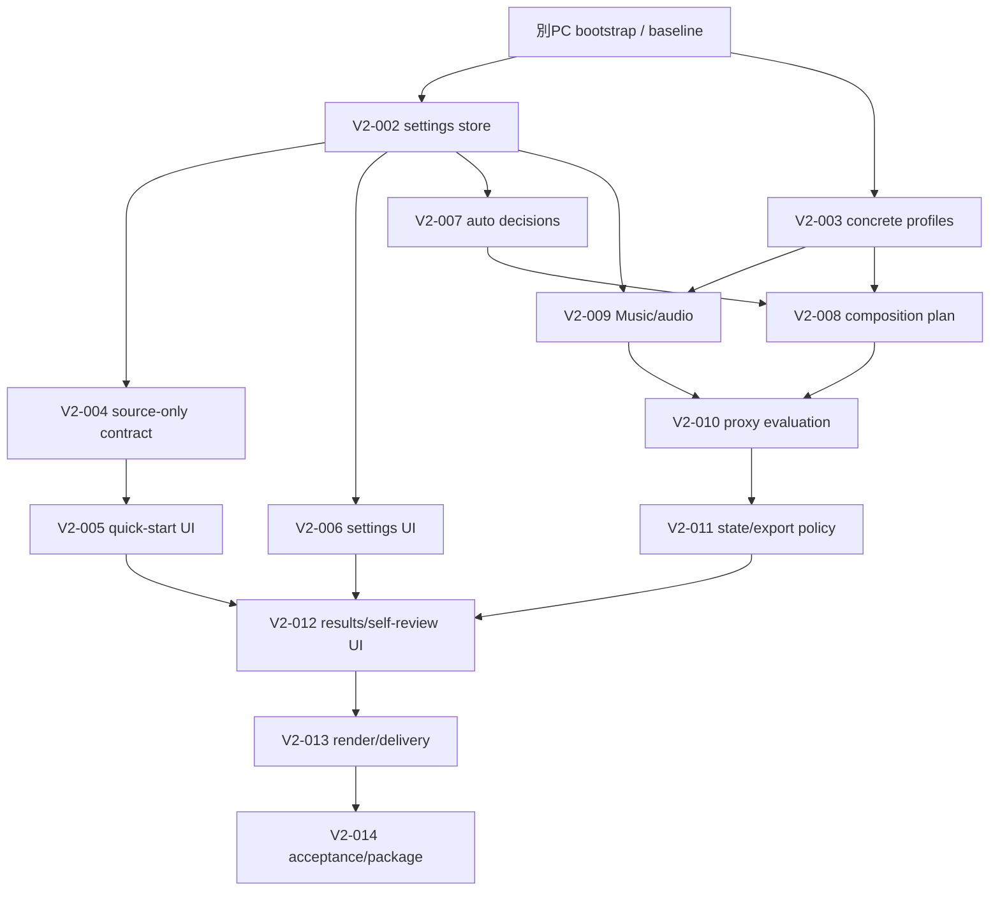

# HubRadio MovieCreator 残作業詳細実行計画（別PC継続用）

- 識別子: `20260902-1750`
- 作成日: 2026-09-02
- 対象: 要求版0.2の残作業を別のWindows PCへ移し、依存順・並列laneで完了する
- source PC基準branch: `main`
- source PC基準commit: `6fbd00049a706e05fcf74290522dfb09bd2336b5`
- source PC remote状態: `origin/main`は`b9f30941895c1793619140c2ba8870ea76fb16bf`で、基準時点のlocal `main`は4 commit先行
- 完了済み: `V2-000`, `V2-001`
- active残作業: `V2-002`〜`V2-014`の13件
- 条件付き将来task: 17件
- 削除済みscope: `S-003`, `Q-000`
- 実行方針: 各taskを「実装 → focused/component test → canonical Release全回帰 → 独立敵対レビュー → 実在指摘の修正 → 再試験 → closure review → 明示pathだけcommit」の順で閉じる

> [!IMPORTANT]
> 本書は実行計画であり、実装、human evaluation、外部公開、権利、法的適合、signed package、clean-machine install、release readinessの完了証拠ではない。測定していない値を合格値にせず、存在しない問題を敵対的レビューへ追加しない。

## 1. 正本と基準証拠

実装判断の優先順位は[ADR-0001](../docs/dev/decisions/ADR-0001-source-of-truth.md)に従う。

1. [要求定義 0.2 Draft](../docs/requirement-definition.md)
2. [確認済み敵対的レビュー](../docs/dev/reviews/)
3. [Accepted ADR](../docs/dev/decisions/)
4. [既定設定調査](../docs/dev/research/default-settings-research.md)
5. [実現方式調査](../docs/dev/research/implementation-research.md)
6. [詳細実装計画 §0](../docs/dev/planning/implementation-plan.md#0-要求版02の現在baseline)

基準commit `6fbd000`における主要証拠は次のとおり。別PCではGit取得後に再計算し、不一致なら実装を開始しない。

| 証拠 | SHA-256 | byte size |
|---|---|---:|
| `docs/requirement-definition.md` | `7507883d5ba3e26a0e83bf2b7c2bacd0c71372470301ce4ab699ab268d0a36d0` | 60,768 |
| `docs/dev/planning/implementation-plan.md` | `28c5f6fd922d0838c42b63dc17feed48650906b89f6be3103c37c5ad9d26c26b` | 126,945 |
| `docs/dev/research/default-settings-research.md` | `4c07f8531fc40534bd5e0a4abd6a43cb450780cf16515afa34c17da95b798d92` | 43,277 |
| `docs/dev/decisions/ADR-0009-source-only-defaults-and-automated-evaluation.md` | `8447aa37bb829c6ca2811dfdf4dea8324700197e93b1b402b0bf98dfdb710b2e` | 13,574 |
| `docs/dev/reviews/v2-defaults-adversarial-review.md` | `201ae085cb585a4dfe39551c06f82bbd88e6655c5a48ebe07482b09d71199f2c` | 10,750 |
| `docs/dev/reviews/v2-001-default-settings-profile-adversarial-review.md` | `5ddcf7d07a45005fef718f8fa20aace8c13fd3cb83ff99f5576930722f8127c2` | 7,060 |
| `build.ps1` | `f22d6d0599204b2efbea89a9b963e97119d4e1ed7a97ba28f97c4fcfc92daa69` | 8,399 |
| `test.ps1` | `03a4c7487153ba21de312cfb61042cb0387726ecf2d35ed873f1fb54d0c42027` | 3,504 |
| `global.json` | `2d219f1ec5a15f1553bc03652880235f6b6e58d6c7363261950f4fbb077c312f` | 173 |
| `benchmarks/fixtures/fixture-manifest.json` | `5d226fbf6cc9b2af88a7142936d6d46f9885abd582a54125db5bb14531cc2363` | 2,574 |
| `packaging/python/runtime-manifest.json` | `ac917bc39ab4c76fb385596ee62b868aee9ae0c54432f0bd37148f35f1d1000b` | 5,876 |
| `packaging/models/catalog.json` | `9699c209e0e4146290436cbb72afa2afaf465e41d0ec3f161c8a4dc4cde1d004` | 15,933 |
| `packaging/ffmpeg/manifest.json` | `d3c535e9ec4810c98c890034ca3d2c50fa984dec71038b742549ca113e68f8f1` | 7,736 |
| `packaging/web/dependency-manifest.json` | `bb4184170bf5fa50e05526c64b9ff450fa50a182a919b4663b074e68b1024463` | 2,101 |

この計画fileと未commitの`.gitignore`は上表の基準commitに含まれない。別PCへ移す直前に§3のhandoff手順で最終`HANDOFF_HEAD`とsidecar hashを記録する。

## 2. 現在状態と残作業一覧

### 2.1 完了済み

| Task | 状態 | 証拠 |
|---|---|---|
| `V2-000` | 完了 | 要求再baseline、R01〜R26引用監査、旧203 task再分類、[敵対的レビュー](../docs/dev/reviews/v2-defaults-adversarial-review.md) |
| `V2-001` | 完了 | 設定domain/schema、canonical parser、snapshot/digest、focused 17/17、全回帰失敗0、[敵対的レビュー](../docs/dev/reviews/v2-001-default-settings-profile-adversarial-review.md) |

`V2-001`完了時のsource PC全回帰観測値は、Architecture 46、Core 654、Infrastructure 679、App 959、Web 442、Accessibility 4、Web asset 6、Python 104成功、failure 0だった。環境依存32件は別計上でありPASSではない。別PCではtest件数が増えるため、この数を固定合格値にしない。

### 2.2 active残作業13件

| Task | 目的 | 正本§0.4の依存 / 再受入scope | 主な出力 |
|---|---|---|---|
| `V2-002` | 設定store、既定解決、個別/全reset、案件snapshot migration | `V2-001`, `D-013`, `D-014` | SQLite additive migration、設定store、OCC/snapshot/reset tests |
| `V2-003` | 調査済みrender/subtitle/audio/transition/neutral profile | `V2-001`, `R-004〜R-007`, `R-010〜R-016` | `DefaultSettingsProfile 1.0.0`、版付きbundle/catalog、strict loader/tests |
| `V2-004` | 元動画だけから安全なProject draftと成果物setを作る契約 | `V2-002`, `M-001`, `D-004` | source-only application/bridge契約、profile snapshot binding |
| `V2-005` | かんたん編集UI | `V2-004`, `U-001〜004` | 元動画選択、設定要約、社内限定、開始/取消だけの画面 |
| `V2-006` | 全設定UI | `V2-002`, `U-004` | 5群、current/default/evidence/reset、keyboard UI |
| `V2-007` | 3種類だけの可逆な自動decision | `V2-002`, `A-007〜009`, `A-016`, `R-001〜003` | decision record/orchestrator、子Composition、negative tests |
| `V2-008` | 長尺、最大3短尺、字幕variant、thumbnail候補のComposition計画 | `V2-003`, `V2-007`, `E-001/E-002/E-004/E-005/E-009`, `R-015` | grounded plan、候補不足理由、generic 9:16 fallback |
| `V2-009` | `Music/` read-only catalog、internal-only BGM、audio policy | `V2-002`, `V2-003`, `S-006`, `E-006/E-008` | catalog snapshot、deterministic choice、absence fallback、`NOT EVALUATED` |
| `V2-010` | 自動代理評価 | `V2-003`, `V2-008`, `V2-009`, `R-021`, `S-012/013` | immutable evaluation evidence、4状態、closed rule tests |
| `V2-011` | 単一利用者state、export policy、旧review compatibility | `V2-010`, `S-001/002/004/008/011/016` | quick-start state machine、legacy read compatibility、export block tests |
| `V2-012` | 進捗・成果物・評価・任意self-review UI | §0.4: `V2-005`, `V2-010`, `V2-011`, `U-006/U-012/U-013`; §0.5 DAGは`V2-006`も入力 | results UI、warning drilldown、source/settings/evidence navigation |
| `V2-013` | 実render、QC、delivery、付帯成果物統合 | `V2-008〜012`, `R-019〜024/026` | atomic render/delivery flow、provenance/QC/metadata tests |
| `V2-014` | source-only実素材受入、全回帰、package再検証 | `V2-013`, `PK-006/PK-007`, `Q-001/Q-002/Q-004〜Q-013` | 実成果物/evidence、package結果、未完了外部gate一覧 |

表の旧task IDは未完了の前提taskではなく、各V2 taskが引き取る既存成果物・変更scopeである。`E-001`等をV2 taskより先に別実装しない。

正本内では`V2-012`の依存に差がある。§0.4表は`V2-005/V2-010/V2-011/U-006/U-012/U-013`、§0.5 DAGは`V2-005/V2-006/V2-011`を示す。取りこぼしを避けるため、本書の実行gateは両者の和集合を使い、`V2-012`開始前に正本側の差を同期する。`V2-011`が`V2-010`を直接要求するため、実行順上の重複gateは増えない。

### 2.3 条件付き将来task 17件

次は初期releaseのactive critical pathではない。開始条件が実在し、product ownerが明示的に再計画した場合だけ実行する。

- model/detector: `ST-008`, `A-010`, `A-012`, `A-013`, `A-015`
- legacy approval scope: `S-010`
- 高度機能: `E-003`, `E-007`, `E-011`, `E-012`, `E-014`, `E-016`, `E-017`
- Azure runtime: `Z-008`, `Z-009`, `Z-010`
- quiz受入: `Q-003`

`S-003`と`Q-000`は要求版0.2でactive scopeから削除済みである。既存ACL/path防御や過去の試験証拠は削除しない。

## 3. source PCから別PCへのhandoff

### 3.1 最初に保護する状態

基準時点のsource PCには次がある。

- local `main`: `6fbd00049a706e05fcf74290522dfb09bd2336b5`
- `origin/main`: `b9f30941895c1793619140c2ba8870ea76fb16bf`
- localはremoteより4 commit先行
- staged: 0
- tracked unstaged: `.gitignore` 1件。差分は`/music`の1行追加だけ
- `.gitignore` working file SHA-256: `92ac05f4215123d98902fe676650e60407c2d89373cec384a46aff6117439b7a`
- この計画を保存した後は`work/20260902-1750-taskplan.md`もuntrackedになる
- local branch/worktreeは`main`の1件だけ

包括的な`git add -A`、reset、clean、stash、rebaseを実行しない。`.gitignore`と本計画の所有意図を保護する。

### 3.2 推奨handoff: 明示2 fileをcommitしてremoteへpush

1. source PCで本計画をreviewし、`git diff --check`を実行する。
2. `.gitignore`の差分が`/music` 1行だけであることを確認する。
3. `.gitignore`と本計画だけを明示stageする。
4. cached diffに2 file以外がないことを確認する。
5. handoff commitを作成する。
6. `HANDOFF_HEAD`を記録し、`git push origin main`する。
7. remoteから`HANDOFF_HEAD`を取得できることを別cloneまたは`git ls-remote`で確認する。

例:

```powershell
pwsh.exe -NoLogo -NoProfile -Command 'git diff --check; git diff -- .gitignore; git status --short --untracked-files=all'
git add -- .gitignore work/20260902-1750-taskplan.md
git diff --cached --check
git diff --cached --name-status
git commit -m "docs: add cross-PC remaining task plan"
git rev-parse HEAD
git push origin main
git ls-remote origin refs/heads/main
```

push権限またはremote利用方針がない場合は勝手に別remoteを作らず、次のGit bundle方式を使う。

### 3.3 代替handoff: Git bundle + sidecar

本計画と`.gitignore`をcommitできる場合は、handoff commit後の`main`をbundle化する。次の例はrepository rootにbundleを作る。作成後、bundleとそのSHA-256 receiptを同じ保護されたhandoff folderへ移し、target PCではそのfolderをcurrent directoryにして§4.2を実行する。

```powershell
$bundlePath = Join-Path (Get-Location) 'HubRadio-MovieCreator-handoff.bundle'
git bundle create $bundlePath main
git bundle verify $bundlePath
pwsh.exe -NoLogo -NoProfile -Command '(Get-FileHash -LiteralPath "HubRadio-MovieCreator-handoff.bundle" -Algorithm SHA256).Hash.ToLowerInvariant()'
```

commitしない場合は、bundleは`6fbd000`までしか含まない。本計画と`.gitignore`をsidecarとして別コピーし、それぞれのbyte size/SHA-256を記録する。target PCでsidecarを適用するまで実装を開始しない。未commit fileをstashへ隠して移送済みとみなさない。

### 3.4 Git管理外assetの移送

#### Source fixture

`sample/20260615_024326000_iOS.MOV`はGitへ追加しない。source/target双方で次を照合する。

- byte size: `6,494,572,403`
- SHA-256: `fe9c763fdf6fe7be4f368bfba926a1f3f2407ceaf044ec7d055e0869e65c1a9f`
- 用途: 要求版0.2の社内限定source-only受入
- external publication: 許可済みと主張しない

`benchmarks/fixtures/fixture-manifest.json`には旧`unconfirmed / local-technical-evaluation-only`記録が残る。これを外部公開許可へ読み替えない。`V2-014`で利用者決定`U01`との内部利用scopeを追記・再baselineし、旧記録は履歴として保持する。

#### `Music/`

`Music/`はGit管理外・read-only・社内限定である。基準観測値は36 MP3、合計149,081,539 bytesだが、これは完全性を保証するaggregate hashではない。source PCで移送直前にfile名、size、SHA-256のlocal manifestを生成し、manifest自体もGitへ追加しない。target PCで全fileを照合する。

保護されたhandoff folderを環境変数`HUBRADIO_HANDOFF_DIR`へ設定してから実行する。repository、Desktop、同期folderを暗黙の出力先にしない。

```powershell
pwsh.exe -NoLogo -NoProfile -Command 'if ([string]::IsNullOrWhiteSpace($env:HUBRADIO_HANDOFF_DIR)) { throw "HUBRADIO_HANDOFF_DIR is required." }; $handoffDir=(Resolve-Path -LiteralPath $env:HUBRADIO_HANDOFF_DIR).Path; $root=(Resolve-Path -LiteralPath "Music").Path; $files=@(Get-ChildItem -LiteralPath $root -File -Filter "*.mp3" | Sort-Object Name -CaseSensitive | ForEach-Object { [pscustomobject][ordered]@{ relativePath=$_.Name; byteSize=$_.Length; sha256=(Get-FileHash -LiteralPath $_.FullName -Algorithm SHA256).Hash.ToLowerInvariant() } }); $manifestPath=Join-Path $handoffDir "HubRadio-Music-manifest.json"; [ordered]@{ schemaVersion=1; fileCount=$files.Count; totalBytes=[long](($files | Measure-Object byteSize -Sum).Sum); files=$files } | ConvertTo-Json -Depth 5 | Set-Content -LiteralPath $manifestPath -Encoding utf8; $item=Get-Item -LiteralPath $manifestPath; [ordered]@{ manifestFile=$item.Name; byteSize=$item.Length; sha256=(Get-FileHash -LiteralPath $manifestPath -Algorithm SHA256).Hash.ToLowerInvariant() } | ConvertTo-Json -Compress'
```

manifest出力は素材名を含むため、保護された移送媒体にだけ置く。最後に表示するreceipt（file名、size、SHA-256）はmanifestの外で記録する。自己参照になるためmanifest自身のhashをmanifest内部へ埋め込まない。target PCでは`Music/`へコピー後、同じ規則でmanifestを再生成してbyte比較または全record比較する。曲名から用途、曲調、権利を推測しない。

### 3.5 package用のGit管理外input

次は`V2-014`のpackage laneまで不要である。存在を仮定せず、各manifestに従いexact inputを取得・照合する。正本は`HANDOFF_HEAD`にあるmanifestと検証scriptであり、下の転記値は探索用要約である。転記値とmanifest/scriptが不一致なら新しい値を採用せず、package laneを停止して本計画を修正・再reviewする。

- CPython 3.12.10 embeddable archive: `python-3.12.10-embed-amd64.zip`, 11,133,606 bytes, SHA-256 `4acbed6dd1c744b0376e3b1cf57ce906f9dc9e95e68824584c8099a63025a3c3`
- PK-001 runtime wheelhouse: `wheel-matrix.json`のruntime 25 wheel
- offline ASR model: `packaging/models/catalog.json`の唯一の`runtimeEligible` bundle、4 file
- FFmpeg: `BtbN.FFmpeg.LGPL.8.1` version `8.1.2-20260731`のmanifest一致file
- Microsoft MakeAppx: 567,328 bytes、SHA-256 `9981418e9a18a9aa19bb69f835137a3bf8fe2e6fe7e18d5ca9b76191cc331f3f`、有効Authenticode署名
- WAPを使う場合: Visual Studio MSIX Packaging Tools / DesktopBridge targets
- signingを実施する場合: 権限ある署名主体と証明書。秘密鍵をrepository、plan、logへ記録しない

固定inputが不足する場合、package laneを`PENDING`で停止する。新しいversionや別buildへ黙って置換しない。

## 4. target PC bootstrap

### 4.1 必須・検証済みbaseline

| 項目 | target条件 | 根拠 |
|---|---|---|
| OS | Windows 11 x64 | product scope |
| shell | PowerShell 7+ Core。Windows PowerShell 5.1禁止 | root scripts `#Requires -Version 7.0` |
| Git | repository/worktree操作が可能な版。実版を記録 | source control |
| .NET SDK | **10.0.400 exact** | `global.json`, rollForward disabled |
| Python | CPython 3.12 Windows x64。再現baselineは3.12.10 | `pyproject.toml`, wheel matrix |
| npm | 11.17.0 | `package.json#packageManager` |
| Node.js | source PC検証値24.19.0を再現baselineにする。ただしrepositoryはNode exact版を宣言していないため、異なる版は実testで判断 | V2-001 review / package metadata |
| PSScriptAnalyzer | 1.25.0以上 | `build.ps1` |
| network | 初回`npm ci`とhash-locked pip restoreがpackage feedへ到達できること。offlineを主張しない | `build.ps1` |

固定disk空き容量の任意閾値を作らない。実行前にsource 6.49 GB、workspace、中間render、最大約1.22 GBの観測済みpackage payload、backup/stagingの具体的見積りを表示し、足りない場合は開始しない。

### 4.2 repository取得

Remote方式:

```powershell
git clone https://github.com/dahatake/HubRadio-MovieCreator.git
Set-Location HubRadio-MovieCreator
git rev-parse HEAD
git merge-base --is-ancestor 6fbd00049a706e05fcf74290522dfb09bd2336b5 HEAD
```

Bundle方式:

```powershell
$bundlePath = (Resolve-Path -LiteralPath '.\HubRadio-MovieCreator-handoff.bundle').Path
git clone --branch main $bundlePath HubRadio-MovieCreator
Set-Location HubRadio-MovieCreator
git bundle verify $bundlePath
git rev-parse HEAD
```

取得直後に、source PCで記録した`HANDOFF_HEAD`と一致すること、または`HANDOFF_HEAD`がtarget HEADの祖先であることを確認する。`origin/main`だけをcloneして`6fbd000`未満なら実装を開始しない。

### 4.3 toolchain記録

```powershell
pwsh.exe -NoLogo -NoProfile -Command '$PSVersionTable | Select-Object PSEdition,PSVersion; [Runtime.InteropServices.RuntimeInformation]::OSArchitecture'
git --version
dotnet --version
node --version
npm --version
py.exe -3.12 -c "import platform,struct,sys; print(sys.version); print(platform.platform()); print(struct.calcsize('P')*8)"
```

`PSEdition=Core`, x64, .NET `10.0.400`, Python 3.12 x64を満たさない場合は停止する。Nodeがsource PC値と異なる場合は差を記録し、baseline全回帰で判断する。

### 4.4 正本・asset照合

1. §1の主要file hashを再計算する。
2. source fixtureを配置し、size/hashを照合する。
3. `Music/`を配置し、local manifestを照合する。
4. `git status --short --branch --untracked-files=all`で、assetがGit対象へ出ていないことを確認する。
5. Git管理外assetの前後hashをtaskごとに保護する。

### 4.5 baseline全回帰

```powershell
pwsh.exe -NoLogo -NoProfile -File .\test.ps1 -Configuration Release
```

合格条件:

- command exit 0
- .NET restore/format/analyzer/build成功
- Web typecheck/build/dependency・asset検証成功
- Python hash-locked restore、`pip check`、syntax、worker test成功
- 各runnerでtestが1件以上discoverされfailure 0
- environment-gated inconclusive/skipは件数と理由を別記し、PASSへ変換しない
- 実行前後でsource fixture、`Music/`、tracked sourceに意図しない変更がない

baselineが失敗した場合、残taskへ進まず、toolchain、network/feed、path、case、権限、ignored inputを切り分ける。source PCの成功件数を満たすためにtestをskip/削除しない。

## 5. task共通の実行・レビュー契約

### 5.1 1 taskの標準手順

1. `main`を最新の統合commitへ更新し、statusを記録する。
2. task専用の**detached worktree**を同じbase commitから作る。local branchを増やす必要はない。
3. 正本要求、task行、直接依存、既存実装、関連test/schemaを読む。
4. taskの許可path、非対象、停止条件、focused test一覧をtask noteへ固定する。
5. 最小実装を行う。二つ目の実装がない抽象、未来用flag、任意thresholdを追加しない。
6. focused testを実行し、必ず1件以上discoverされたことを記録する。
7. 変更component全体を回帰する。
8. `git diff --check`、IDE diagnostics、schema/JSON/XML parse、秘密/absolute path/media trackingを検査する。
9. `test.ps1 -Configuration Release`を実行する。PC資源競合を避け、複数taskのcanonical全回帰は直列にする。
10. 実装担当とは独立したreviewerへ敵対的レビューを依頼する。
11. 実在指摘だけを再現test付きで反映する。推測指摘は不採用理由を記録する。
12. 修正後にfocused/component/full regressionを再実行し、別のclosure reviewで未解決Critical/Major 0を確認する。
13. task固有reviewを`docs/dev/reviews/v2-NNN-<topic>-adversarial-review.md`へ保存する。
14. 意図したpathだけを明示stageし、cached diffを監査して1 logical commitを作る。
15. task commitをintegration worktreeへ順次cherry-pickし、依存gateごとの統合試験・統合敵対レビューを行う。
16. integration commitを`main`へfast-forwardし、task worktreeを削除する。

例:

```powershell
$base = (git rev-parse main).Trim()
git worktree add --detach ..\HubRadio-MovieCreator-V2-002 $base
# 実装・試験・review後、task worktree内で明示pathだけcommit
# integration worktreeへtask commitをcherry-pick
# integrationをmainへfast-forwardした後にworktree remove
```

parallel taskは同じbaseから開始する。共通status文書、README、ADR-0001 hash表は各taskで並行編集せず、shared integration ownerだけが更新する。

### 5.2 敵対的レビューの必須形式

各findingは次の4点を持つ場合だけ採用する。

1. exact file/symbol
2. 違反する要求・schema・contract
3. 再現入力または実行手順
4. expected/actualまたは失敗test

review軸:

- correctness / invariant / canonicality
- invalid、stale、duplicate、partial failure、restart、rollback
- security、privacy、path、secret、content leakage
- requirement/schema/ADR/traceability
- external evidence scope、測定値と製品判断の分離
- YAGNI、重複domain、不要interface/provider
- 過大主張。特にautomated proxyをhuman/legal/release PASSと呼ばないこと

存在しないclass、未実行test、別worktreeの古いfileを根拠にした指摘は採用しない。指摘0件の場合も対象、確認方法、残余scopeをreview recordへ残す。

### 5.3 commitと統合の保護

- `git add -A`禁止
- task worktreeを削除する前にcommitがintegration/mainへ到達したことを確認
- parallel commitのconflictを`ours/theirs`で一括解決しない
- common bridge/schemaのclosed unionを手作業で確認し、両taskのnegative testを同時に通す
- source fixture、`Music/`、model、runtime、package、raw evidenceをstageしない
- environment gateを成功へ読み替えない
- task完了数は実在review/test/commitから再計算する

### 5.4 shared integration gate

同じ契約境界へ合流するtaskが個別PASSした後、integration worktreeで次を行う。

- cherry-pick順とcommit SHAを記録
- common file差分を要求単位で監査
- task間integration focused test
- canonical Release全回帰
- 独立integration敵対レビュー
- status文書だけをintegration ownerが更新
- `main`へfast-forward
- `main`前後HEAD、status、asset manifest/hashを比較

## 6. 依存駆動の並列実行lane



| Trigger | 新たに開始できるtask | 同時進行できるtask | 統合時に直列化する箇所 |
|---|---|---|---|
| baseline PASS | `V2-002`, `V2-003` | 相互に並列 | startup seed/current pointer接続、status docs、全回帰 |
| `V2-002`個別統合PASS | `V2-004`, `V2-006`, `V2-007` | 未完了の`V2-003`とも並列 | central bridge/schema、settings store接続 |
| `V2-004`個別統合PASS | `V2-005` | `V2-003/006/007`とも並列可能 | source-only bridge DTO |
| `V2-002`と`V2-003`統合PASS | `V2-009` | `V2-004〜007`の未完了task | profile bootstrap、audio/asset contract |
| `V2-003`と`V2-007`統合PASS | `V2-008` | `V2-005/006/009` | Composition/profile/decision contract |
| `V2-008`と`V2-009`統合PASS | `V2-010` | `V2-005/006`の未完了task | evaluation input union |
| `V2-010`PASS | `V2-011` | `V2-005/006`の未完了task | state/evidence binding |
| `V2-005`, `V2-006`, `V2-011`PASS | `V2-012` | 以降は直列 | §0.4/§0.5依存差を同期してから開始 |
| `V2-012`PASS | `V2-013` | なし | render/QC/delivery全体 |
| `V2-013`PASS | `V2-014` | package external laneだけ分離可能 | 実素材/全回帰/最終review |

barrier型の一括waveとして全taskを待たず、上表のtriggerが成立したtaskから開始する。ただし「個別統合PASS」はtaskのfocused/component/full regression、敵対review、修正後再review、integration commitが完了した状態を指す。並列taskが同じ既存fileを変更せざるを得ない場合、実装自体は独立worktreeで行えるが、共通fileの統合だけは直列にする。開始後に依存の意味が変わった場合はDAGを黙って変えず、計画・理由・reviewを更新する。

## 7. task別詳細計画

### V2-002 — 設定store、reset、snapshot migration

**目的:** V2-001のcanonical profile/snapshotをSQLiteへ安全に保存し、現在profile、利用者設定、案件作成時snapshot、個別/全resetを再起動後も復元する。

**既存入力:** `src/HubRadio.Core/Settings/**`, `DatabaseMigrator`（現行schema 7）, `001〜007` migration, `ProjectCreationDraftStore`, `SqliteStoreSupport`, database/store tests。

**実装手順:**

1. 現行migration/store規約を読み、additive schema 8を設計する。予定file名は`008_default_settings.sql`等とするが、既存命名規約に合わせて確定する。
2. profile canonical bytes、profile ID/version/digest、current pointer、利用者override、案件snapshotに必要な最小table/constraintを定義する。
3. reset履歴を専用tableへ重複保存するか既存`AuditLog`を使うかを先に決める。二重の監査正本を作らない。
4. `LatestSchemaVersion`を7→8へ更新し、migration set digest、fresh DB、v7→v8、再実行、失敗時backup/rollbackを検証する。
5. storeはprofileをparse/recomputeしてから保存し、同じversionの異なるcontent、digest不一致、noncanonical bytes、unknown profileを拒否する。
6. current pointer変更はOCCまたは同等のstale-write拒否を持たせる。timestampだけの「最新」を同一性判定に使わない。
7. 新規案件snapshotは作成時のprofile ID/version/digestと全値へ固定し、global default変更を既存案件へ遡及適用しない。
8. 個別resetと全resetは**案件snapshotの初期値**へ戻す。最新global profileへ暗黙移行しない。
9. 既存project/compositionは黙って新profileへbindしない。legacy unbound状態を読めるか、明示migrationを要求するかを型付きで決定・試験する。
10. runtime seedをmigration SQLへ埋め込まず、V2-003 bundleとのshared integrationでcurrent profileを初期登録する。

**focused/negative tests:** fresh v8、v7 upgrade、migration二回、backup作成、途中失敗rollback、same version/different digest、canonical改ざん、stale OCC、missing profile、snapshot不変、個別/全reset、restart round-trip、既存project非遡及、SQL injection文字列。

**敵対review重点:** schema/store責務分離、current pointer race、reset先の誤り、FK/cascadeによる履歴消失、payload size、transaction、secret/path混入、migrationでproduct defaultを二重管理していないか。

**完了証拠:** focused test件数、Infrastructure全体、全回帰、migration前後schema/digest、review record、commit SHA。

### V2-003 — 具体的な版付き既定profile

**目的:** [既定設定調査](../docs/dev/research/default-settings-research.md)の全採用値を`DefaultSettingsProfile 1.0.0`と既存Render/Layout/Subtitle/Transition契約へ結合する。

**既存入力:** V2-001 domain/codec/schema、`RenderProfile`, `LayoutSpec`, `Transition`, `SubtitleLayoutEngine`, `BundledRenderProfileLoader`, `src/HubRadio.App/Profiles/**`のdevelopment placeholder。

**実装手順:**

1. V2-001のclosed value kindで表せる設定は新domain型を増やさず使う。既存型で表せない実行契約だけを最小拡張する。
2. profile keyを5群（案件と出力、編集、字幕とグラフィック、音声と素材、privacyと保存）へ全件割り当てる。
3. 各settingへ初期値、unit、allowed/range、根拠区分、実在`U01/C01〜05/R01〜26` IDを結合する。`R99`等をcatalog integrationで拒否する。
4. `1.0.0` canonical bytes/digestを固定し、同版異内容を禁止する。
5. 現行development placeholderのID/contentを上書きせず、新しい版付きproduction-default候補を追加するか、明示migration付き新IDにする。既存Composition参照を壊さない。
6. 16:9は1920×1080、9:16は1080×1920。MP4/H.264/AAC-LC/48 kHz/BT.709等はpartner資料転用の製品判断として記録する。
7. frame rateはsource preserve policyを表現し、30000/1001固定を「source維持」と偽らない。
8. HDR入力はsilent変換せず、明示tone-map設定とwarningを分離する。
9. 字幕は`日本語SDH指向字幕候補`、7 cps、16全角/行、2行、min 5/6秒、max 7秒、gap規則、白/黒、authoring line-height、BBC汎用領域を固定する。意味的完全性は`NOT EVALUATED`。
10. 通常翻訳字幕profileを別設定として保持する。
11. transitionはhard cut 0 ms、crossfade既定OFF・有効時250 msを製品判断として固定する。
12. audioはonline/internal -16 LKFS±1、True Peak -1 dBFS、broadcast別profile -23 LUFS、noise/hum既定OFFを分離する。
13. platform maskは未測定のまま、BBC汎用fallback+warningとし、TikTok等への適合をclaimしない。
14. neutral/no-logo template、thumbnail 3枚、short探索値、保持/cloud既定を台帳と一致させる。
15. strict loader/catalogでunknown property、重複key、非canonical順、digest drift、evidence不在を拒否する。

**focused/negative tests:** 全key一意/欠落0、全evidence解決、canonical repeat、same-version drift、旧profile不変、source-fps policy、subtitle数値、safe-zone warning、HDR warning、audio scope、transition 0/250、external platform nonclaim、`NOT EVALUATED`、schema additionalProperties false。

**敵対review重点:** 外部資料scope漏れ、広告値の一般化、0.5/5/6/20-frame混同、720p profile破壊、fixed fps偽装、SDH/human/music適合の過大主張、根拠registryの未来抽象化。

**完了証拠:** profile inventory/digests、Core/App focused test、schema parse、全回帰、review record、commit SHA。

### V2-002 / V2-003 shared integration

1. `V2-002`と`V2-003`のtask commitを同じintegration worktreeへ順次cherry-pickする。
2. bundled `1.0.0`をstoreへ初期登録しcurrent pointerを設定する最小bootstrapを追加する。
3. 同じversion/digestなら再起動時no-op、異なるcontentならfail-closedとする。
4. store round-trip後のbytesがbundle canonical bytesと一致することを統合試験する。
5. schema v7 DBをupgradeしても既存projectへ遡及snapshotを作らないことを確認する。
6. 各taskは個別にmainへ統合できる。両方が揃った時点でbootstrap接続の全回帰とintegration敵対reviewを行う。`V2-004/006/007`は`V2-002`個別統合後に開始でき、`V2-003`完了を待たせない。

### V2-004 — source-only Project契約

**目的:** 元動画1本を選ぶだけで、安全な初期値とprofile snapshotを持つdraftを作成・finalizeできるようにする。

**既存入力:** V2-001 profile contract、V2-002 store/resolver、`ProjectCreationDraft`, schema, store, `ProjectCreationService`, payload codec, `MediaPicker`, asset candidate registry, `ProjectBridgeHandler`, TypeScript project protocol/state。V2-003の具体値はshared integration入力であり、このtaskの開始gateではない。

**実装手順:**

1. raw pathをReactへ返さず既存asset tokenだけを使う。
2. file name stemから安全なcontent nameを内部導出する。拡張子、path、制御文字、空名、予約名を検証する。
3. purpose=`社内向け再利用動画の自動編集`、audience=`社内視聴者`、scope=`internalOnly`、language=自動検出不能時`ja-JP`、performer空、deadlineなし、neutral template、標準output setをstore/resolverが返すcurrent profile contractから補完する。V2-003未統合時のfocused testはV2-001準拠のfixtureを使い、具体的なproduction-default候補をこのtaskへ重複定義しない。
4. 氏名、肩書、URL、hashtag、deadline、external destinationを推測しない。
5. draft作成時またはfinalize時の一意な契約点でprofile snapshotを固定し、再起動・global default変更でも変えない。
6. profileなし、digest mismatch、source picker cancel、source token stale、file消失を型付きerror/warningにする。
7. 旧10-field draftを読み込めるようにし、値を捨てずsource-only UIへ表示要約する。
8. save/finalize OCC、二重finalize、authorization-before-existenceを維持する。

**focused/negative tests:** source-only成功、picker cancel、path非開示、危険file name、profile snapshot、default drift、架空metadataなし、旧draft互換、request size、unknown property、stale revision、二重finalize。

**敵対review重点:** path/PII leak、hidden必須入力、unsafe filename、defaultをhardcodeしてprofileと二重管理、外部scope昇格、old draft data loss。

### V2-006 — 全設定UI

**目的:** 全設定を5群で表示し、current/default/用途/根拠/profile版、個別reset、全resetをkeyboardで操作可能にする。

**既存入力:** V2-001 profile contract、V2-002 store/resolver、React state/context、closed WebMessage bridge、theme/accessibility tests。V2-003の具体profile bundleはshared integrationで検証し、このtaskの開始gateにしない。

**実装手順:**

1. 5群を正本どおりに表示し、詳細nestは1段までにする。
2. current値と案件snapshot initial値を混同しない。
3. evidence IDと根拠区分を表示する。外部URLを自動取得しない。
4. reset前後の差分を表示し、個別/全resetはsnapshot初期値へ戻す。
5. 既存案件へ最新global profileを暗黙適用しない。
6. bridgeへ`settings.read/reset`相当のclosed methodを追加する場合、size/origin/schema/method allowlistを同時更新する。
7. keyboard、focus、contrast、非色依存、screen reader name/stateを自動contractで検証する。人の理解をPASSにしない。

**focused/negative tests:** 5群/全key、default/current差、個別/全reset、OCC、restart、unknown key、wrong project/profile、bridge oversized/unknown method、keyboard only、focus visible、contrast、error announcement。

**敵対review重点:** reset先、設定漏れ、二重state、XSS/unsafe URL、bridge authorization、human evaluation過大主張、nested UI過多。

### V2-007 — 3種類限定の自動decision

**目的:** 次の3規則だけを、元動画不変の子Compositionへ自動適用する。

1. A-008の明示的な「ここはカット」exact evidence
2. A-009の同一話者・構造的隣接・NFKC完全一致反復の後側
3. A-007の`-50 dB / 2.0 s`規則による**冒頭・末尾**無音。発話前後0.30秒を保持

**実装手順:**

- rule ID/version/digest、candidate ID、SourceSpan、理由、親Composition/settings digestをdecision recordへ固定する。
- stale candidate、重複decision、overlap、範囲外、部分timing、異なるrevisionを拒否する。
- cough/noise、semantic repetition、context deviation、topic、shot、face等を自動採用しない。
- 適用前後TimelineMapを再構築し、元spanを逆引きできるようにする。
- 同じinputへの再実行をidempotentにし、元Compositionを変更しない。
- 利用者が無効化する場合はrollback-as-childを作る。

**focused/negative tests:** 3 success、4th rule拒否、fuzzy repeat拒否、middle silence拒否、padding boundary、overlap、stale revision、missing evidence、duplicate/idempotency、rollback child、TimelineMap round-trip、source hash不変。

**敵対review重点:** 3規則のscope拡大、閾値捏造、clamp、原版書換え、evidenceなし削除、decision順依存。

### V2-009 — `Music/`とaudio policy

**目的:** Git管理外`Music/`をread-only/internal-onlyで利用し、speech-free cardだけへ再現可能に挿入する。

**実装手順:**

1. 設定pathをhost側で解決し、Reactへabsolute pathや曲名を不要に返さない。
2. directory不在、空、読取不能はBGMなし+warningで完了する。
3. regular MP3だけを列挙し、reparse/UNC/device/ADS、途中変更、重複digestをfail-closedまたはwarningで扱う。
4. pinned ffprobe等でdecode可能性とdurationをtechnical probeし、cue以上の長さを持つtrackだけをeligibleにする。
5. catalog snapshotをpathでなくtrack digest、size、technical metadataへ固定する。
6. digest ordinal順で決定的に選び、file名から意味分類しない。
7. title/topic/end cardのspeech-free区間だけを対象にし、短いtrackをloop/自動stretchしない。
8. 本編会話中BGMは既定OFF。利用者が有効化した場合の20 dB duckは機械設定として記録し、speech理解/mix品質は`NOT EVALUATED`。
9. musical fit、brand fit、legal complianceを評価しない。外部profileへ`Music/`を使用しない。
10. fileを移動、改名、書換え、stageしない。処理前後manifest/hashを比較する。

**focused/negative tests:** absent/empty、1件/複数件、digest ordering、duration不足、corrupt MP3、file mutation race、reparse/path攻撃、external scope拒否、speech overlap拒否、no loop、read-only、warning、`NOT EVALUATED`、log/path非開示。

**敵対review重点:** 曲名/権利の推測、directory write、hash前後TOCTOU、外部利用、random選択、speech理解PASS、20 dBをWCAG AAと偽装。

### V2-004 / V2-006 / V2-007 / V2-009 shared integration

- `V2-004`と`V2-006`のcentral bridge enum/schema/dispatcher変更はintegration ownerがclosed unionとして統合する。
- `V2-007`と`V2-009`はComposition/RenderGraphへ先行して汎用fieldを追加せず、それぞれのtyped outputをV2-008/V2-013で結合する。
- 各taskのfocused negative suiteを統合後も全て実行する。
- profile snapshot、asset token、Music digest、auto decisionにabsolute pathがないことを横断試験する。

### V2-005 — かんたん編集UI

**目的:** 5段階10項目wizardを、元動画選択、設定要約、社内限定表示、`編集を開始`、取消だけの通常画面へ置換する。

**実装手順:**

- 旧draftの詳細値を消さず、advanced/settings画面へ移す。
- picker cancel、source invalid、profile unavailable、job開始失敗を明確に表示する。
- 二重開始を防ぎ、pending/cancel/retry/restart stateを一つのreducer正本にする。
- 使用profile version/digest、成果物要約、warning数を表示するがraw pathを出さない。
- 全操作をkeyboardで実行でき、focus順、status announcement、light/dark contrastを検査する。

**focused/negative tests:** sourceだけで開始、追加input要求なし、cancel、double-click、bridge unavailable、stale draft、warning summary、keyboard/skip link/focus、raw path/XSS非表示、旧wizard data保持。

**敵対review重点:** hidden 10-field gate、derived state重複、path表示、即時開始で確認省略、old draft破壊、旧UI testを新UI PASSへ転用。

### V2-008 — 標準Composition計画

**目的:** 同じsettings snapshotとsourceから16:9長尺1本、最大3件の9:16短尺候補、subtitle variant、thumbnail候補を根拠付きで計画する。

**実装手順:**

1. 旧`E-001/002/004/005/009/010`はこのtaskが引き取るscopeであり別前提ではない。
2. 長尺はneutral/no-logo、opening video OFF、title overlay、根拠のある要素だけを使用する。
3. short候補はsourceの連続spanまたは意味を変えない明示抜粋だけを使う。元発言にないhookを作らない。
4. 候補は最大3件。成立0〜2件なら空/重複候補を作らず、件数と不成立理由をmanifestへ記録する。
5. 9:16対象を確定できなければ全映像を失わないgeneric fixed/blur fallbackを使い、platform UI未確認warningを付ける。
6. subtitle variant、thumbnail frame候補は同じComposition/OriginRefへ結ぶ。表情や感情を未採用modelで判定しない。
7. CTAは対応長尺がある場合の`本編を見る`だけ。URL等を生成しない。
8. profile/settings/source/model/tool digestをplanへ固定する。
9. 同じinputから同じ候補順・理由・digestを生成する。

**focused/negative tests:** long success、short 0/1/3、候補不足理由、duplicate elimination without fuzzy、unsupported subject fallback、safe-zone warning、grounded hook、CTA、thumbnail source PTS、stale profile、same-input determinism、OriginRef欠落拒否。

**敵対review重点:** semantic modelの暗黙導入、3件水増し、外部platform適合claim、face/emotion推測、根拠なしmetadata、既存Composition上書き。

### V2-005 / V2-008 shared integration

`V2-005` UIが開始するrequestと`V2-008` plan inputを同じclosed DTOへ統合し、profile/source/snapshot digestの一致、二重開始、cancel/retry、候補不足表示を横断試験する。

### V2-010 — 自動代理評価

**目的:** 機械判定可能なclosed contractだけを評価し、`PASS`, `WARNING`, `FAIL`, `NOT EVALUATED`をimmutable evidenceとして保存する。

**実装手順:**

1. evaluation run ID、rule ID/version、environment、input/output/settings/profile/tool digest、結果、理由を正規化する。正本の表示語は`NOT EVALUATED`である。C# symbolとJSON tokenはschemaで明示して相互変換し、`NOT_EVALUATED`を未承認の永続値として先に固定しない。
2. `OutputQc`等の既存実測を再利用し、container/codec/resolution/frame policy/full decode/duration/A-V、subtitle presence/read speed/line/gap/safe region、loudness/true peak、provenance/digest等を、**既存profileが値を持つ場合だけ**判定する。
3. このtaskでA/V syncやduration等の新しい任意thresholdを作らない。profile/既存正本に値がなければ`NOT EVALUATED`または明示warningにする。
4. subtitle意味的完全性、content accuracy、speech理解、musical/brand fit、platform固有適合、human visual quality、legal/rights/privacy判断を自動PASSにしない。
5. closed ruleが実行不能ならPASSにせず理由付き`NOT EVALUATED`またはFAILへ分ける。
6. result aggregateは個別resultを隠さず、FAIL block、WARNING非block、`NOT EVALUATED`非評価を区別する。
7. 同じevidence bytesから同じdigestを生成し、本文/path/秘密を通常logへ出さない。

**focused/negative tests:** 各closed rule success/fail、rule unavailable、unknown rule、duplicate dimension、digest mismatch、stale profile/tool、`NOT EVALUATED`必須集合、human/approved/certified語の禁止、aggregate precedence、canonical repeat、oversized evidence、malformed media result。

**敵対review重点:** threshold捏造、未実行をPASS、aggregateでfailure隠蔽、human/legal表現、evidenceにcontent/path、QCとevaluationの二重正本。

### V2-011 — stateとexport policy

**目的:** 社内限定quick startを`Editing → AutomatedEvaluation → Ready | ReadyWithWarnings | Failed → Exported`で管理し、legacy review recordを読取可能に保つ。

**実装手順:**

- 旧`ReviewState/Approval`を削除・書換えず、quick-start stateを別の版付き契約として追加する。
- `SelfReviewed`は任意audit eventであり必須approval gateにしない。
- technical corruption、provenance/digest欠落、asset scope違反、external destination、stale evaluationはblockする。
- WARNING/`NOT EVALUATED`は内容を表示したうえでinternal-only exportを許可できる。どのwarningをblockするかを任意推測しない。
- external publication、cloud送信、legacy approval bypassを許可しない。
- 内容変更時は子Composition + 再評価を要求し、同じcontentのtechnical rerenderを区別する。

**focused/negative tests:** 全合法/違法遷移、FAIL export拒否、stale evaluation、warning export、`NOT EVALUATED`表示、optional self-review、content change invalidation、legacy record read、old state round-trip、external destination拒否、actor/system区別。

**敵対review重点:** approval自動付与、legacy data loss、warning隠蔽、内部scopeから外部昇格、self-review必須化、stale digest受理。

### V2-012 — results / optional self-review UI

**目的:** 成果物、評価4状態、warning、未評価範囲、根拠、任意self-reviewを誤認なく表示する。

**実装手順:**

- PASS/WARNING/FAIL/`NOT EVALUATED`を色だけでなくtext/icon/semanticで区別する。
- `Approved`, `Human PASS`, `Certified`, `Legal compliant`を自動結果labelに使わない。
- warningからoutput time、SourceSpan、setting/evidence、修正画面へ移動できるようにする。
- artifact preview/downloadはIDベースbridgeで、pathをUIへ返さない。
- self-reviewは任意で、comment/reason/timecode/digestへ結合する。
- 修正後は子版と再評価状態を表示し、古い結果をcurrentに見せない。
- keyboard/focus/contrast/non-color/status announcementを新UIへ対して再試験する。旧442 testを新画面のhuman評価としない。

**focused/negative tests:** 全4状態、mixed aggregate、stale badge、warning navigation、source seek、settings evidence、self-review add/remove、keyboard、screen-reader semantics、XSS/path、oversized bridge、unknown artifact、no human claim。

**敵対review重点:** status誤認、warning/`NOT EVALUATED`の隠蔽、path leak、self-review必須化、old result表示、accessibility過大主張。

### V2-013 — render / QC / delivery統合

**目的:** 同じComposition/settings snapshotから標準成果物をrenderし、QC後にatomic deliveryへ昇格する。

**既存入力:** `RenderGraph`, validator, `FfmpegCompiler`, `OutputQc`, `ArtifactStore`, `DeliveryManifest`, subtitle writers/variants, TimelineMap, job/cancel/recovery。

**実装手順:**

1. current global profileでなくCompositionのsnapshotを解決する。
2. tool/profile/settings/source/font/template/music digestをRenderManifestへ固定する。
3. shellなし`ArgumentList`とallowlisted graph/filterを維持する。
4. preview/final jobのprogress/cancel/idempotency/restartを統合する。
5. 長尺、成立したshort、字幕焼込/なし、SRT/VTT、transcript、thumbnail、使用区間、評価recordを同じ版へ束ねる。
6. 付帯metadataは元動画/setting/OriginRef根拠がある項目だけ生成し、欠落を空文字や架空値で埋めない。
7. full decode、stream/profile、duration/A-V、subtitle/layout、loudness/true peak、provenance/digestを検査する。
8. QC/evaluation FAILまたはartifact mismatch時はdeliveryへ昇格せず、stagingを成功表示しない。
9. fileごとにsize/hashを再検証してatomic promotionし、二重jobを防ぐ。
10. hardware encoder間のbyte同一性をclaimせず、実encoder/profileを記録する。

**focused/integration tests:** synthetic render、all variants、short不足、cancel、timeout、disk full、process kill/restart、duplicate job、stale snapshot/tool、broken OriginRef、metadata missing、QC fail rollback、partial promotion、delivery manifest round-trip、source不変。

**敵対review重点:** filter/shell injection、partial artifact露出、current settings誤使用、provenance欠落、hash race、架空metadata、byte reproducibility過大主張。

### V2-014 — 実素材受入、package、最終再baseline

**目的:** 許可されたsource-only入力でend-to-end成果物と自動代理評価を実測し、development packageおよび残る外部gateを事実どおり記録する。

**実行lane:**

1. **Input lane:** source 6,494,572,403 bytes / SHA-256一致、`Music/` local manifest一致、前後不変。
2. **Source-only lane:** 元動画だけを選び、追加項目入力なしで開始する。
3. **Output lane:** 16:9長尺、成立した最大3 short、字幕variant/file、transcript、thumbnail候補、span/settings/evaluation manifestを生成する。候補不足は理由で閉じる。
4. **Evaluation lane:** closed ruleを実測し、semantic/human/music/platform/legal項目を`NOT EVALUATED`のまま記録する。
5. **Security/reliability lane:** path/content非log、external/cloud禁止、cancel/restart、stale/digest負例、atomic deliveryを実証する。
6. **Supply-chain lane:** actual runtime/model/FFmpeg/Web bytesとmanifestを照合し、SBOM/notice/CVE状態を記録する。
7. **Package lane:** fixed MakeAppx等のinputが揃う場合、`build-package.ps1`と`verify-package.ps1`でunsigned development MSIXを構築・unpack検証する。
8. **Clean-machine lane:** WAP workload、署名主体、証明書、clean Windows環境が実在する場合だけsigned install/identity launch/upgrade/rollback/uninstallを実施する。
9. **Final review lane:** 要求ID、task、evidence、未評価、既知制限を総合reviewする。

**禁止する完了claim:**

- shortを3本作れなかったのに空/重複動画で水増し
- automated proxyをhuman evaluationと表記
- BBC fallbackをTikTok/YouTube/LinkedIn適合と表記
- `Music/`の社内許可を外部公開/再配布権と表記
- unsigned unpack成功をsigned install/clean machine/release readinessと表記
- SBOM生成だけでlicense/CVE/codec条件を承認済みと表記
- 実施していないhuman/legal/platform評価をPASS

**task完了判定:** active internal-only requirementsに対応する実装・自動test・実素材evidence・敵対reviewが揃い、外部gateは`PENDING`、`NOT EVALUATED`、not applicableとして正確に分類されること。signed install等をV2-014完了条件に含めるかは、その時点の正本task/ADRと実在する配布要求を確認し、未成立なら部分完了のままにする。

## 8. 外部・環境gate

次はcodeだけでは閉じない。入力がない状態で架空証拠を作らない。

| Gate | 現在 | 閉じるための実在入力 |
|---|---|---|
| source/Music移送 | source PCに存在 | copy、size/hash manifest、internal-only決定 |
| platform UI mask | 未測定 | 対象platform/version/dateの実表示測定。初期releaseではBBC generic warning fallback可 |
| human accessibility/知覚 | 旧17項目PENDING | 実WebView2/DPI/keyboard/reader/代表動画で任意評価。自動proxyとは分離 |
| clean Windows package | 未実施 | clean target、actual package、identity launch evidence |
| package signing | 未決 | authorized signer、certificate、timestamp/rotation/revocation方針 |
| complete SBOM/notices/CVE/codec | 未完了 | actual package bytes、transitive inventory、advisory/license review |
| release approval | 未付与 | 上記evidenceと権限あるrelease判断 |
| Azure `Z-008〜010` | gate closed | 2つ目の実在生成実装、必要性、明示指示、validation/fallback/audit |
| shot/face/diarization/local text | held/condition-false | 各ADR-0007再開条件とproduct ownerの明示再計画 |

社内法務部門という特定roleの承認をinitial quick-start gateへ復活させない。一方、第三者license、notice、利用規約、再配布条件、SBOM/CVE/codecの実務的確認を削除しない。

## 9. failure時の停止・復旧

- baseline failure: taskを開始せず環境差を記録
- focused test 0件: PASSにせずfilter/runnerを修正
- task test failure: mergeせずroot causeを修正
- environment inconclusive: task完了条件に必要ならtaskをPENDING、不要なら範囲を明記
- worktree conflict: source branch/commitを保持し、blind resolution禁止
- migration failure: pre-migration backupを保持し、現DBを推測修復しない
- artifact/checkpoint不一致: reconciliation-required。自動登録/削除しない
- source/Music hash drift: 処理停止、再選択/再棚卸し
- package input hash/signature mismatch: package build停止、別versionへ置換しない
- disk full/cancel/process kill: stagingとjob stateを復元し、正本/納品を削除しない
- review finding: 再現できるものだけ修正し、closure review前に次taskへ進まない

## 10. 各taskの証拠template

各review fileまたはtask recordへ次を残す。

```text
Task:
Base commit:
Final task commit:
Integrated main commit:
Changed paths:
Requirements / ADR:
Focused command and discovered count:
Component regression:
Canonical Release regression:
Environment-gated inconclusive:
Adversarial reviewers:
Accepted findings + reproduction:
Rejected findings + reason:
Post-fix verification:
Residual NOT EVALUATED / PENDING:
Source/Music before-after digest status:
```

content、PII、absolute path、SID、token、credential、prompt/response本文、Music file名を通常のtracked evidenceへ複製しない。

## 11. 最短実行順

1. source PCでhandoff commitまたはbundle+sidecarを作成し、`HANDOFF_HEAD`を記録。
2. source fixture、`Music/`、必要時package inputをhash付きで別送。
3. target PCでtoolchain、正本hash、asset hash、baseline全回帰を確認。
4. `V2-002`と`V2-003`を並列開始する。
5. `V2-002`個別統合PASS直後に`V2-004`, `V2-006`, `V2-007`を並列開始する。未完了の`V2-003`を待たない。
6. `V2-004`個別統合PASS直後に`V2-005`を開始する。
7. `V2-002`と`V2-003`がともに統合PASSしたらshared bootstrapをreviewし、`V2-009`を開始する。
8. `V2-003`と`V2-007`がともに統合PASSしたら`V2-008`を開始する。`V2-005/006/009`と並列にできる。
9. `V2-008`と`V2-009`がともに統合PASSしたら`V2-010`を開始する。
10. `V2-010`後に`V2-011`を実行する。この間、未完了なら`V2-005/006`を並行継続できる。
11. `V2-005`, `V2-006`, `V2-011`が揃い、§0.4/§0.5依存差を同期した後に`V2-012`を開始する。
12. `V2-013`render/QC/deliveryを実行する。
13. `V2-014`実素材・security/reliability・package・最終reviewを実行する。
14. final `main`で全回帰、task/要求trace、Git status、branch/worktree cleanupを確認する。
15. future 17 taskは条件成立まで開始しない。

## 12. 最終完了条件

- `V2-002〜V2-014`が各々実装、focused/component/full regression、独立敵対review、修正後closure review、個別commitを持つ
- 依存駆動のshared integrationごとに統合test/reviewがある
- source-onlyで追加入力なしに開始できる
- 全設定が初期値・現在値・根拠・resetとともに表示される
- 自動適用は3 closed rulesだけで可逆・追跡可能
- 成果物不足、未評価、warningを捏造で埋めない
- automated proxyとhuman/legal/releaseを混同しない
- 元動画、`Music/`、過去Composition、旧review recordが不変
- external/cloud/publicationが既定無効
- canonical Release全回帰failure 0。inconclusiveは別記
- mainへ全task commitが到達し、不要branch/worktreeを削除
- signed package、clean machine、SBOM/license/CVE等、未成立gateは未成立と明記
