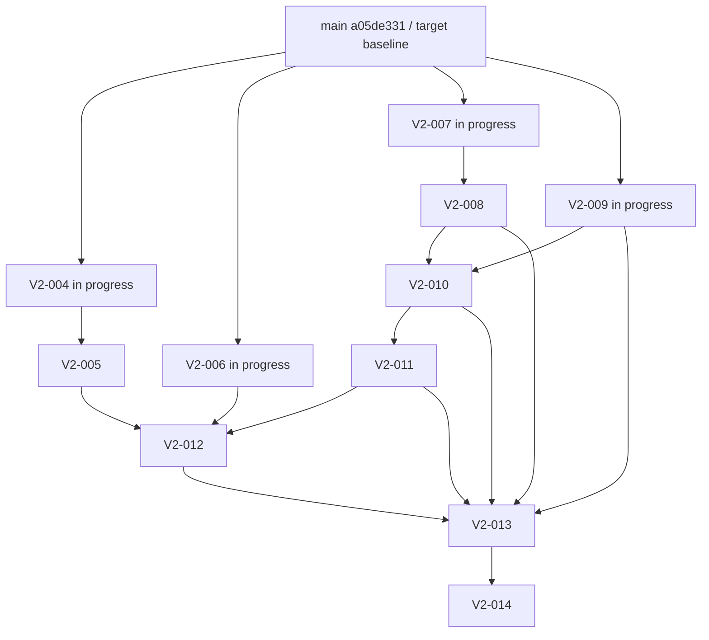

# HubRadio MovieCreator 残タスク実行・移行計画

- **識別子:** `20260903-0615`
- **作成日:** 2026-09-03
- **対象要求:** `docs/requirement-definition.md` 版0.2 Draft
- **source branch:** `main`
- **source baseline commit:** `a05de3313c6b8a2486a43b4834951d0daf6c3b59`
- **remote baseline:** `origin/main = e8221367ddd631aea585d91c7dd216ab5d1f851b`
- **source状態:** 本書作成前の`main`はclean、`origin/main`より3 commit先行
- **完了済みV2 task:** `V2-000`〜`V2-003`（4件）とV2-002/V2-003 shared bootstrap
- **active残task:** `V2-004`〜`V2-014`（11件）
- **条件付き将来task:** 17件
- **active scopeから削除済み:** `S-003`, `Q-000`
- **文書用途:** 現在のsource PCまたは別Windows環境で、残作業を証拠付きで継続するための実行正本

> [!IMPORTANT]
> 本書は実装、human evaluation、外部公開、権利、法的適合、signed package、clean-machine install、release readinessの完了証拠ではない。未実測事項をPASSへ読み替えず、敵対的レビューでは存在しない問題を作らない。各findingは実ファイル、違反契約、再現入力、expected/actualの4点が揃った場合だけ採用する。[S01][S02][S03][S05]

> [!CAUTION]
> 旧要求版0.1の`124/203`、`139/203`、`160/203`、残43/64件、人手gate、cross-account gateは現在値として使用しない。現在の実行単位は要求版0.2の`V2-*`である。旧task IDは履歴と再受入scopeの追跡にだけ使う。[S02][S03][S05]

---

## 0. 結論

1. 現行のactive残taskは`V2-004`〜`V2-014`の**11件**である。`V2-004`,`V2-006`,`V2-007`,`V2-009`には未コミット作業があるが、task review文書、task commit、main統合がないため完了へ数えない。[S05][O01][O03]
2. `V2-005`,`V2-008`,`V2-010`〜`V2-014`は、依存taskの統合完了後に開始する。既存の旧task実装が存在しても、要求版0.2の再受入が完了したことにはならない。[S05][S06]
3. 現行critical path外の17件は、開始条件とproduct ownerによる再計画が成立するまで実行しない。`S-003`と`Q-000`はactive scopeから削除済みであり、残taskへ戻さない。[S03][S05]
4. source fixtureは現在実在し、manifest記載のsize/hashと一致する。一方、過去に36 MP3を観測した`Music/`は2026-09-03T06:12:18+09:00のsource rootには存在しない。したがって`V2-009`は不在時の「BGMなし+warning」を正規に検証し、音源の存在や権利を捏造しない。[S04][S12][O02]
5. source `main`のcanonical Release回帰は2026-09-03にfailure 0で完走した。ただし.NETの22件はenvironment-gated inconclusive/skipであり、PASSへ数えない。[S08][O04]

---

## 1. 出典台帳

### 1.1 Git管理された正本

| ID | 出典 | 現在内容の識別 | 本書で使う範囲 |
|---|---|---|---|
| S01 | [`docs/requirement-definition.md`](../docs/requirement-definition.md) | 60,768 bytes / SHA-256 `7507883d5ba3e26a0e83bf2b7c2bacd0c71372470301ce4ab699ab268d0a36d0` | 要求版0.2、FR/NFR/BR/AC、source-only、成果物、未決事項、完了境界 |
| S02 | [`docs/dev/decisions/ADR-0001-source-of-truth.md`](../docs/dev/decisions/ADR-0001-source-of-truth.md) | 5,634 bytes / SHA-256 `c48de19d7f92dc02266a40619a4003d31fcd73b3efb5e7f9e167213a9291903e` | 正本優先順位、2026-09-02の再baseline、実装再開注記 |
| S03 | [`docs/dev/decisions/ADR-0009-source-only-defaults-and-automated-evaluation.md`](../docs/dev/decisions/ADR-0009-source-only-defaults-and-automated-evaluation.md) | 13,574 bytes / SHA-256 `8447aa37bb829c6ca2811dfdf4dea8324700197e93b1b402b0bf98dfdb710b2e` | 単一利用者、source-only、設定、自動decision、自動代理評価、Music、削除scope |
| S04 | [`docs/dev/research/default-settings-research.md`](../docs/dev/research/default-settings-research.md) | 43,277 bytes / SHA-256 `4c07f8531fc40534bd5e0a4abd6a43cb450780cf16515afa34c17da95b798d92` | 既定値と根拠区分、U01/C01〜C05/R01〜R26、数値の適用scope |
| S05 | [`docs/dev/planning/implementation-plan.md`](../docs/dev/planning/implementation-plan.md) §0 | 127,340 bytes / SHA-256 `01ffd621c22232804f324d1af74fff17f8040cd4d23f1c5c85612db9365afa76` | 現在のV2 task、旧203件の分類、DAG、共通実行契約 |
| S06 | [`work/20260902-1750-taskplan.md`](20260902-1750-taskplan.md) | 57,190 bytes / SHA-256 `e911273ebe8cf335b37c5757447ea867c32f2855e0a9747d4a254ae15d927a4f` | task別詳細、移行手順、review形式。件数とcommitは履歴値のため本書で置換 |
| S07 | [`docs/dev/reviews/v2-defaults-adversarial-review.md`](../docs/dev/reviews/v2-defaults-adversarial-review.md)、[`v2-001`](../docs/dev/reviews/v2-001-default-settings-profile-adversarial-review.md)、[`v2-002`](../docs/dev/reviews/v2-002-default-settings-store-adversarial-review.md)、[`v2-003`](../docs/dev/reviews/v2-003-default-settings-profile-adversarial-review.md)、[`shared bootstrap`](../docs/dev/reviews/v2-settings-bootstrap-integration-adversarial-review.md) | SHA-256順に `201ae085…f2c`, `5ddcf7d0…27c2`, `dfe776cc…ac5b`, `8f3c033c…155d`, `05de1e0e…2931` | `V2-000`〜`V2-003`とshared bootstrapの完了・残余scope |
| S08 | [`build.ps1`](../build.ps1)、[`test.ps1`](../test.ps1)、[`global.json`](../global.json)、[`src/HubRadio.Web/package.json`](../src/HubRadio.Web/package.json) | SHA-256順に `f22d6d05…aa69`, `03a4c748…2027`, `2d219f1e…312f`, `bd91cff8…f246` | PowerShell 7、SDK 10.0.400、build/format、全runner、npm 11.17.0 |
| S09 | [`.gitignore`](../.gitignore) | 1,356 bytes / SHA-256 `92ac05f4215123d98902fe676650e60407c2d89373cec384a46aff6117439b7a` | `/sample/*`, `/music`, package、secret、generated artifactの非追跡境界 |
| S10 | [`packaging/HubRadio.Package/README.md`](../packaging/HubRadio.Package/README.md)、[`PACKAGE-NOT-FOR-RELEASE.txt`](../packaging/HubRadio.Package/PACKAGE-NOT-FOR-RELEASE.txt) | SHA-256 `b8a2a39b…5def`, `615a2ae8…4f20` | PK-006同一host evidence、未署名、未実施のinstall/sign/upgrade/release gate |
| S11 | [`docs/dev/accessibility/test-report.md`](../docs/dev/accessibility/test-report.md) | 11,486 bytes / SHA-256 `19c9a1936f4ec3a4248a70884d3122a6bc41eba23db481a4bbb8b481752ca9ec` | 旧human 17項目PENDING、自動証拠の再利用範囲、新UI未対象 |
| S12 | [`benchmarks/fixtures/fixture-manifest.json`](../benchmarks/fixtures/fixture-manifest.json) | 2,574 bytes / SHA-256 `5d226fbf6cc9b2af88a7142936d6d46f9885abd582a54125db5bb14531cc2363` | source fixtureのsize/hash、旧rights状態、外部公開不可境界 |
| S13 | [`packaging/python/runtime-manifest.json`](../packaging/python/runtime-manifest.json)、[`packaging/models/catalog.json`](../packaging/models/catalog.json)、[`packaging/ffmpeg/manifest.json`](../packaging/ffmpeg/manifest.json)、[`packaging/web/dependency-manifest.json`](../packaging/web/dependency-manifest.json) | SHA-256順に `ac917bc3…1000b`, `9699c209…1d004`, `d3c535e9…f8f1`, `bb418417…04463` | V2-014の固定package inputと供給網照合 |

### 1.2 2026-09-03の実測観測

| ID | 観測 | 結果 | 再取得方法 |
|---|---|---|---|
| O01 | Git状態、2026-09-03T06:12:18+09:00 | `main=a05de331…`, `origin/main=e822136…`, ahead 3 / behind 0。本書作成前のmainはclean | `git rev-parse HEAD`; `git status --short --branch --untracked-files=all`; `git rev-list --left-right --count HEAD...origin/main`; `git ls-remote origin refs/heads/main` |
| O02 | source toolchain/asset | Windows `10.0.29648` x64、PowerShell Core 7.6.5、Git 2.55.0、.NET 10.0.400、Node 24.19.0、npm 11.17.0、CPython 3.12.10 win32 x64、PSScriptAnalyzer 1.25.0。source MOVは6,494,572,403 bytes / SHA-256 `fe9c763f…c1a9f`。`Music/`は不在 | 各version command、`Get-FileHash`、`Test-Path` |
| O03 | 4進行worktree | 全てbase `a05de331…`。V2-004は22 modified+2 untracked、V2-006は15+13、V2-007は0+2、V2-009は0+7。stagedは全て0 | `git worktree list --porcelain`; 各worktreeの`status`, `diff --name-only`, `ls-files --others --exclude-standard`, file SHA-256 |
| O04 | source main canonical Release回帰 | exit 0。Architecture 46/46、Core 655/655、Infrastructure 709成功+19 inconclusive、App 979成功+3 inconclusive、Web 442、Accessibility 4、Web asset 6、Python 104、failure 0。Vite 612.03 kB chunk warningあり | `pwsh.exe -NoLogo -NoProfile -File .\test.ps1 -Configuration Release` |
| O05 | 本書の独立敵対的レビュー | factual/citation軸とrequirements/DAG軸はfinding 0。migration/reproducibility軸で実TAB、ordinal sort、integration worktree識別の3件を再現し、本書へ反映 | 2026-09-03、3つの独立read-only reviewとPowerShell 7.6.5による再現 |

観測値は署名ではなく、移行時の差異検知用receiptである。target環境では同じ手順で再計算し、相違を成功へ丸めない。[S02][S05][S08]

### 1.3 優先順位と文書差

要求の意味はS01、正本優先順位はS02、具体判断は後発Accepted ADRであるS03、値と出典scopeはS04、実行順はS05を優先する。S06は前回handoff時点の詳細を再利用するが、「残13件」「基準commit `6fbd000`」等は現在値にしない。[S02][S05][S06]

確認済みの差は次のとおりである。

- S03冒頭には「production実装は一時停止中」が残るが、S02末尾とS05冒頭はその後の利用者指示で実装再開済みと記録する。本書は最新の利用者指示、S02、S05に従い実装継続を前提とする。ADR本文の履歴は改ざんしない。[S02][S03][S05]
- `V2-012`の依存はS05 §0.4表と§0.5 DAGで差がある。開始gateは安全側の和集合、すなわち`V2-005`,`V2-006`,`V2-010`,`V2-011`と、引き取る旧UI責務を用いる。`V2-011`が`V2-010`を要求していても、正本差を開始前にS05へ同期する。[S05][S06]
- S04は2026-09-02に元worktreeの`Music/` 36 MP3 / 149,081,539 bytesを観測したが、O02では現在不在である。過去観測を現在存在へ読み替えない。[S04][O02]
- S04の利用者決定U01はsourceの社内利用許可を記録する一方、S12のfixture manifestは`rights.status=unconfirmed`, `allowedUse=local-technical-evaluation-only`の履歴値を保持する。V2-014開始前に両記録を履歴保全付きで再baselineし、外部公開許可へ拡張しない。[S04][S12]

---

## 2. 現在のtask inventory

### 2.1 完了済み

| Task | 状態 | 完了根拠 | 未評価の範囲 |
|---|---|---|---|
| `V2-000` | 完了 | 要求・引用・task再baselineの敵対的レビューPASS | production実装、実素材、human/package/release |
| `V2-001` | 完了 | setting domain/schema、focused 17/17、全回帰、review PASS | 具体profile、store、UI、consumer |
| `V2-002` | 完了 | schema 8/store/OCC/reset、全回帰、review PASS | concrete profile、application/UI consumer |
| `V2-003` | 完了 | 123設定profile/strict loader、全回帰、review PASS | runtime consumer、実素材、知覚評価 |
| shared bootstrap | 完了 | bundled profile登録/current pointer/restart/non-retroactiveの統合review PASS | 案件bind、設定UI、Composition/render |

完了判定はS07の実在reviewとmain上のcommitに限定する。[S07][O01]

### 2.2 active残task 11件

| Task | 現在状態 | 開始・継続gate | 並列lane | 引き取る旧`変更`task |
|---|---|---|---|---|
| `V2-004` | **進行中・未完了**。未コミット24 path | receipt一致後に再試験・review・commit | Wave A | `D-004` |
| `V2-005` | 未開始gate | `V2-004`統合PASS | Wave B | `U-005` |
| `V2-006` | **進行中・未完了**。未コミット28 path | receipt一致後に再試験・review・commit | Wave A | 旧taskなし（純新規） |
| `V2-007` | **進行中・未完了**。未コミット2 path | receipt一致後に全回帰・review・commit | Wave A | `D-006`,`D-007`,`A-007〜A-009`,`A-016`,`R-003` |
| `V2-008` | 未開始gate | `V2-003`,`V2-007`統合PASS | Wave B | `A-014`,`A-020`,`A-021`,`R-015`,`E-001`,`E-002`,`E-004`,`E-005`,`E-009`,`E-010` |
| `V2-009` | **進行中・未完了**。未コミット7 path | receipt一致後に不在fallbackを含む再試験・review・commit | Wave A | `S-006`,`E-006`,`E-008` |
| `V2-010` | blocked | `V2-008`,`V2-009`統合PASS | Wave C | `U-015` |
| `V2-011` | blocked | `V2-010`統合PASS | Wave D | `D-011`,`S-002`,`S-004`,`S-008`,`S-011`,`S-016` |
| `V2-012` | blocked | `V2-005`,`V2-006`,`V2-010`,`V2-011`統合PASS＋依存差同期 | Wave E | `U-006〜U-014`,`U-016`,`U-017`,`E-015`,`E-018`,`E-019` |
| `V2-013` | blocked | `V2-008〜V2-012`統合PASS | Wave F | `D-010`,`R-019〜R-024`,`E-013` |
| `V2-014` | blocked | `V2-013`統合PASS＋実在input/gate棚卸し | Wave G | `PK-006`,`PK-007`,`Q-001`,`Q-002`,`Q-004〜Q-006`,`Q-008〜Q-013` |

上表の旧task割当は合計64件だが、これは要求版0.2で残る`変更`責務の追跡数であり、「64件が未実装」という進捗値ではない。既存成果物を再利用しつつ各V2 taskで再受入する。[S05]

### 2.3 条件付き将来task 17件

`ST-008`,`A-010`,`A-012`,`A-013`,`A-015`,`S-010`,`E-003`,`E-007`,`E-011`,`E-012`,`E-014`,`E-016`,`E-017`,`Z-008`,`Z-009`,`Z-010`,`Q-003`は現行critical path外である。再開条件は§8で定義する。[S05]

### 2.4 実行しない削除scope

- `S-003`: cross-account受入をactive scopeから削除。既存ACL/path防御コードは維持する。
- `Q-000`: 人手9:16必須受入をactive scopeから削除。過去の自動・人手PENDING証拠は履歴として維持する。

削除taskを「完了」とも「未完了」とも数えず、現在scope外として扱う。[S03][S05]

---

## 3. source PCから別環境への移行

### 3.1 保護対象

本書作成前のmainはcleanだったが、本書保存後は`work/20260903-0615-TaskExecutionPlan.md`が新規fileになる。明示的にcommitするかsidecarへ含めるまで、bundleだけで移送済みとみなさない。[O01]

mainのremote未反映commitは次の3件である。[O01]

1. `2b9ec6fcf5f43a3945041f80e4e24f850fa8021a` — V2-002 setting store
2. `6a13a0e3eb37e3da6d748ff3016f56d716a94448` — V2-003 profile
3. `a05de3313c6b8a2486a43b4834951d0daf6c3b59` — shared bootstrap

`origin/main`だけをcloneするとこれらを取得できないため、承認済みremoteへpushするか、`main`をGit bundleで移送する。勝手にremoteを変更しない。[O01]

### 3.2 進行中worktree receipt

集約digestは、変更対象各fileについて`relativePath<TAB>byteSize<TAB>sha256`をrelative pathのordinal順にLF結合し、そのUTF-8 bytesをSHA-256した値である。targetで同じ計算を行い、完全一致しなければ作業を開始しない。[O03]

| Worktree | Base | Modified | Staged | Untracked | Unique paths | Content aggregate SHA-256 |
|---|---|---:|---:|---:|---:|---|
| `V2-004` | `a05de331…` | 22 | 0 | 2 | 24 | `3bc7256576d4ea5871d29236399f47710151de0ba2566777f44911a61c1ad000` |
| `V2-006` | `a05de331…` | 15 | 0 | 13 | 28 | `3b1815bb0ea02f2d45087ed3d9e97597e54f442791b8f6b4d0a8f12a7a7c056e` |
| `V2-007` | `a05de331…` | 0 | 0 | 2 | 2 | `b53ef60786ef440a2d3b9e090c6f64e198bd1d8d5dff05d0b8072f046f8a0098` |
| `V2-009` | `a05de331…` | 0 | 0 | 7 | 7 | `ad6cd9d2c9ca381416181fc9aac911d73cb67efdc9501299ddbe664849acafa9` |

完全なpath inventoryは付録Aに記載する。[O03]

### 3.3 推奨handoff artifact

履歴と未コミット作業を分離する。

1. **Git bundle:** `main`の全commitを保持する。
2. **worktree sidecar:** 各worktreeの変更fileをbyte-for-byteで保持する。review用に`git diff --binary --full-index` patchも併記する。
3. **manifest:** base commit、tracked/untracked区分、path、size、SHA-256、集約digestを保持する。
4. **asset receipt:** source fixture、任意の`Music/`、package inputをGitとは別に保持する。
5. **plan:** 本書をcommitしない場合はsidecarへ含め、そのsize/hashをhandoff receiptへ記録する。

`stash`, `reset`, `clean`, `git add -A`, worktree削除をhandoff手段にしない。[S05][S06]

#### source側の実行例

```powershell
$SourceRepo = 'C:\path\to\HubRadio-MovieCreator'
$HandoffDir = 'D:\protected\HubRadio-Handoff-20260903'
New-Item -ItemType Directory -Path $HandoffDir -Force | Out-Null

git -C $SourceRepo status --short --branch --untracked-files=all
git -C $SourceRepo bundle create (Join-Path $HandoffDir 'main.bundle') main
git -C $SourceRepo bundle verify (Join-Path $HandoffDir 'main.bundle')
Get-FileHash -Algorithm SHA256 -LiteralPath (Join-Path $HandoffDir 'main.bundle')
```

各進行worktreeでは、baseを確認してからtracked patchと全変更fileのmirrorを作る。patchはレビュー用、mirrorはline-ending差を含むbyte再現用とする。

```powershell
$Base = 'a05de3313c6b8a2486a43b4834951d0daf6c3b59'
$Worktrees = [ordered]@{
    'V2-004' = 'C:\path\to\HubRadio-MovieCreator-V2-004'
    'V2-006' = 'C:\path\to\HubRadio-MovieCreator-V2-006'
    'V2-007' = 'C:\path\to\HubRadio-MovieCreator-V2-007'
    'V2-009' = 'C:\path\to\HubRadio-MovieCreator-V2-009'
}

foreach ($entry in $Worktrees.GetEnumerator()) {
    $taskDir = Join-Path $HandoffDir $entry.Key
    $mirror = Join-Path $taskDir 'files'
    New-Item -ItemType Directory -Path $mirror -Force | Out-Null
    if ((git -C $entry.Value rev-parse HEAD).Trim() -ne $Base) { throw "Unexpected base: $($entry.Key)" }

    $patchPath = Join-Path $taskDir 'tracked.patch'
    git -C $entry.Value diff --binary --full-index --output=$patchPath HEAD
    if ($LASTEXITCODE -ne 0) { throw "Unable to create patch: $($entry.Key)" }
    $tracked = @(git -C $entry.Value diff --name-only HEAD)
    if ($LASTEXITCODE -ne 0) { throw "Unable to list tracked changes: $($entry.Key)" }
    $untracked = @(git -C $entry.Value ls-files --others --exclude-standard)
    if ($LASTEXITCODE -ne 0) { throw "Unable to list untracked files: $($entry.Key)" }
    $pathSet = [Collections.Generic.HashSet[string]]::new([StringComparer]::Ordinal)
    foreach ($relative in @($tracked + $untracked)) {
        if (-not [string]::IsNullOrWhiteSpace($relative)) { [void]$pathSet.Add($relative) }
    }
    $paths = [string[]]$pathSet
    [Array]::Sort($paths, [StringComparer]::Ordinal)
    $records = @(foreach ($relative in $paths) {
        $source = Join-Path $entry.Value $relative
        $target = Join-Path $mirror $relative
        New-Item -ItemType Directory -Path (Split-Path $target -Parent) -Force | Out-Null
        Copy-Item -LiteralPath $source -Destination $target
        [ordered]@{
            path = $relative.Replace('\','/')
            kind = if ($untracked -contains $relative) { 'untracked' } else { 'modified' }
            byteSize = (Get-Item -LiteralPath $source).Length
            sha256 = (Get-FileHash -LiteralPath $source -Algorithm SHA256).Hash.ToLowerInvariant()
        }
    })
    $aggregateLines = @(foreach ($record in $records) {
        "{0}`t{1}`t{2}" -f $record.path, $record.byteSize, $record.sha256
    })
    $aggregateBytes = [Text.Encoding]::UTF8.GetBytes([string]::Join("`n", $aggregateLines))
    $aggregateHash = [Convert]::ToHexString(
        [Security.Cryptography.SHA256]::HashData($aggregateBytes)).ToLowerInvariant()
    $patchHash = (Get-FileHash -LiteralPath $patchPath -Algorithm SHA256).Hash.ToLowerInvariant()
    [ordered]@{
        task = $entry.Key
        base = $Base
        trackedPatchSha256 = $patchHash
        contentAggregateSha256 = $aggregateHash
        files = $records
    } |
        ConvertTo-Json -Depth 5 |
        Set-Content -LiteralPath (Join-Path $taskDir 'manifest.json') -Encoding utf8NoBOM
}
```

handoff directoryをarchive化した場合はarchive自身のsize/hashを別receiptへ保存する。manifestへ自己hashを埋めない。[S06]

### 3.4 target側の復元

1. bundle/archive/manifestのsize/hashをsource receiptへ照合する。
2. bundleからcloneし、`a05de331…`が取得可能であることを確認する。
3. mainのbaseline全回帰をsidecar適用前に実行する。
4. 4つのdetached worktreeを**同じbase**から作る。
5. 各worktreeがcleanであることを確認後、sidecar mirrorを復元する。patchは差分監査に使い、mirrorと重ねて二重適用しない。
6. modified/untracked分類、個別file hash、集約digest、staged=0を照合する。
7. 一致後にfocused testと敵対的レビューを最初から再実行する。

現在存在する`HubRadio-MovieCreator-Wave3-Integration`、`Wave4-Integration`、`Wave5-Integration`は旧waveの履歴worktreeであり、Wave Aのcanonical integration先に再利用しない。本書のhandoff対象にも削除対象にも含めず、別途所有意図を確認する。[O01][O05]

```powershell
$Bundle = 'D:\protected\HubRadio-Handoff-20260903\main.bundle'
git clone --branch main $Bundle HubRadio-MovieCreator
Set-Location HubRadio-MovieCreator
git rev-parse HEAD
git merge-base --is-ancestor a05de3313c6b8a2486a43b4834951d0daf6c3b59 HEAD
pwsh.exe -NoLogo -NoProfile -File .\test.ps1 -Configuration Release
```

復元先がsourceと異なるのは正常であり、absolute pathを契約やtracked evidenceへ埋め込まない。[S01][S05]

### 3.5 toolchain bootstrap

source観測値はO02であり、target最低条件はS01/S08に従う。

- Windows 11 x64 product環境。sourceのOS API表示値`10.0.29648`をtargetの固定versionとして強制しない。
- PowerShell Core 7+。Windows PowerShell 5.1へfallbackしない。
- .NET SDK `10.0.400` exact、rollForward disabled。
- Node.jsはsource観測24.19.0。repositoryはNode exact版を固定していないため、異なる版は全回帰で判定する。
- npm `11.17.0`。
- CPython 3.12 Windows x64。source観測は3.12.10。
- PSScriptAnalyzer 1.25.0以上。
- 初回restoreに必要なpackage feed接続。offline buildを証拠なしに主張しない。

### 3.6 source fixture、Music、package input

#### source fixture

現在の`sample/20260615_024326000_iOS.MOV`は6,494,572,403 bytes、SHA-256 `fe9c763fdf6fe7be4f368bfba926a1f3f2407ceaf044ec7d055e0869e65c1a9f`で、S12と一致する。Gitへ追加せず、targetでもsize/hashを照合する。[S09][S12][O02]

#### Music

現在のsource rootには`Music/`がない。targetにもない場合はその状態を正規入力とし、`V2-009`でBGMなし+warningを検証する。後から音源を渡す場合だけ、保護された媒体でfileごとのrelative path、size、SHA-256 manifestを作り、read-only/internal-onlyとして照合する。過去の36 MP3という件数を完全性receiptへ使わない。[S01][S03][S04][O02]

#### package input

Python runtime、ASR model、FFmpeg、Web dependencyのexact情報はS13を正本とする。不足またはhash/signature mismatch時はV2-014 package laneをPENDINGで止め、versionやhashを出力に合わせて書き換えない。signing秘密はchat、plan、repo、script引数、logへ渡さない。[S10][S13]

---

## 4. 全task共通の実行・敵対的レビュー契約

各taskは次の順序で閉じる。依存taskが完了していない場合は実装を開始しない。[S05][S06]

1. mainのHEAD/status、task base、source/asset receiptを記録する。
2. task専用detached worktreeを最新統合commitから作る。復元済み4taskは§3のbase/hashを先に照合する。
3. S01〜S05、task行、引き取る旧実装、直接依存、schema/testを読む。
4. 許可path、非対象、外部入力、停止条件、focused testをtask noteへ固定する。
5. 最小実装を行う。二つ目の実装がないinterface/provider/factory、未来用flag、未承認thresholdを追加しない。
6. successに加え、該当するinvalid、stale、duplicate、cancel、timeout、restart、partial failure、privacy、authorization-before-existenceをtestする。
7. MTPは`--minimum-expected-tests 1`を付け、Web/Pythonも対象file/classを明示する。0件実行をPASSにしない。
8. warnings-as-errors build、Web typecheck/build、schema/JSON/XML parse、`git diff --check`、0-byte source、秘密/absolute path/media追跡を確認する。
9. task固有full regressionとして`test.ps1 -Configuration Release`を実行する。複数worktreeのfull regressionは資源競合を避けて直列化する。
10. 実装担当とは独立したreviewerで、(a) correctness、(b) security/privacy/reliability、(c) requirements/schema/traceability/YAGNIの3軸をレビューする。
11. findingは次の4点が揃ったものだけ採用する。
    - exact file/symbol
    - 違反する要求・schema・contract
    - 再現入力または実行手順
    - expected/actualまたは失敗test
12. 実在findingだけを最小修正し、focused/component/full regressionを再実行する。存在しないclass、別worktree、未追跡fileの見落とし、正本にない閾値は不採用理由を記録する。
13. 修正担当とは別のclosure reviewerが未解決Critical/Major 0を確認する。finding 0でも対象と確認方法を記録する。
14. `docs/dev/reviews/v2-NNN-<topic>-adversarial-review.md`へbase、変更、test件数、environment gate、accepted/rejected finding、残余scopeを保存する。
15. 意図したpathだけを明示stageし、cached name/status/diff/checkを監査して1 logical task commitを作る。`git add -A`は禁止する。
16. integration worktreeへtask commitを順次cherry-pickし、共有境界を手作業でclosed unionにする。`ours/theirs`一括解決は禁止する。
17. 統合focused test、全回帰、独立integration review後にmainへfast-forwardする。main前後でstatusとasset receiptが一致しなければ停止する。
18. S05、本書、要求traceへcommit/test/残余scopeを同期し、次の依存taskを解放する。

### 証拠template

```text
Task:
Source baseline / task base:
Final task commit:
Integrated main commit:
Changed paths:
Requirements / ADR / source IDs:
Focused command and discovered count:
Component regression:
Canonical Release regression:
Environment-gated inconclusive:
Adversarial reviewers:
Accepted findings + reproduction:
Rejected findings + reason:
Post-fix verification:
Residual NOT EVALUATED / PENDING:
Source/Music/package before-after receipt:
```

transcript本文、PII、SID、credential、token、raw path、Music file名、prompt/response本文をtracked reviewへ複製しない。[S01][S03][S05]

---

## 5. 依存DAGと並列wave



### Wave A — 4進行taskのclosure

`V2-004`,`V2-006`,`V2-007`,`V2-009`は同じbaseから並行して再試験・reviewできる。ただしfull regressionは直列に実行する。`V2-004`と`V2-006`は`schemas/web-bridge.schema.json`, `Bridge.cs`, `ProjectApplicationRuntime.cs`を共有するため、個別task commit後の統合だけは一人のintegration ownerが直列に行う。[S05][O03]

### Wave B — quick start UIとComposition計画

`V2-004`統合後に`V2-005`、`V2-007`統合後に`V2-008`を開始し、相互に並列実行できる。両taskが作る開始request/plan inputのshared DTOは個別taskで汎用化せず、統合時にprofile/source/snapshot digest、cancel/retry、候補不足を横断検査する。[S05][S06]

### Wave C以降

`V2-008`と`V2-009`の統合後に`V2-010`、その後`V2-011`、依存差同期後`V2-012`、続いて`V2-013`,`V2-014`を直列実行する。[S05]

---

## 6. active残taskの詳細実装計画

### V2-004 — source-only Project契約

**現在:** base `a05de331…`の未コミット24 path。実装・testらしき差分は存在するが、review文書・task commit・main統合がないため未完了。[O03]

**目的:** 元動画1本のopaque candidateから、安全なcontent name、internal-only初期値、固定settings snapshot、標準成果物setを持つProject draftを作る。氏名、肩書、URL、hashtag、期限、外部destinationを作らない。[S01 §6/AC-001][S03 §2][S05 §0.4]

**実装・再開手順:** [S01][S03][S06]

1. §3.2の24 pathと集約digestを照合し、差分を失っていないことを確認する。
2. native pickerが返したcandidate tokenだけをbridgeへ渡し、raw path/file system情報をReactへ返さない。
3. content nameはfilename stemから内部導出し、空、制御文字、不正UTF-16、Windows予約名、末尾dot/space、過長をfail closedまたは安全な型付きerrorにする。別の架空名へ黙って置換しない。
4. profile/storeからpurpose、audience、scope、language fallback、anonymous performer、deadlineなし、neutral/no-logo、artifact planを解決し、同じ既定値を別hard-code正本として増やさない。
5. source reservation、settings snapshot bind、draft保存/finalizeを一貫したtransaction/OCC境界で処理する。失敗時にcandidate reservationやpartial draftを成功扱いしない。
6. picker cancel、candidate stale/file消失、profileなし/digest mismatch、authorization failure、duplicate finalizeを型付き・内容非開示で返す。
7. 旧10-field draftを破棄せず読み、source-only要約へ投影する。値を勝手に新既定へ置換しない。
8. schema、C# codec、TypeScript protocol/state/UIのclosed unionを一致させる。

**focused test:** `SourceOnlyProjectCreationContractTests`, `ProjectCreationServiceTests`, `ProjectCreationDraftStoreTests`, `AssetCandidateRegistryTests`, `BridgeProtocolTests`, `WebBridgeSchemaTests`, `projectProtocol.test.ts`, `projectState.test.ts`, `ProjectWorkspace.test.tsx`。source-only成功、cancel、path非開示、unsafe name、snapshot固定、global drift、metadata不在、legacy、oversize/unknown、stale、二重finalize、authorization-before-existenceを最低対象とする。[O03][S06]

**敵対review重点:** path/PII漏えい、hidden必須入力、profileとhard-codeの二重正本、reservation leak、外部scope昇格、旧draft data loss、bridge schema差。[S01][S03]

**完了:** focused/component/full regression failure 0、environment gate分離、独立3軸reviewとclosure、task commit、Wave A統合review、main到達を全て満たす。[S05]

### V2-005 — かんたん編集UI

**開始gate:** `V2-004`がmainへ統合されるまで開始しない。[S05]

**目的:** 旧5段階・10項目wizardを、元動画選択、設定要約、社内限定表示、`編集を開始`、取消だけの通常画面へ置換する。任意詳細はsettings/advancedへ残し、quick startの必須入力にしない。[S01 §14.1/NFR-001/AC-001][S03 §2]

**実装手順:** [S01][S05][S06]

1. `src/HubRadio.Web/src/features/projects/`とproject bridgeを読み、旧draft互換を壊さずsource-only reducerを唯一のUI state正本にする。
2. picker→draft preview→一回の開始確認を実装し、選択直後の無確認自動開始にしない。
3. profile version/digest、短い設定要約、internal-only、標準成果物、warning件数を表示する。raw path、秘密、actor SIDを表示しない。
4. cancel、invalid source、profile unavailable、stale draft、bridge unavailable、job開始失敗、restart/retryを重複stateなしで表現する。
5. double click/Enter連打による二重開始を防ぎ、同じrequest digestのidempotencyをhost契約へ結ぶ。
6. keyboard、focus visible、skip link、status/error announcement、light/dark contrast、非色依存状態を新UIに対して検証する。

**focused test:** source 1本だけで開始、追加inputなし、cancel、double submit、stale、bridge failure/retry、warning summary、legacy data保持、XSS/raw path非表示、keyboard-only/focus/contrast。旧UIの442 testを新画面のhuman評価へ転用しない。[S11]

**敵対review重点:** 隠れた10-field gate、確認省略、derived state重複、旧値消失、path leak、automated proxy/human表現混同。[S01][S11]

### V2-006 — 全体設定UI

**現在:** base `a05de331…`の未コミット28 path。実装・testらしき差分は存在するが未統合。[O03]

**目的:** 123設定を5群で表示し、current、案件initial、profile default、用途、根拠区分、profile版、個別/全resetをkeyboardで操作可能にする。[S01 §6.4/§14.4/FR-033/AC-006][S07 V2-003]

**実装・再開手順:** [S01][S05][S06]

1. §3.2の28 path/集約digestを照合する。
2. `settings.read/update/reset/resetAll`のclosed bridge request/response、size上限、origin/method/schema allowlist、authorizationをC#/schema/TypeScriptで一致させる。
3. 5群を固定順で表示し、高度設定のnestを1段に限定する。全123 keyを欠落・重複なくprofileから投影し、UI fixtureだけを全件表示証拠にしない。
4. current、project initial、profile defaultを区別する。reset先はproject initialであり、最新globalへ暗黙移行しない。
5. update/resetへexpected revision/profile/snapshot digestを渡し、stale/OCC conflictで利用者変更を上書きしない。refresh後も明示再操作を要求する。
6. value kindごとのeditorをclosedにし、unknown key/kind/unit/evidenceをfail closedにする。
7. evidence ID/区分はtextとして表示し、任意URLを取得しない。XSS payloadをHTMLとして解釈しない。
8. tabのArrow/Home/End、全controlのTab/Shift+Tab、buttonのEnter/Space、advanced summaryのEnter/Space、focus/error announcementを実際のcomponent testで確認する。
9. formatter、TypeScript discriminated union、schema order/sizeを再確認する。

**focused test:** `SettingsBridgeTests`, bridge/schema/security tests、`SettingsPanel.test.tsx`, `settingsProtocol`, `settingsState`, `settingsBridgeSession`, App shell tests。5群/123 key、全value kind、個別/全reset、OCC/restart、unknown/wrong project、oversize、XSS、keyboard-only、focus、announcementを含める。[O03]

**敵対review重点:** reset先誤り、設定欠落、二重state、authorization漏れ、XSS/URL、bridge detail漏えい、nested UI過多、human accessibility過大主張。[S01][S11]

### V2-007 — 3種類限定の可逆自動decision

**現在:** base `a05de331…`に未追跡2 file。tracked差分は0だが、untracked fileはbundleに入らないためsidecar必須。[O03]

**目的:** 自動適用を次の3規則だけに限定し、元Compositionを変更せず子版、decision evidence、TimelineMap、rollback-as-childを作る。[S01 FR-005/FR-030/NFR-008][S03 §4]

1. 明示的な「ここはカット」のexact evidence。
2. 同一話者・構造的隣接・NFKC完全一致反復の後側。
3. 版付き`-50 dB / 2.0 s`規則による冒頭・末尾無音。発話前後0.30秒保持。[S01][S04]

**実装・再開手順:** [S03][S05][S06]

1. 2 fileのhash/aggregateを照合し、MTP focused suiteと全回帰をtargetで再実行する。
2. rule ID/version/digest、candidate/ModelRun、SourceSpan、comparison evidence、parent Composition/settings/transcript digestをdecisionへ固定する。
3. candidate/evidence/revision/settings/parentのstale、欠落、重複conflict、range外、partial timing、overlapをmutation前に拒否する。
4. cough/noise、semantic repetition、context deviation、topic、shot、face、感情を自動採用しない。4種類目のruleを受理しない。
5. operation順に依存せず同じchild/decision digestを作り、同じinputの再実行をidempotentにする。
6. in-memory copyに適用し、atomic checkpoint前のcancelでは永続副作用を残さない。
7. child TimelineMapのround-tripとsource不変を確認する。
8. 無効化は過去版・approval/historyを書き換えずrollback childを作る。

**focused test:** 3 success、4th/fuzzy/middle silence拒否、padding boundary、overlap、stale revision/settings、missing evidence、duplicate/idempotency/order、cancel、Unicode、rollback child、TimelineMap、source hash不変、並行checkpoint conflict。[S06]

**敵対review重点:** 3規則のscope拡大、threshold/clamp捏造、evidenceなし削除、原版/履歴書換え、digest未結合、順序依存、partial persistence。[S01][S03]

### V2-008 — 標準Composition計画

**開始gate:** `V2-003`と`V2-007`のmain統合PASS。[S05]

**目的:** 同じsource/settings/decisionから、16:9長尺1本、成立した最大3件の9:16短尺候補、subtitle variant、thumbnail候補を根拠付きで計画する。[S01 FR-007〜FR-015/FR-021/FR-031][S05]

**実装手順:** [S01][S03][S04][S06]

1. `E-001/E-002/E-004/E-005/E-009/E-010`の要求版0.2 scopeを本taskへ取り込み、別の前提taskが完了したと仮定しない。
2. longはneutral/no-logo、opening video OFF、source stem由来title overlay、根拠のある要素だけを使う。
3. shortは連続SourceSpanまたは意味を変えない明示抜粋だけを候補化し、元発言にないhookやsemantic completenessを生成しない。
4. 0〜3件を正規結果とし、不足時は空/重複candidateで水増しせず、reason codeと未成立inputをmanifestへ記録する。
5. subject/face/materialを確定できない9:16は、元映像全体を失わないfixed/blur fallbackと`platform UI未確認`warningを使う。
6. subtitle variantはV2-003 profile、thumbnailは実source frame PTS/OriginRefへ結ぶ。表情・感情・目口の意味を推測しない。
7. CTAは対応longが同案件にある場合の`本編を見る`だけとし、URL/channel/formを作らない。
8. source/profile/settings/decision/template/tool digestをplanへ固定し、same inputの候補順・理由・digestを決定的にする。
9. parent Compositionを変更せず、新しいplan/child versionとして保存する。

**focused test:** long success、short 0/1/3、不足理由、exact duplicate、grounded hook、CTA、generic fallback、safe-zone warning、thumbnail source PTS、stale profile/decision、determinism、OriginRef欠落、external scope拒否。[S05][S06]

**敵対review重点:** 3件水増し、semantic model暗黙導入、platform適合claim、face/emotion推測、根拠なしmetadata、親版上書き、scoreでpolicyを相殺。[S01][S03]

### V2-009 — `Music/` read-only catalogとaudio policy

**現在:** base `a05de331…`に未追跡7 file。current source rootの`Music/`は不在であり、この状態を失敗ではなく必須fallback inputとして扱う。[O02][O03]

**目的:** `Music/`を存在する場合だけread-only/internal-onlyで棚卸しし、speech-free cardに再現可能に割り当てる。不在・空・読取不能・不適格ならBGMなし+warningで完了する。[S01 FR-019/020/BR-004][S03 §7]

**実装・再開手順:** [S01][S03][S04][S06]

1. 7 fileのhash/aggregateを照合する。過去reviewや検索でuntracked fileを見落として「実装なし」と判定しない。
2. library rootはhostが明示解決し、React/evidenceへabsolute pathや不要な曲名を返さない。別directoryを探索しない。
3. directory不在/空/読取不能をtyped library stateとwarningにし、BGMなしで成功可能にする。
4. regular MP3だけを列挙し、UNC/device/ADS/reparse、oversize/duplicate digest、途中変更をfail closedまたは明示warningへ分ける。
5. pinned ffprobe等でdecode可能性、duration、technical metadataを取得し、cue以上のtrackだけをeligibleにする。file名から曲調、権利、ブランド適合を推測しない。
6. pathではなくdigest/size/technical metadataでimmutable catalog snapshotを作り、ordinal digest順で決定的に選ぶ。
7. title/topic/end card等のspeech-free cueだけを自動対象にし、短いtrackをloop/stretchしない。本編会話BGMは既定OFF。
8. 利用者が本編BGMを明示有効化した場合だけ20 dB低いduck設定を記録する。符号表現はV2-003 setting contractと一貫させ、speech理解/mix品質をPASSにしない。
9. musical fit、brand fit、human listening、legal complianceを`NOT EVALUATED`にする。external profileを拒否する。
10. scan前後に全file hashを再確認し、source assetを移動・改名・書換え・stageしない。

**focused test:** currentのabsent、synthetic empty/unreadable、1/複数、digest order、短尺/corrupt、mutation race、reparse/path、duplicate digest、external scope、speech overlap、no loop、read-only、warning、`NOT EVALUATED`、error/log path非開示。実音源がなくてもtemp synthetic fixtureでcontractを検証し、音楽的品質は主張しない。[S01][O02]

**敵対review重点:** filename/rights推測、directory write、TOCTOU、random選択、外部利用、20 dBのWCAG AA誤表示、absentをtask failureへ誤変換、untracked成果物見落とし。[S03][S04]

### V2-010 — 自動代理評価

**開始gate:** `V2-008`と`V2-009`のmain統合PASS。[S05]

**目的:** 機械判定可能なclosed contractだけを`PASS`,`WARNING`,`FAIL`,`NOT EVALUATED`へ分類し、immutable evidenceとして保存する。human/legal/知覚評価と呼ばない。[S01 FR-034/AC-006][S03 §5]

**実装手順:** [S01][S03][S05][S06]

1. evaluation run ID、rule ID/version、environment、input/output/settings/profile/tool/music digest、result、reason、未評価範囲のdomain/schema/canonical codecを作る。
2. `OutputQc`等の既存実測を再利用し、container/codec/resolution/frame policy/full decode/duration/A-V、subtitle presence/read speed/line/gap/safe region、loudness/True Peak、provenance/settings digestをprofile値がある場合だけ判定する。
3. A/V sync等の新しい任意thresholdを作らない。closed値がなければ`NOT EVALUATED`または根拠付きwarningにする。
4. subtitle意味完全性、content accuracy、speech理解、musical/brand fit、platform固有適合、visual quality、感情、legal/rights/privacyを自動PASSにしない。
5. unknown/duplicate dimension、rule unavailable、stale input/profile/tool、digest mismatch、oversized/malformed evidenceをfail closedにする。
6. aggregateはFAILを隠さず、WARNINGとNOT EVALUATEDを個別表示する。自動評価不能をsuccessへ丸めない。
7. content/path/秘密をevidence/logへ複製せず、同じcanonical evidenceから同じdigestを作る。
8. UI keyboard/focus/contrastは新UIに対する機械contractとして実行し、旧S11のhuman PENDINGを書き換えない。

**focused test:** 各4状態、closed rule success/fail/unavailable、unknown/duplicate、stale/digest、aggregate precedence、canonical repeat、oversize、禁止label（Human PASS/Approved/Certified/Legal compliant）、必須NOT EVALUATED集合。[S01][S11]

**敵対review重点:** threshold捏造、未実行PASS、failure隠蔽、human/legal語、content/path leak、QCとevaluationの二重正本。[S01][S03]

### V2-011 — 単一利用者stateとexport policy

**開始gate:** `V2-010`のmain統合PASS。[S05]

**目的:** quick startを`Editing → AutomatedEvaluation → Ready | ReadyWithWarnings | Failed → Exported`で管理し、legacy review/approval dataを読取可能に保ちながら、社内限定出力へ多役割approvalを要求しない。[S01 FR-029/NFR-004/AC-004][S03 §6]

**実装手順:** [S01][S03][S05][S06]

1. 旧ReviewState/Approvalを削除・書換えず、版付きquick-start state/eventを追加する。
2. actor SIDを持つuser eventとsystem evaluation/worker eventを区別する。
3. technical corruption、provenance/digest欠落、asset scope違反、external destination、stale evaluationをclosed blockにする。
4. WARNING/NOT EVALUATEDは内容を表示した上でinternal-only exportを許可可能にし、任意の追加block規則を作らない。
5. SelfReviewed/ChangesRequested/commentは任意eventで、approvalを自動付与せず必須gateにしない。
6. content変更は子Compositionと再評価を要求し、same-content technical rerenderと区別する。
7. external publication、direct posting、cloud送信、legacy approval bypassを許可しない。
8. legacy row/eventのround-tripとread compatibilityを検証し、migrationで履歴を失わない。

**focused test:** 全合法/違法遷移、FAIL/stale/external拒否、warning/NOT EVALUATED internal export、optional self-review、content invalidation、technical rerender、legacy read、actor/system、duplicate/restart/OCC。[S05][S06]

**敵対review重点:** approval自動付与、warning隠蔽、self-review必須化、外部scope昇格、legacy data loss、stale digest受理。[S03]

### V2-012 — 進捗・成果物・評価・任意self-review UI

**開始gate:** `V2-005`,`V2-006`,`V2-010`,`V2-011`のmain統合PASS。開始前にS05 §0.4/§0.5の依存差を正本へ同期する。[S05][S06]

**目的:** 進捗、成果物、評価4状態、warning/未評価範囲、根拠、設定snapshot、任意self-reviewを誤認なく表示する。[S01 §14.2/§14.5/FR-026/029/034]

**実装手順:** [S01][S03][S05][S06]

1. job progress/cancel/retry/restartとartifact一覧を同じcurrent project/composition digestへ結ぶ。
2. PASS/WARNING/FAIL/NOT EVALUATEDをtext、icon、semantic、accessible nameで区別し、色だけに依存しない。
3. warning/failureからoutput time、SourceSpan、setting/evidence、修正画面へIDベースで移動する。
4. preview/downloadはartifact ID/tokenを使い、filesystem pathをUIへ返さない。
5. self-review/comment/reason/timecodeは任意で対象digestへ固定し、出力の必須approvalにしない。
6. 修正後はchild versionと再評価中/staleを表示し、旧resultをcurrentに見せない。
7. unknown artifact、oversized/invalid bridge、XSS、double submit、offline/restartを安全に処理する。
8. keyboard/focus/contrast/non-color/status announcementを新画面へ再試験し、人の理解をPASSにしない。

**focused test:** 4状態/mixed aggregate、stale badge、progress recovery、warning navigation/source seek/settings evidence、artifact token、self-review任意、keyboard/screen reader semantic、XSS/path、oversize/unknown、禁止human claim。[S01][S11]

**敵対review重点:** status誤認、warning/NOT EVALUATED隠蔽、path leak、self-review必須化、旧result表示、accessibility過大主張。[S01]

### V2-013 — render・QC・delivery統合

**開始gate:** `V2-008`〜`V2-012`のmain統合PASS。[S05]

**目的:** Composition/settings snapshotから標準成果物をrenderし、closed QC/evaluation後だけatomic deliveryへ昇格する。根拠のない付帯metadataは未生成にする。[S01 FR-020/025/031/032/NFR-003/008][S05]

**実装手順:** [S01][S03][S05][S06]

1. current global profileでなくCompositionに固定したsnapshotを解決する。
2. source/profile/settings/decision/template/font/tool/model/music digestをRenderManifestへ固定する。
3. typed RenderGraph、validator、allowlisted FfmpegCompiler、`ArgumentList`を再利用し、shell/filter文字列連結を追加しない。
4. preview/final jobのprogress、cancel、timeout、idempotency、restart/checkpointを統合する。
5. long、成立したshort、字幕焼込/なし、SRT/VTT、transcript、thumbnail、使用区間、evaluation recordを同じCompositionへ束ねる。
6. title/chapter等はsource/settings/OriginRef根拠がある場合だけ生成し、空文字、架空URL/hashtag/personで埋めない。不成立artifactはreason recordにする。
7. full decode、stream/profile、duration/A-V、subtitle/layout、loudness/True Peak、provenance/digestを検査する。
8. QC/evaluation FAIL、broken provenance、hash mismatch、partial outputではdeliveryへ昇格せず、stagingをsuccess表示しない。
9. 各fileのsize/hashを昇格直前に再検証し、同一volume atomic promotionとDB登録を一貫させる。
10. hardware encoder間のbyte同一性を主張せず、実encoder/profileを記録する。

**focused/integration test:** synthetic render、all variants、short不足、metadata未生成、cancel/timeout/disk full/process kill/restart、duplicate job、stale snapshot/tool/music、broken OriginRef、QC fail、partial promotion、manifest round-trip、source不変、injection/path。[S05][S06]

**敵対review重点:** shell/filter injection、partial artifact露出、current settings誤使用、provenance欠落、TOCTOU/hash race、架空metadata、byte reproducibility過大主張。[S01][S03]

### V2-014 — source-only受入・package・最終再baseline

**開始gate:** `V2-013`統合PASS。source/rights、package input、実行環境を再棚卸しし、存在しない外部inputを作らない。[S01 §18/§19][S05]

**目的:** 許可範囲が確認できたsource-only入力でend-to-end成果物と自動代理評価を実測し、packageと残る外部gateを正確に分類する。[S01 AC-001〜AC-006][S05]

**実行lane:** [S01][S05][S10][S12][S13]

1. **Input:** source MOVのsize/hash一致、S04 U01とS12 rights履歴の再baseline、`Music/`実状態、前後不変を記録する。
2. **Source-only:** 元動画1本だけを選び、追加案件入力なしで一回の確認から開始する。
3. **Output:** 16:9 long、成立した最大3 short、subtitle variant/file、transcript、thumbnail候補、used spans/settings/evaluation manifestを生成する。不足を空/重複で水増ししない。
4. **Evaluation:** codec/decode/duration/A-V/subtitle/safe-zone/loudness/True Peak/provenance/settingsを実測し、semantic/human/music/platform/legalは該当時`NOT EVALUATED`にする。
5. **Security/reliability:** path/content非log、external/cloud既定OFF、cancel/restart、stale/digest/OriginRef負例、atomic deliveryを統合検証する。
6. **Supply chain:** 実際にpackageするruntime/model/FFmpeg/Web bytesをS13へ照合し、SBOM/notices/CVE/codec状態を記録する。
7. **Development package:** exact MakeAppx等が揃う場合だけunsigned MSIXを再build/unpackし、payload/hash/runtimeを検証する。
8. **Clean-machine/signing:** authorized signer、secretを露出しない署名経路、clean Windows、WAP workloadが実在する場合だけinstall/identity launch/upgrade/rollback/uninstallを実施する。未実施ならPENDINGのままにする。
9. **Acceptance rebaseline:** `Q-001/Q-002/Q-004〜Q-006/Q-008〜Q-013`をsource-only/単一actor/automated proxy契約へ再受入し、旧human PENDINGを改ざんしない。
10. **Final review:** 全要求ID、V2 task、旧変更task、evidence、未評価、既知制限、external gateを独立3軸で総合reviewする。

**完了claim禁止:** automated proxyをhuman PASS、generic safe zoneをplatform適合、Music社内利用を外部/再配布権、unsigned unpackをsigned install/clean machine、SBOM生成をlicense/CVE承認、未実施human/legal/platformをPASSと表記しない。[S01][S03][S10][S11]

**task判定:** active internal-only contractの実装・自動test・実素材evidence・reviewが揃った範囲だけをPASSとし、signed install等が正本上の必須完了条件で未成立ならV2-014を部分完了/PENDINGに保つ。[S01 §19][S05]

---

## 7. shared integration計画

### 7.1 Wave A integration

1. 最新mainがcleanで`a05de331…`を祖先に持つことを確認し、実際のbase commitを記録する。
2. 既存の旧Wave3/4/5 worktreeを使わず、未使用の専用path `../HubRadio-MovieCreator-V2-WaveA-Integration-20260903`へ新しいdetached integration worktreeを作る。作成前に同名path/worktreeが存在した場合は停止し、別名を推測採用せず計画とreceiptを更新する。
3. `V2-004` task commitをcherry-pickする。
4. `V2-006` task commitをcherry-pickし、`web-bridge.schema.json`, `Bridge.cs`, `ProjectApplicationRuntime.cs`を要求単位でclosed unionにする。
5. `V2-007`,`V2-009`を順にcherry-pickする。
6. project/settings bridgeのunknown method、oversize、authorization、path非開示を横断試験する。
7. settings snapshot、source candidate、auto decision、music catalog/resultにabsolute pathがないことを検査する。
8. 4taskのfocused negative suite、canonical全回帰、integration敵対reviewを実行する。
9. integration base、cherry-pick順、各commit、最終HEAD、status、reviewをreceiptへ保存する。
10. mainへfast-forwardし、4task commitがancestorであることを確認してから、**この新規Wave A worktreeだけ**を削除する。旧Wave3/4/5 worktreeは触らない。[S05][S06][O03][O05]

### 7.2 Wave B integration

`V2-005`のstart requestと`V2-008`のplan inputを同じsource/settings/draft/decision digestへ結ぶ。二重開始、cancel/retry、short不足、stale profileを横断試験する。両taskを無理に共通providerへ抽象化しない。[S06]

### 7.3 Evaluation以降

- `V2-010`→`V2-011`: evaluation digest/resultとstate/export blockを統合する。
- `V2-005/006/010/011`→`V2-012`: quick start、settings、state、results UIのbridge unionとaccessibilityを統合する。
- `V2-008〜012`→`V2-013`: plan/evaluation/policy/UIを実render/deliveryへ閉じる。
- `V2-013`→`V2-014`: synthetic contractと実素材/package evidenceを分離したまま受入する。[S05]

---

## 8. 条件付き将来task 17件の再開計画

次はactive残11件とは別枠である。開始条件が成立し、S01/S03/S05を更新してproduct ownerが明示的に再計画した場合だけ実行する。[S03][S05]

| Task | 現在状態 / 再開条件 | 再開時の最小実装と完了証拠 |
|---|---|---|
| `ST-008` | diarization利用条件への明示同意、exact model revision/license/hash、rights-cleared speaker annotationが必要 | 隔離benchmarkで話者数・誤割当・失敗条件・resourceを実測し、採否を記録。不同意ならcondition-false維持 |
| `A-010` | `ST-008`が採用へ変わった場合のみ | 匿名speaker cluster候補をTranscript digestへ結び、氏名を自動確定しない。A-011 manual fallback、model不在/hash drift/stale負例を保持 |
| `A-012` | representative shot正例annotation、評価規則、threshold採用判断が必要 | PTS正本のshot candidate producerを比較し、VFR/hard cut/gradual/0件/false positive-negativeを実測。R-016/manual fallback維持 |
| `A-013` | small/profile/multiple-faceを含むbbox annotationと評価定義が必要 | face evidenceをsource PTS/frameへ結ぶ候補に限定し、0件/複数/横顔/小顔/stale/confidence driftを試験。manual layout維持 |
| `A-015` | grounded JSON正例、exact model/runtime hash、offline/resource実測が必要 | 結果はProposed候補だけ。unknown evidence、意味変更、固有名詞/数値hallucination、timeout/staleを拒否。manual path維持 |
| `S-010` | 将来、digest-bound human approvalを必須にする別scopeが成立した場合 | legacy approvalをComposition digestへ固定し、内容変更失効・technical rerender区別を実装。initial internal-only quick startの必須gateへ戻さない |
| `E-003` | annotation-backed近似判定method/thresholdと`E-002`相当の入力が必要 | exact duplicate以外は候補を削除せずcluster化し、false merge/split、order/tie、decision provenanceを試験 |
| `E-007` | supporting document、rights/privacy scope、OCR採用条件が必要 | host発行stagingだけを処理し、page/region/source/right/publication scopeを保持。任意URL取得、secret log、oversize/deep inputを拒否 |
| `E-011` | quizをactive Shouldとして再計画し、grounded span入力があること | 問い/情報/待ち/答え/元発言/解説/CTAを根拠付きで作り、曖昧時reviewRequired。根拠なしなら生成しない |
| `E-012` | `E-001/E-004/E-011`相当が再計画済み | 教育/驚き/誤解訂正/失敗談/比較/ranking/Q&A/story/quiz/demoをtyped slot化。根拠なしrankingを拒否 |
| `E-014` | platform/version/dateごとの公式仕様と実機captureが必要 | 版付きUI maskを実測し、expiry/unknown時はgeneric fallback+warning。推測pixelや単一端末値を普遍化しない |
| `E-016` | `E-011〜E-013`相当のdomainがactive | quiz/publishing UIで根拠、wait、ambiguity、CTA、metadataを編集。XSS/keyboard/version conflictを試験 |
| `E-017` | `E-007/E-010`相当のmaterial/jump-cut domainがactive | page/region/time/source/rightsを表示し、許可素材だけをtyped operationで採用。external scope/stale OCRを拒否 |
| `Z-008` | local/manualとは異なる2つ目の**実在**文章生成実装、cloud必要性、明示指示が必要 | concrete実装2つが同じclosed DTOで成立した後だけ最小interfaceを抽出。Entra/RBAC、API key禁止、manual fallbackを維持 |
| `Z-009` | `Z-008`完了後 | Structured Outputをclosed schemaへparseし、evidence ID、引用、数値、固有名詞、URL、rangeを送信前snapshotへ再照合。schema適合を真実性とみなさない |
| `Z-010` | `Z-008/009`完了後 | local/cloud比較、offline/auth/quota/timeout/content-filter fallback、ModelRun監査、disable/sign-outを実測。cloud結果を自動採用しない |
| `Q-003` | grounded quiz domain/UIとexport policyがactiveになった後 | 問い→待ち→答え→元発言→解説を実入力で通し、根拠移動、曖昧性、stale、未承認出力を受入。quizなしなら現scope外維持 |

Azure task再開時は、実行時点の公式資料、resource/model/quota/cost/data policyを再照会する。現在のAzure resource存在を必要性またはproduction利用の証拠にしない。[S03][S05]

---

## 9. 外部・環境gate

| Gate | 2026-09-03現在 | 閉じるための実在入力 / 本書での扱い | 出典 |
|---|---|---|---|
| source fixture | fileとsize/hashは一致。rights記録にU01と旧manifestの差 | internal-use scopeを履歴保全付きで再baseline。external publicationへ拡張しない | [S04][S12][O02] |
| `Music/` | source rootに不在 | V2-009はBGMなし+warningをPASS可能にする。音源追加時だけ新manifest | [S01][S04][O02] |
| platform UI mask | 未測定 | initial scopeはgeneric fallback+warning。適合済みと表示しない | [S01 §19][S04] |
| human accessibility/知覚 | 旧17項目PENDING | 任意human observationとして分離。automated proxyへ変換しない | [S11] |
| production quality/performance threshold | 未決 | 実測・評価規則・責任者がない値を作らない | [S01 §19][S04] |
| clean Windows install | 未実施 | actual package、clean target、identity launch evidenceが必要 | [S10] |
| package signing/upgrade/rollback/uninstall | 未実施/未決 | authorized signer、certificate、data policy、実clean snapshotが必要。秘密をagentへ渡さない | [S10] |
| complete SBOM/notices/CVE/codec | 未完了 | actual package bytesとtransitive inventoryを照合。未確認1件でもrelease block | [S01 §19][S10][S13] |
| release approval | 未付与 | active requirementsと外部gateのevidenceを権限者が判断。agentは承認しない | [S01 §19][S10] |
| Azure Z-008〜010 | future gate closed | 2つ目の実装、必要性、明示指示、validation/fallback/auditが必要 | [S03][S05] |
| held model/detector | condition-false/held | §8のannotation、license、採用判断が成立したものだけ再計画 | [S05] |

---

## 10. 停止条件と復旧

次のいずれかで停止し、成功へ丸めない。[S05][S06]

- main/bundle/worktree baseまたはreceipt hashが一致しない。
- sidecarにuntracked fileが1件でも欠ける。
- target baselineがfailure、0 discovery、予期しないskip/inconclusiveになる。
- source fixture、Music、package inputがtask前後で変化する。
- V2-004/V2-006のshared bridgeをblind `ours/theirs`で解決しようとする。
- migration/store/artifact/checkpointがpartial stateになり、正本を推測修復しようとする。
- setting/profile/tool/model/source digest mismatchをwarningだけで通そうとする。
- `Music/`不在を別directory探索や自動downloadで埋めようとする。
- short/thumbnail/metadata不足を空・重複・架空内容で埋めようとする。
- automated proxyをhuman/legal/platform/release PASSへ読み替える。
- unsigned unpackをsigned install/clean machine/release readinessへ読み替える。
- 実在しないreview問題、正本にない閾値、別worktreeの古い状態をfindingにする。

failure時はtask worktreeとreceiptを保持し、root cause、再現、未変更の正本/asset、次の安全な再開点を記録する。worktreeを削除して隠さない。[S05]

---

## 11. 最短実行順

1. 本書をreviewし、mainへ明示commitするかsidecarへ入れる。
2. main bundle、4 worktree sidecar、source fixture receiptを作成する。
3. targetでtoolchain、正本hash、bundle/base、assetを照合し、main baseline全回帰を実行する。
4. Wave Aの`V2-004`,`V2-006`,`V2-007`,`V2-009`を並列に再検証・reviewし、full regressionは直列化する。
5. Wave Aをshared integration ownerが統合し、全回帰・統合review後にmainへ反映する。
6. `V2-005`と`V2-008`を並列実行し、各task review後にshared DTO統合を確認する。
7. `V2-010`→`V2-011`を順に実行する。
8. S05の依存差を同期後、`V2-012`を実行する。
9. `V2-013`を実行し、render/QC/deliveryを閉じる。
10. `V2-014`を実在inputの範囲で実行し、PENDING/NOT EVALUATEDを残したまま最終再baselineする。
11. final mainで全回帰、task/要求trace、Git status、asset receipt、worktree cleanupを確認する。
12. future 17件は§8の条件成立まで開始しない。[S05][S06]

---

## 12. 最終完了条件

- active 11 taskがそれぞれfocused/component/full regression、独立3軸review、実在finding反映、closure review、task commit、main統合commitを持つ。
- shared integrationごとにclosed union testと独立reviewがある。
- 元動画1本と一回の確認だけでquick startを開始できる。
- 123設定のcurrent/initial/default/用途/根拠/resetを確認でき、既存Compositionへ遡及しない。
- 自動適用は3 closed ruleだけで可逆・追跡可能である。
- 成果物不足、warning、NOT EVALUATEDを架空内容で埋めない。
- automated proxyとhuman/legal/platform/releaseを明確に分離する。
- source、Music、過去Composition、旧review dataが意図せず変化しない。
- external/cloud/direct postingは既定無効である。
- final mainのcanonical Release全回帰はfailure 0で、inconclusive/skipを別記する。
- signed package、clean machine、SBOM/license/CVE等の未成立gateは未成立と記録する。
- future 17件と削除2件をactive完了数へ混ぜない。[S01][S03][S05][S10]

---

## 13. 本計画の敵対的レビュー

2026-09-03に、(1) factual correctness/citation/status、(2) cross-machine migration/Git/PowerShell、安全性、(3) requirements/DAG/YAGNI/overclaimの3軸で独立read-only reviewを行った。[O05]

| ID | 重要度 | 再現した問題 | 反映 |
|---|---|---|---|
| `PLAN-R01` | Major | single-quoted PowerShell format文字列内の`` `t ``は実TABへ展開されず、§3.2のaggregate定義と異なる | double-quoted format文字列へ変更し、実TABで4worktreeのdigestを再計算した |
| `PLAN-R02` | Major | `Sort-Object`既定比較はculture依存で、要求したordinal path順をcross-machineで保証しない | `HashSet<string>(StringComparer.Ordinal)`と`Array.Sort(..., StringComparer.Ordinal)`へ変更し、V2-004/V2-006 receiptを更新した |
| `PLAN-R03` | Major | 複数の旧integration worktreeが実在するのにWave Aのphysical worktreeと削除対象が一意でなかった | 新規専用path、base/HEAD receipt、同名存在時の停止、旧Wave3/4/5非変更を明記した |

factual/citation軸とrequirements/DAG軸では実在findingは0件だった。上記3件の反映後、相対link 24件、PowerShell fence 3件、active task 11件、future task 17件、定義・利用された出典ID 18件、Markdown diagnostics、whitespaceを再検証し、すべて成功した。4worktreeのaggregateはPowerShell 7.6.5で`en-US`,`ja-JP`,`tr-TR`の各cultureから同値になった。別reviewerによるclosureで`PLAN-R01`〜`PLAN-R03`をclosed、新規Critical/Major/Minor 0、未解決Critical/Major 0と確認した。立証できない懸念はfindingへ追加しない。[O05]

---

## 付録A — 進行中worktreeの変更path inventory

### A.1 V2-004（24 path）

- `schemas/project-creation-draft.schema.json`
- `schemas/web-bridge.schema.json`
- `src/HubRadio.App/Projects/ProjectApplicationRuntime.cs`
- `src/HubRadio.App/Projects/ProjectCreationService.cs`
- `src/HubRadio.App/Projects/SourceOnlyProjectCreationContract.cs`
- `src/HubRadio.App/Web/Bridge.cs`
- `src/HubRadio.App/Web/ProjectBridgeHandler.cs`
- `src/HubRadio.Infrastructure/Database/DefaultSettingsStore.cs`
- `src/HubRadio.Infrastructure/Database/ProjectCreationDraftStore.cs`
- `src/HubRadio.Infrastructure/Diagnostics/StableErrorCodes.cs`
- `src/HubRadio.Infrastructure/Media/AssetCandidateRegistry.cs`
- `src/HubRadio.Web/src/bridge/projectProtocol.test.ts`
- `src/HubRadio.Web/src/bridge/projectProtocol.ts`
- `src/HubRadio.Web/src/features/projects/projectState.test.ts`
- `src/HubRadio.Web/src/features/projects/projectState.ts`
- `src/HubRadio.Web/src/features/projects/ProjectWorkspace.test.tsx`
- `src/HubRadio.Web/src/features/projects/ProjectWorkspace.tsx`
- `tests/HubRadio.App.Tests/BridgeProtocolTests.cs`
- `tests/HubRadio.App.Tests/ProjectCreationServiceTests.cs`
- `tests/HubRadio.App.Tests/SourceOnlyProjectCreationContractTests.cs`
- `tests/HubRadio.App.Tests/WebBridgeSchemaTests.cs`
- `tests/HubRadio.Infrastructure.Tests/AssetCandidateRegistryTests.cs`
- `tests/HubRadio.Infrastructure.Tests/DiagnosticErrorCodeTests.cs`
- `tests/HubRadio.Infrastructure.Tests/ProjectCreationDraftStoreTests.cs`

### A.2 V2-006（28 path）

- `schemas/web-bridge.schema.json`
- `src/HubRadio.App/MainWindow.xaml.cs`
- `src/HubRadio.App/Projects/ProjectApplicationRuntime.cs`
- `src/HubRadio.App/Web/Bridge.cs`
- `src/HubRadio.App/Web/SettingsBridge.cs`
- `src/HubRadio.App/Web/WebViewHost.cs`
- `src/HubRadio.Web/src/App.test.tsx`
- `src/HubRadio.Web/src/App.tsx`
- `src/HubRadio.Web/src/bridge/bridge.test.ts`
- `src/HubRadio.Web/src/bridge/index.ts`
- `src/HubRadio.Web/src/features/settings/index.ts`
- `src/HubRadio.Web/src/features/settings/settingsBridgeSession.test.ts`
- `src/HubRadio.Web/src/features/settings/settingsBridgeSession.ts`
- `src/HubRadio.Web/src/features/settings/SettingsPanel.test.tsx`
- `src/HubRadio.Web/src/features/settings/SettingsPanel.tsx`
- `src/HubRadio.Web/src/features/settings/settingsProtocol.test.ts`
- `src/HubRadio.Web/src/features/settings/settingsProtocol.ts`
- `src/HubRadio.Web/src/features/settings/settingsState.test.ts`
- `src/HubRadio.Web/src/features/settings/settingsState.ts`
- `src/HubRadio.Web/src/features/settings/SettingsStateProvider.tsx`
- `src/HubRadio.Web/src/features/settings/settingsTestFixture.ts`
- `src/HubRadio.Web/src/main.tsx`
- `src/HubRadio.Web/src/security.test.tsx`
- `src/HubRadio.Web/src/styles.css`
- `tests/HubRadio.App.Tests/BridgeProtocolSecurityTests.cs`
- `tests/HubRadio.App.Tests/BridgeProtocolTests.cs`
- `tests/HubRadio.App.Tests/SettingsBridgeTests.cs`
- `tests/HubRadio.App.Tests/WebBridgeSchemaTests.cs`

### A.3 V2-007（2 path）

- `src/HubRadio.App/Compositions/AutoDecisionOrchestrator.cs`
- `tests/HubRadio.App.Tests/AutoDecisionOrchestratorTests.cs`

### A.4 V2-009（7 path）

- `src/HubRadio.App/Media/MusicPlanningService.cs`
- `src/HubRadio.Core/Media/MusicCatalog.cs`
- `src/HubRadio.Core/Media/MusicPolicy.cs`
- `src/HubRadio.Infrastructure/Media/MusicCatalogScanner.cs`
- `tests/HubRadio.App.Tests/MusicPlanningServiceTests.cs`
- `tests/HubRadio.Core.Tests/MusicPolicyTests.cs`
- `tests/HubRadio.Infrastructure.Tests/MusicCatalogScannerTests.cs`

このinventoryはO03の観測値であり、target復元時にmanifestから再計算する。pathの存在だけでtask完了を主張しない。[O03]

---

## 付録B — baseline result receipt

2026-09-03のsource `main=a05de331…`でS08のcanonical runnerを実行した。[O04]

| Runner | Total | Success | Failure | Environment-gated skip/inconclusive |
|---|---:|---:|---:|---:|
| Architecture .NET | 46 | 46 | 0 | 0 |
| Core .NET | 655 | 655 | 0 | 0 |
| Infrastructure .NET | 728 | 709 | 0 | 19 |
| App .NET | 982 | 979 | 0 | 3 |
| Web Vitest | 442 | 442 | 0 | 0 |
| Accessibility Node | 4 | 4 | 0 | 0 |
| Web asset/dependency | 6 | 6 | 0 | 0 |
| Python worker | 104 | 104 | 0 | 0 |

合計は.NET 2,411件中2,389成功・22 environment-gated、Web/Node 452成功、Python 104成功、failure 0である。restore、format/analyzer、warnings-as-errors build、Web typecheck/build、hash-locked Python dependency checkも成功した。Viteの612.03 kB chunk warningは失敗ではないが隠さず、後続UI統合時に再観測する。[O04]
