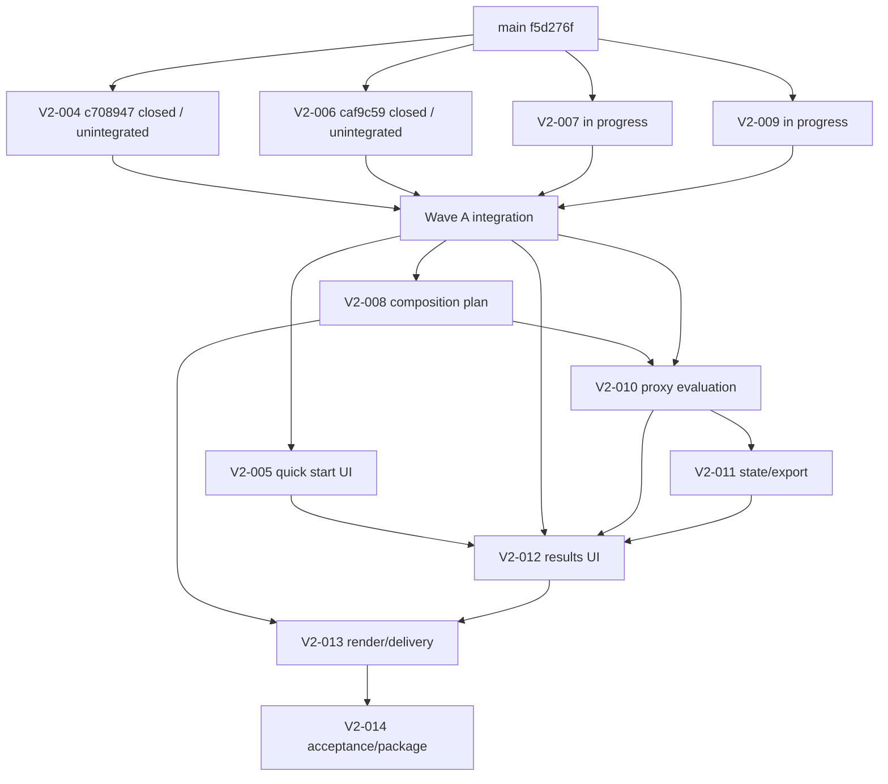

# HubRadio MovieCreator 残タスク実行・環境移行計画

- **識別子:** `20260903-1650`
- **作成日:** 2026-09-03
- **対象要求:** `docs/requirement-definition.md` 版0.2 Draft
- **現在のmain:** `f5d276fab9538e7d5f4057128fe8e31f1d062683`
- **現在のorigin/main:** `f5d276fab9538e7d5f4057128fe8e31f1d062683`
- **用途:** 現環境または別Windows環境で、未統合・未コミット作業を失わず、残るactive taskを依存順・証拠付きで完了するための実行正本

> [!IMPORTANT]
> 本書は実装、受入、human evaluation、外部公開、法的適合、signed package、clean-machine install、release readinessの完了証拠ではない。task完了は、実在する差分、1件以上discoverしたfocused test、canonical全回帰、独立敵対的レビュー、finding反映、closure review、task commit、main統合が揃った範囲だけで認定する。[S01 §11.8][S02 変更規則][S05 §0.6][S06 §4]

> [!CAUTION]
> 旧要求版0.1の`124/203`、`139/203`、`160/203`、残43/64件、人手gate、cross-account gateを現在値にしない。現在の実行単位は要求版0.2の`V2-*`であり、旧task IDは責務追跡にだけ使う。[S02 2026-09-02の再baseline][S05 §0.2〜0.4]

---

## 0. 結論

1. `main`と`origin/main`のcommitは同じ`f5d276f…`である。計画作成開始時はcleanだったが、現在のworking treeには本計画に加え、既存plan 1件の削除と別plan 1件の未追跡変更がある。所有意図を推測せずroot sidecarへ保護し、canonical統合mainへ混ぜない。`V2-000`〜`V2-003`とsettings shared bootstrapはcommit済み入力である。[O01][S05 §0.4〜0.6]
2. `V2-004`は個別commit `c708947a…`、`V2-006`は個別commit `caf9c593…`で、それぞれreview closed・worktree cleanである。ただし両commitはmain未到達で、Wave A shared integrationも未完了なので、active系列の完了数へはまだ加えない。[O02][S07 §8][S08 §8]
3. `V2-007`はbase `f5d276f…`上に7 modified＋4 untracked、staged 0、review文書なしである。`V2-009`は同じbase上に7 untracked、staged 0、review文書なしである。両taskは実装途中としてbyte単位で保護し、focused testと敵対的レビューを最初から閉じる。[O03][O04][S06 §4/§6]
4. 現在のactive残task IDは引き続き`V2-004`〜`V2-014`の11件である。うち`V2-004`と`V2-006`は個別lane完了・統合待ち、`V2-007`と`V2-009`は実装途中、残り7件は依存gate待ちである。[S05 §0.4/§0.5][O01〜O04]
5. 現在の`Music/`は36 MP3、149,081,539 bytesで存在する。これは旧計画の06:12時点の「不在」観測と異なるため、現在receiptを採用する。ただし存在・hash一致を権利、完全性、音楽的適合、外部利用許可へ拡張しない。`V2-009`では現物のpresent経路と、syntheticなabsent/empty/inaccessible経路を両方検証する。[O06][S01 FR-019/BR-004][S03 §7][S04 §3/§4.6]
6. 条件付き将来task 17件は開始条件とproduct ownerの再計画が成立するまでactive critical pathへ入れない。`S-003`と`Q-000`はactive scopeから削除済みであり、復帰させない。[S05 §0.2][S06 §2.3/§2.4/§8]

---

## 1. 出典台帳

### 1.1 Git管理された正本・実行証拠

| ID | 出典 | 現在bytes / SHA-256 | 用途 |
|---|---|---|---|
| S01 | `docs/requirement-definition.md` | 60,768 / `7507883d5ba3e26a0e83bf2b7c2bacd0c71372470301ce4ab699ab268d0a36d0` | 要求版0.2、FR/NFR/BR/AC、対象外、未決事項 |
| S02 | `docs/dev/decisions/ADR-0001-source-of-truth.md` | 5,634 / `c48de19d7f92dc02266a40619a4003d31fcd73b3efb5e7f9e167213a9291903e` | 正本優先順位、旧進捗の禁止、変更規則 |
| S03 | `docs/dev/decisions/ADR-0009-source-only-defaults-and-automated-evaluation.md` | 13,574 / `8447aa37bb829c6ca2811dfdf4dea8324700197e93b1b402b0bf98dfdb710b2e` | source-only、単一利用者、設定、自動decision、代理評価、Music、削除scope |
| S04 | `docs/dev/research/default-settings-research.md` | 43,277 / `4c07f8531fc40534bd5e0a4abd6a43cb450780cf16515afa34c17da95b798d92` | 既定値、根拠区分、適用scope、U01/C01〜C05/R01〜R26 |
| S05 | `docs/dev/planning/implementation-plan.md` §0 | 127,340 / `01ffd621c22232804f324d1af74fff17f8040cd4d23f1c5c85612db9365afa76` | 現在のV2 task、旧task再分類、DAG、共通実行契約 |
| S06 | `work/20260903-0615-TaskExecutionPlan.md` | 70,879 / `dd2d1015c91eb9417d87643bec3ec31ff52e3134e72d6c8af0df67285fe460dc` | 前回計画、詳細task手順、旧観測との差分、review形式 |
| S07 | `V2-004` worktreeの`docs/dev/reviews/v2-004-source-only-project-adversarial-review.md` | 12,499 / `bd89b9b93270ed6c2a46b9fd1154c074a0354d956a7503cb5cbdfbb40354f51c` | V2-004個別実装、試験、finding、closure、残余scope |
| S08 | `V2-006` worktreeの`docs/dev/reviews/v2-006-settings-ui-adversarial-review.md` | 11,537 / `45d9c666fbce9636d35754574cc6558603a0cb7de83dc5a77009cbb4770dd994` | V2-006個別実装、試験、finding、closure、残余scope |
| S09 | `build.ps1` / `test.ps1` / `global.json` / `src/HubRadio.Web/package.json` | 順に`f22d6d05…aa69` / `03a4c748…2027` / `2d219f1e…312f` / `bd91cff8…f246` | PowerShell 7、SDK、build/format、全runner、npm固定 |
| S10 | `packaging/python/runtime-manifest.json` / `packaging/models/catalog.json` / `packaging/ffmpeg/manifest.json` / `packaging/web/dependency-manifest.json` | 順に`ac917bc3…1000b` / `9699c209…1d004` / `d3c535e9…f8f1` / `bb418417…04463` | V2-014 package inputの固定値 |
| S11 | `benchmarks/fixtures/fixture-manifest.json` | 2,574 / `5d226fbf6cc9b2af88a7142936d6d46f9885abd582a54125db5bb14531cc2363` | source fixtureの履歴rights・size/hash台帳 |
| S12 | `docs/dev/accessibility/test-report.md` | 11,486 / `19c9a1936f4ec3a4248a70884d3122a6bc41eba23db481a4bbb8b481752ca9ec` | human accessibility PENDINGと自動証拠の分離 |
| S13 | `packaging/HubRadio.Package/README.md` / `PACKAGE-NOT-FOR-RELEASE.txt` | `b8a2a39b…5def` / `615a2ae8…4f20` | unsigned、同一host検証、未実施install/sign/release gate |
| S14 | `.gitignore` | 1,356 / `92ac05f4215123d98902fe676650e60407c2d89373cec384a46aff6117439b7a` | `/sample/*`、`/music`、secret、generated artifactの非追跡境界 |

上表のhashは2026-09-03に現在bytesから再計算した変更検知値であり、署名ではない。[O05][S02 変更規則]

### 1.2 2026-09-03 16:50計画作成時の実測観測

| ID | 観測 | 結果 |
|---|---|---|
| O01 | main/remote/worktree | main=`f5d276f…`、origin/main=`f5d276f…`、ahead 0 / behind 0。計画作成開始時はclean。現在statusは`D work/20260807-0742-TaskExecutionPlan.md`、`?? work/20260827-0742-TaskExecutionPlan.md`、`?? work/20260903-1650-TaskExecutionPlan.md`。削除元のHEAD bytes/hashは44,004 / `159c0990…9333`、20260827 fileは44,384 / `0b626251…e99`でbyte同一ではなく、rename意図を推測しない。登録worktreeはmain、V2-004、V2-006、V2-007、V2-009 |
| O02 | 個別closure済みlane | V2-004=`c708947a5e51f0dfcd3489e624629b24df903a11`、parent=`f5d276f…`、tree=`cf922c958f4914b4a61892fd141a873167af00ab`、clean。V2-006=`caf9c593cb33492dd3f951b776d8410700b6a767`、parent=`f5d276f…`、tree=`1129020f08c656c1ec8fbc12e72e4eea4b1a30b9`、clean |
| O03 | V2-007 worktree | HEAD=`f5d276f…`、staged 0、modified 7、untracked 4、11 path、content aggregate=`8338da45ed5b7800d25ca2f63b02f2976e12bfca8eaca02e87aee59f3c1d53e0`、review文書なし |
| O04 | V2-009 worktree | HEAD=`f5d276f…`、staged 0、modified 0、untracked 7、content aggregate=`79d3ddc2ba6367b60179ed19d3c2a590f4ce7d73eadf24301acbe1335634d8cf`、review文書なし |
| O05 | toolchain | Windows NT 10.0.29648.0 x64、PowerShell Core 7.6.5、Git 2.55.0.windows.3、.NET SDK 10.0.400、Node 24.19.0、npm 11.17.0、CPython 3.12.10、PSScriptAnalyzer 1.25.0 |
| O06 | Git外asset | source MOVは6,494,572,403 bytes / SHA-256 `fe9c763fdf6fe7be4f368bfba926a1f3f2407ceaf044ec7d055e0869e65c1a9f`。`Music/`はpresent、top-level regular MP3 36件、149,081,539 bytes、reparse 0、non-MP3 0、canonical aggregate=`f0763e5f17b508b2b717a219b2728b6e342379c4f8cae136c5700b7e5e6fa814` |
| O07 | V2-004機械証拠 | focused 145成功＋1 environment-gated、failure 0。全回帰は.NET 2,397成功＋32 environment-gated、Web/Node 454成功、Python 104成功、failure 0 |
| O08 | V2-006機械証拠 | focused 137/137成功。全回帰は.NET 2,392成功＋32 environment-gated、Web/Node 473成功、Python 104成功、failure 0 |

O01〜O06はPowerShell Core 7.6.5とGit 2.55.0でread-only再取得した。O06のMusic aggregateは、top-level regular `.mp3`ごとに`Music/<leafName><TAB>byteSize<TAB>lowercaseSha256`をpathのordinal順、LF結合、UTF-8 BOMなし、末尾LFなしでhashした値であり、PowerShellとCPythonの独立実装が一致した。file名は本書へ記録しない。S07/S08に記録された`7225a4c7…`は同じ件数・総bytesの履歴観測だが、計算recipeがO06と同一であることを立証できないためhash同値比較には使わない。O07/O08は個別commitに含まれるreview正本の実測記録であり、Wave A統合後の結果ではない。両laneは異なるtask差分と追加testを持つため、.NET成功件数の差をbaseline不一致とは扱わない。[S07 §5/§6][S08 §5/§6][O06]

### 1.3 正本優先順位と既知の差

要求の意味はS01、正本優先順位はS02、具体判断は後発Accepted ADRのS03、数値と資料scopeはS04、実行順はS05を優先する。S06は前回handoffの詳細を再利用するが、その観測値はO01〜O06で置換する。[S02 決定][S06 §1.3]

- S03冒頭の「production実装は一時停止中」は履歴表示であり、S02末尾とS05冒頭および現在の利用者指示により実装は再開済みである。ADR本文の履歴は改ざんしない。[S02 結果][S03 背景][S05 冒頭]
- `V2-012`の依存はS05 §0.4表と§0.5 DAGで差がある。開始gateは安全側の和集合、`V2-005`,`V2-006`,`V2-010`,`V2-011`と引き取る旧UI責務を使い、開始前にS05へ同期する。[S06 §1.3][S01 §6.4/§14.2/§14.4]
- S06の06:12観測では`Music/`不在だったが、現在O06ではpresentである。O06を現在状態とし、S04 C05および過去の不在を履歴として保つ。どちらも権利・適合の証拠にはしない。[S04 §3/§7 C05][S06 O02][O06]
- S04 U01はsourceの社内利用許可を記録する一方、S11のfixture manifestは旧rights状態を保持する。V2-014前に履歴保全付きで再baselineし、外部公開許可へ拡張しない。[S04 §7 U01][S11][S06 §1.3]

---

## 2. 残task inventory

### 2.1 main上で完了済みの入力

`V2-000`〜`V2-003`とsettings shared bootstrapは、各reviewとmain上のcommitを持つ完了済み入力である。未評価のproduction consumer、human、package、release範囲は後続taskへ残る。[S05 §0.4/§0.5][S02 結果]

### 2.2 active残task 11件

| Task | 現在状態 | 次の実行gate | Wave | 引き取る旧`変更`task |
|---|---|---|---|---|
| `V2-004` | 個別closure・commit済み、main/Wave A未統合 | task bundle/tree照合後、Wave Aでclosed union統合 | A | `D-004` |
| `V2-005` | 未開始 | V2-004を含むWave Aがmain統合PASS | B | `U-005` |
| `V2-006` | 個別closure・commit済み、main/Wave A未統合 | task bundle/tree照合後、Wave Aでclosed union統合 | A | なし（純新規） |
| `V2-007` | 実装途中、11 path、未commit、reviewなし | O03 receipt一致、build/focused/full/review/closure | A | `D-006`,`D-007`,`A-007〜A-009`,`A-016`,`R-003` |
| `V2-008` | 未開始 | V2-003とV2-007のmain統合PASS | B | `A-014`,`A-020`,`A-021`,`R-015`,`E-001`,`E-002`,`E-004`,`E-005`,`E-009`,`E-010` |
| `V2-009` | 実装途中、7 untracked、未commit、reviewなし | O04/O06 receipt一致、present＋fallback検証、full/review/closure | A | `S-006`,`E-006`,`E-008` |
| `V2-010` | blocked | V2-008とV2-009のmain統合PASS | C | `U-015` |
| `V2-011` | blocked | V2-010のmain統合PASS | D | `D-011`,`S-002`,`S-004`,`S-008`,`S-011`,`S-016` |
| `V2-012` | blocked | V2-005,V2-006,V2-010,V2-011のmain統合PASS＋依存差同期 | E | `U-006〜U-014`,`U-016`,`U-017`,`E-015`,`E-018`,`E-019` |
| `V2-013` | blocked | V2-008〜V2-012のmain統合PASS | F | `D-010`,`R-019〜R-024`,`E-013` |
| `V2-014` | blocked | V2-013統合PASS＋実在input/package/external gate再棚卸し | G | `PK-006`,`PK-007`,`Q-001`,`Q-002`,`Q-004〜Q-006`,`Q-008〜Q-013` |

状態・依存・旧task割当はS05 §0.4/§0.5を基礎に、個別laneの現在状態をO01〜O04で更新した。旧task割当64件は責務追跡数であり、64件の新規実装を意味しない。[S05 §0.4][O01〜O04]

### 2.3 条件付き将来task 17件

`ST-008`,`A-010`,`A-012`,`A-013`,`A-015`,`S-010`,`E-003`,`E-007`,`E-011`,`E-012`,`E-014`,`E-016`,`E-017`,`Z-008`,`Z-009`,`Z-010`,`Q-003`は現行critical path外である。§8の開始条件が成立し、S01/S03/S05を更新してproduct ownerが明示的に再計画した場合だけ開始する。[S05 §0.2][S06 §2.3/§8]

### 2.4 実行しない削除scope

- `S-003`: cross-account受入をactive scopeから削除。既存ACL/path防御コードは維持する。
- `Q-000`: 人手9:16必須受入をactive scopeから削除。過去の自動・human PENDING証拠は履歴として維持する。

削除taskを完了数・残task数へ混ぜず、将来scope復帰には別要求と再計画を必要とする。[S03 §1/置換範囲][S05 §0.2][S06 §2.4]

---

## 3. 別環境への移行

### 3.1 必ず保護するartifact

1. **main bundle:** `f5d276f…`までのmain履歴。[O01]
2. **V2-004 task bundle:** mainから未到達の`c708947a…`と親履歴。[O02]
3. **V2-006 task bundle:** mainから未到達の`caf9c593…`と親履歴。[O02]
4. **V2-007 sidecar:** O03の11 fileをbyte-for-byte保存。tracked patchはreview用、mirrorは復元用。[O03]
5. **V2-009 sidecar:** O04の7 untracked fileをbyte-for-byte保存。patchだけではuntracked fileを運べないためmirror必須。[O04]
6. **root working-copy sidecar:** O01の削除・未追跡3 pathを、意図を推測せずexact statusとして保存する。targetではcanonical mainではなく専用detached worktreeへ復元する。[O01]
7. **本計画:** 本書をcommitしない場合、main bundleには入らない。handoff archiveへ含め、archive外receiptへsize/hashを記録する。自己hashを本書へ埋めない。[S06 §3.1/§3.3]
8. **Git外asset:** source fixture、`Music/`、実際に使うpackage bytesをGitとは別の保護媒体とmanifestで運ぶ。[O06][S10][S11][S14]

`stash`,`reset`,`clean`,`git add -A`、worktree削除を移行手段にしない。[S06 §3.3/§10]

### 3.2 source側bundle作成例

```powershell
$Repo = 'C:\path\to\HubRadio-MovieCreator'
$V2004 = 'C:\path\to\HubRadio-MovieCreator-V2-004-20260903'
$V2006 = 'C:\path\to\HubRadio-MovieCreator-V2-006-20260903'
$Handoff = 'D:\protected\HubRadio-Handoff-20260903-1650'
New-Item -ItemType Directory -Path $Handoff -Force | Out-Null

if (-not (Test-Path -LiteralPath $Repo -PathType Container) -or
    -not (Test-Path -LiteralPath $V2004 -PathType Container) -or
    -not (Test-Path -LiteralPath $V2006 -PathType Container)) {
    throw 'A required repository or worktree path is missing.'
}
$expectedHeads = [ordered]@{
    $Repo = 'f5d276fab9538e7d5f4057128fe8e31f1d062683'
    $V2004 = 'c708947a5e51f0dfcd3489e624629b24df903a11'
    $V2006 = 'caf9c593cb33492dd3f951b776d8410700b6a767'
}
foreach ($entry in $expectedHeads.GetEnumerator()) {
    $actual = (git -C $entry.Key rev-parse HEAD).Trim()
    if ($LASTEXITCODE -ne 0 -or $actual -ne $entry.Value) {
        throw "Unexpected HEAD for a handoff source worktree."
    }
}

git -C $Repo status --short --branch --untracked-files=all
git -C $Repo bundle create (Join-Path $Handoff 'main.bundle') main
git -C $V2004 bundle create (Join-Path $Handoff 'V2-004.bundle') HEAD
git -C $V2006 bundle create (Join-Path $Handoff 'V2-006.bundle') HEAD

foreach ($bundle in Get-ChildItem -LiteralPath $Handoff -Filter '*.bundle') {
    git bundle verify $bundle.FullName
    if ($LASTEXITCODE -ne 0) { throw "Bundle verification failed." }
    Get-FileHash -Algorithm SHA256 -LiteralPath $bundle.FullName
}
```

実行hostはPowerShell Core 7+を使い、Windows PowerShell 5.1へfallbackしない。[S09 build.ps1][O05]

### 3.3 未コミットsidecar作成

```powershell
$Base = 'f5d276fab9538e7d5f4057128fe8e31f1d062683'
$Worktrees = [ordered]@{
    'V2-007' = 'C:\path\to\HubRadio-MovieCreator-V2-007-20260903'
    'V2-009' = 'C:\path\to\HubRadio-MovieCreator-V2-009-20260903'
}
$ExpectedAggregates = [ordered]@{
    'V2-007' = '8338da45ed5b7800d25ca2f63b02f2976e12bfca8eaca02e87aee59f3c1d53e0'
    'V2-009' = '79d3ddc2ba6367b60179ed19d3c2a590f4ce7d73eadf24301acbe1335634d8cf'
}

foreach ($entry in $Worktrees.GetEnumerator()) {
    if ((git -C $entry.Value rev-parse HEAD).Trim() -ne $Base) {
        throw "Unexpected base: $($entry.Key)"
    }

    $taskDir = Join-Path $Handoff $entry.Key
    $mirror = Join-Path $taskDir 'files'
    New-Item -ItemType Directory -Path $mirror -Force | Out-Null
    $patch = Join-Path $taskDir 'tracked.patch'
    git -C $entry.Value diff --binary --full-index --output=$patch HEAD
    if ($LASTEXITCODE -ne 0) { throw "Unable to create patch." }

    $tracked = @(git -C $entry.Value diff --name-only HEAD)
    if ($LASTEXITCODE -ne 0) { throw "Unable to list tracked changes." }
    $untracked = @(git -C $entry.Value ls-files --others --exclude-standard)
    if ($LASTEXITCODE -ne 0) { throw "Unable to list untracked files." }
    $set = [Collections.Generic.HashSet[string]]::new([StringComparer]::Ordinal)
    foreach ($relative in @($tracked + $untracked)) {
        if (-not [string]::IsNullOrWhiteSpace($relative)) { [void]$set.Add($relative) }
    }
    $paths = [string[]]$set
    [Array]::Sort($paths, [StringComparer]::Ordinal)

    $records = @(foreach ($relative in $paths) {
        $source = Join-Path $entry.Value $relative
        $target = Join-Path $mirror $relative
        New-Item -ItemType Directory -Path (Split-Path $target -Parent) -Force | Out-Null
        Copy-Item -LiteralPath $source -Destination $target
        [ordered]@{
            path = $relative.Replace('\','/')
            kind = if ($untracked -contains $relative) { 'untracked' } else { 'modified' }
            byteSize = (Get-Item -LiteralPath $source).Length
            sha256 = (Get-FileHash -Algorithm SHA256 -LiteralPath $source).Hash.ToLowerInvariant()
        }
    })
    $lines = @($records | ForEach-Object {
        "{0}`t{1}`t{2}" -f $_.path, $_.byteSize, $_.sha256
    })
    $bytes = [Text.UTF8Encoding]::new($false).GetBytes([string]::Join("`n", $lines))
    $aggregate = [Convert]::ToHexString(
        [Security.Cryptography.SHA256]::HashData($bytes)).ToLowerInvariant()
    if ($aggregate -ne $ExpectedAggregates[$entry.Key]) {
        throw "Source sidecar aggregate does not match the recorded receipt."
    }
    $staged = @(git -C $entry.Value diff --cached --name-only)
    if ($LASTEXITCODE -ne 0 -or $staged.Count -ne 0) {
        throw "The source worktree has staged changes."
    }
    [ordered]@{
        task = $entry.Key
        base = $Base
        stagedCount = $staged.Count
        trackedPatchSha256 = (Get-FileHash -Algorithm SHA256 -LiteralPath $patch).Hash.ToLowerInvariant()
        contentAggregateSha256 = $aggregate
        files = $records
    } | ConvertTo-Json -Depth 5 |
        Set-Content -LiteralPath (Join-Path $taskDir 'manifest.json') -Encoding utf8NoBOM
}

# Preserve the source root working copy separately; do not infer a rename.
$rootSidecar = Join-Path $Handoff 'Main-Working-Copy'
$rootMirror = Join-Path $rootSidecar 'files'
New-Item -ItemType Directory -Path $rootMirror -Force | Out-Null
git -C $Repo diff --binary --full-index `
    --output=(Join-Path $rootSidecar 'tracked.patch') HEAD
if ($LASTEXITCODE -ne 0) { throw 'Unable to create the root review patch.' }
$rootTracked = @(git -C $Repo diff --name-only HEAD)
if ($LASTEXITCODE -ne 0) { throw 'Unable to list root tracked changes.' }
$rootDeleted = @(git -C $Repo diff --name-only --diff-filter=D HEAD)
if ($LASTEXITCODE -ne 0) { throw 'Unable to list root deletions.' }
$rootUntracked = @(git -C $Repo ls-files --others --exclude-standard)
if ($LASTEXITCODE -ne 0) { throw 'Unable to list root untracked files.' }
$rootSet = [Collections.Generic.HashSet[string]]::new([StringComparer]::Ordinal)
foreach ($relative in @($rootTracked + $rootUntracked)) {
    if (-not [string]::IsNullOrWhiteSpace($relative)) { [void]$rootSet.Add($relative) }
}
$rootPaths = [string[]]$rootSet
[Array]::Sort($rootPaths, [StringComparer]::Ordinal)
$rootRecords = @(foreach ($relative in $rootPaths) {
    if ($rootDeleted -contains $relative) {
        [ordered]@{ path = $relative.Replace('\','/'); kind = 'deleted' }
        continue
    }
    $source = Join-Path $Repo $relative
    $target = Join-Path $rootMirror $relative
    New-Item -ItemType Directory -Path (Split-Path $target -Parent) -Force | Out-Null
    Copy-Item -LiteralPath $source -Destination $target
    [ordered]@{
        path = $relative.Replace('\','/')
        kind = if ($rootUntracked -contains $relative) { 'untracked' } else { 'modified' }
        byteSize = (Get-Item -LiteralPath $source).Length
        sha256 = (Get-FileHash -Algorithm SHA256 -LiteralPath $source).Hash.ToLowerInvariant()
    }
})
[ordered]@{
    task = 'Main-Working-Copy'
    base = $Base
    stagedCount = @(git -C $Repo diff --cached --name-only).Count
    files = $rootRecords
} | ConvertTo-Json -Depth 5 |
    Set-Content -LiteralPath (Join-Path $rootSidecar 'manifest.json') -Encoding utf8NoBOM

$planTarget = Join-Path $Handoff 'plan\20260903-1650-TaskExecutionPlan.md'
New-Item -ItemType Directory -Path (Split-Path $planTarget -Parent) -Force |
    Out-Null
Copy-Item -LiteralPath (Join-Path $Repo 'work\20260903-1650-TaskExecutionPlan.md') `
    -Destination $planTarget

# The receipt is deliberately outside $Handoff so it never hashes itself.
$receiptPath = Join-Path (Split-Path $Handoff -Parent) `
    ('{0}.receipt.json' -f (Split-Path $Handoff -Leaf))
$handoffRoot = [IO.Path]::GetFullPath($Handoff).TrimEnd('\') + '\'
$handoffFiles = @(Get-ChildItem -LiteralPath $Handoff -File -Recurse)
$receiptByPath = [Collections.Generic.Dictionary[string,object]]::new(
    [StringComparer]::Ordinal)
foreach ($file in $handoffFiles) {
    $relative = $file.FullName.Substring($handoffRoot.Length).Replace('\','/')
    $receiptByPath.Add($relative, [ordered]@{
        path = $relative
        byteSize = $file.Length
        sha256 = (Get-FileHash -Algorithm SHA256 -LiteralPath $file.FullName).Hash.ToLowerInvariant()
    })
}
$receiptPaths = [string[]]$receiptByPath.Keys
[Array]::Sort($receiptPaths, [StringComparer]::Ordinal)
$receiptRecords = @($receiptPaths | ForEach-Object { $receiptByPath[$_] })
[ordered]@{
    schemaVersion = '1.0.0'
    handoffDirectoryName = Split-Path $Handoff -Leaf
    files = $receiptRecords
} | ConvertTo-Json -Depth 5 |
    Set-Content -LiteralPath $receiptPath -Encoding utf8NoBOM
```

manifestのaggregateは`relativePath<TAB>byteSize<TAB>sha256`をordinal順、LF結合、UTF-8 BOMなし、末尾LFなしでhashする。target値はO03/O04と完全一致しなければ作業を開始しない。[O03][O04][S06 §3.2/§3.3]

### 3.4 target側復元

1. archive、bundle、manifest、assetのsize/hashをsource側のarchive外receiptへ照合する。
2. `main.bundle`からcloneし、HEADが`f5d276f…`であることを確認する。
3. V2-004/V2-006 bundleを`refs/handoff/V2-004`、`refs/handoff/V2-006`へfetchし、O02のcommit/treeを確認する。
4. sidecar適用前のmainでcanonical Release全回帰を実行し、failure 0、0-discovery 0、environment-gatedを別記する。
5. V2-004/V2-006は各handoff ref、V2-007/V2-009は`f5d276f…`から新しいdetached worktreeを作る。
6. V2-007/V2-009はcleanを確認後、manifest記載fileをmirrorから1回だけcopyする。tracked patchはdiff監査用であり、mirrorと重ねて適用しない。
7. 個別hash、modified/untracked分類、aggregate、staged=0を照合する。
8. source fixture、`Music/`、package inputを別manifestへ照合する。絶対path差は正常であり、tracked evidenceへ埋め込まない。[S01 NFR-004/NFR-008][S06 §3.4]

```powershell
$Handoff = 'D:\protected\HubRadio-Handoff-20260903-1650'
$receiptPath = Join-Path (Split-Path $Handoff -Parent) `
    ('{0}.receipt.json' -f (Split-Path $Handoff -Leaf))
$receipt = Get-Content -LiteralPath $receiptPath -Raw -Encoding utf8 |
    ConvertFrom-Json
if ($receipt.handoffDirectoryName -ne (Split-Path $Handoff -Leaf)) {
    throw 'The handoff receipt belongs to a different directory.'
}
$handoffRoot = [IO.Path]::GetFullPath($Handoff).TrimEnd('\') + '\'
$receiptPaths = [Collections.Generic.HashSet[string]]::new([StringComparer]::Ordinal)
foreach ($record in $receipt.files) {
    if (-not $receiptPaths.Add([string]$record.path)) {
        throw 'The handoff receipt contains a duplicate path.'
    }
    $path = [IO.Path]::GetFullPath(
        (Join-Path $Handoff $record.path.Replace('/', [IO.Path]::DirectorySeparatorChar)))
    if (-not $path.StartsWith($handoffRoot, [StringComparison]::OrdinalIgnoreCase)) {
        throw 'The handoff receipt path escapes its directory.'
    }
    if (-not (Test-Path -LiteralPath $path -PathType Leaf)) {
        throw 'A handoff file is missing.'
    }
    $item = Get-Item -LiteralPath $path
    $hash = (Get-FileHash -Algorithm SHA256 -LiteralPath $path).Hash.ToLowerInvariant()
    if ($item.Length -ne $record.byteSize -or $hash -ne $record.sha256) {
        throw 'A handoff file does not match the external receipt.'
    }
}
$actualHandoffFiles = @(Get-ChildItem -LiteralPath $Handoff -File -Recurse)
if ($actualHandoffFiles.Count -ne $receipt.files.Count) {
    throw 'The handoff directory contains an unrecorded or missing file.'
}

git clone --branch main (Join-Path $Handoff 'main.bundle') HubRadio-MovieCreator
$Target = (Resolve-Path '.\HubRadio-MovieCreator').Path
git -C $Target fetch (Join-Path $Handoff 'V2-004.bundle') HEAD:refs/handoff/V2-004
git -C $Target fetch (Join-Path $Handoff 'V2-006.bundle') HEAD:refs/handoff/V2-006
if ($LASTEXITCODE -ne 0) { throw 'Unable to fetch a task bundle.' }

$expected = [ordered]@{
    'HEAD' = 'f5d276fab9538e7d5f4057128fe8e31f1d062683'
    'refs/handoff/V2-004' = 'c708947a5e51f0dfcd3489e624629b24df903a11'
    'refs/handoff/V2-006' = 'caf9c593cb33492dd3f951b776d8410700b6a767'
}
foreach ($entry in $expected.GetEnumerator()) {
    $actual = (git -C $Target rev-parse $entry.Key).Trim()
    if ($LASTEXITCODE -ne 0 -or $actual -ne $entry.Value) {
        throw 'A restored commit does not match its receipt.'
    }
}
$trees = [ordered]@{
    'refs/handoff/V2-004^{tree}' = 'cf922c958f4914b4a61892fd141a873167af00ab'
    'refs/handoff/V2-006^{tree}' = '1129020f08c656c1ec8fbc12e72e4eea4b1a30b9'
}
foreach ($entry in $trees.GetEnumerator()) {
    $actual = (git -C $Target rev-parse $entry.Key).Trim()
    if ($LASTEXITCODE -ne 0 -or $actual -ne $entry.Value) {
        throw 'A restored task tree does not match its receipt.'
    }
}

pwsh.exe -NoLogo -NoProfile -File (Join-Path $Target 'test.ps1') -Configuration Release
if ($LASTEXITCODE -ne 0) { throw 'Restored main baseline failed.' }

$Parent = Split-Path $Target -Parent
$TaskPaths = [ordered]@{
    'Main-Working-Copy' = Join-Path $Parent 'HubRadio-MovieCreator-Main-Working-Copy-20260903-1650'
    'V2-004' = Join-Path $Parent 'HubRadio-MovieCreator-V2-004-20260903-1650'
    'V2-006' = Join-Path $Parent 'HubRadio-MovieCreator-V2-006-20260903-1650'
    'V2-007' = Join-Path $Parent 'HubRadio-MovieCreator-V2-007-20260903-1650'
    'V2-009' = Join-Path $Parent 'HubRadio-MovieCreator-V2-009-20260903-1650'
}
foreach ($path in $TaskPaths.Values) {
    if (Test-Path -LiteralPath $path) { throw 'A target worktree path already exists.' }
}
git -C $Target worktree add --detach $TaskPaths['V2-004'] refs/handoff/V2-004
if ($LASTEXITCODE -ne 0) { throw 'Unable to create V2-004 worktree.' }
git -C $Target worktree add --detach $TaskPaths['V2-006'] refs/handoff/V2-006
if ($LASTEXITCODE -ne 0) { throw 'Unable to create V2-006 worktree.' }
git -C $Target worktree add --detach $TaskPaths['V2-007'] $expected['HEAD']
if ($LASTEXITCODE -ne 0) { throw 'Unable to create V2-007 worktree.' }
git -C $Target worktree add --detach $TaskPaths['V2-009'] $expected['HEAD']
if ($LASTEXITCODE -ne 0) { throw 'Unable to create V2-009 worktree.' }
git -C $Target worktree add --detach $TaskPaths['Main-Working-Copy'] $expected['HEAD']
if ($LASTEXITCODE -ne 0) { throw 'Unable to create root working-copy worktree.' }

foreach ($task in @('V2-007', 'V2-009')) {
    $taskPath = $TaskPaths[$task]
    if (@(git -C $taskPath status --porcelain=v1 --untracked-files=all).Count -ne 0) {
        throw 'A target worktree is not clean before sidecar restore.'
    }
    $taskRoot = Join-Path $Handoff $task
    $manifestPath = Join-Path $taskRoot 'manifest.json'
    $manifest = Get-Content -LiteralPath $manifestPath -Raw -Encoding utf8 |
        ConvertFrom-Json
    if ($manifest.base -ne $expected['HEAD'] -or $manifest.stagedCount -ne 0) {
        throw 'The sidecar manifest base or staged count is invalid.'
    }

    foreach ($record in $manifest.files) {
        $relative = $record.path.Replace('/', [IO.Path]::DirectorySeparatorChar)
        $source = Join-Path (Join-Path $taskRoot 'files') $relative
        $destination = Join-Path $taskPath $relative
        if (-not (Test-Path -LiteralPath $source -PathType Leaf)) {
            throw 'A sidecar file is missing.'
        }
        New-Item -ItemType Directory -Path (Split-Path $destination -Parent) -Force |
            Out-Null
        Copy-Item -LiteralPath $source -Destination $destination
        $item = Get-Item -LiteralPath $destination
        $hash = (Get-FileHash -Algorithm SHA256 -LiteralPath $destination).Hash.ToLowerInvariant()
        if ($item.Length -ne $record.byteSize -or $hash -ne $record.sha256) {
            throw 'A restored sidecar file does not match its receipt.'
        }
    }

    $paths = [string[]]@($manifest.files.path)
    [Array]::Sort($paths, [StringComparer]::Ordinal)
    $lines = @(foreach ($path in $paths) {
        $record = @($manifest.files | Where-Object { $_.path -ceq $path })
        if ($record.Count -ne 1) { throw 'The sidecar manifest has duplicate paths.' }
        "{0}`t{1}`t{2}" -f $record[0].path, $record[0].byteSize, $record[0].sha256
    })
    $bytes = [Text.UTF8Encoding]::new($false).GetBytes([string]::Join("`n", $lines))
    $aggregate = [Convert]::ToHexString(
        [Security.Cryptography.SHA256]::HashData($bytes)).ToLowerInvariant()
    if ($aggregate -ne $manifest.contentAggregateSha256) {
        throw 'The restored sidecar aggregate does not match its manifest.'
    }

    $modified = @(git -C $taskPath diff --name-only HEAD)
    $untracked = @(git -C $taskPath ls-files --others --exclude-standard)
    $staged = @(git -C $taskPath diff --cached --name-only)
    foreach ($record in $manifest.files) {
        $collection = if ($record.kind -eq 'modified') { $modified } else { $untracked }
        if ($collection -cnotcontains $record.path) {
            throw 'A restored file has the wrong Git classification.'
        }
    }
    if ($staged.Count -ne 0 -or
        $modified.Count + $untracked.Count -ne $manifest.files.Count) {
        throw 'The restored Git inventory does not match its manifest.'
    }
}

$rootManifest = Get-Content -LiteralPath `
    (Join-Path $Handoff 'Main-Working-Copy\manifest.json') -Raw -Encoding utf8 |
    ConvertFrom-Json
$rootTarget = $TaskPaths['Main-Working-Copy']
if ($rootManifest.base -ne $expected['HEAD'] -or $rootManifest.stagedCount -ne 0) {
    throw 'The root working-copy manifest is invalid.'
}
foreach ($record in $rootManifest.files) {
    $relative = $record.path.Replace('/', [IO.Path]::DirectorySeparatorChar)
    $destination = Join-Path $rootTarget $relative
    if ($record.kind -eq 'deleted') {
        if (-not (Test-Path -LiteralPath $destination -PathType Leaf)) {
            throw 'A root deletion does not exist in the baseline.'
        }
        Remove-Item -LiteralPath $destination
        continue
    }
    $source = Join-Path (Join-Path $Handoff 'Main-Working-Copy\files') $relative
    New-Item -ItemType Directory -Path (Split-Path $destination -Parent) -Force |
        Out-Null
    Copy-Item -LiteralPath $source -Destination $destination
    $hash = (Get-FileHash -Algorithm SHA256 -LiteralPath $destination).Hash.ToLowerInvariant()
    if ((Get-Item -LiteralPath $destination).Length -ne $record.byteSize -or
        $hash -ne $record.sha256) {
        throw 'A restored root working-copy file does not match its receipt.'
    }
}
$expectedRootStatus = @(
    $rootManifest.files | ForEach-Object {
        switch ($_.kind) {
            'deleted' { " D $($_.path)" }
            'modified' { " M $($_.path)" }
            'untracked' { "?? $($_.path)" }
            default { throw 'The root working-copy kind is invalid.' }
        }
    }
)
$actualRootStatus = @(git -C $rootTarget status --porcelain=v1 --untracked-files=all)
if (Compare-Object $expectedRootStatus $actualRootStatus -CaseSensitive) {
    throw 'The restored root working-copy status does not match its manifest.'
}
```

### 3.5 target toolchain

最低条件はPowerShell Core 7+、`.NET SDK 10.0.400` exact（`global.json`）、npm `11.17.0`、CPython 3.12 Windows x64、PSScriptAnalyzer 1.25.0以上である。Nodeはrepositoryでexact固定されていないため、source観測24.19.0と異なる場合は全回帰で判定する。初回restoreにはpackage feed接続が必要であり、offline buildを未実測で主張しない。[S09][O05]

---

## 4. 全task共通の実行・敵対的レビュー契約

各taskは次の順で閉じる。依存taskがmainへ統合されていない場合は開始しない。[S05 §0.6][S06 §4]

1. main HEAD/status、task base、source/Music/package receiptを記録する。
2. task専用detached worktreeを最新統合commitから作る。復元taskは先に個別hashとaggregateを照合する。
3. S01〜S05、task行、引き取る旧実装、直接依存、schema/testを読む。
4. 許可path、非対象、外部入力、停止条件、focused testをtask noteへ固定する。
5. 最小実装を行い、二つ目の実装がないinterface/provider/factory、未来flag、未承認thresholdを追加しない。
6. successに加え、該当するinvalid、stale、duplicate、cancel、timeout、restart、partial failure、privacy、authorization-before-existenceをtestする。
7. MTPは`--filter FullyQualifiedName~... --minimum-expected-tests 1`を使う。Web/Pythonも対象file/classを明示し、0件をPASSにしない。
8. warnings-as-errors build、TypeScript typecheck/build、schema/JSON/XML parse、`git diff --check`、0-byte source、secret/absolute path/media追跡を監査する。
9. task固有のcanonical `test.ps1 -Configuration Release`を実行する。複数worktreeの全回帰は資源競合を避け直列化する。
10. 実装担当とは独立したreviewerで、(a) correctness、(b) security/privacy/reliability、(c) requirements/schema/traceability/YAGNIをレビューする。
11. findingは、exact file/symbol、違反契約、再現入力/手順、expected/actualまたは失敗testの4点が揃ったものだけ採用する。
12. 実在findingだけを最小修正し、focused/component/full regressionを再実行する。後付けthreshold、存在しないclass、別worktree、未追跡file見落としは不採用理由を記録する。
13. 修正担当とは別のclosure reviewerが未解決Critical/Major 0を確認する。finding 0でも対象と確認方法を記録する。
14. `docs/dev/reviews/v2-NNN-<topic>-adversarial-review.md`へbase、変更、実測件数、environment gate、採否、残余scopeを保存する。
15. 意図したpathだけを明示stageし、cached name/status/diff/checkを監査して1 logical task commitを作る。`git add -A`は禁止する。
16. integration worktreeへtask commitを順次cherry-pickし、共有境界を要求単位のclosed unionにする。blind `ours/theirs`は禁止する。
17. 統合focused test、全回帰、独立integration review後にmainへfast-forwardする。main/asset receipt差があれば停止する。
18. S05、本書、要求traceへcommit/test/残余scopeを同期してから次の依存taskを解放する。

reviewへtranscript本文、PII、SID、credential、token、raw path、Music file名、prompt/response本文を複製しない。[S01 NFR-004/NFR-006/NFR-008][S06 §4]

---

## 5. 現在DAGと並列wave



- **Wave A:** V2-007とV2-009を個別closureし、V2-004→V2-006→V2-007→V2-009の順で専用integration worktreeへ統合する。V2-004/V2-006のshared bridgeは一人のintegration ownerが直列に解決する。[S06 §5/§7.1][O02〜O04]
- **Wave B:** Wave A main統合後、V2-005とV2-008を別worktreeで並列実行する。full regressionは直列にする。[S05 §0.5][S06 §5]
- **Wave C〜G:** V2-010→V2-011→V2-012→V2-013→V2-014を依存順に実行する。[S05 §0.5][S06 §5]

---

## 6. active残taskの詳細実装計画

### V2-004 — source-only Project契約（個別closed、統合待ち）

**現在証拠:** commit `c708947a…`、tree `cf922c95…`、worktree clean、focused 145成功＋1 environment-gated、全回帰failure 0、未解決Critical/Major/Minor 0。管理workspaceへの実byte取込、V2-005 UI、Composition/render等は後続scopeである。[O02][O07][S07 §5〜§8]

**残作業:** 再実装しない。task bundleのcommit/tree/review hashを照合し、Wave Aへ最初にcherry-pickする。V2-006との`schemas/web-bridge.schema.json`、`ProjectApplicationRuntime.cs`、bridge routingをclosed union化し、opaque candidate、one-time ingest handoff、legacy draft、snapshot固定、path/SID非開示を横断試験する。[S07 §2/§7][S08 §7][S06 §7.1]

**完了:** Wave A統合reviewと全回帰がfailure 0、commitがmain ancestorになった時点。[S06 §4/§7.1]

### V2-006 — 全体設定UI（個別closed、統合待ち）

**現在証拠:** commit `caf9c593…`、tree `1129020f…`、worktree clean、focused 137/137、全回帰failure 0、未解決Critical/Major/Minor 0。実WebView2/screen reader/DPI/forced-colors、人による操作性はNOT EVALUATED。[O02][O08][S08 §5〜§8]

**残作業:** 再実装しない。task bundle/review hashを照合し、V2-004後にcherry-pickする。4 settings method、64 KiB envelope、5秒timeout、案件切替late response、123 setting/5 group/5 value kind、reset-to-initial、OCC、authorization-before-existence、keyboard/status契約を統合状態で再試験する。[S08 §2/§3/§7]

**完了:** Wave A統合reviewと全回帰がfailure 0、commitがmain ancestorになった時点。[S06 §7.1]

### V2-007 — 3種類限定の可逆自動decision

**現在:** base `f5d276f…`、11 path、aggregate `8338da45…53e0`、staged 0、reviewなし。現在差分はauto-decision evidence envelope、orchestrator、CompositionVersion/schema、VersionService、ProjectStore/SQLite supportと関連testを含むが、完了証拠ではない。[O03][付録A]

**実行手順:** [S01 FR-005/FR-030/NFR-008][S03 §4][S06 §6 V2-007]

1. 付録Aの11 fileとaggregateを照合し、欠落・追加があれば停止する。
2. 現在差分を読み、明示cut、同一話者・構造的隣接・NFKC完全一致反復の後側、`-50 dB / 2.0 s`の冒頭/末尾無音＋発話前後0.30秒の3規則以外をauto-applyしないことを確認する。
3. rule/version/digest、candidate、ModelRun、SourceSpan、parent Composition、settings、transcript、decision historyをcanonical evidenceへ固定し、load時に同じchildを再構築できることを検証する。
4. parent/sourceを変更せず、child Composition＋TimelineMapをatomic checkpointし、同一input再実行は同一childを返し、並行winner/loserを破損させない。
5. rollbackは保存済みlineageを検証してchildとして作り、過去版・evidence・historyを書き換えない。
6. fourth rule、fuzzy/non-adjacent/untimed token、middle silence、overlap/range外、missing/stale evidence/settings/model、duplicate、cancel、DB conflictをmutation前またはtransaction rollbackで拒否する。
7. warnings-as-errors build後、`AutoDecisionOrchestratorTests`、`VersionServiceTests`、`ProjectStoreTests`、composition schema関連testを`--minimum-expected-tests 1`付きで実行する。現在のtest sourceに存在するcaseだけを数え、過去の非永続な件数報告を流用しない。
8. canonical全回帰後、3軸敵対reviewを実施する。scope拡大、証拠の再hashだけでsemantic改ざんを受理する経路、非冪等、partial persistence、rollback lineage、unbounded resourceの実在経路を4点根拠で確認する。存在しない問題はfindingにしない。
9. finding反映・再試験・closure後、review文書と現在差分だけを明示stageしてtask commitを作る。

**完了:** focused/component/full failure 0、environment gate分離、review/closure、task commit、Wave A/main統合。[S05 §0.4/§0.6]

### V2-009 — `Music/` read-only catalogとaudio policy

**現在:** base `f5d276f…`、7 untracked、aggregate `79d3ddc2…d8cf`、staged 0、reviewなし。現在test sourceにはscanner 10、policy 7、planning 6の`TestMethod`があるが、実行済みPASSとは扱わない。[O04][付録B]

**実行手順:** [S01 FR-019/FR-020/BR-004][S03 §7][S04 §4.6][S06 §6 V2-009]

1. 付録Bの7 fileとaggregate、およびO06のcurrent Music receiptを照合する。file名をtracked evidenceへ出さない。
2. hostが明示したrootだけをscanし、別directory探索・downloadを行わない。absent/empty/inaccessible/no-eligibleをBGMなし＋typed warningとして正常完了可能にする。
3. top-level regular MP3だけを対象にし、UNC/device/ADS/reparse、oversize、duplicate digest、scan中変更、非MP3 codec、unknown probe shapeをfail closedまたは明示warningへ分類する。
4. pinned ffprobe相当のtechnical metadataだけを使い、path/file名、曲調、権利、ブランド適合をcatalog/bridge/logへ推測・露出しない。
5. trackをcontent digestのordinal順で決定的に選び、cue以上の長さを要求する。loop/stretchを行わない。
6. title/topic/end等speech-free cueだけを既定対象にし、本編会話BGMは既定OFFとする。利用者が明示有効化した場合だけforegroundより`-20 dB`のrelative gainを記録する。
7. musical fit、brand fit、human listening、speech理解、mix品質、legal/rightsを常に`NOT EVALUATED`として分離し、external scope/profileを拒否する。
8. synthetic absent/empty/corrupt/mutation/reparse/duplicate/external/no-loop負例と、O06現物に対するread-only前後receiptを別々に検証する。現物がないtargetでもsynthetic contractは実行し、音楽品質を主張しない。
9. `MusicPlanningServiceTests`、`MusicPolicyTests`、`MusicCatalogScannerTests`を1件以上discovery付きで実行し、全回帰、3軸review、finding反映、closure後に7 file＋reviewだけをcommitする。

**完了:** asset前後不変、focused/component/full failure 0、review/closure、task commit、Wave A/main統合。present状態は権利または適合PASSを意味しない。[S01 NFR-008/BR-004][O06]

### Wave A shared integration

1. mainがcleanで`f5d276f…`、source/Music receiptが開始値と一致することを確認する。
2.未使用の専用path `../HubRadio-MovieCreator-V2-WaveA-Integration-20260903-1650`を作る。同名path/worktreeが存在すれば停止し、別名をreceiptへ明記する。
3. `c708947a…`→`caf9c593…`→V2-007 task commit→V2-009 task commitの順にcherry-pickする。
4. V2-004/V2-006共有fileを要求単位のclosed unionにする。`ours/theirs`一括解決は禁止する。
5. project/settings unknown method、oversize、authorization、timeout、late response、path/SID非開示、snapshot/source candidate/decision/musicにabsolute pathがないことを横断試験する。
6. 4taskのfocused negative suite、warnings-as-errors build、canonical全回帰を実行する。
7. 独立3軸integration reviewとclosureを`docs/dev/reviews/v2-wave-a-integration-adversarial-review.md`へ保存する。
8. integration base、cherry-pick順、task commit、conflict解決、最終HEAD、test件数、asset前後receiptを記録する。
9. mainへfast-forwardし、4 task commitがancestorであることを確認してから、このintegration worktreeだけを削除する。個別worktreeはhandoff検証完了まで保持する。[S06 §7.1]

### V2-005 — かんたん編集UI

**開始gate:** Wave A main統合PASS。[S05 §0.4/§0.5]

1. V2-004のsource-only reducer/bridgeを唯一のUI state正本にし、旧10-field draftを読取互換として保持する。
2. 通常画面を元動画選択→設定要約→一回の`編集を開始`確認と取消だけにする。追加inputを必須化せず、選択直後の無確認自動開始をしない。
3. profile version/digest、短い設定要約、社内限定、標準成果物、warning件数を表示し、raw path/SID/秘密を表示しない。
4. cancel、invalid source、profile unavailable、stale draft、bridge unavailable、job開始失敗、restart/retryを重複stateなしで表現する。
5. double click/Enter連打をidempotency digestで防ぎ、one-time source handoffから既存ingest workflowへ接続する。
6. keyboard、focus visible、skip link、status/error announcement、light/dark contrast、非色依存状態をcomponent testし、人による理解をPASSにしない。

**focused:** source 1本のみ、追加inputなし、一回確認、cancel、double submit、stale、bridge/ingest failure・retry、warning summary、legacy保持、XSS/path非表示、keyboard/focus/contrast。[S01 §6/§7/§14.1/AC-001][S07 §7]

**review重点:** hidden 10-field gate、確認省略、candidate handoff leak、derived state重複、旧値消失、path leak、automated proxy/human表現混同。[S01 NFR-001/NFR-004/NFR-008]

### V2-008 — 標準Composition計画

**開始gate:** V2-003とV2-007のmain統合PASS。[S05 §0.4/§0.5]

1. 16:9 long 1本、成立した0〜3件の9:16 short、subtitle variant、thumbnail候補を同じsource/settings/decisionから計画する。
2. longは1920×1080 production default、neutral/no-logo、opening video OFF、source stem由来title overlayとし、根拠のある要素だけ使う。
3. shortは連続SourceSpanまたは意味を変えない明示抜粋だけとし、元発言にないhookやsemantic completenessを生成しない。
4. 0〜3件を正規結果とし、不足時に空・重複candidateで水増しせずreason codeをmanifestへ残す。
5. subject/face/material未確定時は元映像全体を失わないfixed/blur fallbackと`platform UI未確認`warningを使う。
6. subtitleはV2-003 profile、thumbnailは実source frame PTS/OriginRefへ結び、表情・感情を推測しない。
7. CTAは対応longが同案件にある場合の`本編を見る`だけとし、URL/channel/formを作らない。
8. source/profile/settings/decision/template/tool digestを固定し、candidate順・理由・digestを決定的にする。
9. parentを変更せずplan/child versionとして保存する。

**focused/review:** long、short 0/1/3、不足理由、duplicate、grounded hook/CTA、fallback、safe-zone warning、thumbnail PTS、stale、determinism、OriginRef/external拒否。3件水増し、暗黙semantic model、platform claim、face/emotion推測、親上書きを重点確認する。[S01 FR-007〜FR-015/FR-021/FR-031][S04 §4.3〜§4.7][S06 §6 V2-008]

### V2-010 — 自動代理評価

**開始gate:** V2-008とV2-009のmain統合PASS。[S05 §0.4/§0.5]

1. evaluation run/rule ID・version、environment、input/output/settings/profile/tool/music digest、result/reason/未評価範囲のdomain/schema/codecを作る。
2. 既存OutputQc等の実測を再利用し、profileにclosed値があるcontainer/codec/resolution/frame policy/full decode/duration/A-V、subtitle presence/read speed/line/gap/safe region、loudness/True Peak、provenance/settingsだけを判定する。
3. 根拠のないA/V sync等のthresholdを作らず、closed値がなければ`NOT EVALUATED`または根拠付きwarningにする。
4. subtitle意味完全性、content accuracy、speech理解、music/brand fit、platform適合、visual quality、感情、legal/rights/privacyを自動PASSにしない。
5. unknown/duplicate dimension、rule unavailable、stale input/profile/tool、digest mismatch、oversized/malformed evidenceをfail closedにする。
6. aggregateはFAILを隠さず、WARNINGとNOT EVALUATEDを個別表示する。
7. content/path/secretをevidence/logへ複製せず、同じcanonical evidenceから同じdigestを作る。
8. UI keyboard/focus/contrastは機械contractとして実行し、S12のhuman PENDINGを書き換えない。

**focused/review:** 4状態、closed rule success/fail/unavailable、unknown/duplicate、stale/digest、aggregate precedence、determinism、oversize、禁止label、必須NOT EVALUATED集合。threshold捏造、未実行PASS、human/legal語、failure隠蔽を重点確認する。[S01 FR-034/AC-006][S03 §5][S04 §4.8][S12]

### V2-011 — 単一利用者stateとexport policy

**開始gate:** V2-010のmain統合PASS。[S05 §0.4/§0.5]

1. 旧ReviewState/Approvalを削除・書換えず、版付きquick-start state/eventを追加する。
2. `Editing → AutomatedEvaluation → Ready | ReadyWithWarnings | Failed → Exported`を実装し、actor SIDのuser eventとsystem eventを区別する。
3. technical corruption、provenance/digest欠落、asset scope違反、external destination、stale evaluationだけをclosed blockにする。
4. WARNING/NOT EVALUATEDは内容を表示してinternal-only exportを許可可能にし、任意block規則を作らない。
5. SelfReviewed/ChangesRequested/commentは任意eventで、approvalを自動付与せず必須gateにしない。
6. content変更はchild Compositionと再評価を要求し、same-content technical rerenderと区別する。
7. external publication、direct posting、cloud送信、legacy approval bypassを拒否する。
8. legacy row/eventのround-trip/read compatibilityを検証する。

**focused/review:** 全合法/違法遷移、FAIL/stale/external拒否、warning/NOT EVALUATED internal export、optional self-review、content invalidation、technical rerender、legacy、actor/system、duplicate/restart/OCC。approval自動付与、warning隠蔽、外部scope昇格、legacy lossを重点確認する。[S01 FR-029/NFR-004/AC-004][S03 §6][S06 §6 V2-011]

### V2-012 — 進捗・成果物・評価・任意self-review UI

**開始gate:** V2-005,V2-006,V2-010,V2-011のmain統合PASS。開始前にS05 §0.4/§0.5の依存差を同期する。[S06 §1.3/§6 V2-012]

1. job progress/cancel/retry/restartとartifact一覧を同じcurrent project/composition digestへ結ぶ。
2. PASS/WARNING/FAIL/NOT EVALUATEDをtext/icon/semantic/accessibility nameで区別し、色だけに依存しない。
3. warning/failureからoutput time、SourceSpan、setting/evidence、修正画面へIDで移動する。
4. preview/downloadはartifact ID/tokenを使いfilesystem pathをUIへ返さない。
5. self-review/comment/reason/timecodeは任意で対象digestへ固定し、出力の必須approvalにしない。
6. 修正後はchild versionと再評価中/staleを表示し、旧resultをcurrentに見せない。
7. unknown artifact、oversized/invalid bridge、XSS、double submit、offline/restartを安全に処理する。
8. keyboard/focus/contrast/non-color/status announcementを再試験し、人の理解をPASSにしない。

**focused/review:** mixed 4状態、stale badge、progress recovery、warning navigation、artifact token、self-review任意、keyboard/semantic、XSS/path、oversize/unknown、禁止human claim。status誤認、warning隠蔽、path leak、self-review必須化、旧result表示を重点確認する。[S01 §14.2/§14.5/FR-026/FR-029/FR-034][S12]

### V2-013 — render・QC・delivery統合

**開始gate:** V2-008〜V2-012のmain統合PASS。[S05 §0.4/§0.5]

1. current globalではなくComposition固定snapshotを解決する。
2. source/profile/settings/decision/template/font/tool/model/music digestをRenderManifestへ固定する。
3. typed RenderGraph、validator、allowlisted FfmpegCompiler、ArgumentListを再利用し、shell/filter文字列連結を追加しない。
4. preview/final jobのprogress、cancel、timeout、idempotency、restart/checkpointを統合する。
5. long、成立short、字幕焼込/なし、SRT/VTT、transcript、thumbnail、使用区間、evaluation recordを同じCompositionへ束ねる。
6. title/chapter等はsource/settings/OriginRef根拠がある場合だけ生成し、空文字・架空URL/hashtag/personで埋めない。不成立artifactはreason recordにする。
7. full decode、stream/profile、duration/A-V、subtitle/layout、loudness/True Peak、provenance/digestを検査する。
8. QC/evaluation FAIL、broken provenance、hash mismatch、partial outputをdeliveryへ昇格しない。
9. file size/hashを昇格直前に再検証し、同一volume atomic promotionとDB登録を一貫させる。
10. hardware encoder間のbyte同一性を主張せず、実encoder/profileを記録する。

**focused/review:** synthetic render、variants、short不足、metadata未生成、cancel/timeout/disk full/process kill/restart、duplicate、stale snapshot/tool/music、broken OriginRef、QC fail、partial promotion、manifest round-trip、source不変、injection/path。shell/filter injection、partial露出、current settings誤使用、TOCTOU、架空metadataを重点確認する。[S01 FR-020/FR-025/FR-031/FR-032/NFR-003/NFR-008][S06 §6 V2-013]

### V2-014 — source-only受入・package・最終再baseline

**開始gate:** V2-013 main統合PASS。source/rights、Music、package input、実行環境を再棚卸しする。[S01 §18/§19][S06 §6 V2-014]

1. source MOV size/hash、S04 U01とS11 rights履歴、Music実状態、前後不変を記録する。
2. 元動画1本だけを選び、追加案件入力なし・一回確認で開始する。
3. 16:9 long、成立した最大3 short、subtitle variant/file、transcript、thumbnail候補、used spans/settings/evaluation manifestを生成する。不足を空/重複で水増ししない。
4. codec/decode/duration/A-V/subtitle/safe-zone/loudness/True Peak/provenance/settingsを実測し、semantic/human/music/platform/legalは該当時NOT EVALUATEDにする。
5. path/content非log、external/cloud既定OFF、cancel/restart、stale/digest/OriginRef負例、atomic deliveryを統合検証する。
6. packageするruntime/model/FFmpeg/Web bytesをS10へ照合し、SBOM/notices/CVE/codec状態を記録する。
7. exact MakeAppx/WAPが揃う場合だけunsigned development MSIXを再build/unpackし、payload/hash/runtimeを検証する。
8. authorized signer、秘密を露出しない経路、clean Windows、WAP workloadが実在する場合だけinstall/identity launch/upgrade/rollback/uninstallを実施する。未実施はPENDINGのままにする。
9. `Q-001/Q-002/Q-004〜Q-006/Q-008〜Q-013`をsource-only/単一actor/automated proxy契約へ再受入し、旧human PENDINGを改ざんしない。
10. 全要求ID、V2 task、旧変更task、evidence、未評価、既知制限、external gateを独立3軸で最終reviewする。

**禁止claim:** automated proxy≠human PASS、generic safe zone≠platform適合、Music社内利用≠外部/再配布権、unsigned unpack≠signed install/clean machine、SBOM生成≠license/CVE承認。[S01 NFR-008/§19][S03 §5/§7/§9][S13]

---

## 7. 条件付き将来task 17件

以下はactive残11件と別枠であり、開始条件成立・正本更新・product owner再計画が必要である。[S05 §0.2][S06 §8]

| Task | 再開条件 | 再開時の最小実装・証拠 |
|---|---|---|
| `ST-008` | diarization利用条件への明示同意、exact model revision/license/hash、rights-cleared annotation | 隔離benchmarkで話者数・誤割当・失敗条件・resourceを実測し採否記録 |
| `A-010` | ST-008採用時のみ | 匿名speaker cluster候補をTranscript digestへ結び、氏名を自動確定しない。manual fallback維持 |
| `A-012` | representative shot正例annotation、評価規則、threshold採用 | PTS正本のshot candidate producerを比較し、VFR/hard/gradual/0件/false positive-negativeを実測 |
| `A-013` | small/profile/multiple-face bbox annotationと評価定義 | face evidenceをsource PTS/frameへ結ぶ候補に限定し、0件/複数/横顔/小顔/staleを試験 |
| `A-015` | grounded JSON正例、exact model/runtime hash、offline/resource実測 | Proposed候補だけ返し、unknown evidence、意味変更、固有名詞/数値hallucination、timeout/staleを拒否 |
| `S-010` | digest-bound human approvalを必須にする別scope成立 | legacy approvalをComposition digestへ固定し内容変更失効を実装。initial quick start gateへ戻さない |
| `E-003` | annotation-backed近似判定method/thresholdとE-002入力 | exact以外は削除せずcluster化し、false merge/split、order/tie、provenanceを試験 |
| `E-007` | supporting document、rights/privacy scope、OCR採用条件 | host発行stagingだけ処理しpage/region/source/right/scopeを保持。任意URL、secret log、oversizeを拒否 |
| `E-011` | quizをactive Shouldへ再計画しgrounded spanが存在 | 問い/情報/待ち/答え/元発言/解説/CTAを根拠付きで作り、曖昧ならreviewRequired |
| `E-012` | E-001/E-004/E-011相当がactive | 構成templateをtyped slot化し、根拠なしrankingを拒否 |
| `E-014` | platform/version/date別公式仕様と実機capture | 版付きUI maskを実測し、expiry/unknownはgeneric fallback＋warning |
| `E-016` | E-011〜E-013相当domainがactive | quiz/publishing UIで根拠・待ち・曖昧性・CTA・metadataを編集しXSS/OCCを試験 |
| `E-017` | E-007/E-010相当domainがactive | page/region/time/source/rightsを表示し許可素材だけtyped operationで採用 |
| `Z-008` | local/manualと異なる2つ目の実在文章生成実装、cloud必要性、明示指示 | concrete実装2つ成立後だけ最小interfaceを抽出。Entra/RBAC、API key禁止、manual fallback維持 |
| `Z-009` | Z-008完了 | Structured Outputをclosed schemaへparseし、evidence ID、引用、数値、固有名詞、URL、rangeを再照合 |
| `Z-010` | Z-008/009完了 | local/cloud比較、offline/auth/quota/timeout/filter fallback、ModelRun監査、disable/sign-outを実測 |
| `Q-003` | grounded quiz domain/UI/export policyがactive | 問い→待ち→答え→元発言→解説を実入力で通し、根拠移動・曖昧性・staleを受入 |

Azure関連を再開する場合は、実行時点の公式資料、resource/model/quota/cost/data policyを再照会する。現在resourceが存在してもcloud必要性またはproduction利用の証拠にしない。[S03 §8][S05 Z-008〜Z-010]

---

## 8. 外部・環境gate

| Gate | 現在状態 | 閉じ方・扱い |
|---|---|---|
| source fixture | file size/hashはO06で一致。rights記録はU01と旧manifestに履歴差 | V2-014でinternal-use scopeを履歴保全付き再baseline。externalへ拡張しない [S04 U01][S11][O06] |
| `Music/` | present、36 MP3、149,081,539 bytes、aggregateはO06 | V2-009でpresentとsynthetic fallbackを試験。権利・fit・外部利用はNOT EVALUATED [S01 FR-019/BR-004][O06] |
| platform UI mask | 未測定 | generic fallback＋warning。適合済みと表示しない [S01 FR-014/§19][S04 §4.5] |
| human accessibility/知覚 | 旧human項目PENDING | automated proxyと分離し、実WebView2/keyboard/screen reader等の任意観測を別記 [S12][S01 NFR-005] |
| production品質・性能threshold | 未決 | 実測・評価規則・責任者のない値を作らない [S01 §19][S04 §2] |
| clean Windows install | 未実施 | actual package、clean target、identity launch evidenceが必要 [S13][S01 §19] |
| signing/upgrade/rollback/uninstall | 未実施/未決 | authorized signer、certificate、data policy、clean snapshotが必要。秘密をplan/logへ渡さない [S13] |
| complete SBOM/notices/CVE/codec | 未完了 | actual package bytesとtransitive inventoryを照合。未確認をrelease PASSにしない [S01 §19][S10][S13] |
| release approval | 未付与 | active requirementsとexternal gate証拠を権限者が判断。agentは承認しない [S01 §19][S13] |
| future Azure/model | condition-false/held | §7の条件成立時だけ再計画 [S03 §8][S05 §0.2] |

---

## 9. 停止条件と復旧

次のいずれかで停止し、成功へ丸めない。[S06 §10][S01 NFR-003/NFR-008]

- main/bundle/worktree base、task tree、個別file hash、aggregateが一致しない。
- sidecarにuntracked fileが1件でも欠ける。
- baseline/focused/full regressionがfailure、0 discovery、予期しないskip/inconclusiveになる。
- source fixture、Music、package inputがtask前後で変化する。
- V2-004/V2-006 shared bridgeをblind `ours/theirs`で解決しようとする。
- migration/store/artifact/checkpointがpartial stateになり、正本を推測修復しようとする。
- profile/tool/model/source/music digest mismatchをwarningだけで通そうとする。
- `Music/`状態を別directory探索・downloadで埋める。
- short/thumbnail/metadata不足を空・重複・架空内容で埋める。
- automated proxyをhuman/legal/platform/release PASSへ読み替える。
- unsigned unpackをsigned install/clean machine/release readinessへ読み替える。
- exact file/contract/reproduction/expected-actualがないreview懸念をfindingにする。

failure時はtask worktreeとreceiptを保持し、root cause、再現、未変更の正本/asset、次の安全な再開点を記録する。worktreeを削除して隠さない。[S06 §10]

---

## 10. 最短実行順

1. 本書をreviewし、mainへ明示commitするかhandoff sidecarへ含める。
2. main/V2-004/V2-006 bundle、V2-007/V2-009 sidecar、asset receiptを作る。
3. targetでtoolchain、正本hash、bundle/ref、sidecar、assetを照合し、main baseline全回帰を実行する。
4. `V2-007`をfocused→全回帰→3軸review→finding反映→closure→commitまで閉じる。
5. `V2-009`をcurrent present＋synthetic fallbackで同じ順に閉じる。V2-007/V2-009の全回帰は直列化する。
6. Wave AへV2-004→V2-006→V2-007→V2-009を統合し、shared test・全回帰・integration review後にmainへfast-forwardする。
7. `V2-005`と`V2-008`を別worktreeで並列実行し、各task review後にshared source/settings/decision digestを統合確認する。
8. `V2-010`→`V2-011`を直列実行する。
9. S05のV2-012依存差を同期し、`V2-012`を実行する。
10. `V2-013`でrender/QC/deliveryを閉じる。
11. `V2-014`を実在inputの範囲で実行し、成立しないexternal gateはPENDING/NOT EVALUATEDのまま最終再baselineする。
12. final mainで全回帰、task/要求trace、Git status、asset receipt、worktree cleanupを確認する。
13. future 17件は§7の条件成立まで開始しない。[S05 §0.5][S06 §11]

---

## 11. 最終完了条件

- active 11 taskが各々focused/component/full regression、独立3軸review、実在finding反映、closure、task commit、main統合を持つ。
- shared integrationごとにclosed union testと独立reviewがある。
- 元動画1本と一回の確認だけでquick startを開始できる。
- 123設定のcurrent/initial/default/用途/根拠/resetを確認でき、既存Compositionへ遡及しない。
- 自動適用は3 closed ruleだけで可逆・追跡可能である。
- 成果物不足、warning、NOT EVALUATEDを架空内容で埋めない。
- automated proxyとhuman/legal/platform/releaseを分離する。
- source、Music、過去Composition、旧review dataが意図せず変化しない。
- external/cloud/direct postingは既定無効である。
- final mainのcanonical Release全回帰はfailure 0で、inconclusive/skipを別記する。
- signed package、clean machine、SBOM/license/CVE等の未成立gateは未成立と記録する。
- future 17件と削除2件をactive完了数へ混ぜない。[S01 §20/NFR-008][S03][S05 §0.6][S06 §12]

---

## 12. 本計画の敵対的レビュー

2026-09-03に、(a) factual correctness/citation/status、(b) cross-machine Git/PowerShell migration、(c) requirements/DAG/YAGNIの3軸で独立read-only reviewを行った。findingはexact section、違反契約、再現、expected/actualの4点が揃ったものだけ採用した。[S05 §0.6][S06 §4]

| ID | 重要度 | 再現した問題 | 反映 |
|---|---|---|---|
| `PLAN-1650-R01` | Major | Musicの現在aggregateに計算recipeがなく、S07/S08の履歴aggregateと同じ件数・bytesでも値が異なるため再現不能だった | `Music/<leafName><TAB>size<TAB>sha256`、ordinal/LF/UTF-8/no-final-LFを定義し、PowerShellとCPythonで`f0763e5f…fa814`へ一致させた。履歴`7225a4c7…`は同じrecipeと立証できないため比較対象外と明記した |
| `PLAN-1650-R02` | Major | target例がbundle fetchで終わり、task tree照合、worktree作成、sidecar copy/hash/classification検証を実行できなかった | source HEAD/aggregate検査、target commit/tree照合、4 worktree作成、manifest駆動copy、個別hash・aggregate・Git分類検査を追加した |
| `PLAN-1650-R03` | Major | bundle/sidecar/本計画のhashがstdoutだけで、targetが照合できる永続receiptを作らなかった | 本計画をhandoffへcopyし、handoff全fileのpath/size/hashを外部JSONへ保存して、targetでclone前に全件・余分file 0を照合する手順を追加した |

V2-004/V2-006の.NET test件数差は、異なるtask treeが異なるtestを追加した結果であり、同じinventoryであるべきという契約がないためfindingにしなかった。illustrativeな`C:\path\to`は実行者が指定する変数だが、誤worktreeをbundle化しないようexact HEAD検査を追加した。要求/DAG/YAGNI軸のqualifying findingは0件だった。反映後、PowerShell fence 3件は全て構文error 0、active/future/removed taskは11/17/2、V2-007/V2-009 aggregateはO03/O04と一致、Music aggregateはPowerShell/CPythonでO06と一致、Markdown diagnosticsとwhitespaceは0件だった。別のclosure reviewerが`PLAN-1650-R01`〜`R03`をclosed、新規qualifying finding 0、未解決Critical/Major/Minor 0と判定した。本節は**REVIEW CLOSED**である。

---

## 付録A — V2-007 現在の未コミットreceipt

Base `f5d276fab9538e7d5f4057128fe8e31f1d062683`、staged 0、modified 7、untracked 4、aggregate `8338da45ed5b7800d25ca2f63b02f2976e12bfca8eaca02e87aee59f3c1d53e0`。[O03]

| Path | Bytes | SHA-256 | Kind |
|---|---:|---|---|
| `schemas/composition-version.schema.json` | 8,844 | `6b5049ffb022815a7324fad6a6d1e511b900860929b1bc84027b79a3f3f80435` | modified |
| `src/HubRadio.App/Compositions/AutoDecisionEvidenceCodec.cs` | 38,256 | `3474f6ddf726361154975d1b92ce9d29083c0a8da200b6fd5a180d4b8812a2b` | untracked |
| `src/HubRadio.App/Compositions/AutoDecisionOrchestrator.cs` | 91,247 | `bb94d999d4878306ea1d26653e3ea964c90f97c9570159dc3025c804853f02d1` | untracked |
| `src/HubRadio.App/Compositions/VersionService.cs` | 50,220 | `811730f54b12d9b6365fd8074853501c9e9b40bfc5566240b132287db0ade58c` | modified |
| `src/HubRadio.Core/Compositions/CompositionEvidenceEnvelope.cs` | 3,671 | `d0eeec7030a5ed21b75be67e2d1491aced4113773280e8e33e955bd24554d00c` | untracked |
| `src/HubRadio.Core/Compositions/CompositionVersion.cs` | 2,846 | `f3e267d0486725df1fa0aa7543e3221b56fe764c644d969a7361aaf0b298598c` | modified |
| `src/HubRadio.Infrastructure/Database/ProjectStore.cs` | 31,985 | `7652c0f0b18f6a26824f32d9f481b9b6651523327d863d98dadc3d503b6bd5c9` | modified |
| `src/HubRadio.Infrastructure/Database/SqliteStoreSupport.cs` | 13,972 | `d560712a25a50c8032ae39335836e189d02bfd554fd6e19ed54f4e3c55b9504d` | modified |
| `tests/HubRadio.App.Tests/AutoDecisionOrchestratorTests.cs` | 56,801 | `946b8a648e8ba6cd55b192a0a8b1212672314f03e9887ff2faaaaf3d7147da84` | untracked |
| `tests/HubRadio.App.Tests/VersionServiceTests.cs` | 51,620 | `75e3a2077fee1545f459d1819e4061a80fb64c05d282bf0cd6479147ae93595a` | modified |
| `tests/HubRadio.Infrastructure.Tests/ProjectStoreTests.cs` | 26,756 | `225283c314ddea17988f4c99cf5a6a6b7a14dcae7d2f8208c9390b753bc74628` | modified |

## 付録B — V2-009 現在の未コミットreceipt

Base `f5d276fab9538e7d5f4057128fe8e31f1d062683`、staged 0、modified 0、untracked 7、aggregate `79d3ddc2ba6367b60179ed19d3c2a590f4ce7d73eadf24301acbe1335634d8cf`。[O04]

| Path | Bytes | SHA-256 | Kind |
|---|---:|---|---|
| `src/HubRadio.App/Media/MusicPlanningService.cs` | 6,242 | `dabff8c77575fb18346dfc79db5687d927be96df50d36924c793a2d81d244920` | untracked |
| `src/HubRadio.Core/Media/MusicCatalog.cs` | 7,099 | `65f42eadc1aaaac43d1ec265df054237e196b5e13def0091c2e791ce81d505eb` | untracked |
| `src/HubRadio.Core/Media/MusicPolicy.cs` | 5,116 | `b23623a6c73476bc263166a65c09f912244c29c594457ca6345e3f901b552b2f` | untracked |
| `src/HubRadio.Infrastructure/Media/MusicCatalogScanner.cs` | 22,510 | `ffa77e1261ee3a21ef681d0b4199d6c844947eca9eb4ac3a7f93188acb7f342f` | untracked |
| `tests/HubRadio.App.Tests/MusicPlanningServiceTests.cs` | 6,083 | `d2c92026593b1646eb28e81a55fc9c4100d49d76c14359dbd8f56d6a8449fa0e` | untracked |
| `tests/HubRadio.Core.Tests/MusicPolicyTests.cs` | 5,003 | `d52f7a5ccd60da425b44eb5f64c13e8c60ba6a425c7a5b71f251ffe741bab96c` | untracked |
| `tests/HubRadio.Infrastructure.Tests/MusicCatalogScannerTests.cs` | 11,008 | `2717906ed7ca9b92c1fa6cfcdce12050484813f58ab8265ee62c865dff505a0c` | untracked |

## 付録C — task evidence template

```text
Task:
Source baseline / task base:
Final task commit:
Integrated main commit:
Changed paths and aggregate:
Requirements / ADR / source IDs:
Focused command and discovered count:
Component regression:
Canonical Release regression:
Environment-gated inconclusive:
Adversarial reviewers:
Accepted findings + reproduction:
Rejected findings + reason:
Post-fix verification:
Residual NOT EVALUATED / PENDING:
Source/Music/package before-after receipt:
```

このtemplateは未実測値を埋めるためのものではなく、実行後に取得した値だけを記録する。[S06 §4]
