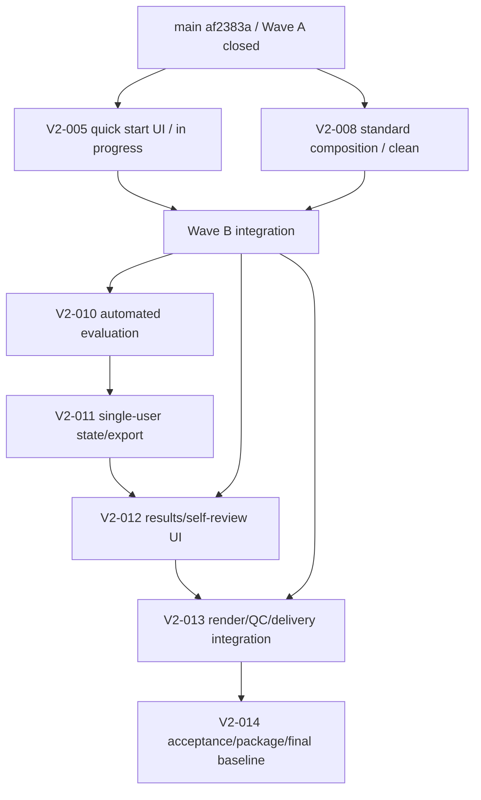

# HubRadio MovieCreator 残タスク実行・別環境移行計画

- **識別子:** `20260904-1735`
- **作成日:** 2026-09-04
- **要求正本:** `docs/requirement-definition.md` 版0.2 Draft
- **現在main:** `af2383a767b83fafc0887f62e9d4055fc71d805a`
- **現在origin/main:** `c63917ab93e1453f4ee6fd3945d3a6413942dce9`
- **現在main tree:** `5a6fac8bf2630b40941ba718ec9e60c99f2ea1ac`
- **用途:** 現環境または別Windows環境で、未コミット作業を失わず、残るactive taskを依存順・証拠付きで実行するための正本

> [!IMPORTANT]
> 本書は実装、受入、human evaluation、法的適合、外部公開、signed package、clean-machine install、release readinessの完了証拠ではない。完了は、実在差分、1件以上discoverしたfocused test、関連回帰、canonical全回帰、独立敵対的review、finding反映、closure、task commit、main統合が揃った範囲だけで認定する。[S01 NFR-008/§19][S02 変更規則][S05 §0.6]

> [!CAUTION]
> 旧要求版0.1の`124/203`、`139/203`、`160/203`、残43/64件を現在値にしない。現在のactive実行単位は要求版0.2の`V2-*`である。旧task IDは責務追跡にだけ使い、実装件数や完了件数へ読み替えない。[S02 2026-09-02の再baseline][S05 §0.2〜0.4]

---

## 0. 結論

1. `V2-000`〜`V2-004`、`V2-006`、`V2-007`、`V2-009`は個別review、task commit、main到達を持つ。Wave A closed unionは`21b30b8…`でcanonical全回帰し、integration reviewを`af2383a…`で追加した。`af2383a…`はreview Markdownだけを追加したため、試験済みproduction code treeを変更していない。[S05 §0.4〜0.6][S07〜S11][O01][O06]
2. active残taskは**7件**、`V2-005`,`V2-008`,`V2-010`,`V2-011`,`V2-012`,`V2-013`,`V2-014`である。旧`変更`taskの責務割当では53件分に対応するが、これは53個の新規実装を意味しない。[S05 §0.4]
3. `V2-005`は専用worktreeで4 pathの未コミット実装中である。TypeScript typecheck、focused Vitest 12/12、`git diff --check`は成功したが、component/full regression、独立review、closure、commit、main統合は未実施なので**未完了**である。[O02]
4. `V2-008`専用worktreeは`af2383a…`から作成済みでclean、未開始である。`V2-008`は旧`E-001/E-002/E-004/E-005/E-009`責務を自身で引き取るため、存在しないserviceをstubにして完了扱いしない。[S05 §0.4][O01][O07]
5. `V2-010`〜`V2-014`は依存taskのmain統合までblockedである。実装順は`V2-005/V2-008 → V2-010 → V2-011 → V2-012 → V2-013 → V2-014`とする。[S05 §0.5][S06 §5/§10]
6. 条件付き将来task 17件は開始条件とproduct ownerの再計画が成立するまでactive critical pathへ入れない。削除scope `S-003`,`Q-000`は復帰させない。[S05 §0.2][S06 §2.3/§2.4/§7]
7. source MOVと`Music/`は現環境に実在し、既知receiptと一致する。ただし存在・hash一致を外部利用権、音楽的適合、人手品質、release許可へ拡張しない。[S01 §18/§19/BR-004][S03 §7/§9][O03]
8. 別環境への最小handoffは、`main` bundle、V2-005のmirror+manifest+review patch、本書、Git外assetの別receiptである。V2-007/V2-009旧worktreeのcommitはmain bundleに含まれるため別bundle必須ではないが、target照合完了前にsource worktreeを削除しない。[O01][S06 §3/§9]

---

## 1. 出典台帳

### 1.1 要求・判断・計画の正本

| ID | 出典 | 現在bytes / SHA-256 | 本書で使う範囲 |
|---|---|---|---|
| S01 | `docs/requirement-definition.md` | 60,768 / `7507883d5ba3e26a0e83bf2b7c2bacd0c71372470301ce4ab699ab268d0a36d0` | 版0.2のscope、FR/NFR/BR/AC、§18実素材、§19未決事項 |
| S02 | `docs/dev/decisions/ADR-0001-source-of-truth.md` | 5,634 / `c48de19d7f92dc02266a40619a4003d31fcd73b3efb5e7f9e167213a9291903e` | 正本優先順位、旧進捗値の禁止、変更規則 |
| S03 | `docs/dev/decisions/ADR-0009-source-only-defaults-and-automated-evaluation.md` | 13,574 / `8447aa37bb829c6ca2811dfdf4dea8324700197e93b1b402b0bf98dfdb710b2e` | source-only、単一利用者、settings、自動decision、自動代理評価、Music、削除scope |
| S04 | `docs/dev/research/default-settings-research.md` | 43,277 / `4c07f8531fc40534bd5e0a4abd6a43cb450780cf16515afa34c17da95b798d92` | 123設定の根拠、数値の適用scope、U01/C01〜C05/R01〜R26 |
| S05 | `docs/dev/planning/implementation-plan.md` §0 | 127,340 / `01ffd621c22232804f324d1af74fff17f8040cd4d23f1c5c85612db9365afa76` | V2 task、旧task責務割当、DAG、共通実行契約。§1以降は履歴snapshot |
| S06 | `work/20260903-1650-TaskExecutionPlan.md` | 73,134 / `6a6d660cc09800ca6dc75ac5e738d0542003ae9c1c33741b97d6bb7137451ac7` | Wave Aまでのhandoff、task詳細、review形式、停止条件 |

正本の優先順位はS02のとおり、S01 → review → Accepted ADR → S04 → implementation research → S05である。本書とS06は実行計画であり、上位正本を変更しない。[S02 決定]

### 1.2 完了済みtaskとintegrationの証拠

| ID | 出典 | 現在bytes / SHA-256 | 状態 |
|---|---|---|---|
| S07 | `docs/dev/reviews/v2-004-source-only-project-adversarial-review.md` | 12,499 / `bd89b9b93270ed6c2a46b9fd1154c074a0354d956a7503cb5cbdfbb40354f51c` | V2-004 review closed |
| S08 | `docs/dev/reviews/v2-006-settings-ui-adversarial-review.md` | 11,537 / `45d9c666fbce9636d35754574cc6558603a0cb7de83dc5a77009cbb4770dd994` | V2-006 review closed |
| S09 | `docs/dev/reviews/v2-007-auto-decision-adversarial-review.md` | 12,438 / `36e9c3a8a3145f38b32de0e8632e240753dc95f61f3f17d0962fe807c3ecb65d` | V2-007 review closed |
| S10 | `docs/dev/reviews/v2-009-music-catalog-policy-adversarial-review.md` | 9,200 / `687528a7603790f5ad3a9c75fc99444a1becfec8926064b7842c456e77d7a8b7` | V2-009 review closed |
| S11 | `docs/dev/reviews/v2-wave-a-integration-adversarial-review.md` | 7,183 / `68570d26a2e04ec2b6065e8c846501bae49d52420a2db4637b5caf20a4db2100` | Wave A review closed、canonical件数とasset receipt |

### 1.3 build、package、外部gateの正本

| ID | 出典 | 現在bytes / SHA-256 | 用途 |
|---|---|---|---|
| S12 | `build.ps1`; `test.ps1`; `global.json`; `src/HubRadio.Web/package.json`; `src/HubRadio.Web/package-lock.json` | 8,399 / `f22d6d0599204b2efbea89a9b963e97119d4e1ed7a97ba28f97c4fcfc92daa69`; 3,504 / `03a4c7487153ba21de312cfb61042cb0387726ecf2d35ed873f1fb54d0c42027`; 173 / `2d219f1ec5a15f1553bc03652880235f6b6e58d6c7363261950f4fbb077c312f`; 1,076 / `bd91cff83ac6e0d20866f3ff134fd3a05d0edab55cfc8755a084b1f33418f246`; 84,188 / `14e2c22256d111df11d7660a3cea3d9e9f95eb0971fbaa53877978bd061ca1da` | PowerShell 7、SDK 10.0.400、restore/build/test、npm lock |
| S13 | `packaging/python/runtime-manifest.json`; `packaging/models/catalog.json`; `packaging/ffmpeg/manifest.json`; `packaging/web/dependency-manifest.json` | `ac917bc39ab4c76fb385596ee62b868aee9ae0c54432f0bd37148f35f1d1000b`; `9699c209e0e4146290436cbb72afa2afaf465e41d0ec3f161c8a4dc4cde1d004`; `d3c535e9ec4810c98c890034ca3d2c50fa984dec71038b742549ca113e68f8f1`; `bb4184170bf5fa50e05526c64b9ff450fa50a182a919b4663b074e68b1024463` | package inputの版・size/hash・取得条件 |
| S14 | `benchmarks/fixtures/fixture-manifest.json`; `docs/dev/accessibility/test-report.md`; `packaging/HubRadio.Package/README.md`; `PACKAGE-NOT-FOR-RELEASE.txt`; `.gitignore` | `5d226fbf6cc9b2af88a7142936d6d46f9885abd582a54125db5bb14531cc2363`; `19c9a1936f4ec3a424a70884d3122a6bc41eba23db481a4bbb8b481752ca9ec`; `b8a2a39b305956f3ca2a495aac893c1e87089df17d5baffe458d08c4edd65def`; `615a2ae82e905576477bdc5dcb4114e4f61c5c27d2e11e2ef214ac214b914f20`; `92ac05f4215123d98902fe676650e60407c2d89373cec384a46aff6117439b7a` | rights履歴、human PENDING、unsigned package境界、Git外asset/secret境界 |

別環境では上表のhashを署名とみなさず、対象fileを再hashして変更検知値として照合する。[S02 変更規則][O04]

### 1.4 current code snapshotの直接証拠

以下はすべてmain tree `5a6fac8b…1ac`に固定されたsourceである。[O01]

| ID | 実在source / symbol | 示す事実 |
|---|---|---|
| C01 | `src/HubRadio.Web/src/features/projects/ProjectWorkspace.tsx`, `projectState.ts`, `ProjectStateProvider.tsx`, `src/HubRadio.Web/src/bridge/projectProtocol.ts`; `src/HubRadio.App/Projects/ProjectCreationService.cs` | V2-004 source-only summary/OCCと旧wizard。V2-005はWeb分岐が残責務 |
| C02 | `LongFormComposer.cs`; `TopicBoundaryService.cs`; `TopicMetadataService.cs`; `EmphasisCandidateService.cs`; `ManualLayoutResolver.cs`; `ManualThumbnailService.cs`; `CompositionVersion.cs`; `VersionService.cs` | V2-008が再利用するlong、topic、grounding、layout、thumbnail、child version基盤 |
| C03 | `OutputQc.cs`の`OutputQcResult`; `DefaultSettings/Profiles/1.0.0.json`; `docs/dev/accessibility/test-report.md` | QC測定値はあるが4状態の自動代理評価record/engine/schemaは未実装。未承認数値とhumanを分離する必要 |
| C04 | `ReviewStateMachine.cs`; `ReviewRecord.cs`; `ExportPolicy.cs`; `FinalRenderService.cs`; `DeliveryService.cs` | 旧多role/approval必須contractが存在し、V2-011のsingle-user state/export互換層が必要 |
| C05 | `App.tsx`; `JobProgressPanel.tsx`; `ReviewPanel.tsx`; `DeliveryPanel.tsx`; 各StateProvider/bridge | V2-012が再利用する進捗・旧review・delivery UI。現状は別panelとID手入力中心 |
| C06 | `FinalRenderService.cs`; `OutputQc.cs`; `SubtitleVariantService.cs`; `DeliveryService.cs`; `AncillaryArtifactExporter.cs`; `FfmpegCompiler.cs` | render、QC、字幕2 variant、delivery、6 ancillary、shellなしcompileは個別実装済み。V2-013は新state/evaluation/standard planとの統合 |
| C07 | `src/HubRadio.Infrastructure/Database/Migrations/001_initial.sql`〜`008_default_settings.sql`; `ProjectStore.cs`; `ReviewStore.cs`; `ArtifactStore.cs` | 現在migrationは001〜008。後続番号はtask開始時に再確認して割り当てる |
| C08 | `packaging/ffmpeg/`, `packaging/models/`, `packaging/python/`, `packaging/HubRadio.Package/` | tracked treeにはmanifest/script/projectがあり、FFmpeg binary/model bundle/Python runtime payload/package出力の実在はtracked treeから証明できない |

### 1.5 2026-09-04現在の実測観測

| ID | 観測 | 結果 |
|---|---|---|
| O01 | Git/main/worktree | main=`af2383a767b83fafc0887f62e9d4055fc71d805a`、tree=`5a6fac8bf2630b40941ba718ec9e60c99f2ea1ac`、origin/main=`c63917ab93e1453f4ee6fd3945d3a6413942dce9`、ahead 3 / behind 0、mainは本書作成前clean、stash 0。V2-005/V2-008は同じmainからbranch作成し、V2-008はclean。V2-007=`21b30b8ed21e76ed3a3330bb4ab9d9f22006c70b`、V2-009=`34e08aca946101b7bd2149eca45c0ada623f4b91`の旧worktreeも保持 |
| O02 | V2-005 | base=`af2383a…`、modified 3、untracked 1、staged 0、aggregate=`5cb558d10535cb9ebcc5f36f1947e85b2d0cb7730d5bd3a005eff61b04cf040f`。typecheck、focused Vitest 12/12、pending 0、`git diff --check`成功 |
| O03 | Git外asset | source MOV 6,494,572,403 bytes / SHA-256 `fe9c763fdf6fe7be4f368bfba926a1f3f2407ceaf044ec7d055e0869e65c1a9f`。`Music/`はregular MP3 36件、149,081,539 bytes、reparse 0、regular non-MP3 0、aggregate=`f0763e5f17b508b2b717a219b2728b6e342379c4f8cae136c5700b7e5e6fa814` |
| O04 | toolchain/source hash取得環境 | Windows NT 10.0.29648.0 x64、PowerShell Core 7.6.5、Git 2.55.0.windows.3、.NET SDK 10.0.400、Node 24.19.0、npm 11.17.0、workspace venv CPython 3.12.10 |
| O05 | tracked package directory | `packaging/ffmpeg`はmanifest/NOTICE/README、`packaging/models`はcatalog/README、`packaging/python`はscripts/manifest/README、package projectはsource filesだけを列挙。生成payloadの存在を確認していない |
| O06 | Wave A canonical | .NET 2,459成功＋34 environment-gated、Web/Node 475成功、Python 104成功、failure 0。`WAVE_A_FULL_TEST_EXIT=0`、`WAVE_A_DIFF_CHECK_EXIT=0` [S11] |
| O07 | missing/current boundaries | `src/HubRadio.App/Highlights/`, `Generation/`, `Reframe/`とevaluation schemaは存在しない。C02/C03/C06の既存型は存在する。`OutputQcResult.ApprovedNumericThresholdsApplied=false`、`CanProceedToDelivery=false`が現在contract |

O01〜O05/O07はPowerShell Core 7.6.5、Git、workspace file APIでread-only取得した。O02のaggregateは4 pathの`relativePath<TAB>byteSize<TAB>lowercaseSha256`をordinal順、LF結合、UTF-8 BOMなし、末尾LFなしでhashした。O03のMusic aggregateは`Music/<leafName><TAB>byteSize<TAB>lowercaseSha256`を同じ規則でhashした。file名は本書へ記録しない。[O02][O03]

### 1.6 不採用にした情報

- current Gitを読まずS06作成時の旧SHAを現在値とした探索結果は不採用。O01を現在値とする。[S02 変更規則][O01]
- 存在しないE系serviceをstub/mockで完了させる案は不採用。S05がV2-008へ旧責務を割り当て、S01 NFR-008が不成立成果物の捏造を禁じる。[S01 NFR-008][S05 §0.4]
- 未実行のtest件数、日数見積、clean machine、package payload、実render結果は本書で固定しない。実行時のdiscoveryとreceiptだけを証拠にする。[S01 NFR-008/§19][S05 §0.6]
- `OutputQc`が測定するA/V差、luma等に、正本にない合否thresholdを追加する案は不採用。closed値がなければV2-010で`NOT EVALUATED`または根拠付きmeasurementにする。[S01 FR-034/NFR-008][S04 §2/§4.8][C03]

---

## 2. 残task inventory

### 2.1 完了済みで残taskへ数えないもの

| 集合 | 状態 | 証拠 |
|---|---|---|
| `V2-000`〜`V2-003` | main統合・review済み | [S05 §0.4]
| `V2-004`,`V2-006`,`V2-007`,`V2-009` | 個別closure、task commit、main ancestor | [S07〜S10][O01]
| Wave A shared integration | focused、canonical、independent review closed | [S11][O06]

### 2.2 active残task 7件

| Task | 現在状態 | 開始/完了gate | 引き取る旧`変更`task | 主要求 |
|---|---|---|---|---|
| `V2-005` | **実装中**。4 path未commit、focused 12/12のみ | component/full/review/closure/commit/Wave B統合 | `U-005` | NFR-001、§14.1、AC-001 [S01][S05][O02] |
| `V2-008` | worktree clean、未開始 | V2-003/V2-007 main PASS済み。grounded plan実装〜review〜Wave B統合 | `A-014`,`A-020`,`A-021`,`R-015`,`E-001`,`E-002`,`E-004`,`E-005`,`E-009`,`E-010` | FR-007〜015、FR-021/031 [S01][S05] |
| `V2-010` | blocked | V2-008/V2-009 main統合PASS | `U-015` | FR-025/034、NFR-005/006/008、AC-006 [S01][S05] |
| `V2-011` | blocked | V2-010 main統合PASS | `D-011`,`S-002`,`S-004`,`S-008`,`S-011`,`S-016` | FR-029、NFR-004、AC-004 [S01][S05] |
| `V2-012` | blocked | V2-005,V2-006,V2-010,V2-011 main PASS。S05表/DAG差を先に同期 | `U-006〜U-014`,`U-016`,`U-017`,`E-015`,`E-018`,`E-019` | §14.2/14.5、FR-026/029/034 [S01][S05][S06] |
| `V2-013` | blocked | V2-008〜V2-012 main PASS | `D-010`,`R-019〜R-024`,`E-013` | FR-020/025/031/032、NFR-003/008 [S01][S05] |
| `V2-014` | blocked | V2-013 main PASS＋実在input/package/gate再棚卸し | `PK-006`,`PK-007`,`Q-001`,`Q-002`,`Q-004〜Q-006`,`Q-008〜Q-013` | §18、AC-001〜006 [S01][S05] |

残責務割当は$1+10+1+6+14+8+13=53$件である。これは旧task追跡数であり、53件の独立commitや新規fileを要求しない。[S05 §0.4]

### 2.3 現在DAG



V2-005とV2-008は別worktreeで並行できるが、canonical全回帰は資源競合を避け直列化する。V2-012開始前に、S05 §0.4表がV2-006を明記せず§0.5 DAGが依存させる差を、安全側の和集合へ同期する。[S05 §0.4〜0.6][S06 §1.3/§5]

---

## 3. 別環境への移行

### 3.1 必須handoff artifact

1. **main bundle:** `af2383a…`までのmain履歴。V2-004/V2-006/V2-007/V2-009とWave A reviewを含む。[O01][S07〜S11]
2. **V2-005 sidecar:** O02の4 fileをmirror、manifest、tracked review patchで保存する。patchだけではuntracked `QuickStartPanel.tsx`を運べない。[O02]
3. **本計画:** 本書は作成時点でmain bundleに含まれないため、handoff内`plan/`へcopyし、外側receiptでhashする。自己hashを本書へ埋めない。[S02 変更規則]
4. **source MOV:** 6,494,572,403 bytesとSHA-256を別の保護媒体で運ぶ。Git bundleへ入れない。[O03][S14 `.gitignore`]
5. **Music:** 36 MP3/149,081,539 bytesとaggregateを別の保護媒体で運ぶ。tracked文書へ曲名を記録しない。[O03][S03 §7]
6. **任意package input:** production FFmpeg/model/Python runtime等を移す場合だけ、S13のmanifestに対するfile-by-file receiptを作る。現在tracked directoryだけではpayload実在を証明しない。[S13][O05]
7. **外部receipt:** handoff directory外に全fileのrelative path/size/SHA-256を保存する。receipt自身をhash対象へ入れない。[S06 §3.3]

V2-008はcleanでmainと同じHEADなのでsidecar不要であり、targetでmainから作り直す。V2-007/V2-009旧worktreeのcommitはmain bundleに入るので別bundle不要だが、target検証完了前の削除、`stash`,`reset`,`clean`,`git add -A`は禁止する。[O01][S06 §3/§9]

### 3.2 source側bundle/sidecar作成例

以下は現在receipt専用の例である。`$Handoff`は実在しない新規保護先へ変更する。PowerShell 7+ Coreだけで実行し、Windows PowerShell 5.1へfallbackしない。[O01][O02][O04][S12]

```powershell
$Repo = 'C:\GitHub\HubRadio-MovieCreator'
$V2005 = 'C:\GitHub\HubRadio-MovieCreator-V2-005-20260904'
$V2008 = 'C:\GitHub\HubRadio-MovieCreator-V2-008-20260904'
$Handoff = 'D:\protected\HubRadio-Handoff-20260904-1735'
$ExpectedMain = 'af2383a767b83fafc0887f62e9d4055fc71d805a'
$ExpectedTree = '5a6fac8bf2630b40941ba718ec9e60c99f2ea1ac'
$ExpectedV2005Aggregate = '5cb558d10535cb9ebcc5f36f1947e85b2d0cb7730d5bd3a005eff61b04cf040f'

if ($PSVersionTable.PSEdition -ne 'Core' -or
    $PSVersionTable.PSVersion.Major -lt 7) {
    throw 'PowerShell 7+ Core is required.'
}
if (Test-Path -LiteralPath $Handoff) {
    throw 'The handoff destination already exists.'
}
foreach ($path in @($Repo, $V2005, $V2008)) {
    if (-not (Test-Path -LiteralPath $path -PathType Container)) {
        throw 'A required source worktree does not exist.'
    }
}
$repoHead = ([string](@(git -C $Repo rev-parse HEAD) -join '')).Trim()
if ($LASTEXITCODE -ne 0) { throw 'Unable to resolve main HEAD.' }
$repoTree = ([string](@(git -C $Repo rev-parse 'HEAD^{tree}') -join '')).Trim()
if ($LASTEXITCODE -ne 0) { throw 'Unable to resolve main tree.' }
$v2005Head = ([string](@(git -C $V2005 rev-parse HEAD) -join '')).Trim()
if ($LASTEXITCODE -ne 0) { throw 'Unable to resolve V2-005 HEAD.' }
$v2008Head = ([string](@(git -C $V2008 rev-parse HEAD) -join '')).Trim()
if ($LASTEXITCODE -ne 0) { throw 'Unable to resolve V2-008 HEAD.' }
if ($repoHead -ne $ExpectedMain -or $repoTree -ne $ExpectedTree -or
    $v2005Head -ne $ExpectedMain -or $v2008Head -ne $ExpectedMain) {
    throw 'A source commit or tree does not match this plan.'
}
$mainStatus = @(git -C $Repo status --porcelain=v1 --untracked-files=all)
if ($LASTEXITCODE -ne 0) { throw 'Unable to inspect main status.' }
$expectedPlanStatus = '?? work/20260904-1735-TaskExecutionPlan.md'
if ($mainStatus.Count -ne 1 -or $mainStatus[0] -cne $expectedPlanStatus) {
    throw 'The main working copy contains an unexpected change.'
}
$stash = @(git -C $Repo stash list)
if ($LASTEXITCODE -ne 0) { throw 'Unable to inspect Git stash state.' }
if ($stash.Count -ne 0) {
    throw 'A Git stash exists and is not represented by this handoff.'
}
$v2008Status = @(git -C $V2008 status --porcelain=v1 --untracked-files=all)
if ($LASTEXITCODE -ne 0) { throw 'Unable to inspect V2-008 status.' }
if ($v2008Status.Count -ne 0) {
    throw 'V2-008 is no longer clean; create a sidecar before continuing.'
}
$v2005Staged = @(git -C $V2005 diff --cached --name-only)
if ($LASTEXITCODE -ne 0) { throw 'Unable to inspect V2-005 staged changes.' }
if ($v2005Staged.Count -ne 0) {
    throw 'V2-005 contains staged changes.'
}

New-Item -ItemType Directory -Path $Handoff | Out-Null
git -C $Repo bundle create (Join-Path $Handoff 'main.bundle') main
if ($LASTEXITCODE -ne 0) { throw 'Unable to create main bundle.' }
git bundle verify (Join-Path $Handoff 'main.bundle')
if ($LASTEXITCODE -ne 0) { throw 'Main bundle verification failed.' }

$taskRoot = Join-Path $Handoff 'V2-005'
$mirror = Join-Path $taskRoot 'files'
New-Item -ItemType Directory -Path $mirror -Force | Out-Null
git -C $V2005 diff --binary --full-index --output=(Join-Path $taskRoot 'tracked.patch') HEAD
if ($LASTEXITCODE -ne 0) { throw 'Unable to create V2-005 review patch.' }
$tracked = @(git -C $V2005 diff --name-only HEAD)
if ($LASTEXITCODE -ne 0) { throw 'Unable to list V2-005 tracked changes.' }
$untracked = @(git -C $V2005 ls-files --others --exclude-standard)
if ($LASTEXITCODE -ne 0) { throw 'Unable to list V2-005 untracked files.' }
$set = [Collections.Generic.HashSet[string]]::new([StringComparer]::Ordinal)
foreach ($relative in @($tracked + $untracked)) {
    if (-not [string]::IsNullOrWhiteSpace($relative)) { [void]$set.Add($relative) }
}
$paths = [string[]]@($set)
[Array]::Sort($paths, [StringComparer]::Ordinal)
$taskRootPath = [IO.Path]::GetFullPath($V2005).TrimEnd('\') + '\'
$records = @(foreach ($relative in $paths) {
    if ([IO.Path]::IsPathRooted($relative) -or
        $relative.Split([char[]]@('\','/')) -contains '..') {
        throw 'A V2-005 path is not repository-relative.'
    }
    $source = [IO.Path]::GetFullPath((Join-Path $V2005 $relative))
    if (-not $source.StartsWith(
            $taskRootPath,
            [StringComparison]::OrdinalIgnoreCase)) {
        throw 'A V2-005 path escapes its worktree.'
    }
    $target = Join-Path $mirror $relative
    New-Item -ItemType Directory -Path (Split-Path $target -Parent) -Force |
        Out-Null
    Copy-Item -LiteralPath $source -Destination $target
    [ordered]@{
        path = $relative.Replace('\','/')
        kind = if ($untracked -ccontains $relative) { 'untracked' } else { 'modified' }
        byteSize = (Get-Item -LiteralPath $source).Length
        sha256 = (Get-FileHash -Algorithm SHA256 -LiteralPath $source).Hash.ToLowerInvariant()
    }
})
$lines = @($records | ForEach-Object {
    "{0}`t{1}`t{2}" -f $_.path, $_.byteSize, $_.sha256
})
$bytes = [Text.UTF8Encoding]::new($false).GetBytes([string]::Join("`n", $lines))
$aggregate = [Convert]::ToHexString(
    [Security.Cryptography.SHA256]::HashData($bytes)).ToLowerInvariant()
if ($aggregate -ne $ExpectedV2005Aggregate -or $records.Count -ne 4) {
    throw 'V2-005 does not match its recorded receipt.'
}
$patchHash = (Get-FileHash -Algorithm SHA256 -LiteralPath (Join-Path $taskRoot 'tracked.patch')).Hash.ToLowerInvariant()
[ordered]@{
    task = 'V2-005'
    base = $ExpectedMain
    stagedCount = 0
    contentAggregateSha256 = $aggregate
    trackedPatchSha256 = $patchHash
    files = $records
} | ConvertTo-Json -Depth 6 |
    Set-Content -LiteralPath (Join-Path $taskRoot 'manifest.json') -Encoding utf8NoBOM

$planTarget = Join-Path $Handoff 'plan\20260904-1735-TaskExecutionPlan.md'
New-Item -ItemType Directory -Path (Split-Path $planTarget -Parent) -Force |
    Out-Null
Copy-Item -LiteralPath (Join-Path $Repo 'work\20260904-1735-TaskExecutionPlan.md') `
    -Destination $planTarget

$receiptPath = Join-Path (Split-Path $Handoff -Parent) `
    ('{0}.receipt.json' -f (Split-Path $Handoff -Leaf))
$handoffRoot = [IO.Path]::GetFullPath($Handoff).TrimEnd('\') + '\'
$records = @(Get-ChildItem -LiteralPath $Handoff -File -Recurse | ForEach-Object {
    $relative = $_.FullName.Substring($handoffRoot.Length).Replace('\','/')
    [ordered]@{
        path = $relative
        byteSize = $_.Length
        sha256 = (Get-FileHash -Algorithm SHA256 -LiteralPath $_.FullName).Hash.ToLowerInvariant()
    }
} | Sort-Object path -CaseSensitive)
[ordered]@{
    schemaVersion = '1.0.0'
    handoffDirectoryName = Split-Path $Handoff -Leaf
    files = $records
} | ConvertTo-Json -Depth 5 |
    Set-Content -LiteralPath $receiptPath -Encoding utf8NoBOM
```

mainへ本書をcommitした後にhandoffを作る場合、`ExpectedMain`、`ExpectedTree`、main status条件、V2-005 baseを実測値へ更新し、本書のreceipt節も同期する。値を推測して置換しない。[S02 変更規則]

### 3.3 Git外asset receipt

source MOVはpathをtracked evidenceへ複製せず、relative identity、size、SHA-256を保護された外部receiptへ記録する。Musicは各fileのrelative leaf identity、size、SHA-256をordinal順で外部manifestへ保存し、そのmanifest aggregateだけをtracked evidenceへ記録する。targetではfile count、総bytes、reparse/non-MP3 count、aggregateをすべて一致させる。[O03][S03 §7][S14]

現在期待値:

- source: 6,494,572,403 bytes / `fe9c763fdf6fe7be4f368bfba926a1f3f2407ceaf044ec7d055e0869e65c1a9f`
- Music: 36 regular MP3 / 149,081,539 bytes / reparse 0 / regular non-MP3 0 / `f0763e5f17b508b2b717a219b2728b6e342379c4f8cae136c5700b7e5e6fa814`

一致はinternal-use evidenceの同一性だけを示し、rights/legal/musical fit/external scopeを示さない。[S01 BR-004/NFR-008][S03 §7][O03]

### 3.4 target側復元

1. handoff外receiptを読み、handoff全fileのpath/size/hashと余分file 0を照合する。
2. `main.bundle`をcloneし、HEAD=`af2383a…`、tree=`5a6fac8b…1ac`を確認する。
3. toolchainを§3.5へ照合し、clean mainで`test.ps1 -Configuration Release`を実行する。restore不能は環境blockとして停止し、code failureへ丸めない。
4. `task/v2-005-restored` worktreeをmainから作り、manifestの各pathをrooted/`..`なし・worktree root配下のfull pathへ正規化してから、mirrorのfileを1回だけcopyする。`tracked.patch`はreview用でありmirrorと重ねて適用しない。
5. file hash、aggregate、modified 3/untracked 1/staged 0を照合する。
6. `task/v2-008-restored` worktreeを同じmainから作り、cleanを確認する。
7. 本書をmain working copyへcopyする場合は、expected untracked 1件として分離する。canonical integrationへ無関係に混ぜない。
8. source/Music/package bytesを別媒体から配置する場合、配置前後のreceiptを確認する。
9. V2-005から再開し、full regressionはV2-008と同時に走らせない。[O01〜O05][S05 §0.6]

### 3.5 toolchainとnetwork/offline境界

| 項目 | 現source観測 / 最低契約 | target扱い |
|---|---|---|
| OS/arch | Windows x64、観測build 10.0.29648.0 | Windows x64必須。build差は記録し全回帰で判定 [O04][S05 §2] |
| PowerShell | Core 7.6.5、最低7+ | `pwsh.exe -NoLogo -NoProfile`。5.1へfallback禁止 [O04][S12] |
| Git | 2.55.0.windows.3 | bundle/worktree対応版を記録し、bundle verify必須 [O04] |
| .NET | SDK 10.0.400 exact | `global.json`がroll-forwardを許さない [S12][O04] |
| Node/npm | 24.19.0 / 11.17.0 | npm 11.17.0はpackage metadata。Node差はtypecheck/build/testで判定 [S12][O04] |
| Python | CPython 3.12.10 x64 | build scriptのhash-lock restoreと`pip check`を通す [S12][O04] |
| PSScriptAnalyzer | build scriptが要求する利用可能版 | 不在ならonline取得または保護cacheが必要。未取得をPASSにしない [S12] |
| NuGet/npm/PyPI | current tracked lockは存在 | target cacheがなければ初回restoreにnetworkが必要 [S12] |
| FFmpeg/model/package payload | tracked treeで実在未証明 | S13 receipt一致bytesがなければ該当実tool test/package gateはPENDING [S13][O05] |

### 3.6 移行停止条件

次のいずれかで停止し、成功へ丸めない。[S01 NFR-003/NFR-008][S06 §9]

- bundle HEAD/tree、V2-005 file/hash/classification/aggregate、asset receiptが一致しない。
- untracked `QuickStartPanel.tsx`または本書がhandoffから欠ける。
- main baseline regressionがfailure、0-discovery、予期しないskip/inconclusiveになる。
- source/Music/package bytesが移行前後で変わる。
- mirror適用後にpatchも適用する、または`stash/reset/clean/git add -A`で状態を推測修復する。
- secret/signing keyをhandoffまたはtracked planへ入れようとする。
- package inputがないのにoffline package/release readinessを主張する。

---

## 4. 全task共通の実行・review契約

各active taskは次を順に閉じる。[S05 §0.6][S06 §4]

1. main HEAD/tree/status、task base、source/Music/package receiptを記録する。
2. 最新統合mainからtask専用worktree/branchを作る。既存V2-005はO02一致後に継続する。
3. S01〜S05、task行、引取旧task、依存source/schema/testを読む。
4. task noteへ許可path、非対象、停止条件、focused test、外部gateを固定する。
5. production file編集前に現在実装を読み、二つ目の実装がないinterface/factory/provider、future flag、根拠のないthresholdを作らない。
6. successに加え、invalid、stale、duplicate、cancel、timeout、restart、partial failure、privacy、authorization-before-existenceを該当範囲でtestする。
7. .NET focused testはMTP executableを`--filter FullyQualifiedName~<Class> --minimum-expected-tests 1`で実行する。Web/Pythonも対象file/classとdiscovery件数を保存する。
8. warnings-as-errors build、TypeScript typecheck/build、schema parse、`git diff --check`、0-byte、secret/absolute path/media追跡を監査する。
9. task固有のcanonical `test.ps1 -Configuration Release`を実行し、全runnerとenvironment-gatedを分離する。
10. 実装担当と独立したreviewerが(a) correctness、(b) security/privacy/reliability、(c) requirements/schema/traceability/YAGNIをreviewする。
11. findingはexact file/symbol、違反contract、再現入力/手順、expected/actualの4点が揃った場合だけ採用する。
12. 実在findingを最小修正し、focused/component/fullを再実行する。別worktree、未来class、未承認threshold等の指摘は不採用理由を記録する。
13. 修正担当と別のclosure reviewerが未解決Critical/Major 0を確認する。finding 0でも確認対象を記録する。
14. `docs/dev/reviews/v2-NNN-<topic>-adversarial-review.md`へbase、paths、実測件数、finding、PENDING、asset receiptを保存する。
15. allowlist pathだけを明示stageし、cached status/diff/check後に1 logical task commitを作る。
16. integration worktreeへ依存順でcommitを統合し、shared focused、canonical全回帰、独立integration review後だけmainへfast-forwardする。
17. main ancestor、status、asset receiptを再確認し、target handoff確認後に不要worktreeだけを削除する。

reviewやlogへtranscript本文、PII、SID、credential、token、raw path、Music file名、prompt/response本文を複製しない。[S01 NFR-004/NFR-006/NFR-008]

---

## 5. active残taskの詳細実装計画

### V2-005 — かんたん編集UI

**現在:** base `af2383a…`。次の4 pathが未commitで、aggregateは`5cb558d1…040f`。typecheck、focused Vitest 12/12、whitespaceは成功したがtask未完了である。[O02]

- modified: `ProjectWorkspace.tsx`, `ProjectWorkspace.test.tsx`, `styles.css`
- untracked: `QuickStartPanel.tsx`

**契約:** source-only draftでは元動画、既定設定の短い要約、社内限定、`編集を開始`、取消だけを通常DOMへ出し、旧10-field wizardを必須表示しない。legacy draftの読取・編集互換は維持する。[S01 §6/§7/§14.1/NFR-001/AC-001][S03 §2][S04 §4.1][C01]

**実行:** 

1. O02の4 path/hash/aggregate/staged 0を照合する。差があれば現在値を再receiptし、意図不明なら停止する。
2. `sourceOnly !== null`だけを`QuickStartPanel`へ分岐し、bridge/reducer/backend contractを増やさない。opaque source candidate ID、profile ID、draft ID、path、SIDを画面へ表示しない。[S07 §2/§7][C01]
3. 要約にはprofile version、profile/settings digest、社内限定、artifact set、実際の開始前warning件数を表示する。warningを0へ固定せず、source reselection等の現在stateから導出する。[S01 §7/§14.1][S03 §2]
4. `編集を開始`は既存`finalizeDraft` OCC、pending disable、request correlationを再利用する。二重click/Enter、late response、revision conflict、bridge unavailable、retryで二重projectを作らない。[C01][S07 §2]
5. 取消はdraftを閉じるだけで、finalize/ingestを開始しない。source reselection時だけ既存pickerを使い、pathを返さない。[S01 §7][S07]
6. source-only DOMに10入力、wizard progress、save buttonがないこと、legacy `sourceOnly=null`では旧wizardが残ることをtestする。
7. XSS payloadをartifact labelへ入れたtext escape、path/SID非表示、heading/error focus、Tab/Shift+Tab、Enter/Space、non-color status、pending disableをcomponent testする。物理WebView2/screen reader/DPI/High ContrastはPENDINGとする。[S01 NFR-004/NFR-005/NFR-008][S14]
8. project protocol/state/session/workspace、App、accessibility token testsをcomponent回帰する。focused 12件は履歴として再利用できるが、変更後は再実行する。[O02]
9. Web full、canonical全回帰、3軸review、finding反映、closure後、4 path＋reviewだけをcommitする。

**focused minimum:** `ProjectWorkspace.test.tsx`、`projectState.test.ts`、`projectBridgeSession.test.ts`、`projectProtocol.test.ts`、`App.test.tsx`。各fileの実discovery件数を保存し、12件を将来の固定期待値にしない。[O02][S05 §0.6]

**完了:** source-onlyの一回確認、cancel/double-submit/stale/retry/privacy/legacy/accessibility proxyが成功し、canonical failure 0、review closed、task commit、Wave B/main統合が揃うこと。human理解はPENDINGのまま。[S01 AC-001/NFR-005/NFR-008]

### V2-008 — 標準Composition計画

**現在:** `task/v2-008`は`af2383a…`でclean。C02のlong/topic/emphasis/layout/thumbnail/version基盤は存在するが、`Highlights/`,`Generation/`,`Reframe/`、standard plan/codecは存在しない。[O01][O07][C02]

**重要なscope判断:** S05は`E-001/E-002/E-004/E-005/E-009/E-010`の変更契約をV2-008へ割り当てる。別taskまたはstubへ逃がさず、根拠付きで成立する最小経路を実装する。意味score、face/emotion認識、未承認thresholdは追加しない。[S01 FR-007〜FR-017/NFR-007/NFR-008][S05 §0.4]

**予定成果物（名称は計画値）:** 

- standard plan immutable domainとcanonical schema。task開始時に既存命名へ合わせ、最終pathをtask noteへ固定する。
- plan request/result、reason/warning、long 1件、short 0〜3件、subtitle variant参照、thumbnail 0〜3件、music cue参照、input digest集合。
- grounded candidate producer/ranker/hook/reframe/thumbnail evidence。不要な汎用providerは作らない。
- plan codec/evidenceと、parentを変更せずchild `CompositionVersion`へcheckpointするapplication service。
- Core/App/schema/persistence testsとreview文書。

**実行:** 

1. requestへProject/source asset、parent Composition、TimelineMap、Transcript revision、SourceSpan、TopicBoundary/Metadata、Emphasis candidate、settings profile/snapshot、template/layout/profile、music catalog/evaluation input digestを明示する。全identity/digest/revisionをexactに検証する。[S01 FR-030〜032][C02]
2. **long:** `LongFormComposer`を再利用し、1920×1080 production default、neutral/no-logo、opening video OFF、source stem由来title overlayを使う。番組名、出演者、summary、CTA、endingは根拠入力がある場合だけ含める。[S01 FR-008/009/015/024/031][S04 §4.3/§4.4][C02]
3. **short candidate列挙:** 明示採用済みHighlight/Emphasis、manual topic range、連続utterance/SourceSpan等、source内のclosed evidenceだけを候補にする。Q&A/topicを跨ぐか、範囲外/overlap/untimed/stale/policy違反なら除外理由を残す。意味を自動判定できなければ0件を正規結果にする。[S01 FR-007/011/NFR-008][C02]
4. **順位と最大3:** approved numeric scoreがないため架空scoreを作らない。明示優先順位が存在する入力だけを尊重し、同順位はcanonical source range/identityのordinal tupleで安定化する。exact duplicateを除き、最大3件へ切る。候補不足を空・重複で埋めない。[S01 FR-007/031/NFR-008][S04 §2]
5. **hook:** `editing.shortHookPolicy=sourceGroundedQuestionOrConclusionOnly`と`shortHookMaximumStart=3`をprofileから読み、元発言の連続spanまたは意味を変えない明示抜粋だけを使う。成立しなければhookなし。[S01 FR-011][S04 §4.4][O04 profile抽出]
6. **reframe:** manual subject/keyframe evidenceがある場合だけspeaker turnへ結び、なければ`ManualLayoutResolver`のfixed/blur backgroundで元映像全体を失わないfallbackを使う。face/material検出済み、platform UI適合済みと表示せずwarningを残す。[S01 FR-010/014][S04 §4.3/§4.5][C02]
7. **subtitle variants:** R-025/R-026の既存display/variant contractを参照し、V2-008でrenderを実行・複製しない。16:9 burn-in/clean/SRT/VTT、9:16 burn-inというplan参照を同じCompositionへ固定する。[S01 FR-012/031][C06]
8. **thumbnail:** actual source frame PTS/OriginRefとM-010 preview indexに存在するframeだけを候補にする。blur/exposure/marginの測定algorithmまたはversioned orderingが実装正本にない場合、threshold/quality PASSを発明せず0件＋reasonとする。成立候補だけを最大3件にし、生成顔/場面を作らない。[S01 FR-021/NFR-008][S04 §4.7][C02]
9. **CTA:** 対応longが同案件planにあるshortだけ`本編を見る`を設定し、URL/channel/form/communityを生成しない。[S01 FR-024]
10. **determinism:** candidate/reason/warning/order、source/profile/settings/decision/template/tool/music digestをcanonical evidenceへ固定する。同じ意味入力は同じplan digestにし、list順の揺れをcanonical sortで除く。[S01 NFR-002/003/006/008]
11. **immutability/persistence:** parentを変更せず、plan適用をchild Composition＋TimelineMapとしてatomic checkpointする。load時にevidenceから同じchildを再構築し、semantic tamper、stale input、duplicate、concurrent OCC、partial saveを拒否する。必要なら次のmigration番号をC07再確認後に割り当てる。[S01 FR-030〜032][S09][C07]
12. schema/codec/domain test後、planner integration、ProjectStore restart/OCC、existing LongForm/Subtitle/Thumbnail/Layout regression、canonical全回帰、3軸reviewを実行する。

**focused cases:** long; short 0/1/3/>3; duplicate/overlap/policy/stale; grounded hook/no hook; CTA/no CTA; fixed/blur fallback; platform warning; thumbnail PTS/OriginRef/0件; subtitle variant references; input permutation determinism; parent immutability; restart; semantic evidence tamper; external scope拒否。[S01 FR-007〜015/021/024/030〜032]

**停止条件:** candidate quality/rank、thumbnail metric、A/V threshold等に正本値がなく、product decisionなしでは成果物成立を断定できない場合。0件＋reasonで要件を満たせる範囲を越えて値を作らない。[S01 NFR-008][S04 §2]

**完了:** planがlong 1＋成立short/thumbnailだけを作り、不足理由、safe fallback、OriginRef、determinism、child lineageを持つ。focused/full failure 0、review closed、task commit、Wave B/main統合。[S05 §0.4〜0.6]

### Wave B shared integration

1. V2-005/V2-008 task commitとreview hashを照合する。
2. latest clean mainから専用integration worktreeを作り、V2-005→V2-008の順に統合する。
3. source-only summaryのartifact setとstandard planの実artifact kinds、profile/settings/decision digest、internal-only scopeを横断確認する。
4. quick start double-submitからplan child作成を二重実行しないこと、cancelはplanを作らないこと、legacy draftがplan contractを破らないことをtestする。
5. V2-005/V2-008 focused、warnings-as-errors build、Web build、canonical全回帰、asset receiptを実行する。
6. `docs/dev/reviews/v2-wave-b-integration-adversarial-review.md`へindependent reviewを保存し、mainへfast-forwardする。
7. 両commitがmain ancestorになった後だけV2-010を解放する。[S05 §0.5/§0.6][S06 §5]

### V2-010 — 自動代理評価domain/engine/evidence

**開始gate:** V2-008とV2-009がmain統合PASS。[S05 §0.4/§0.5]

**現在境界:** `OutputQc`はcodec/stream/timing/decode/luma/loudnessを測定し、human review areaを列挙するが、approved threshold適用とdelivery可否をfalseにしている。4状態評価domain/schema/storeは存在しない。[C03][O07]

**予定成果物（計画値）:** `AutomatedEvaluationRecord`相当のimmutable domain、JSON Schema、canonical codec、engine、SQLite store/migration、tests。実path/migration番号はC07再確認後に固定する。[C03][C07]

**実行:** 

1. evaluation run ID、rule ID/version、environment、project/composition/artifact、source/output/settings/profile/template/tool/model/music digest、timestamp、reason code、evidence digestをclosed domainにする。[S01 FR-034/NFR-006]
2. 各dimensionを`PASS`,`WARNING`,`FAIL`,`NOT EVALUATED`のいずれかにし、unknown/duplicate dimension、undefined enum、空reason、不整合status/evidenceをconstructorで拒否する。[S01 FR-034/NFR-008]
3. aggregateはFAILを隠さない。WARNINGとNOT EVALUATEDを個別collectionのまま保持し、NOT EVALUATEDがあるのに「全評価PASS」と表示しない。[S01 §7/FR-029/034][S03 §5]
4. `OutputQcResult`、RenderProfile、SubtitleLayout/Display、TimelineMap、settings snapshotをadapter入力として再利用する。V2-010はtest evidenceでengineを閉じ、実render orchestrationはV2-013が行う。[C03][C06][S05 DAG]
5. **closed PASS/FAIL対象:** exact container/codec/resolution/frame policy/stream topology、full decode、subtitle presence、profileに値がある読速/行長/行数/cue/gap/safe region、-16 LKFS±1、True Peak -1 dBFS、OriginRef/digest/settings binding、機械化されたkeyboard/focus/contrast contract。[S01 FR-009/012/020/034][S04 §4.3/§4.5/§4.6/§4.8]
6. **値がない対象:** A/V delta、luma、moving-video fidelity等にapproved closed thresholdがなければ測定値＋`NOT EVALUATED`またはwarningにし、任意数値を作らない。[S01 §19/NFR-008][C03]
7. **必須NOT EVALUATED:** 字幕の意味的完全性、speech理解、music/brand fit、platform適合、人の可読性/自然さ/音質/感情、metadataの事実性でclosed evidenceがない項目、rights/legal/privacy最終判断。[S01 FR-012/019/034/NFR-005/008][S03 §5/§7][S04 §4.6/§4.8]
8. canonical JSONを再parseしてdomainを再構築し、同じinputから同じsemantic digestを得る。4 MiB等の上限を追加する場合は既存transport/resource契約から導き、根拠なく流用しない。[S01 NFR-003/006/008][S09]
9. storeはcomposition/artifact/rule digestへ固定し、stale resultをcurrentに返さない。migration rollback、restart、OCC/duplicate runを試験し、旧DBを読めることを確認する。[S01 NFR-003/006][C07]
10. bridge/UIへ渡す場合、reason code/ID/測定値だけを送り、content/path/SID/secretを複製しない。[S01 NFR-004/006]

**focused cases:** 4状態、closed success/fail、rule unavailable、unknown/duplicate、stale/digest mismatch、FAIL precedence、WARNING＋NOT EVALUATED共存、determinism、oversize/malformed、必須NOT EVALUATED集合、禁止`HUMAN PASS`/approved/legal表現、legacy accessibility PENDING不変。[S01 FR-034/AC-006][S14]

**完了:** domain/schema/store/engine、focused/full、3軸review、closure、task commit、main統合。実render結果、人手品質、法的適合はtask PASSへ含めない。[S01 NFR-008]

### V2-011 — 単一利用者stateとexport policy

**開始gate:** V2-010 main統合PASS。[S05 §0.4/§0.5]

**現在境界:** old `ReviewStateMachine`, `ReviewRecord`, `Approval`, `ExportPolicy`, `FinalRenderService`, `DeliveryService`は多role/approval evidenceを要求する。旧historyは削除せず、source-only経路だけを新contractへ接続する。[C04][S03 §6/置換範囲]

**実行:** 

1. exact stateを`Editing → AutomatedEvaluation → Ready | ReadyWithWarnings | Failed → Exported`としてimmutable domain/schemaへ定義する。SelfReviewed/ChangesRequested/commentはstateを偽装する必須approvalではなくoptional eventにする。[S03 §6][S01 FR-029]
2. state eventへproject/composition/evaluation digest、actor kind（Windows SID user/system）、timestamp、reason codeを固定する。system actorを利用者/承認者と呼ばない。[S01 §5/FR-029/NFR-006][S03 §1/§5]
3. content変更はchild Compositionとevaluation staleを必須にし、same-content technical rerenderは同じCompositionでtool/render evidenceを更新する。[S01 FR-029/030/NFR-003][S03 §6]
4. export blockをtechnical corruption、broken provenance/digest、asset scope violation、external destination、stale/FAIL evaluationへ閉じる。WARNING/NOT EVALUATEDは詳細を保持してinternal-only exportを許可可能にする。[S01 §7/FR-029/NFR-004][S03 §5/§6]
5. external/cloud/direct postingは既定拒否し、publication scopeを自動拡大しない。`Music/`はinternal-onlyを維持する。[S01 §4.2/§6.3/NFR-004/BR-004]
6. old `ReviewState`, Approval, comments, audit rows/codecsはそのまま読取可能に保つ。new quick-start event/storeを別versioned recordとして追加し、旧enumの意味を書き換えない。[S03 §6/置換範囲][C04]
7. current `ExportPolicy`を無条件に緩和しない。new quick-start request/authorization receiptを追加し、legacy APIは維持する。authorization-before-existence、one-shot consume、repository recheck、TOCTOU/revocationを既存patternで再利用する。[C04][S08]
8. `FinalRenderService`/`DeliveryService`のapproval型置換はV2-013統合で行えるよう、V2-011ではversion-bound authorization interface/receiptを完成させる。二つ目の実在経路が揃うまで汎用providerを作らない。[S01 NFR-007][C04]
9. 次migration番号をC07から割り当て、legacy DB→new event→rollback、duplicate/restart/OCC、stored corruptionを試験する。[C07][S01 NFR-003]

**focused cases:** 全合法/違法遷移、FAIL/stale/external拒否、WARNING/NOT EVALUATED internal export、optional self-review、content invalidation、technical rerender、actor/system区別、duplicate/restart/OCC、legacy rows round-trip、old approvalを自動付与しない、scope非拡大。[S01 FR-029/NFR-004/006/008][S03 §6]

**完了:** new state/policy/store/compatibility、focused/full、review/closure、task commit、main統合。旧review UI/approval履歴を削除しない。[S03 §6]

### V2-012 — 進捗・成果物・評価・任意self-review UI

**開始gate:** V2-005,V2-006,V2-010,V2-011 main PASS。開始前にS05 §0.4/§0.5の依存差を安全側の和集合へ文書同期する。[S05][S06 §1.3]

**現在境界:** `JobProgressPanel`, `ReviewPanel`, `DeliveryPanel`, Settings/Player/Timeline等は実在するが、`App.tsx`で独立panelとして並び、job/version UUID手入力とold review/approval語彙を中心にする。[C05]

**実行:** 

1. current project/composition/evaluation digestを単一selection contextにし、job、plan、artifact、evaluation、navigation、self-reviewを同じidentityへ結ぶ。derived stateを複製しない。[S01 §14.2/14.5/NFR-001/003][C05]
2. 既存`JobProgressPanel`のprogress/cancel/retry/restartを再利用し、source-only finalize後のjob IDへtyped bridgeで自動接続する。手入力は診断/legacy経路として残せるがquick startの必須操作にしない。[S01 §7/§14.2][C05]
3. artifact一覧へlong、成立short、subtitle variants/files、transcript、thumbnail、used spansをreason付きで表示する。不成立artifactはplaceholder cardではなくcount/reasonを表示する。[S01 FR-031/NFR-008]
4. automated evaluationを`PASS/WARNING/FAIL/NOT EVALUATED`のtext/icon/accessible nameで表示し、色だけに依存しない。`Automated proxy`と明示しhuman/approval labelを使わない。[S01 FR-029/034/NFR-005/008][S03 §5]
5. warning/failureからoutput time、SourceSpan、setting key/evidence ID、既存Player/Transcript/Timeline/Settingsへtyped navigationする。raw pathやcontentをquery/bridgeへ入れない。[S01 FR-026/032/NFR-004][C05]
6. preview/downloadはartifact ID/tokenだけを使い、filesystem pathを返さない。unknown artifact、stale digest、oversized/invalid bridge、late responseをfail closedにする。[S01 NFR-003/004][S08]
7. `ReviewPanel`は任意self-review/comment/ChangesRequestedへ再構成し、approval tabをquick-start必須gateから外す。legacy review画面/rowsはhistoryとして表示可能にする。[S01 §14.5/FR-029][S03 §6][C05]
8. 内容修正後はchild versionと再評価中/staleを表示し、旧resultをcurrentに見せない。同content technical rerenderと区別する。[S01 FR-029/030]
9. settings snapshot/profile、source/Music/tool/evaluation digestはshortened label＋full accessible/detail valueで表示し、SID/path/secretは表示しない。[S01 NFR-004/006]
10. bridge schema/C#/TS protocolをclosed unionで同期し、authorization-before-existence、response byte limit、unknown method、project switch late responseをtestする。[S08][C05]
11. keyboard/focus/skip link/contrast/non-color/status announcement/XSSをcomponent testし、real WebView2/screen reader/DPI/High ContrastはPENDINGのままにする。[S01 NFR-005][S14]

**focused cases:** mixed 4状態、stale badge、progress recovery/cancel/retry、short 0/1/3、不成立reason、warning navigation、artifact token/path非開示、optional self-review、legacy history、keyboard/semantic、XSS、oversize/unknown/late response、禁止human claim。[S01 §14.2/14.5/FR-026/029/031/034]

**完了:** UI/bridge/state、focused Web＋App bridge、full regression、review/closure、task commit、main統合。human accessibilityはPENDING。[S14]

### V2-013 — render・QC・delivery統合

**開始gate:** V2-008〜V2-012 main統合PASS。[S05 §0.4/§0.5]

**現在境界:** C06の各serviceは個別に存在し、`SubtitleVariantService`はrender→QC→deliveryを2 variantで実行し、`AncillaryArtifactExporter`は6種をcanonical昇格する。一方、legacy approval、`OutputQcResult.CanProceedToDelivery=false`、new standard plan/evaluation/state未接続が残る。[C03][C04][C06]

**実行:** 

1. V2-008 standard planとV2-011 authorization receiptから、current globalではなくComposition固定source/profile/settings/decision/template/font/tool/model/music digestを解決する。[S01 NFR-003/006][S03 §3/§4/§7]
2. plan内のlong 1件、成立short、thumbnail、subtitle variant、ancillaryをtyped work itemへ展開する。不成立reasonを維持し、空/duplicate outputを作らない。[S01 FR-031/NFR-008]
3. `RenderGraphValidator`→`FfmpegCompiler`→`FinalRenderService`を再利用する。shell/filter文字列連結や別compilerを追加しない。[C06][S01 NFR-004/007]
4. music assignmentをgraph/manifestへtrack digest・internal-only scope付きで固定し、render直前にcatalog/content digestを再検証する。stale/欠落時はBGMなし再計画またはblockをtypedに行い、別directory探索/loopをしない。[S01 FR-019/BR-004][S10][C06]
5. `OutputQc`の実測をV2-010 engineへ渡し、closed ruleの4状態recordを生成する。technical corruption/provenance FAILをdeliveryへ進めず、WARNING/NOT EVALUATEDはV2-011 internal policyで扱う。[S01 §7/FR-034][C03]
6. legacy approval引数をV2-011 quick-start authorizationへ置換する新overload/adapterを追加し、old API/testを保持する。fake approval rowを生成しない。[S03 §6][C04][C06]
7. `SubtitleVariantService`でburn-in/cleanを同じComposition/TimelineMapから作り、SRT/VTTをexact cue evidenceへ結ぶ。片側だけdurableになった場合は成功へ丸めずreconciliation stateを記録する。[C06][S01 FR-012/031]
8. `AncillaryArtifactExporter`へtranscript、chapters、publishing metadata、editing instructions、review/self-review、used rangesを渡す。根拠なしtitle/summary/post/hashtag/URL/personはnull/emptyのままにする。[S01 FR-025/NFR-008][C06]
9. 全required artifactのQC/evaluation/bindingが揃った後だけDeliveryManifestをcurrentとして公開する。個別artifactのatomic promotionを全setのatomic filesystem transactionと過大主張せず、durable checkpoint＋manifest visibilityでpartial setを隠す。[S01 §7/NFR-003][C06]
10. progress/cancel/timeout/retry/restart/idempotencyを既存JobCoordinatorへ結び、promotion race、DB先行/遅延、disk full、process killをreconciliationへ送る。[S01 NFR-002/003][C06]
11. file size/hashを昇格前後に再検証し、source/Music/過去Compositionを変更しない。hardware encoder間のbyte同一性を主張せず、実encoder/profile/tool digestを記録する。[S01 NFR-003/006/008]
12. Delivery bridge/UIへnew state/evaluationを渡し、legacy approval必須表示をquick-start evidenceへ変更する。external destination/cloud/direct postingは拒否する。[S01 NFR-004][S03 §8]

**focused cases:** long、short 0/1/3、subtitle variants、thumbnail/ancillary、不足reason、grounded metadata、cancel/timeout/disk full/process kill/restart、duplicate、stale settings/profile/tool/music/source、broken OriginRef、evaluation FAIL、WARNING/NOT EVALUATED internal、partial promotion/reconciliation、manifest canonical round-trip、source/Music不変、argument/path injection。[S01 FR-020/025/031/032/NFR-003/008]

**実tool gate:** approved packaged FFmpeg/FFprobe bytesがtargetにない場合、synthetic/delegate testsを実行し、actual tool integrationをenvironment-gatedのまま残す。V2-013全体をactual render PASSと表記しない。[S13][O05]

**完了:** new plan/state/evaluationを既存render/QC/deliveryへ統合し、required artifactだけがmanifestへ昇格する。focused/full、review/closure、task commit、main統合。人手品質・external/legal/packageはPENDING。[S01 NFR-008]

### V2-014 — source-only受入・package・最終再baseline

**開始gate:** V2-013 main統合PASS。source/rights、Music、package input、toolchainを再棚卸しする。[S01 §18/§19][S05 §0.4][S06 §6]

**実行:** 

1. source MOVのrelative identity、size/hash、S04 U01とS14 fixture rights履歴、Music receiptを開始時に記録する。internal-useをexternal/re-distribution権へ拡張しない。[S01 §18/BR-004][S04 U01][S14][O03]
2. 元動画1本だけをnative pickerから選択し、追加案件入力なし、一回の確認で開始する。V2-005 UI、V2-004 one-time handoff、M-011 ingestを実経路で通す。[S01 §7/§18/AC-001][S07]
3. ingest、analysis、3 closed auto-decision、V2-008 plan、V2-009 music、V2-010 evaluation、V2-011 state、V2-013 render/deliveryを同じProject/Composition chainで実行する。[S01 §7/§18]
4. 16:9 long、成立した最大3 short、subtitle burn-in/clean/file、transcript、thumbnail候補、used spans、settings/evaluation manifestを生成する。候補不足は空/duplicateで水増ししない。[S01 FR-031/§18/NFR-008]
5. codec、full decode、duration、A/V、subtitle、generic safe zone、loudness、True Peak、OriginRef/settingsを実測し、ruleごとに4状態を保存する。closed thresholdがない項目はNOT EVALUATEDのままにする。[S01 FR-034/AC-006][S04]
6. path/content非log、external/cloud既定OFF、cancel/restart、stale/digest/OriginRef負例、delivery visibilityを統合検証する。[S01 AC-004/NFR-003/004]
7. source/Musicを終了時に再hashし、開始receiptと完全一致させる。不一致ならdelivery/packageを停止する。[O03][S01 NFR-003]
8. S13の4 manifestを再hashし、実際にpackageするruntime/model/FFmpeg/Web bytesをfile-by-file照合する。payloadがない場合はpackage実行をPENDINGにし、代替downloadを無断実行しない。[S13][O05]
9. exact WAP/MakeAppx環境とactual bytesが揃う場合だけunsigned development MSIXを再build/unpackし、全payload/hash/runtimeを検証する。`PACKAGE-NOT-FOR-RELEASE`を維持する。[S14 package][O05]
10. authorized signer、秘密をmodelへ渡さない経路、WAP workload、別clean Windowsが実在する場合だけsigned install、identity launch、upgrade/rollback/uninstallを実施する。成立しなければPENDINGのままにする。[S01 §19][S14 package]
11. Q-001/Q-002/Q-004〜Q-006/Q-008〜Q-013をsource-only/single-actor/automated-proxy契約へ再受入する。旧runnerを現在契約へ適合させ、存在しないrunner/test件数を事前にPASS扱いしない。[S05 §0.4][S01 AC-001〜006]
12. `test.ps1 -Configuration Release`をfinal mainで実行し、runner別success/failure/environment gate、schema、diff、statusを保存する。[S12][S05 §0.6]
13. 全要求ID、V2 task、旧`変更`task責務、evidence、NOT EVALUATED、PENDING、既知制限、external gateを独立3軸で最終reviewする。[S01 §19/§20][S05 §0.6]
14. final receipt/reviewをcommitし、main ancestor、origin divergence、asset不変、worktree cleanup可否を確認する。push/releaseは別の明示指示なしに行わない。[S02 変更規則]

**成果物（計画値）:** source/Music before-after receipt、active task trace matrix、acceptance result、package input validation、final regression summary、`docs/dev/reviews/v2-014-final-acceptance-adversarial-review.md`。実pathは実装時の既存evidence配置規則へ合わせる。[S01 §18/§19][S05]

**禁止claim:** automated proxy≠human PASS、generic safe zone≠platform適合、Music internal use≠外部/再配布権、unsigned unpack≠signed install/clean machine、SBOM生成≠license/CVE承認、file存在≠release approval。[S01 NFR-008/§19][S03 §5/§7/§9][S14]

**完了:** active 7 taskが個別closure/main統合を持ち、final canonical failure 0、source/Music不変、実在する範囲のacceptance/package evidenceと未成立gateが分離されること。external/human/legal gateは未成立でもPENDINGとして正確ならよく、偽のPASSで閉じない。[S01 §19/NFR-008]

---

## 6. 条件付き将来task 17件

以下はactive残7件と別枠である。開始条件成立、S01/S03/S05更新、product owner再計画が必要であり、V2-014完了数へ混ぜない。[S05 §0.2][S06 §7]

| Task | 現在状態 / 再開条件 | 再開時の最小証拠 |
|---|---|---|
| `ST-008` | pyannote等の利用条件への明示同意、exact model/license/hash、rights-cleared annotation | 話者数/誤割当/resource/失敗条件の隔離benchmark [S05 §5.7][S06 §7] |
| `A-010` | ST-008採用時のみ | anonymous speaker cluster候補。氏名を自動確定しない [S05 §5.7] |
| `A-012` | representative shot正例annotation、method/threshold採用 | PTS-bound shot候補とfalse positive/negative実測 [S05 §5.7] |
| `A-013` | face bbox annotationと評価定義 | source PTS/frameへ結ぶ候補。表情・感情を確定しない [S05 §5.7] |
| `A-015` | grounded JSON正例、exact local model/runtime、resource実測 | Proposed候補だけ返しhallucination/timeout/stale拒否 [S05 §5.7] |
| `S-010` | digest-bound human approvalを再び必須にする別scope | legacy approvalをComposition digestへ固定。quick start gateへ戻さない [S05 §0.2][S06 §7] |
| `E-003` | annotation-backed近似判定method/threshold | exact以外は削除せずcluster化し誤merge/splitを実測 [S05 §5.11] |
| `E-007` | supporting document、rights/privacy、OCR採用条件 | page/region/source/right/scopeを保持し任意URL/oversize拒否 [S05 §5.11] |
| `E-011` | quizをactive Shouldへ再計画しgrounded spanが存在 | 問い/情報/待ち/答え/元発言/解説/CTA、曖昧ならreviewRequired [S01 AC-003][S05 §5.11] |
| `E-012` | grounded E-001/E-004/E-011相当がactive | typed構成template、根拠なしranking拒否 [S05 §5.11] |
| `E-014` | platform/version/date別公式仕様と実機capture | 版付きUI mask、expiry/unknownはgeneric fallback＋warning [S01 FR-014][S05 §5.11] |
| `E-016` | quiz/publishing domainがactive | 根拠/待ち/曖昧性/CTA/metadata編集とXSS/OCC [S05 §5.11] |
| `E-017` | material/jump-cut domainがactive | page/region/time/source/rights表示と許可素材だけ採用 [S05 §5.11] |
| `Z-008` | local/manualと異なる2つ目の実在text実装、cloud必要性、明示指示 | concrete実装2つ成立後だけinterface抽出。API key禁止 [S01 NFR-007][S05 §5.12] |
| `Z-009` | Z-008完了 | Structured Outputをclosed schemaへparseしevidence/引用/数値/固有名詞/URL/range再照合 [S05 §5.12] |
| `Z-010` | Z-008/009完了 | local/cloud比較、offline/auth/quota/timeout fallback、ModelRun、disable/sign-out [S05 §5.12] |
| `Q-003` | grounded quiz domain/UI/export policyがactive | 問い→待ち→答え→元発言→解説の実入力受入 [S01 AC-003][S05 §5.14] |

Azure関連を再開する場合は、その時点の公式資料、resource/model/quota/cost/data policyを再照会する。現在resourceが存在してもcloud必要性またはproduction利用を示さない。[S03 §8][S05 §0.2]

---

## 7. 削除scopeと外部・人手gate

### 7.1 activeへ戻さない削除scope

| Task | 扱い |
|---|---|
| `S-003` | cross-account受入をactive scopeから削除。既存ACL/path防御コードは維持し、別account隔離を保証済みと表示しない。[S03 §1][S05 §0.2] |
| `Q-000` | 人手9:16必須受入をactive scopeから削除。過去のautomated/human PENDING証拠は履歴保持する。[S03 task baseline][S05 §0.2] |

### 7.2 PENDING / NOT EVALUATED gate

| Gate | 現在状態 | 閉じ方・本書での扱い |
|---|---|---|
| source internal-use rights | U01とfixture履歴あり、external権なし | V2-014で履歴保全付きreceipt。externalへ拡張しない [S04 U01][S14][O03] |
| Music rights/fit | bytes実在、internal-only決定。fit/legal/external未評価 | V2-013/014でread-only/digest、fit等はNOT EVALUATED [S01 BR-004][S03 §7][O03] |
| actual packaged FFmpeg/FFprobe | tracked payload実在未証明 | exact manifest bytesがある環境だけ実tool test [S13][O05] |
| model/Python/package payload | tracked payload実在未証明 | exact manifest bytesがある環境だけpackage検証 [S13][O05] |
| platform UI mask | 未測定 | generic region＋warning。適合済みと表示しない [S01 FR-014/§19][S04 §4.5] |
| human accessibility/知覚 | existing reportはhuman PENDING | real WebView2/keyboard/screen reader/DPI/High Contrast等を別record [S14][S01 NFR-005] |
| production quality/performance | 合格値の一部未決 | 実測・評価規則・責任者のない値を作らない [S01 §19][S04 §2] |
| clean Windows install | 未実施 | actual package、clean target、identity launch evidenceが必要 [S01 §19][S14 package] |
| signing/upgrade/rollback/uninstall | 未実施/未決 | authorized signer、秘密非露出、clean snapshotが必要 [S01 §19][S14 package] |
| complete SBOM/notices/CVE/codec | 未完了 | actual transitive package inventoryを照合 [S01 §19][S13/S14] |
| release approval | 未付与 | active evidenceとexternal gateを権限者が判断。agentは承認しない [S01 §19] |

---

## 8. task別commit・統合順

| 順序 | branch/worktree | closure後の統合 |
|---:|---|---|
| 1 | existing `task/v2-005` | task commitを保持。単独main統合前にV2-008を待てる [O01/O02] |
| 2 | existing `task/v2-008` | task commitを保持 [O01] |
| 3 | Wave B integration | V2-005→V2-008、focused/full/review、main fast-forward [S05 §0.5] |
| 4 | `task/v2-010` | closure後main fast-forward [S05 §0.5] |
| 5 | `task/v2-011` | closure後main fast-forward [S05 §0.5] |
| 6 | S05 dependency sync + `task/v2-012` | closure後main fast-forward [S06 §1.3] |
| 7 | `task/v2-013` | closure後main fast-forward [S05 §0.5] |
| 8 | `task/v2-014` | final evidence commit、main全回帰、cleanup [S05 §0.5/§0.6] |

各main更新前に`git merge-base --is-ancestor`で依存commitを確認し、blind `ours/theirs`を使わない。mainへのmergeはfast-forward可能なclosed integration commitだけにする。[S06 §4/§9]

---

## 9. 最終完了条件

- active残7 taskが各々focused/component/full regression、独立3軸review、実在finding反映、closure、task commit、main統合を持つ。[S05 §0.6]
- Wave B shared integrationがsource-only artifact summaryとstandard planのclosed union test/reviewを持つ。[S05 §0.5]
- 元動画1本と一回の確認だけでquick startを開始し、cancel/double-submit/restartが安全である。[S01 AC-001]
- standard planがlong 1件と成立した0〜3 short/thumbnailだけを作り、不足理由、OriginRef、settings/decision/music digestを持つ。[S01 FR-007/021/031/NFR-008]
- automated evaluationが4状態、rule/environment/input/output digest、未評価範囲を保持し、human/legal/platform claimを作らない。[S01 FR-034/NFR-008]
- approvalなしのsingle-user internal exportとlegacy review compatibilityが共存し、technical/provenance/scope failureだけをclosed blockにする。[S03 §6]
- progress/artifact/evaluation/self-review UIがtyped IDで結合し、path/SID/secretを表示しない。[S01 §14.2/14.5/NFR-004]
- render/QC/deliveryがpartial outputをcurrent deliveryへ昇格せず、manifest、OriginRef、hash、state/evaluationを一致させる。[S01 §7/FR-031/032/NFR-003]
- source、Music、過去Composition、legacy review dataが意図せず変化しない。[S01 NFR-003/006][O03]
- final main canonical Release全回帰はfailure 0で、skip/inconclusiveをenvironment-gatedとして別記する。[S12][S05 §0.6]
- signed package、clean machine、human、legal、platform、SBOM/CVE等の未成立gateはPENDING/NOT EVALUATEDのまま記録する。[S01 §19/NFR-008]
- future 17件とdeleted 2件をactive完了数へ混ぜない。[S05 §0.2]
- final Git status、main/origin divergence、asset receipt、worktree listを保存し、push/release/cleanupは明示範囲だけ実行する。[S02 変更規則]

---

## 10. 実行証拠template

```text
Task:
Requirement / ADR / source IDs:
Source main HEAD / tree:
Task base / worktree:
Initial changed paths / aggregate:
Final changed paths / aggregate:
Focused commands and discovered counts:
Component regression:
Canonical Release regression:
Environment-gated inconclusive:
Accepted findings + exact reproduction:
Rejected findings + reason:
Post-fix verification:
Task commit:
Integrated main commit:
Residual NOT EVALUATED / PENDING:
Source/Music/package before-after receipt:
```

このtemplateは未実測値を埋めるものではない。実行後に取得した値だけを記録し、予定値、履歴値、実測値を区別する。[S01 NFR-008][S05 §0.6]

---

## 11. 本計画の敵対的review

- review日: 2026-09-04
- 対象: 本書全体、current main `af2383a…`、V2-005 sidecar、V2-008 clean worktree
- 軸: factual/citation、implementation/requirements/YAGNI、portability/security
- 状態: **REVIEW CLOSED**
- 未解決Critical / Major / Minor: **0 / 0 / 0**

独立read-only reviewを3軸で実施し、findingはexact section/snippet、違反contract、再現手順、expected/actualの4点が揃う場合だけ採用した。[S05 §0.6][S06 §4]

### 11.1 採用したfinding

| ID | 重要度 | 再現した問題 | 反映 |
|---|---|---|---|
| `PLAN-1735-R01` | Major | §3.1はV2-008 cleanをsidecar不要の前提にしたが、§3.2 scriptがhandoff時のV2-008 statusを検査しないため、開始後の未commit差分を失う経路があった | `$V2008`の存在、HEAD、porcelain statusを検査し、非cleanならsidecar作成まで停止するよう変更 |
| `PLAN-1735-R02` | Major | §3.2の一部`git status/diff/ls-files`がexit codeを確認せず、Git失敗の出力をstateとして解釈する余地があった。またstashはporcelain statusへ現れずbundleに含まれない | 全Git取得直後に`$LASTEXITCODE`を検査し、stash 0を必須化。現在stash 0をO01へ記録 |
| `PLAN-1735-R03` | Major | sidecar source pathとtarget復元手順に明示的なrooted/`..`/root containment検査がなく、改ざんmanifestを安全に復元するcontractが不足した | sourceでrepository-relativeとfull path containmentを検査し、target手順にも同じ検査を追加 |
| `PLAN-1735-R04` | Major | R01〜R03反映後のPowerShell fenceをparserへ渡すと、hashtable内の改行command式に7件、最初の修正後にも4件の構文errorが再現した | patch hash取得を単一行の事前計算へ分離し、再parseでfence 1件・error 0を確認 |

### 11.2 不採用にした指摘

| 指摘 | 判定 | 根拠 |
|---|---|---|
| V2-005 baseのancestor検査がない | 不採用 | scriptはmain HEADとV2-005 HEADを同じexact `ExpectedMain`へ照合する。同一commit同士のancestor関係は既に成立し、mainが別historyへ変わればexact HEAD検査で停止する |
| V2-008のhook/short/thumbnail型、V2-011 stateが現在存在しない | 不採用 | いずれも§5で「予定成果物」「これから実装」と明示した残taskそのもの。未存在を現在の完了claimにしていない |
| audio profileに`-16/±1/-1`が存在しない | 事実誤認 | current `1.0.0.json`を機械抽出し、`audio.internalOnlineTargetLoudness=-16`、`audio.internalOnlineLoudnessTolerance=1`、`audio.truePeakMaximum=-1`を確認した。[S04 §4.6][C03] |
| V2-005 source-only分岐/pending/OCCがない | 事実誤認 | 指摘はmainだけを読み、O02のV2-005 worktreeにある`QuickStartPanel.tsx`と`ProjectWorkspace.tsx`分岐を見ていない。既存request ID correlation、pending disable、revision OCCを再利用し、新しい架空correlation fieldは作らない。[O02][C01] |
| stashを検出する必要はない | 安全側に採用済み | stashは現在0だが別環境handoffの完全性を優先し、存在時は明示sidecar化するまで停止する。[O01] |

### 11.3 closure検証

- factual/citation reviewのqualifying finding: 0件。
- implementation reviewの候補5件: 上表の事実誤認または予定成果物の未存在で、qualifying finding 0件。
- portability finding: `PLAN-1735-R01`〜`R03`を反映。PowerShell parseで発見した`R04`も反映。
- PowerShell fence: 1件、parser error 0件。
- active/future/deleted task: 7 / 17 / 2。
- active V2見出し: 7件。
- V2-005 sidecar: 4 path、aggregate `5cb558d10535cb9ebcc5f36f1947e85b2d0cb7730d5bd3a005eff61b04cf040f`で不変。
- Markdown diagnostics: 0件。
- `git diff --check`: PASS。
- main working copy: 本書1件だけuntracked。V2-005 staged 0、V2-008 clean、stash 0。[O01][O02]

別のclosure確認で未解決Critical/Major/Minor 0とし、本書をhandoff正本として利用可能と判定した。これは本書が記述する将来実装・受入・外部gateの完了を意味しない。[S01 NFR-008]
