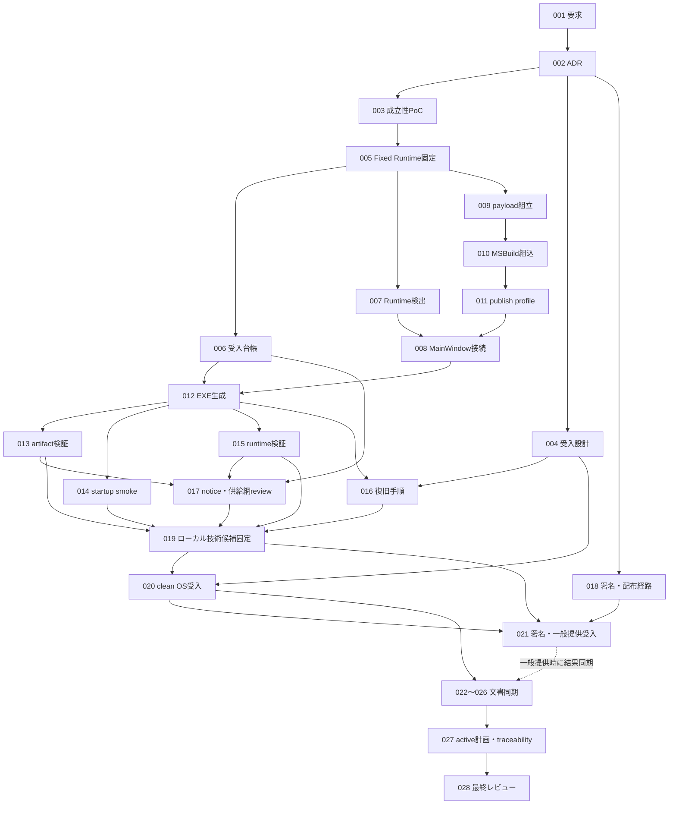

# OSのみのWindowsから1操作で起動するための調査・実装計画

- 作成日・外部資料確認日: 2026-09-06
- 調査基準: `main` / `49c5a49ea4b9c0d38841b212f8dea52529bdf945`
- 状態: **確認用提案。実装未承認・未着手**
- 今回の成果物: この計画書のみ。製品コード、要求定義書、`docs/`、既存配布スクリプトは変更していない。
- 今回の検証範囲: ソース・設定・既存記録・採用SDK内のtargets・公式資料の照合。アプリ起動、publish、依存インストール、クリーンOS試験は実行していない。
- 判断の正本: [要求定義書](../docs/requirement-definition.md)を最優先とし、[ADR-0001](../docs/dev/decisions/ADR-0001-source-of-truth.md)の優先順位に従う。
- 本書のタスクはすべて未実施。利用者が本計画を確認し、作成を指示した後にのみ着手する。

## 1. 結論

**第一候補は、既存のWinUIアプリを、必要な実行依存も含む「SDK標準の自己展開型・自己完結型単一EXE」として配布する方式である。独自ランチャーは作らない。**

利用者に渡す起動ファイルは原則 `HubRadio.App.exe` 1個とする。起動後、SDKが依存ファイルを利用者の一時領域へ展開し、既存のWinUI / WebView2画面を表示する。これはインストーラーではないが、**内部のファイル展開とユーザーデータ保存は発生する**。

- .NET RuntimeとWindows App SDK Runtimeはself-containedにする。
- WebView2はFixed Versionを同梱し、OS側のEvergreen導入状態に依存させない。
- Pythonは既存のCPython embeddable＋固定wheelの組立を再利用する。
- FFmpeg/ffprobe、採用済みCPU/int8 ASRモデル、Web静的asset、既定profileを同梱する。
- 利用者にGit、SDK、Node.js、Python、pip、PowerShell 7、WinGet、GPU用追加runtime、Azure認証、環境変数設定を要求しない。
- 元動画・DB・設定・WebView2のユーザーデータは、実行依存の展開場所と分離する。
- MSIX、MSI、セットアップウィザード、自動更新、アンインストーラーの作成は将来事項にする。

**ただし、このアプリで単一EXEが動くことはまだ実測していない。** 採用SDKには対応targetsが存在する一方、既存の通常publishでXAML資産が欠けた記録がある。最初に小さな成立性検証を行い、成功を確認してから本実装へ進む。[R03][R07][W01][W02][W10]

### 1.1 方式比較

| 方式 | 利用者の操作 | OSのみ・オフライン起動 | 評価 |
|---|---|---|---|
| SDK標準の自己展開型単一EXE | 保存済みEXEを1回起動 | 全依存を同梱すれば実現候補 | **第一候補。既存アプリを維持し、独自展開エンジンを追加しない** |
| self-containedフォルダー配布 | 展開済みフォルダー内のEXEを1回起動 | 全依存を同梱すれば実現候補 | 最小の比較基準・組立中間成果物。ただしZIPの手動展開が必要なら、厳密な「取得後1操作」は満たさない |
| 起動用setupスクリプト | スクリプト起動後に配布済みバイナリを取得・展開・起動 | オンライン取得方式では初回通信が必要 | 代替候補。取得元、hash、実行制限、proxy、中断処理の設計が増える。現行PowerShell 7前提のbuildスクリプトをそのまま渡す案は不適合 |
| 独自の自己展開ランチャー | EXEを1回起動 | 技術的候補 | SDK標準方式が成立する限り採用しない。失敗の実測と追加承認なしに作らない |
| MSIX / MSI / 専用インストーラー | インストール後に起動 | 別の配布・信頼設定が必要 | **今回の対象外。既存MSIX資産は保全する** |

setupスクリプト案を選ぶ場合も、利用者PCでソースのビルド、npm/pip restore、開発環境の一括導入を行う方式にはしない。完全な事前ビルド済みpayloadを使う。Windows標準の起動手段で完結するかは、代替案を選択した時点で検証する。PowerShell 5.1へのフォールバックは採用しない。

## 2. 現行実装から確認できた事実

`確認済み`はソースまたは既存記録の確認を指す。今回の実行試験に成功したという意味ではない。

| ID | 確認した事実 | 計画への影響 | 出典 |
|---|---|---|---|
| F01 | 対象は単一のWindows標準ユーザー。ローカル保存、cloud AI既定OFF、第三者再配布条件の検査、先回り抽象化の禁止が要求にある | 管理者権限・クラウド設定・汎用基盤を起動条件にしない | [R01] §5、NFR-004/007、BR-004 |
| F02 | アプリの最小Windows targetは `10.0.26100.0`、RIDは `win-x64`、Windows App SDKは `2.4.0`、`WindowsPackageType=None` | 初期対象は現行のWindows 11 24H2以降 x64を維持する。OS/CPU対応拡張は行わない | [R03] |
| F03 | 既存publish profileは.NETとWindows App SDKのself-containedを指定するが、`PublishSingleFile=false` | 新しい専用publish profileを追加する。既存profileを無条件に書き換えない | [R03] |
| F04 | `WebViewStartupCoordinator`は引数なしでシステムのRuntimeを検出し、`MainWindow`は空のbrowser folderで初期化する。欠落時は手動インストールを案内する | **検出と初期化の両方**を同じ同梱Runtimeへ向ける必要がある。現在は自動インストールしていない | [R04] |
| F05 | WebView2 user dataとworkspaceは `%LOCALAPPDATA%\HubRadio.MovieCreator` 配下。profile、Web assetは `AppContext.BaseDirectory` 基準で読む | 保存先の全面改修ではなく、展開後のパス互換性を検証する | [R04][R08] |
| F06 | Pythonは3.12.10 embeddable、runtime wheel 25件、`-I -B`、専用`._pth`、実行時pip不要を既存manifestが定義する | venvのコピーやPyInstallerへの置換は不要。既存組立・検証を再利用する | [R05] |
| F07 | モデルcatalogはnetwork acquisitionを無効化し、採用ASRだけにoffline bundleを定義する。`transcribe.py`は明示されたローカルdirectoryを `local_files_only=True` で開く | 「初回にモデルを自動downloadする問題」を修正する必要はない。既存のローカルモデル配置を維持する | [R06] |
| F08 | 旧MSIX builderは `App/HubRadio.App.exe` と、兄弟の `Worker/`、`Tools/`、`Models/` を組み立てる。一方、アプリのthumbnail処理にはEXE基準の `Tools/ffmpeg.exe` 参照がある | 旧layoutをそのまま転用しない。新layoutはアプリの実際の参照規約へ合わせる。旧MSIX全体の失敗を断定する指摘ではない | [R07][R08] |
| F09 | 既存MSIX検証記録は約1.22 GBの展開payloadを報告し、通常publishで `App.xbf`、`MainWindow.xbf`、`HubRadio.App.pri` が欠けたためbuild出力を使用したと記録する | 単一EXE化の成立性、全内容の同梱、容量・初回展開時間を実測する。新EXEのサイズをこの数値から断定しない | [R07] |
| F10 | 既存startup smokeはEXE隣接treeの不変性を検査し、main window/Ready待ちは各15秒。PowerShell 7を前提にする | 自己展開先の検査を追加する。既存待ち時間が十分かは測る。テスト用PowerShellを利用者の前提条件にしない | [R09] |
| F11 | READMEと現在計画は `V2-000`〜`V2-009`完了、`V2-010`以降の評価・state・render/delivery・最終受入を未完了とする | 起動対応と業務E2E完成を分ける。過去の`work/`の途中状態で現在の進捗を上書きしない | [R10] |
| F12 | ADR-0006の現在の配布既定は署名済みMSIX / Evergreenであり、今回の方針と異なる | 後続ADRでWindows配布部分だけを置換する。Azure部分の再設定は不要 | [R02] |
| F13 | manifestやModelManagerは採用状態・内容hash・未承認状態を固定している | 「配布できた」という理由で `releaseApproved` 等を一括true化しない。変更が必要なら既存Q-010の契約更新として別途扱う | [R05][R06][R11] |
| F14 | 安定エラーコード文書は `webview.runtime_unavailable` をEvergreenの版検出失敗と説明する | 検出失敗で初期化を始めないという意味と秘匿境界を維持し、開発/配布の検出対象の説明を同期する | [R13] |

以下は**未確認**であり、現在存在する不具合とは扱わない。

- 完全payloadを含む単一EXEのpublish成功と、展開後の全参照先。
- OS外の追加VC++ DLL等が実際に不足するか。Python archiveに `vcruntime140.dll` と `vcruntime140_1.dll` があることだけでは、全native依存の充足は証明できない。
- 新しい配布物の容量、初回/再起動時間、ピーク空き容量、CPU/RAM最小要件。
- 対象端末のSmartScreen、Smart App Control、組織のApplication Controlでの実動作。
- 新しい配布物のクリーンWindows実行、再配布条件の最終確認、一般利用者向け提供可否。

## 3. 公式資料と採用SDKによる方式確認

### 3.1 WinUI単一EXE

専用のunpackaged配布資料は、Windows App SDK 1.5以降の **unpackagedかつself-contained** なWinUIアプリで単一EXEをサポートすると説明する。[W01]

採用中のNuGet `Microsoft.WindowsAppSDK 2.4.0` のnuspecが参照する `Microsoft.WindowsAppSDK.Base 2.0.4` 内にも、`buildTransitive/Microsoft.WindowsAppSDK.SingleFile.targets` が存在することを読み取り確認した。同targetsは `EnableMsixTooling`、`WindowsPackageType=None`、`IncludeAllContentForSelfExtract` などを検査する。[W02]

提案する専用profileの主要設定は次のとおり。実際の評価タイミング・PRI生成・出力はOSL-003で先に確認する。

| 設定 | 提案値・方針 |
|---|---|
| `RuntimeIdentifier` | `win-x64` |
| `WindowsPackageType` | `None` |
| `SelfContained` | `true` |
| `WindowsAppSDKSelfContained` | `true` |
| `PublishSingleFile` | `true` |
| `IncludeAllContentForSelfExtract` | `true` |
| `EnableMsixTooling` | `true`。SDKが要求するPRI生成のためであり、MSIXを出力・インストールする指示ではない |
| `WindowsAppSdkUndockedRegFreeWinRTInitialize` | 必要な自動初期化を維持する。ユーザーに環境変数を設定させる回避にしない |
| trimming / Native AOT | 今回は使用しない。起動・同梱対応と無関係な互換性変更を混ぜない |
| 圧縮 | 容量・起動時間を測る前に最適化しない。標準設定から始める |

**資料間の不一致:** 一般的なself-contained配布ガイドにはWinUI単一EXEを否定する記述がある一方、専用資料と採用SDKのtargetsには対応がある。[W10][W01][W02] また.NET一般資料は全内容展開モードを互換モードとして説明する。[W05] したがって「無条件に利用可能」と断定せず、固定SDKでのPoCを採用ゲートにする。将来SDK更新時の動作まで保証しない。

### 3.2 WebView2

- Fixed VersionはアプリにRuntimeを同梱でき、インストール用registryを使用しない。一方、自動更新はなく、配布者による更新が必要で、公式資料は250 MB超の追加サイズを示す。[W03]
- WinRT APIには、folderを渡す `GetAvailableBrowserVersionString` と `CreateWithOptionsAsync` が存在する。[W04]
- packaged向け例にある `Package.Current.InstalledLocation` は今回のunpackaged方式へそのまま転用しない。展開されたアプリ資産の実際のrootから解決する。
- Windows 10向けFixed Version 120以降の追加ACL手順を、Windows 11へ無条件に適用しない。公式資料はその変更がWindows 11には影響しないと説明する。[W03]
- Fixed RuntimeのUNC実行は対応しないとされる。初期対象はローカルディスクとする。[W03]

### 3.3 その他の実行依存と信頼

- Python公式はembeddable配布への依存同梱を説明し、通常のpip運用を前提にしていない。既存の隔離runtimeと整合する。[W08][R05]
- VC++ DLLのapp-local配布は選択肢だが、再配布許諾と更新責任がある。OS-only試験で必要性を確認せず、開発PCのSystem32からDLLを集めてはならない。[W06]
- 署名済みでも新しいEXEにSmartScreen警告が出る場合がある。単一EXEや証明書だけで全端末の無警告起動を保証しない。[W07]
- Smart App Controlは未知・未署名のbinaryをブロックし得る。外側EXEだけを署名すれば、内部の全child executable/DLLも許可されるとは仮定しない。[W09]
- FFmpegを同梱する場合も、その構成に対応するlicense、source/build情報、依存licenseの確認は必要。別プロセス実行とライブラリへのリンクを混同せず、適用条件をQ-010で確認する。[W11][R11]

## 4. 不明点・選択肢・デフォルト案

以下は**製品判断の提案であって、利用者の承認済み事項ではない**。特にD01、D02、D03、D05、D11、D13をご確認いただきたい。

| ID | 不明点 | 選択肢 | デフォルトの選択肢 | デフォルトを選ぶ明確な理由 |
|---|---|---|---|---|
| D01 | 「1操作」の起点はどこか | ダウンロードを含む / 保存済みファイルの起動から / 手動ZIP展開後 | **保存済みEXEの起動から**。手動展開や依存導入は不要 | ブラウザーでの取得操作までアプリが制御できない。起動後のセットアップ負担をなくす目的を明確に検証できる |
| D02 | 「1つのexe」は配布ファイル数か、実行プロセス数か | 配布1ファイル / 実行1プロセス / 一切展開しない | **配布1ファイル。内部展開とchild processは許容** | 既存WinUI・WebView2・FFmpeg・Pythonを保てる。1プロセス化は不要な全面改修になる |
| D03 | 初回起動時に通信を許すか | offline完結 / 依存downloadのみ許可 | **取得後はoffline完結** | OS側のRuntime欠落、proxy、アカウント、通信障害を起動条件から外せる。local-firstとも整合する |
| D04 | 対応OS・CPU・editionをどこまで広げるか | 現行対象 / Win10・ARM64等へ拡張 | **サポート中のproduction-channel Windows 11 24H2以降 x64を基準**。editionを記録 | 現行min targetを維持し、追加互換性開発をしない。N/LTSC/Sモード等を未検証のまま対応済みとしない |
| D05 | 起動の完了点は何か | ウィンドウ表示だけ / 操作可能UI＋実行基盤 / 動画納品完了まで | **既存UIが操作可能で、同梱基盤の独立検証が通ること** | 白いウィンドウだけの成功を避ける一方、未完了V2業務統合を配布対応へ混ぜない。一般的な動画編集完成はV2-014で別判定 |
| D06 | WebView2の配布方式 | Evergreen / Fixed Version | **Fixed Version同梱** | OS-only・offline・追加セットアップなしを優先するため。容量増とセキュリティ更新責任は受け入れ条件にする |
| D07 | 開発ビルドにもFixed Runtimeを必須にするか | 全ビルド同一 / 配布profileだけ同梱版 | **配布profileだけ同梱版、既存開発経路は維持** | 無関係な開発・MSIX検証を壊さない。必要な区別はbuild時だけとし、ユーザー設定やRuntime providerは作らない |
| D08 | モデル・GPUをどう扱うか | 全候補同梱 / CPU採用分だけ / 初回取得 | **現在採用のCPU/int8モデルと既存runtimeだけ** | catalogの採否、CUDA未承認、network取得禁止を維持できる。高性能GPUが起動前提にならない |
| D09 | 展開先とデータ保存先 | EXE隣接 / 独自cache / SDK標準展開＋既存データ領域 | **SDK標準の利用者TEMP配下への展開＋既存LOCALAPPDATA保存** | 独自展開・cache管理を作らず、実行依存とDB/成果物を分離できる。実際のBaseDirectoryはPoCで検証する |
| D10 | native DLLが不足していた場合 | system-wide再配布パッケージ導入 / 許諾済みapp-local同梱 | **実測で必要なDLLだけapp-local同梱を検討** | 標準ユーザーの管理者昇格を避けるため。現時点で不足は未確認。具体的な追加ファイルは不足の証拠を得てから限定する |
| D11 | OSの安全確認まで省略するか | 警告・ポリシーを無効化 / 信頼される配布経路を使う | **保護を維持し、署名・信頼条件を別途確認** | Windows/組織の保護はアプリが無条件に省略できない。文字どおり全端末・全状態で無警告1操作という保証はできない |
| D12 | 署名主体と未署名試作の扱い | OSから信頼される既存手段 / 自己署名証明書の配布 / 未署名 | **一般提供用は信頼される署名手段を選定。未選定時は技術評価用と明示** | 受信者へ証明書導入を求めるとOS-onlyの目的から外れる。証明書や費用・アカウントを無断で作らない |
| D13 | 配布先はどこか | 既存の社内配布先 / GitHub Releases等 / ローカルのみ | **配布先が承認されるまではローカル成果物のみ** | 現在、実配布URLと公開範囲の指定がない。クラウドや公開releaseを先回りして作らない |
| D14 | 更新・削除はどこまで作るか | 自動更新・rollback・uninstall / 手動EXE差替え | **終了後の手動差替え。データは保持。自動更新等は将来** | 今回は起動簡素化であり、インストーラー運用の先行実装を避ける。DB downgradeを保証せず、既存migration/backupを維持する |
| D15 | 許容サイズ・初回待ち時間・空き容量はいくつか | 仮の数値を置く / 実測後に合意 | **実測後に値を確定** | 既存payloadサイズは新EXEの測定値ではない。EXE・展開cache・model cacheの重複分も含めて測る必要がある |
| D16 | SDK標準の単一EXEが成立しなかったらどうするか | 無断で独自ランチャー追加 / script・folder案を再提示 | **失敗箇所と最小修正候補を提示して再承認** | 不成立を隠して別方式を実装しない。複数の配布方式を同時に保守しない |
| D17 | 既存catalogのrelease承認flagを変更するか | 一括true / 原本維持＋実配布候補の別証拠 | **原本維持。正式変更はQ-010の明示的な契約更新** | ModelManagerのpinned hash・閉じたpolicyと結合している。起動成功は品質やlicenseの承認ではない |
| D18 | 候補SBOMの形式と生成担当は何か | 既存buildで自動生成可能なSPDX/CycloneDX / 独自一覧のみ | **既存の標準形式による自動生成をOSL-012が担当**。採用tool/schema版を記録 | 既存調査方針[R14]を維持し、レビュー前の入力を確保する。独自SBOM形式・利用者側依存を増やさない |

## 5. 要求定義書への変更提案

現行文書には動画指定後の「1回の確認」はあるが、アプリ自体のOS-only起動の受入基準はない。これをAC-001と混同せず追加する。[R01]

### 5.1 追加候補: NFR-009 配布・初回起動

番号は本調査時点で未使用。実装着手時に再確認する。

1. 対象Windows標準ユーザーが、保存済みの配布ファイルへ1回起動指示を与えるだけで、追加セットアップなしにアプリを起動できること。
2. 利用者にSDK、Node.js、Python、pip、PowerShell 7、FFmpeg、追加Runtime、Gitの手動導入を要求しないこと。
3. 管理者昇格、再起動、Azureログイン、API key、環境変数の手動設定を必須にしないこと。
4. D03の承認に従い、取得後の初回起動と既定のローカル経路に依存downloadを必要としないこと。
5. 内部展開の存在、必要容量、ユーザーデータの保存先を説明し、実行依存の再展開で案件や設定を削除しないこと。
6. 配布物の依存版、内容digest、第三者notice、必要な再配布条件を記録すること。
7. Windowsの保護を無効化せず、対応環境と信頼条件、未検証範囲を明示すること。
8. インストーラー、自動更新、rollback、uninstallは初期対象外とすること。後日必要になった時点で別タスクにすること。

具体的なMSBuild設定やRuntimeの種類は要求本文で固定せず、ADR-0010と配布設計に置く。

### 5.2 追加候補: AC-007 OS-only起動

| 受入項目 | 確認内容 |
|---|---|
| AC-007.1 | 開発ツール・追加Runtimeを入れていない対象Windowsの標準ユーザーで、本体EXEの1回起動から既存UIへ到達する |
| AC-007.2 | 同梱Web UIのbridgeが応答し、元動画選択と設定画面の既存操作へ到達できる。ウィンドウの存在だけを合格にしない |
| AC-007.3 | OSのWebView2に依存せず、同梱Fixed Runtimeの実際のversion・process/module配置を確認する |
| AC-007.4 | 配布候補内のPython health/protocol、必要なnative imports、FFmpeg/ffprobe、CPUモデルのoffline loadを独立に確認する。これを業務E2E成功とは呼ばない |
| AC-007.5 | 管理者昇格、依存導入、手動設定、起動時downloadがない。ユーザーデータは既存per-user領域へ保存される |
| AC-007.6 | 終了・再起動、展開cacheの再生成で設定・案件を失わない。payloadと配布EXEをアプリが変更しない |
| AC-007.7 | 欠落・破損・容量不足・アクセス拒否を成功扱いしない。managed起動前の障害はSDK/OS側の観測結果と対処を記録する |
| AC-007.8 | cold/warm起動時間、最初の可視UIまでの時間、展開サイズ、ピーク占有量を記録し、D15で合意した値と照合する |
| AC-007.9 | 実配布経路と対象ポリシーで信頼動作を確認する。MOTWなしのローカルコピー試験を、実ダウンロードのSmartScreen受入と偽らない |

要求定義書の更新対象は§4、NFR-009、AC-007、§16、§19。signed MSIX/upgrade/uninstallは将来へ区分するが、BR-004の再配布検査や既存の保存・監査要求は削除しない。

### 5.3 完了区分を分ける

- **ローカル起動技術の検証完了:** 評価に必要な利用条件を満たす候補で、AC-007.1〜8に対応する技術検証を行った状態。未署名ならその事実と実際のOS/policyを記録する。一般配布の合格ではない。
- **一般提供向け起動・配布受入の完了:** 上記に加え、署名後の実配布候補で起動を再確認し、AC-007.9、供給網・信頼条件を満たした状態。
- **編集アプリケーション全体の提供完了:** さらに、既存 `V2-013` / `V2-014` などの実render/delivery、AC-001〜006、Q-010等が成立した状態。

署名主体や配布先の未選定は、ローカル技術検証とその文書化を一律に停止する理由にしない。ただし、試験環境の保護により未署名候補が拒否された場合、その試験はBLOCKEDとし、保護を解除してPASSにしない。評価許諾が未確認の内容を「技術検証」という名目で利用・配布することも認めない。

本計画だけで編集全体を完了させたことにはしない。未完了機能を含む試作を共有する場合は、共有自体の許可を得たうえで「起動検証用」と明示する。

## 6. 最小実装の設計

### 6.1 展開後の配置契約

以下は**新しい配布方式の提案layout**。MSIXの既存layoutの説明ではない。SDKが実際に展開したasset rootを基準にする。

| 配置 | 内容・再利用元 |
|---|---|
| root | アプリ、.NET、Windows App SDK、必要なnative DLL、XAML/PRI資産。SDKの正規出力を使用 |
| `WebAssets/` | 既存Vite production出力と `asset-manifest.json` |
| `Profiles/`、`DefaultSettings/Profiles/` | 既存profileをbyte単位で保持 |
| `Worker/` | 既存Python runtime組立の全必要内容。`python.exe`、`python312._pth`、wheel群、worker、runtime manifest |
| `Tools/` | 固定 `ffmpeg.exe`、`ffprobe.exe`。EXE基準の既存参照と一致させる |
| `ModelCatalog/catalog.json` | 既存catalog原本。再シリアライズしてhashを変えない |
| `ModelCatalog/<catalogのbundle.relativePath>/` | 採用ASRの4ファイル。現在は `Bundles/faster-whisper-small-536b0662742c02347bc0e980a01041f333bce120` |
| `WebView2Runtime/` | 固定・検証済みRuntimeの全必要ファイル。任意のsystem Edgeや「最初に見つかった版」を使わない |
| `Licenses/` | 実際の同梱物に対応するnotice/license。配布ページ等からも参照可能にする |
| `Evidence/` | component manifest等。生成する全体manifestは自己参照hashを避ける |

利用者が保持・起動するファイルはrootの展開物ではなく、これらを内包した `HubRadio.App.exe` 1個。開発・監査用のmanifest/SBOM等は `artifacts/` に分離し、起動時の追加入力にしない。licenseのsource提供等は起動操作数と別に必要条件を満たす。

**除外:** 元動画、`sample/`、`test/`の実媒体、案件DB、利用者設定、秘密情報、署名秘密鍵、`Music/`、開発venv、Node.js/npm、SDK、テスト専用wheel、未採用モデル、CUDA cache、生成source map、不要なsymbol。

`Music/`がない場合のBGMなし処理は既存要求のままとし、音源の再配布権を推測しない。モデルは既存ModelManagerのbundle/cache契約を維持し、不要な新cache管理層を作らない。[R01][R06]

### 6.2 起動処理

1. アプリに先行する展開はSDKに任せる。独自のZIP extractor、更新サービス、installer registry登録を追加しない。
2. 配布profileでは同梱WebView2 folderを一意に解決し、存在確認・version取得と環境作成へ同じ値を渡す。
3. 開発時のEvergreen経路を残す区別は配布profileのbuild時指定だけに限定する。たとえば実際に使用するcompile symbolで区別し、エンドユーザー向けの選択flag/providerを作らない。
4. 配布ビルドの同梱Runtime欠落をsystem版への黙ったfallbackで隠さない。既存native startup panelと診断コードを再利用し、配布元からの再取得など実行可能な対処を表示する。
5. `%LOCALAPPDATA%\HubRadio.MovieCreator\WebView2` と既存workspace/設定初期化を維持する。
6. Python/modelの重いloadを毎回のUI表示前に新設しない。同梱基盤の完全性は組立・候補検証で確認し、実処理での既存検証も維持する。
7. FFmpeg、workerを使う業務経路の追加統合は既存V2タスクが所有する。今回、未接続の業務処理を「起動の修正」として無断で実装しない。

### 6.3 ビルド・供給網

- ビルド担当者の環境と利用者の環境を区別する。PowerShell 7、.NET SDK、Node.js、組立用Python等はビルド担当者側だけで使用する。
- 既存 `build.ps1` / `test.ps1`、Python組立・検証、FFmpeg/model/Web manifestを再利用する。
- 新しい処理はpayload準備、MSBuildへの組込み、単一EXE生成、候補検証に限定する。汎用packaging frameworkは作らない。
- ビルド用の明示input pathを使い、利用者PCのPATH探索やネットワーク取得へ依存させない。
- `FilesToBundle`等のSDK拡張点で実際の同梱一覧を確認し、宣言上のファイル一覧だけで成功にしない。[W05]
- OSL-012で候補SBOMを生成し、OSL-013でpayloadとの対応を検証してからOSL-017へ渡す。形式は既存調査が認めるSPDX/CycloneDX等の標準形式を使い、tool/schema版を記録する。[R14] 空または未解析のBOMを完全なSBOMと呼ばない。
- 候補ごとのstaging/outputを分離し、既存成果物を無言で上書きしない。生成EXE、展開物、raw証跡、SBOMは既存のGit除外 `artifacts/` 配下に置く。[R12]
- signatureを適用する場合はbundle完成後の最終EXEを検証し、**署名後のhash**を受入へ渡す。署名前のEXEの試験結果をそのまま最終候補の証拠にしない。
- child binaryの署名変更が必要と判明した場合は、元hash・署名後hash・再配布条件・既存binary verifierへの影響を特定してから追加承認する。固定hashを理由なく置換しない。

## 7. 詳細タスクとファイル所有権

### 7.1 実行ルール

- タスク単位は原則「1つの契約」＋「その試験」。通常は製品/スクリプト1〜2ファイルと専用テスト1ファイル以内とする。
- 実施時の入力は、対象行、参照する要求/ADRの該当節、直接依存の確定成果物、対象コード/テストに限定する。本計画全文や全`docs/`を毎タスクへ持ち込まない。
- 新規ファイル名は提案。着手前に重複と適用instructionsを確認する。
- 同じファイルを並列編集しない。必要になった追加ファイルが割当を超える場合は、先にタスクを再分割する。
- 各タスクでfocused test/文書検査、差分検査、独立レビューを行う。統合・全回帰は最後のgateでも実施する。
- 既存のMSIX/Python/modelの過去PASS、未実施・未承認のflagを今回の結果へ書き換えない。
- 下記は実行指示ではなく、**承認後の作業単位**である。

パス略号（いずれもrepository root相対）:

| 略号 | 実パス |
|---|---|
| `A` | `src/HubRadio.App` |
| `T` | `tests/HubRadio.App.Tests` |
| `AT` | `tests/Architecture.Tests` |
| `P` | `packaging` |
| `D` | `docs/dev` |
| `S` | `tests/smoke` |

`新`は新規、`更`は既存ファイル更新、`生成`はGit対象外成果物。入力のR/Wは§11の実在資料、OSLは先行タスクの出力を表す。

### 7.2 A: 要求・成立性・受入設計

| ID | 作業（1契約） | 入力 | 作成・編集ファイル | 合格条件 | 依存 |
|---|---|---|---|---|---|
| OSL-001 | 起動要求と受入基準を定義 | R01、承認されたD01〜D18 | 更 `docs/requirement-definition.md` | NFR-009/AC-007、対象外、1操作の境界を記述。AC-001の動画開始と混同しない | なし |
| OSL-002 | 配布方式のADRを確定 | OSL-001、R02、W01〜W05 | 新 `D/decisions/ADR-0010-one-action-portable-launch.md`、更 `D/decisions/ADR-0006-distribution-and-azure.md` | Windows配布部分だけの置換範囲、暫定layout、PoC gateを明示。Azure・既存履歴は保持 | OSL-001 |
| OSL-003 | 固定SDKで単一EXEの小規模成立性を検証 | OSL-002、R03/R04/R07、W01/W02/W05/W10 | 新 `D/research/one-action-launch-feasibility.md`、生成 `artifacts/portable-spike/` | XAML/PRI/Web asset、展開root、BaseDirectory、初期化を実測。成功範囲と未検証範囲を分離 | OSL-002 |
| OSL-004 | クリーンOS受入の試験設計 | OSL-001/002、R09、W07/W09 | 新 `tests/Acceptance/OneActionLaunch.md` | OS・標準ユーザー・導入済み依存・network・policyの前提と証拠形式を固定。skipをPASSにしない | OSL-002 |

### 7.3 B: WebView2同梱と起動

| ID | 作業（1契約） | 入力 | 作成・編集ファイル | 合格条件 | 依存 |
|---|---|---|---|---|---|
| OSL-005 | Fixed Runtimeの版と内容を固定 | OSL-003、W03、既存component manifest形式 | 新 `P/webview2/runtime-manifest.json`、新 `AT/WebView2RuntimeManifestTests.cs` | 実在する公式x64版、取得元、hash、展開配置、必要licenseを記録。未測定版・架空hashを置かない | OSL-003 |
| OSL-006 | 新規Runtimeの受入台帳を更新 | OSL-005、R11、W03/W06 | 更 `D/licenses/third-party-intake.md`、更 `D/licenses/dependencies.csv` | SDKとRuntimeを区別し、実同梱版・再配布条件・未完了事項を登録。既存履歴は消さない | OSL-005 |
| OSL-007 | 指定Runtimeを検出する起動契約を追加 | OSL-003/005、R04のCoordinator、R13、W04 | 更 `A/Web/WebViewStartupCoordinator.cs`、更 `T/WebViewStartupCoordinatorTests.cs`、更 `D/error-catalog.md` | 指定folderの検出、欠落・空version・初期化失敗、既存開発経路を検査。既存コードの処理段階・秘匿境界を変えず、検出対象の説明を同期 | OSL-003, OSL-005 |
| OSL-008 | MainWindowから同梱Runtimeを使用 | OSL-007/011、R04のMainWindow | 更 `A/MainWindow.xaml.cs` | 検出と初期化へ同じfolderを渡す。portable欠落をsystem fallbackで隠さない。user dataと既存native recoveryを維持 | OSL-007, OSL-011 |

### 7.4 C: 配布payloadと単一EXE生成

| ID | 作業（1契約） | 入力 | 作成・編集ファイル | 合格条件 | 依存 |
|---|---|---|---|---|---|
| OSL-009 | 固定依存を提案layoutへ組み立てる | OSL-003/005、R05/R06/R07/R08の配置・manifest | 新 `P/portable/prepare-payload.ps1`、新 `AT/PortablePayloadTests.cs` | Python既存verifierを再利用。FFmpeg/model/WebView2の実bytesを検査。catalog.relativePath準拠。媒体・秘密・非採用物なし | OSL-003, OSL-005 |
| OSL-010 | payloadをMSBuild publishへ組み込む | OSL-009、既存csproj Content項目、W05 | 新 `P/portable/PortablePayload.targets`、新 `AT/PortablePayloadTargetTests.cs` | 相対配置を維持してFilesToBundleへ含める。XAML/PRI・静的assetの漏れと重複を検査 | OSL-009 |
| OSL-011 | 単一EXE専用profileを追加 | OSL-010、OSL-003の実証設定、R03 | 新 `A/Properties/PublishProfiles/win-x64-singlefile.pubxml`、新 `AT/PortablePublishProfileTests.cs` | §3の必要設定・targets import・配布buildの区別を固定。旧profileとSDK版は変更しない | OSL-010 |
| OSL-012 | 固定inputから候補EXE・SBOMを生成 | OSL-006/008/011、R14、既存build入口 | 新 `P/portable/build-portable.ps1`、新 `AT/PortableBuildTests.cs`、生成 候補EXE/manifest/SBOM | 標準形式の候補SBOMも生成し、tool/schema版と未解析項目を記録。既存output上書き・不足input・混入物を拒否。MakeAppx不要 | OSL-006, OSL-008, OSL-011 |
| OSL-013 | 候補artifactの整合を検証 | OSL-012のEXE/manifest/SBOM、FilesToBundle記録 | 新 `P/portable/verify-portable.ps1`、新 `AT/PortableArtifactVerificationTests.cs` | 実同梱一覧、component hash、EXE hash、必要assetとSBOMの対応を確認。欠落/改変/余分入力の負例を検査 | OSL-012 |

### 7.5 D: 実行検証と配布候補の確定

| ID | 作業（1契約） | 入力 | 作成・編集ファイル | 合格条件 | 依存 |
|---|---|---|---|---|---|
| OSL-014 | startup smokeを自己展開へ対応 | OSL-012、R09、AC-007.2/3/6/8 | 更 `S/Test-WebViewStartup.ps1` | 既存AppPath契約を保ち、cold/warm、可視UI、実Runtime配置、展開tree不変を追加検査。待ち時間を実測に基づき扱う | OSL-012 |
| OSL-015 | 配布runtimeを独立検証 | OSL-012、R05/R06、W06/W08 | 新 `S/Test-PortableRuntime.ps1`、新 `AT/PortableRuntimeSmokeTests.cs` | 空PATH・異なるcwdでpackaged worker/native imports、FFmpeg/ffprobe、offline CPU model loadを確認。開発PCのDLL依存でないか切り分ける | OSL-012 |
| OSL-016 | 起動失敗・再展開の受入手順を定義 | OSL-004/012、AC-007.6/7 | 新 `tests/Reliability/portable-launch-recovery.md` | 容量不足、アクセス拒否、cache再生成、破損、起動前失敗と起動後失敗を区別。既存案件を消さない手順にする | OSL-004, OSL-012 |
| OSL-017 | 実同梱物のnotice・SBOM・再配布条件をレビュー | OSL-012の候補SBOM、OSL-006/013/015、R11、既存Q-010 | 更 `D/licenses/THIRD-PARTY-NOTICES.md`、新 `D/licenses/release-review.md` | 同梱native依存まで対応付け、評価利用と一般配布の許諾を区別。未確認の一般配布条件はBLOCKED。評価自体が未許諾なら技術試験も停止 | OSL-006, OSL-013, OSL-015 |
| OSL-018 | 署名と実配布経路の運用を確定 | OSL-002、D11〜D13、W07/W09 | 新 `D/packaging/portable-signing.md` | 信頼主体・検証方法・配布経路と未決を記録。秘密を保存せず、受信者への証明書導入・保護解除を前提にしない | OSL-002 |
| OSL-019 | ローカル技術評価用候補を再生成・固定 | OSL-013〜017の実成果物 | 生成 `artifacts/portable/<version>/` 配下の技術評価用EXE、manifest、SBOM | notice反映後に再buildしSBOMを再照合。hashと実際の署名状態を固定。署名未選定でも評価利用が許される候補は作れるが、一般配布承認にはしない | OSL-013, OSL-014, OSL-015, OSL-016, OSL-017 |
| OSL-020 | クリーンWindowsで起動技術を検証 | OSL-004/019、OSL-014〜016の手順 | 新 `D/reviews/one-action-launch-acceptance.md`、生成 `artifacts/portable-validation/<run-id>/` | AC-007.1〜8の通常・異常系を標準ユーザーで検証。未署名/policyを明記し、一般配布成功とはしない。保護が拒否した試験はBLOCKED | OSL-004, OSL-019 |
| OSL-021 | 署名・実配布の受入（一般提供gate） | OSL-018/019/020、W07/W09 | 新 `D/reviews/portable-trust-validation.md`、生成 署名済みEXE/manifest/SBOM/署名記録/再受入証跡 | 署名後hashを固定し、同じEXEで起動受入を再実行。実取得/MOTW/policyとchildの扱いを確認。署名・配布先未選定時は一般提供だけを保留 | OSL-018, OSL-019, OSL-020 |

### 7.6 E: 文書同期と最終レビュー

| ID | 作業（1契約） | 入力 | 作成・編集ファイル | 合格条件 | 依存 |
|---|---|---|---|---|---|
| OSL-022 | 開発者向け配布runbookを作る | OSL-020、確定したbuild・layout | 新 `D/packaging/portable-distribution.md`、更 `P/HubRadio.Package/README.md` | 技術検証結果で文書化を進められる。一般提供はOSL-021の実施/未実施を明示し、旧測定記録を保全 | OSL-020 |
| OSL-023 | 開発ドキュメントの入口を同期 | OSL-022、R12 | 更 `D/getting-started.md`、更 `D/README.md` | SDK等は開発者用と明記し、新runbook/ADR/受入へ誘導。無関係な古い記述の一括改稿はしない | OSL-022 |
| OSL-024 | アーキテクチャの配布説明を同期 | OSL-020、OSL-002/008/011 | 更 `D/architecture/overview.md` | Fixed Runtime、自己展開、保存境界と実装状態を説明。process構成・業務E2Eの未完了は維持 | OSL-020 |
| OSL-025 | 安全性と品質gateを同期 | OSL-017/020、R11 | 更 `D/security-privacy.md`、更 `D/quality.md` | payload/cache/workspace、保護維持、更新責任を記載。OSL-021未完了でも技術文書を更新し、一般提供gateの未成立を明示 | OSL-017, OSL-020 |
| OSL-026 | 非技術者向け起動説明を更新 | OSL-020/022、現在の業務機能状態 | 更 `README.md`、更 `D/troubleshooting.md` | 起動手順・条件・実測値・保存先を記載。OSL-021未成立時は一般提供未開始と明記し、実在しない配布URLを作らない | OSL-020, OSL-022 |
| OSL-027 | active計画と要求対応を更新 | OSL-022〜026、既存V2/PK/Q分類 | 更 `D/planning/implementation-plan.md` | 現在§0へOSL/NFR-009/AC-007を対応付け、V2-014の配布依存を再定義。旧203 task snapshotは変更しない | OSL-022, OSL-023, OSL-024, OSL-025, OSL-026 |
| OSL-028 | 独立レビュー・回帰・証拠整合 | OSL-020/027、全変更差分 | 新 `D/reviews/one-action-launch-review.md` | 技術検証のレビューを実施し、一般提供未完了を分離。一般提供時にはOSL-021の署名後候補/再受入と文書を入力に再レビュー | OSL-020, OSL-027 |

OSL-021は一般提供用の分岐であり、未選定の署名・配布先を理由にOSL-020やOSL-022〜028を一律停止しない。一般提供を開始するときはOSL-021を必須とし、その実結果でOSL-022/025/026/027を差分更新し、OSL-028を再実施する。既存の未署名試験を署名後の試験へ遡及変更しない。これらは工程の区分であり、アプリへ新しいrelease mode設定を追加する指示ではない。

### 7.7 特に注意するタスクの境界

**OSL-003: 成立性検証**

- 使い捨ての隔離worktree/outputで実施し、SDK版と既存ユーザーデータを変更しない。
- 一時的なprofile/targetsで必要設定を検証する。検証用変更をそのまま本番実装として残さない。
- main window、XAML/PRI、Web静的asset、展開先と `AppContext.BaseDirectory` の一致を観測する。
- この段階で利用したsystem WebView2等を明記する。小PoC成功は完全payload・offline・clean OS成功の代替ではない。
- 未成立なら失敗箇所と最小修正の根拠を報告し、D16の再承認まで後続の製品実装へ進まない。
- profileだけではMSBuild評価順を満たせずcsproj変更が必要と判明した場合は、そのファイルをOSL-011の変更範囲へ明示してから進める。予防的にglobal propsやSDKを変えない。

**OSL-009〜013: 組立と監査**

- Pythonは既存 `build-runtime.ps1` / `verify-runtime.ps1` の契約を使う。新たなpip起動・freeze・venv持ち運びを実装しない。
- モデルrootはcatalogの `bundle.relativePath` をそのまま解決できる形にする。`Models/`等の別名へ移し替えてcatalogを書換える方法は採用しない。
- WebView2の版・hash・配置はOSL-005だけを正本にし、複数箇所へ独立した版指定を増やさない。
- 入力のhash一致、stagingの一覧、実際のbundle一覧、展開後の一覧を区別する。
- 候補SBOMの生成はOSL-012、内容照合はOSL-013、license/CVE等のレビューはOSL-017が担当する。OSL-019では更新後の候補、OSL-021では署名後の配布物との一致を再確認する。
- native依存不足や署名変更が実測で判明した場合は、必要なファイル・既存verifier・manifestへの影響を特定して計画差分を承認する。「念のためのDLL一式」や汎用依存収集器は追加しない。

**OSL-014〜021: 実行・クリーンOS検証**

- 開発者PCでの空PATH実行は有益だが、OS-only受入の代替ではない。System32等に開発環境由来の依存がある可能性を排除できないためである。
- クリーンguestへのSDK、PowerShell 7、テストrunner等の導入を初回起動の前提にしない。まず本体EXEだけの状態で利用者手順を実施する。補助toolを用いる検証は別フェーズ/スナップショットと明示する。
- テスト用VMの準備と実際のアプリ利用者権限を分け、アプリは標準ユーザーで動かす。「昇格画面が出なかった」だけで標準権限と断定しない。
- 起動時の案件/DB初期化で普段の利用者workspaceを書き換えないよう、使い捨てテスト環境を使用する。
- 既存startup smokeの「EXE隣接treeだけのhash比較」では自己展開先を見落とすので、実展開rootも検査する。
- 既存15秒待機を製品性能要件へ読み替えない。初回展開を含む測定値と試験timeoutを分ける。
- managed entry到達前の容量不足/権限拒否ではアプリのnative recovery panel自体を表示できない場合がある。未実装の独自preloader表示を約束せず、SDK/OSの実挙動と対処を記録する。
- model load/worker ping成功を、文字起こし精度や「動画1本から納品まで」の成功にしない。
- 実配布先が未定なら実ダウンロード信頼試験はBLOCKEDとする。保護解除やregistry変更で成功に見せない。

## 8. 直列・並列実行設計

### 8.1 依存の大枠

詳細の必須依存は§7の表を正本とする。図の`022〜026`はまとめ表示であり、完全な相互依存を表すものではない。点線は一般提供時の結果同期であり、初回の技術文書作成を停止する依存ではない。

### 8.2 並列にできるまとまり

| 開始条件 | 並列実行候補 | 共有ファイルへの配慮 |
|---|---|---|
| OSL-002完了 | OSL-003、004、018 | 別文書・別生成物。PoCのbuild/outputは隔離する |
| OSL-005完了 | OSL-006、007、009 | 台帳、Coordinator、payload scriptは別所有者 |
| OSL-012完了 | OSL-013、014、015、016 | 検証対象EXEは同一hashのread-only input。実行・展開・profile・証跡は検証ごとに別環境 |
| OSL-020完了 | OSL-022、024、025。署名・配布先が整えばOSL-021も並行可 | 文書は技術候補の事実を扱う。一般提供分岐の署名後候補と証跡は別に保存 |
| OSL-022完了 | OSL-023、026 | 開発入口と一般READMEを分離。OSL-027が最後に集約 |

**直列固定:** 001→002、003の成立判定、009→010→011、007/011→008、各検証→019→020、文書群→027→028。一般提供分岐は018/020→021→必要文書の差分同期・028再レビュー。

共有worktree内でApp build、web build、同じTEMP/cacheを使うGUI試験を同時に走らせない。並列化は依存がないことに加え、worktree・出力・ユーザーデータの分離を条件とする。

### 8.3 既存タスクへの接続

- `PK-001〜005`: 既存の固定依存・組立・offline契約を再利用する。既存完了記録は取り消さない。
- `PK-006/007`: MSIXのinstall/upgrade/rollback/uninstall部分を将来へ区分する。未実施を「完了」にしない。
- `Q-010`: 最終候補に対するnotice/SBOM/CVE/再配布条件の検査は維持し、対象を新EXEとその内容へ合わせる。
- `V2-010〜013`: 本計画とは別の業務実装。今回、重複する代替pipelineを作らない。
- `V2-014`: 技術評価では`V2-013`等の業務成果物とOSL-019/020の候補・証拠を使える。一般提供判定にはOSL-021の署名後EXEと同じbytesでの再受入、OSL-028の再レビューを必要とする。新たな製品コードを統合した場合はEXEを再生成し、影響を受ける起動・供給網試験を再実行する。
- 起動タスクのために `V2-010〜013` 全完了を待つ必要はない。一方、一般的な「編集アプリ完成」の表示・配布判断はその未完了を無視しない。

## 9. `/docs` 更新調査の結果

**更新は必要である。** 要求、Accepted ADR、active計画、一般向け説明の間に、現在のMSIX既定と今回のインストーラー延期の差がある。

| 文書・分類 | 扱い | 所有タスク |
|---|---|---|
| `docs/requirement-definition.md` | 起動要求/受入、対象外、未決を更新 | OSL-001 |
| `docs/dev/decisions/ADR-0006-distribution-and-azure.md` | 後続ADRによるWindows配布部分の置換注記だけ追加 | OSL-002 |
| 新ADR-0010 | 実装方式、layout、固定Runtime、暫定判断・採用条件 | OSL-002 |
| `docs/dev/planning/implementation-plan.md` | 現在§0で新task/要求対応とV2-014/PK/Qの依存を更新 | OSL-027 |
| `docs/dev/architecture/overview.md` | 実装された起動・保存境界だけを同期 | OSL-024 |
| `docs/dev/quality.md`、`security-privacy.md` | clean OSの証明範囲、cacheとデータ、署名・更新責任 | OSL-025 |
| `docs/dev/error-catalog.md` | 公開済み診断コードの処理段階・秘匿境界を保ち、Evergreen/Fixedの検出対象を説明 | OSL-007 |
| `docs/dev/getting-started.md`、`docs/dev/README.md` | 開発前提と利用者起動を分けて誘導 | OSL-023 |
| `README.md`、`docs/dev/troubleshooting.md` | 1操作の手順、対応条件、実在する復旧案内、未提供機能 | OSL-026 |
| `docs/dev/licenses/` の既存台帳・notice | 新Runtimeと実同梱物だけを反映。未確認を承認済みにしない | OSL-006/017 |
| 新しい成立性・配布・受入・review文書 | 実際に使う契約と証拠だけを作る。空templateを量産しない | OSL-003/018/020/021/022/028 |
| `packaging/HubRadio.Package/README.md` | MSIXの将来区分と新runbookへの参照を追加。過去実測は保持 | OSL-022 |

次は**原則として変更しない**。

- ADR-0001の過去hash一覧: 明示的な履歴値であり、今回の変更で再hashして置換する対象ではない。
- ADR-0008等のAzure設定、`infra/`: ローカル起動簡素化とは独立。
- 過去のreview、旧203 task snapshot、日付付き`work/`計画: 歴史記録を再解釈して書き換えない。
- `docs/dev/architecture/constraints.md`: runtime server/shell/汎用基盤を追加しないため、現在の制約をそのまま守る。
- 業務schema、Coreの編集ルール、字幕既定値、Web画面の再デザイン: 起動・配布のための変更ではない。
- 既存のMSIX builder/project、既存のpublish profile: 専用profile/配布経路を追加し、全面改修を避ける。
- `global.json`、.NET/Windows App SDKの版: 本課題に必要な根拠なしに更新しない。

## 10. 検証・完了・中止基準

### 10.1 検証する層

1. **静的/単体:** profile、targets、manifest、Runtime検出、入力path、欠落・改変の負例。
2. **候補payload:** Web assets、XAML/PRI、Python、FFmpeg、model、Fixed WebView2、noticeの実内容一致。
3. **実プロセス:** 展開後の起動、bridge/画面操作、同梱Runtimeの使用、終了、cold/warm、再展開。
4. **clean OS:** 開発依存なしの対象Windows、標準ユーザー、offline、既存設定の保持、容量/アクセス拒否。
5. **実配布の信頼:** 最終署名・hash、取得経路、MOTW、適用policy、child binaryへの影響。
6. **回帰と文書:** 既存.NET/Web/worker試験、旧開発起動、変更したscriptのPowerShell 7 parser、リンク、要求/task対応。

.NETのfocused testは本リポジトリの既存MSTest/MTP実行方法を再利用し、0件実行を成功にしない。全回帰は既存 `test.ps1` のRelease経路を利用する。新規test frameworkやrelease用CI基盤を先行導入しない。

### 10.2 証拠に残す情報

- source commit、最終EXEのSHA-256、component manifestのdigest、署名検証結果。
- OSのedition/version/build/channel、CPU architecture、標準ユーザーであること、関連Runtime/開発ツールの初期状態。
- 実Runtime versionと取得経路、cold/warmの条件、実測時間・容量、試験ごとの結果。
- `PASS`、`FAIL`、`BLOCKED`、`NOT EVALUATED`を区別する。未設定環境やskipはPASSにしない。
- 個人の絶対path、SID、媒体metadata、音声/字幕本文、秘密鍵等を通常ログや共有reportへ出さない。
- 同一hostの結果をclean OS、機械的UI確認を人の可読性評価、model loadをASR品質評価へ読み替えない。

### 10.3 停止・保留の区分

**技術検証の合格またはその後続を停止する条件:**

- OSL-003で単一EXEの成立性が確認できない。
- 必要なnative DLLが不足する、または評価利用に必要な許諾が成立しない。
- 別端末・clean OSを用意できず、OS-only受入を実施できない。
- 試験環境の保護が候補を拒否し、保護を維持したまま試験できない。
- 実装に独自installer、汎用provider、不要な設定flag、別の業務pipelineが必要だと考えたが、追加要求の確認がない。

**一般提供を保留する条件（許諾済みローカル技術検証・文書化は独立に進められる）:**

- 署名主体・実配布経路・対象policyの信頼条件が未確定、またはOSL-021が未完了。
- 一般配布に必要な第三者再配布条件、notice、SBOM/CVEの確認が未完了。
- V2の未完了機能を「編集アプリケーション完成」と表示しようとする。

これらは「現時点で発生済みの不具合」ではなく、将来の実施時に守る判定条件である。BLOCKEDの内容を明示し、具体的な最小変更/代替案を再提示する。

## 11. 出典台帳

### 11.1 リポジトリの一次資料

- [R01] [要求定義書](../docs/requirement-definition.md): §4/5/11/15/16/19、NFR-004/007/008、BR-004、AC-001〜006。
- [R02] [ADR-0006](../docs/dev/decisions/ADR-0006-distribution-and-azure.md): Windows配布のMSIX/Evergreen既定と署名・clean Windows試験。
- [R03] [HubRadio.App.csproj](../src/HubRadio.App/HubRadio.App.csproj)、[win-x64.pubxml](../src/HubRadio.App/Properties/PublishProfiles/win-x64.pubxml): target/min version、RID、SDK版、Content、現在のpublish設定。
- [R04] [MainWindow.xaml.cs](../src/HubRadio.App/MainWindow.xaml.cs)、[WebViewStartupCoordinator.cs](../src/HubRadio.App/Web/WebViewStartupCoordinator.cs): Runtimeの検出/初期化と起動失敗表示。
- [R05] [Python runtime manifest](../packaging/python/runtime-manifest.json)、[build-runtime.ps1](../packaging/python/build-runtime.ps1)、[verify-runtime.ps1](../packaging/python/verify-runtime.ps1): 既存の固定runtimeと組立/検証入口。manifestの数値は既存記録であり今回の再測定値ではない。
- [R06] [model catalog](../packaging/models/catalog.json)、[ModelManager.cs](../src/HubRadio.App/Models/ModelManager.cs)、[transcribe.py](../src/HubRadio.Worker/src/hubradio_worker/tasks/transcribe.py): offline bundle、hash、cache、採否、local-files-only。
- [R07] [MSIX README](../packaging/HubRadio.Package/README.md)、[build-package.ps1](../packaging/HubRadio.Package/build-package.ps1): 既存layout、約1.22 GBの過去payload記録、publish欠落記録、未実施gate。
- [R08] [ThumbnailApplicationRuntime.cs](../src/HubRadio.App/Web/ThumbnailApplicationRuntime.cs)、[ProjectApplicationRuntime.cs](../src/HubRadio.App/Projects/ProjectApplicationRuntime.cs): ToolsのEXE基準参照、workspace/DB/設定の初期化。
- [R09] [Test-WebViewStartup.ps1](../tests/smoke/Test-WebViewStartup.ps1)、[Coordinator tests](../tests/HubRadio.App.Tests/WebViewStartupCoordinatorTests.cs): 既存startup smokeと検出試験。
- [R10] [README](../README.md)、[現在計画](../docs/dev/planning/implementation-plan.md)、[architecture overview](../docs/dev/architecture/overview.md): 現在の実装/未実装状態。現在計画の§0と歴史snapshotを区別する。
- [R11] [第三者受入方針](../docs/dev/licenses/third-party-intake.md)、[security/privacy](../docs/dev/security-privacy.md)、[品質管理](../docs/dev/quality.md): notice/SBOM/CVE/再配布責務と実測・未評価の区分。
- [R12] [開発者入口](../docs/dev/README.md)、[getting-started](../docs/dev/getting-started.md)、[.gitignore](../.gitignore): 開発者向け前提、文書配置規則、生成artifact/秘密の除外。
- [R13] [安定エラーコード](../docs/dev/error-catalog.md): 現在のEvergreen検出失敗の説明、コード互換性・秘匿規約。
- [R14] [実現方式調査](../docs/dev/research/implementation-research.md): SBOM/Model BOMは既存buildで自動生成できるSPDX/CycloneDX等を使い、独自形式を新設しない方針。

### 11.2 外部の一次資料

すべて2026-09-06に取得して確認。仕様・公式説明と、本書の製品上の推奨判断を区別する。

- [W01] Microsoft Learn, [Distribute an unpackaged WinUI 3 app](https://learn.microsoft.com/windows/apps/package-and-deploy/unpackage-winui-app): Single-file EXE、unpackaged/self-contained条件、必要properties。
- [W02] Microsoft Learn, [Project properties and auto-initializers](https://learn.microsoft.com/windows/apps/package-and-deploy/project-properties): SingleFile検証targets、PRI関連設定、auto-initializers。採用NuGet内targetsとも照合した。
- [W03] Microsoft Learn, [Distribute your app and the WebView2 Runtime](https://learn.microsoft.com/microsoft-edge/webview2/concepts/distribution): Evergreen/Fixed、初回導入、更新責任、サイズ、Windows 10限定ACL注意、UNC制約。
- [W04] Microsoft Learn, [CoreWebView2Environment — WinRT](https://learn.microsoft.com/microsoft-edge/webview2/reference/winrt/microsoft_web_webview2_core/corewebview2environment?view=webview2-winrt-1.0.4129.50): folderを受けるversion取得とCreateWithOptionsAsyncのAPI。
- [W05] Microsoft Learn, [Single-file deployment](https://learn.microsoft.com/dotnet/core/deploying/single-file/overview): 全内容展開、TEMP、API互換性、FilesToBundle、圧縮のtrade-off。
- [W06] Microsoft Learn, [Redistribute Visual C++ files](https://learn.microsoft.com/cpp/windows/redistributing-visual-cpp-files?view=msvc-170): 個別DLLのapp-local配布、許諾、更新責任、system-wide導入の昇格。
- [W07] Microsoft Learn, [SmartScreen reputation for Windows app developers](https://learn.microsoft.com/windows/apps/package-and-deploy/smartscreen-reputation): 署名とreputation、署名済み新規binaryにも警告があり得ること、組織policy。
- [W08] Python 3.12 documentation, [The embeddable package / Finding modules](https://docs.python.org/3.12/using/windows.html#the-embeddable-package): private runtime、依存同梱、pip非前提、._pthによる隔離。
- [W09] Microsoft Learn, [Smart App Control overview](https://learn.microsoft.com/windows/apps/develop/smart-app-control/overview): clean install、evaluation/enforcement、未知・未署名binaryの扱い。
- [W10] Microsoft Learn, [Self-contained Windows App SDK deployment](https://learn.microsoft.com/windows/apps/package-and-deploy/self-contained-deploy/deploy-self-contained-apps): self-contained配置とauto-initializer。単一EXEに関するW01との記述の不一致は§3.1に明示した。
- [W11] FFmpeg, [License and Legal Considerations](https://www.ffmpeg.org/legal.html): 構成に依存するlicense、source/build情報、依存license。ライセンス適合の最終判断を本調査だけで完了したとは扱わない。

## 12. 確認をお願いしたい内容

1. 第一候補を「SDK標準の自己展開型単一EXE＋全実行依存同梱」とするか。
2. 「保存済みEXEの起動から1操作」「内部展開あり」「取得後offline」を初期要求とするか。
3. 現行Windows 11 x64を維持し、起動受入と動画編集E2E受入を分けるか。
4. Fixed WebView2のサイズ増・配布者側の更新責任を許容するか。
5. 署名主体・実配布経路は別途指定し、保護解除を前提にしない方針でよいか。

承認後は **OSL-001から開始し、OSL-003の成立性を確認してから後続を実行**する。本書の作成は実装開始の指示とは扱わない。
